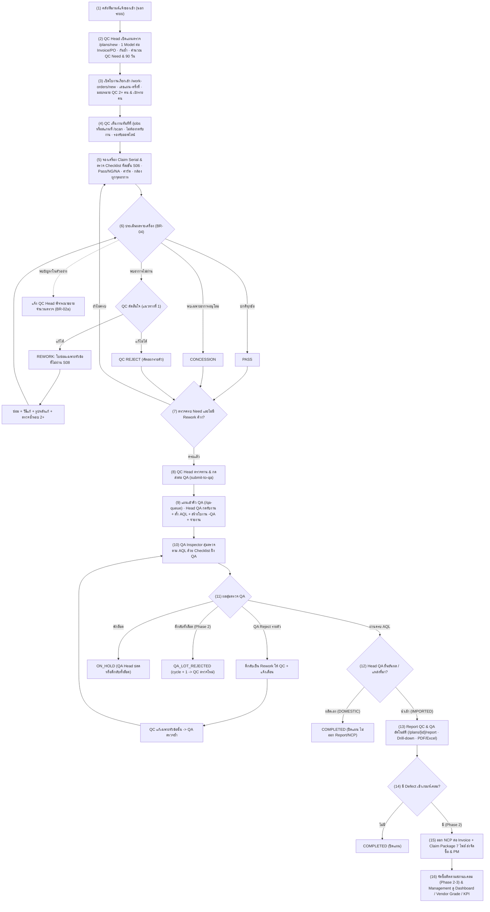
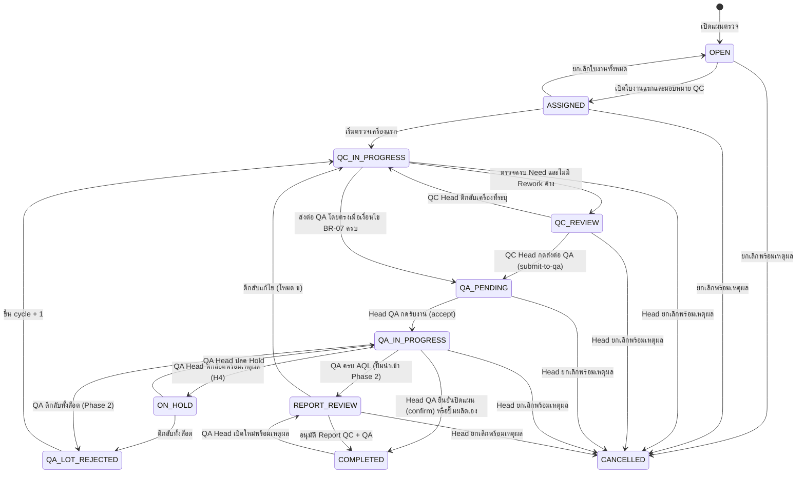
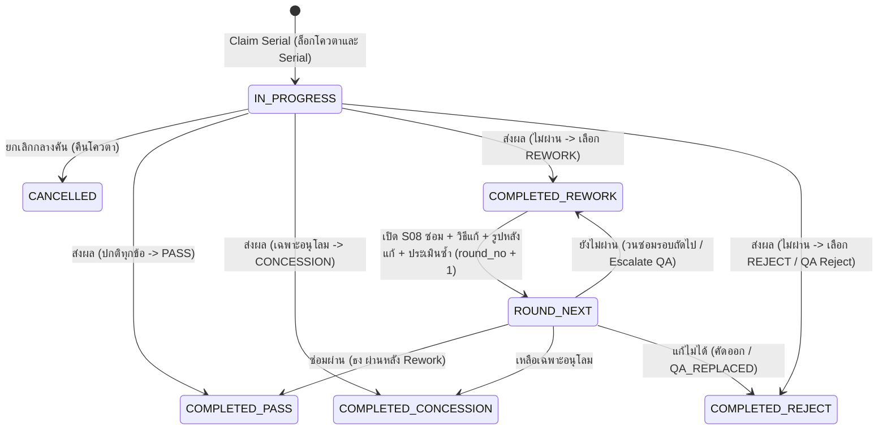
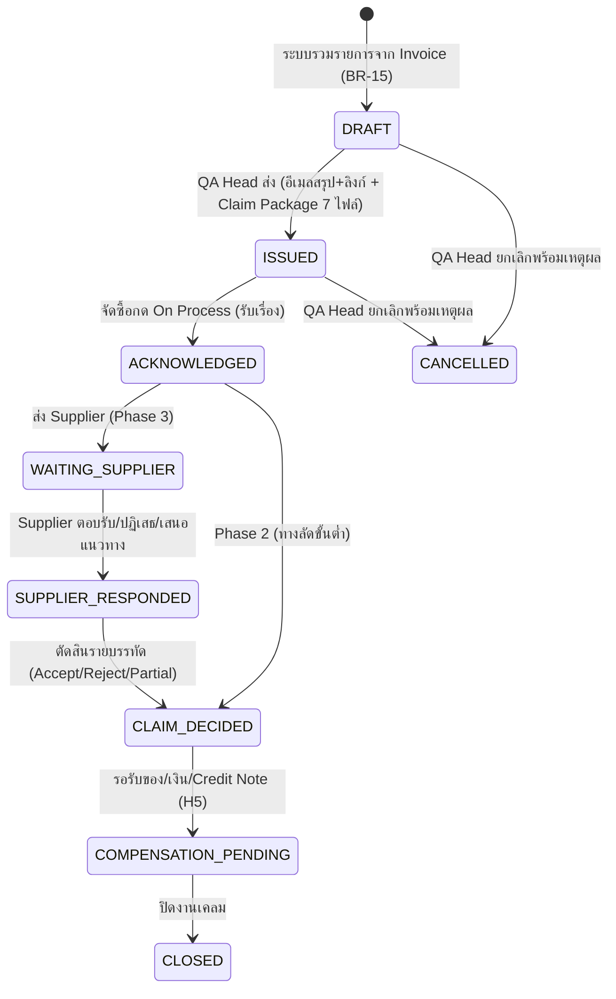
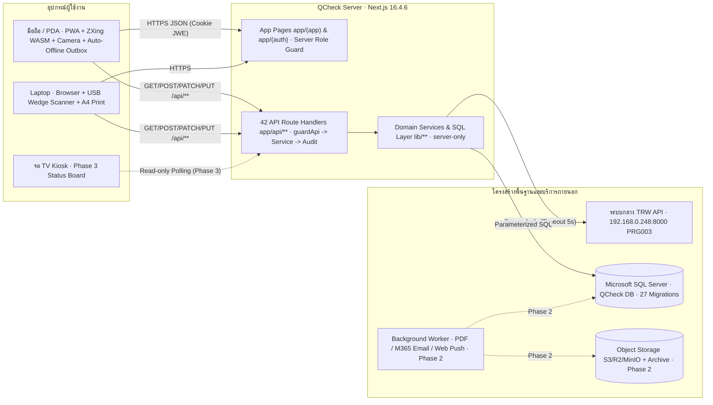
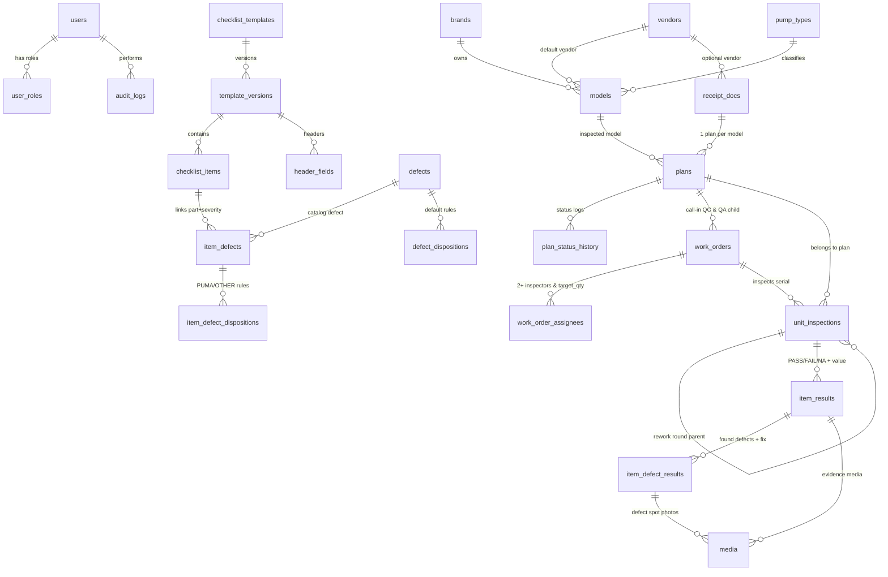

# QCheck — เอกสารข้อกำหนดโครงการฉบับสมบูรณ์ (Master Project Specification)

> **โครงการ:** QCheck — ระบบตรวจรับคุณภาพปั๊มลม ธีรวัฒน์ (TRW) × โรงงาน PUMA  
> **เวอร์ชันเอกสาร:** v2.0 (Master Consolidated Edition — รวบรวมสเปกทุกฉบับ บันทึกการประชุมทุกรอบ และสถานะระบบจริงในโค้ดเบส)  
> **วันที่จัดทำ / ปรับปรุงล่าสุด:** 19 พฤศจิกายน 2026  
> **แหล่งข้อมูลต้นทาง:** เอกสารโครงการ `docs/01`–`docs/20`, สไลด์ประชุม IT 22 แผ่น (`QC_Application_Workflow_IT_Meeting.pptx`), ถอดความประชุม A/B/C/D และมติย่อยถึง 19 พ.ย. 2026, กติกา `CLAUDE.md`, และซอร์สโค้ดจริง (`db/001`–`db/027`, `app/`, `lib/`, `components/`, `tests/`)  
> **สถานะซอฟต์แวร์ปัจจุบัน:** Next.js 16.4.6 · React 19.3.1 · Tailwind CSS v4 · SQL Server (`mssql`) · 27 SQL Migrations · 42 API Route Files · 23 App Pages · 104 Test Files / 1,575 Automated Tests (ผ่าน 100%)

---

## สารบัญ (Table of Contents)

1. [ภาพรวมโครงการ ที่มา ปัญหา และเป้าหมาย (Executive Summary, As-Is & Objectives)](#1-ภาพรวมโครงการ-ที่มา-ปัญหา-และเป้าหมาย)
2. [บันทึกและสรุปมติจากการประชุมทั้งหมด (Complete Meeting Compendium & Evolution Log)](#2-บันทึกและสรุปมติจากการประชุมทั้งหมด)
3. [บทบาท ผู้ใช้งาน และตารางสิทธิ์ (Stakeholders, Roles & RBAC Matrix)](#3-บทบาท-ผู้ใช้งาน-และตารางสิทธิ์)
4. [กระบวนการทำงาน End-to-End และ State Machines (Workflows & State Machines)](#4-กระบวนการทำงาน-end-to-end-และ-state-machines)
5. [กฎธุรกิจและสูตรคำนวณทั้งหมด (Business Rules Catalog — BR-01 ถึง BR-21+)](#5-กฎธุรกิจและสูตรคำนวณทั้งหมด)
6. [ข้อกำหนดเชิงฟังก์ชันรายโมดูล (Functional Requirements — M00 ถึง M12)](#6-ข้อกำหนดเชิงฟังก์ชันรายโมดูล)
7. [รายการหน้าจอ การนำทาง และ UX/UI Specification (Screens S01–S31 & Design System)](#7-รายการหน้าจอ-การนำทาง-และ-uxui-specification)
8. [สถาปัตยกรรมระบบและกติกาการพัฒนา (System Architecture & Engineering Standards)](#8-สถาปัตยกรรมระบบและกติกาการพัฒนา)
9. [แบบจำลองฐานข้อมูลและประวัติ Migration (`db/001`–`db/027`)](#9-แบบจำลองฐานข้อมูลและประวัติ-migration)
10. [สัญญาและแคตตาล็อก API ทั้งหมด (42 Route Handlers)](#10-สัญญาและแคตตาล็อก-api-ทั้งหมด)
11. [ข้อกำหนดด้านคุณภาพ ความปลอดภัย โครงสร้างพื้นฐาน และงาน IT (NFRs & DevOps)](#11-ข้อกำหนดด้านคุณภาพ-ความปลอดภัย-โครงสร้างพื้นฐาน-และงาน-it)
12. [แผนการดำเนินงาน WBS, Timeline, ความคืบหน้าจริง และ Roadmap](#12-แผนการดำเนินงาน-wbs-timeline-ความคืบหน้าจริง-และ-roadmap)
13. [แผนการทดสอบและเกณฑ์การยอมรับ (Testing Strategy & UAT Suites A–D)](#13-แผนการทดสอบและเกณฑ์การยอมรับ)
14. [บันทึกการตัดสินใจ (Decision Log — DEC-01 ถึง DEC-14+)](#14-บันทึกการตัดสินใจ-decision-log)
15. [รายการคำถามที่ปิดแล้วและยังรอการยืนยัน (Open Questions Tracker — กลุ่ม T, A–L)](#15-รายการคำถามที่ปิดแล้วและยังรอการยืนยัน)
16. [ทะเบียนความเสี่ยงและแนวทางรับมือ (Risk Register R1–R14)](#16-ทะเบียนความเสี่ยงและแนวทางรับมือ)

---

## 1. ภาพรวมโครงการ ที่มา ปัญหา และเป้าหมาย

### 1.1 QCheck คืออะไร

**QCheck** คือเว็บแอปพลิเคชันแบบ **Mobile-First PWA** (ใช้งานหลักบนมือถือหน้างาน และใช้งานเต็มประสิทธิภาพบน Laptop / จอ TV ตามเกณฑ์ Device × Flow) สำหรับ **ตรวจรับคุณภาพปั๊มลม** ของ **บริษัท ธีรวัฒน์ (TRW) × โรงงาน PUMA** ครอบคลุมทั้ง:
- **ปั๊มลมนำเข้าจากต่างประเทศ (`IMPORTED`)** — อ้างอิงเลข **Invoice**
- **ปั๊มลมผลิตเองในโรงงาน PUMA (`DOMESTIC` แผนก 408, 409 และ FG)** — อ้างอิงเลข **PO / ใบสั่งผลิต (WO)**

ระบบถูกออกแบบมาเพื่อทดแทนกระบวนการเดิมที่ใช้ **Google Sheets + AppSheet + Excel + กระดาษ** โดยมีหลักการแกนกลางจากที่ประชุมคือ:
> **“กรอกข้อมูลครั้งเดียว → ใช้ได้ตลอดทั้งกระบวนการ (One Data Entry & Full Traceability)”**

วงจรธุรกิจครบวงจร:  
`เปิดแผนตรวจ (1 Model ต่อเอกสารรับเข้า) → เปิดใบงานเรียกเข้า (Work Order) & มอบหมาย QC → QC สแกน Serial & ตรวจ Checklist บนมือถือ (ถ่ายรูปสดผูกจุดอาการ, รองรับออฟไลน์) → Rework / Reject → ส่งต่อ QA → QA สุ่มตรวจตามตาราง AQL จากแผนเดียวกัน → Report QC/QA อัตโนมัติ + Drill-down Serial → ออก NCP ต่อ Invoice ส่งจัดซื้อต่างประเทศ → ติดตามสถานะเคลม & PM Track → Status Board / Dashboard คุณภาพ Vendor / Pareto / KPI`

### 1.2 กระบวนการปัจจุบัน (As-Is) และ Pain Points ที่ต้องแก้

| ขั้นตอนปัจจุบัน | ทำอยู่ที่ไหน | ผู้รับผิดชอบ | ปัญหาหลักที่พบ (อ้างอิงเวลาประชุม) |
|---|---|---|---|
| ข้อมูลของเข้า (`QC_Demand Planning`) | Excel / อีเมล | คลังสินค้า / หน่วยงานต้นทาง `[B 00:01:56]` | ไม่มีสถานะรวม ทำให้หน้างานไม่เห็นภาพรวมการทยอยรับของ |
| เปิดแผนตรวจ (Invoice, Model, Qty, AQL) | Excel + AppSheet | หัวหน้า QA หยอดเองทุกวัน `[B 01:10:36]` | เปิดแผนซ้ำ, ใช้ Checklist ผิดรุ่น, จำนวน QA ไม่ขึ้นทันทีต้องบันทึกก่อน `[B 00:14:41]` `[B 01:17:55]` |
| ตรวจ Checklist | AppSheet มือถือ + กระดาษ (ส่วนตรวจ 100%) | QC Inspector `[B 00:55:28]` | Defect พิมพ์ชื่อไม่เหมือนกัน, กรอกจำนวนผิด, เอารูปเดิมมาใช้ซ้ำหลายเครื่อง `[B 01:33:38]` `[B 01:38:12]` |
| เก็บรูป/วิดีโอ | Drive บัญชีเจ้าของ AppSheet | หัวหน้า QA `[B 00:38:51]` | พื้นที่เต็มต้องสร้างเมลใหม่แล้วย้าย ownership แอปเอง ลิงก์รูปกระจายตามบุคคล `[B 00:36:29]` |
| ระบุตัวตนผู้ใช้ | Gmail ส่วนตัว | พนักงานทุกคน `[A 04:26]` | ตรวจสอบย้อนหลัง (Audit Trail) ไม่ได้เมื่อพนักงานลาออกหรือเปลี่ยนเครื่อง `[A 04:54]` |
| ออก Report / NCP | Excel ทีละใบ เซ็นทีละใบ | QC / QA `[B 01:44:06]` | Report QC ล่าช้า (กำหนด 7 วันแต่ช่วง มิ.ย.–ก.ค. ไม่ออกเลย `[B 01:46:55]`); หัวหน้า QA ต้องเปิดรูปตรวจทีละตัว; 1 Invoice ออกหลาย NCP ห่างกันหลายสัปดาห์หักเงินยาก `[A 22:15]` |
| เคลม Supplier & Dashboard | อีเมล / Excel แยก / Vendor Score ทำมือ | จัดซื้อต่างประเทศ / Management `[A 33:51]` | ไม่รู้ว่าแผนไหนค้างหรือจัดซื้อหยิบ NCP ไปหรือยัง; ปัญหาหน้างานรู้ตอน 16:30 กระทบการขาย `[B 00:52:27]`; ทำข้อมูลซ้ำหลายชุด `[A 45:31]` |

### 1.3 เป้าหมายโครงการและตัวชี้วัดความสำเร็จ (Objectives & KPIs)

| รหัส | เป้าหมาย | ตัวชี้วัดความสำเร็จ (ค่าตั้งต้น — ยืนยัน E14) |
|---|---|---|
| **O1** | การตรวจรับทั้งหมดทำในระบบเดียวบนมือถือ | 100% ของแผนใหม่หลัง Go-live อยู่ใน QCheck (ยกเว้นส่วนที่ตกลงตรวจกระดาษ) |
| **O2** | Report ออกอัตโนมัติจากข้อมูล Checklist | Report QC (ปั๊มนำเข้า) อนุมัติภายใน **7 วัน** หลัง QC ปิดงาน (จากเดิมค้างเป็นเดือน) |
| **O3** | ข้อมูล Defect เป็นมาตรฐานเดียว | เลือกจาก Defect Master เท่านั้น; บังคับถ่ายรูปสดในแอป; ตรวจจับรูปซ้ำข้ามเครื่อง |
| **O4** | ป้องกันความผิดพลาดเชิงระบบ | 0 แผนซ้ำต่อเอกสาร+Model; Checklist ผูกอัตโนมัติตาม Model |
| **O5** | ตรวจสอบย้อนหลังได้สมบูรณ์ | ทุกการสร้าง/แก้ไข/ยกเลิก/อนุมัติ/Login มี Audit Log แบบ append-only (ใคร ทำอะไร เมื่อไร ค่าเดิม→ใหม่) |
| **O6** | ติดตามงานแบบ Near Real-Time | Status Board + แจ้งเตือน QA Reject / พบปัญหาในตัวอย่าง ทันทีที่เกิด |
| **O7** | ส่งต่อข้อมูลเคลมและวัดผล Vendor | จัดซื้อติดตามสถานะ NCP ในระบบ (Phase 2); Dashboard คุณภาพ Vendor/Pareto/KPI แทนงานมือ (Phase 3) |

### 1.4 ขอบเขตโครงการ (In-Scope vs Out-of-Scope)

#### ขอบเขตในโครงการ (In-Scope)
- **โมดูลซอฟต์แวร์ 13 โมดูล (M00–M12):** App Shell, Authentication (ระบบกลาง TRW + Local PIN), Master Data & Checklist Configurator, เอกสารรับเข้าและแผนตรวจ, ใบงานเรียกเข้าและการมอบหมาย, QC Checklist Runner (มือถือ + ออฟไลน์ + รูป/วิดีโอ + ค่าวัดตัวเลข), Rework & Correction, QA Queue & AQL, Review & Reports (PDF/Excel), NCP & Claim, Notifications, Status Board/Dashboards/KPI, Audit/History/Search
- **แพลตฟอร์ม:** PWA เดียวรองรับ Android 10+ (Chrome), iOS 17+ (Safari Home Screen), Laptop (Chrome/Edge), TV Kiosk (1920×1080); สแกนกล้อง + เครื่องยิง USB/PDA keyboard-wedge; ทนเน็ตหลุด/ความหน่วงสูง; UI ภาษาไทย
- **งานที่ไม่ใช่โค้ดในขอบเขต:** รวบรวม/ทำความสะอาด Master Data จาก Google Sheet QA (127 อาการกลาง / 770 ลิงก์, 105 รุ่นแรงดัน, ตาราง AQL จริง), สำรวจ Wi-Fi จุดตรวจ, เสนอสเปกเครื่องส่วนกลาง, แบบฟอร์มกระดาษสำรอง + โหมดบันทึกย้อนหลัง, คู่มือรายบทบาท, อบรม, Pilot และ Hypercare

#### นอกขอบเขต (Out-of-Scope)
- การกรอกตาราง `QC_Demand Planning` ของคลังสินค้า (Phase 4 อาจพิจารณา import) `[B 00:01:56]`
- การเชื่อมต่อ ERP Business Central (BC) แบบ real-time (ตกลงไม่ผูกใน Phase 1–3; ออกแบบ key ไว้ map ภายหลัง Phase 4) `[B 00:12:29]`
- เซ็นเซอร์/กล้อง AI นับเครื่องบนสายพาน `[B 00:53:18]`
- การบันทึกส่วนที่ตรวจ 100% บนกระดาษรายตัว (ในแอปตรวจ 10%; มีช่องกรอกตัวเลข `paper_checked_qty` สรุปได้) `[B 00:55:28]`
- Native Mobile App (App Store / Google Play) — ใช้ PWA แทน
- แจ้งเตือนผ่าน LINE Official Account (มีค่าใช้จ่ายโควต้า — เลื่อนไป Phase 4) `[B 00:04:45]`
- การกำหนดนโยบายเคลม/บัญชีหักเงิน Supplier/ราคาต่อ SKU (อยู่ใน ERP; ระบบรองรับการตั้งค่าเมื่อนโยบายอนุมัติ) `[A 43:51]`
- ทะเบียน NCP ตาม ISO (ยังไม่มี ISO) `[A 34:09]` และประเมิน Vendor ด้านราคา `[A 44:41]`
- Report/NCP สำหรับปั๊มผลิตเอง (ซ่อมที่หน้างาน แต่ข้อมูลเข้า Status Board/Dashboard/KPI) `[B 01:58:26]`

### 1.5 คำศัพท์มาตรฐานของระบบ (Glossary)

| คำศัพท์ | ความหมายมาตรฐานในระบบ QCheck |
|---|---|
| **เอกสารรับเข้า (`receipt_docs`)** | ใบ Invoice (ปั๊มนำเข้า) หรือ ใบ PO / ใบสั่งผลิต WO (ปั๊มผลิตเอง) 1 ใบมีได้หลาย Model/SKU |
| **แผนตรวจ (`plans`)** | 1 Model ภายใต้ 1 เอกสารรับเข้า (= 1 ล็อต) เปิดได้ครั้งเดียว ใช้ร่วมกันทั้ง QC และ QA (เลข `QP-YYMM-NNNN`) |
| **ใบงาน (`work_orders`)** | **ฝั่ง QC:** การเรียกของเข้ามาตรวจแต่ละครั้ง (`<เลขแผน>-<ครั้งที่>`) มีประเภท `QC` หรือ `CALLIN_FIX` ("เรียกเข้าแก้ไข") · **ฝั่ง QA:** ใบงานลูกสุ่มตรวจ AQL (`<เลขแผน>-QA`, type `QA`) |
| **ผลตรวจรายเครื่อง (`unit_inspections`)** | การตรวจ Checklist ของเครื่อง 1 เครื่อง ระบุด้วย `serial_pump` (ไม่ซ้ำใน แผน × บทบาท × cycle) |
| **รอบ (`round_no`)** | ตรวจครั้งแรก = รอบ 1, ตรวจซ้ำหลังซ่อม (Rework) = รอบ 2, 3… (**ห้ามแก้ข้อมูลรอบก่อน**) |
| **ฉบับแก้ไข (`revision_no`)** | การแก้ไขข้อมูลที่บันทึกผิดพลาดในรอบเดิม (Correction) เก็บค่าเดิมและประวัติเสมอ |
| **รอบตรวจของล็อต (`cycle_no`)** | เพิ่มขึ้นเมื่อ QA ตีกลับทั้งล็อต (Phase 2) |
| **Disposition** | กติกาการตัดสินต่อ Defect แยกตามกลุ่มแบรนด์ (`PUMA` / `OTHER`): `CONCESSION` (อนุโลม), `REWORK` (ส่งซ่อม), `REJECT` (คัดออก), `CHOOSE` (ผู้ตรวจเลือก) |
| **Severity** | `CRITICAL` (กระทบการใช้งาน), `MAJOR` (ปานกลาง), `MINOR` (เล็กน้อย/ความสวยงาม) |
| **`brand_group` vs `origin`** | **ห้ามสับสน:** `brand_group` (`PUMA`/`OTHER`) ใช้เลือก Disposition · `origin` (`IMPORTED`/`DOMESTIC`) ใช้กับกฎ 90 วัน/AQL ตั้งต้น/Report/NCP (แบรนด์ PUMA อาจนำเข้า OEM ได้) |
| **QC Reject vs QA Reject** | **QC Reject** = QC ตัดสินว่าแก้ไม่ได้ คัดออกรายตัว (`REJECT`) · **QA Reject** = QA ไม่ยอมรับ ส่งกลับเป็นงาน Rework ให้ QC แก้ (ปุ่มในระบบใช้คำไทยกำกับเสมอเพื่อกันสับสนคำว่า Accept/Reject ระหว่างโรงงานกับ QA `[A 12:54]`) |

---

## 2. บันทึกและสรุปมติจากการประชุมทั้งหมด

ส่วนนี้รวบรวมข้อเท็จจริง มติ และวิวัฒนาการของความต้องการจากการประชุมทั้งหมดตั้งแต่เริ่มโครงการจนถึงปัจจุบัน (19 พ.ย. 2026) เพื่อใช้เป็นแหล่งอ้างอิงและตรวจสอบย้อนหลังได้ทุกประเด็น

### 2.1 การประชุมครั้งที่ 1 — Meeting A (~56 นาที)
**หัวข้อหลัก:** Master Data, ผู้ใช้งาน, AQL, Defect, Disposition, NCP/เคลม, ค่าแรง, Dashboard  
**ผู้เกี่ยวข้องหลัก:** ทีม QA (ผู้นำเสนอเอกสาร Master Data/AQL/Defect), ฝ่ายจัดซื้อต่างประเทศ, ทีมพัฒนา

| ประเด็นที่ประชุม | รายละเอียดและข้อสรุป (พร้อมเวลาอ้างอิง) | ผลต่อระบบ |
|---|---|---|
| **การส่งมอบ Master Data** | ทีม QA จะส่งสำเนา "Main data" พร้อมคำอธิบายคอลัมน์และสูตรใน Google Sheet `[A 00:00]` `[A 13:57]` · **ข้อควรระวัง:** ผู้เขียนเอกสารกำลังจะย้ายงาน ต้องส่งมอบใน Phase 0 และตั้ง Product Owner คนเดียว `[A 07:01]` `[A 06:57]` | WBS 0.2, E11 |
| **QR / Barcode** | มีโค้ด 2 แบบ: QR ของ Supplier ต่างประเทศ และโค้ดที่บริษัททำเอง รุ่นที่ไม่มีโค้ดเลือกจาก Dropdown `[A 00:40]` `[A 01:50]` | FR-PLAN-05/05b, BR-18 |
| **ผู้ใช้และสังกัด** | เลิกใช้ Gmail ส่วนตัวเพื่อ Audit ย้อนหลังได้ `[A 04:26]` `[A 04:54]` · ไม่ใช่ทุกคนมีอีเมลบริษัท `[A 05:44]` · ผู้ตรวจปัจจุบัน ~4 เผื่อ ~10 คน รวม ≤ 30 คน `[A 06:50]` · มี 2 นิติบุคคล (TRW / โรงงาน PUMA) ซึ่งพนักงาน PUMA เข้าออกบ่อย `[A 06:15]` `[A 06:44]` | M01, DEC-09, DEC-12, E9 |
| **ประเภทปั๊มและ Defect** | ประเภทปั๊ม (Piston, Oil-free, Rotary) ต้องเป็นคอลัมน์แยกกรองได้ `[A 03:32]` · Defect แยกตามประเภทปั๊มและตำแหน่ง/ชิ้นส่วน เพราะวิธีแก้ที่แจ้ง Supplier ต่างกัน `[A 07:25]` · มีพูดถึง 19 และ 33 หัวข้อ `[A 07:25]` `[A 11:20]` · แนบภาพเกณฑ์เคลมแบบ SOP `[A 23:59]` | FR-MD-02/07, DEC-14 |
| **ตาราง Disposition & Severity** | แยกตาม `QC/QA × กลุ่มแบรนด์ (PUMA/อื่นๆ)` `[A 10:48]` · ฝั่ง QC ส่วนใหญ่เป็น "ผู้ตรวจเลือก" `[A 12:27]` · ฝั่ง QA พบ Defect = Reject เท่านั้น `[A 12:12]` · Critical = กระทบการใช้งาน `[A 40:28]`, Minor = ความสวยงามไม่กระทบการใช้งาน (เช่น สีถลอกจากการขนส่ง มักไม่เคลม) `[A 23:59]` | BR-04, FR-MD-08 |
| **NCP ต่อ Invoice & กำหนด 90 วัน** | ฝ่ายจัดซื้อเสนอ **1 NCP ต่อ 1 Invoice** รวมทุก SKU เพื่อหักเงิน/ต่อรองในใบลดหนี้ใบเดียว `[A 22:15]` `[A 47:08]` (ยังมีเสนอต่อ item/lot `[A 47:46]`) · สรุป **กำหนดตรวจ QC 90 วันนับจากวันที่ Invoice** ห้ามเลื่อนเกินกรอบนี้ (พิจารณาเทียบ credit term 60 วันแล้ว) `[A 30:03]` `[A 31:31]` `[A 32:54]` | BR-11, BR-15, FR-PLAN-13/14 |
| **บทบาท PM (PM Track)** | จัดซื้อย้ำว่าหากไม่มีขั้น PM คุยแนวทางแก้ไขสินค้ากับ Supplier จะวนลูปเดิม `[A 16:11]` `[A 28:32]` · แยก Track PM ตอบวิธีแก้สินค้าขนานกับจัดซื้อทำเรื่องเคลม `[A 19:01]` `[A 27:44]` | FR-NCP-07, D11 |
| **ค่าแรงคำนวณ (ไม่จับเวลาจริง)** | ใช้สูตร `(Man-day Complexity 1–4 + Man-day Severity) × อัตราตลาดช่าง` (ตัวอย่าง: งานสี 0.5 + Minor 0.25 = 0.75 × 1,000 = 750 บาท/ตัว; อัตรา 1,000 บาท/วัน ≈ 30,000/30 วัน ห้ามใช้ค่าแรงขั้นต่ำ) `[A 49:30]` `[A 51:26]` `[A 52:47]` · **ปฏิเสธการจับเวลาซ่อมจริง** `[A 51:06]` vs `[A 54:50]` | BR-21, FR-MD-15 |
| **Dashboard & Vendor Score** | ต้องทบทวน Vendor Score Dashboard เดิมก่อน `[A 33:51]` · วัดผลด้วย `% Invoice ที่พบ Defect`, จำนวน Defect (ไม่ใช่นับเคส `[A 46:41]`), ค่าแรงคำนวณเทียบสิ่งที่ Supplier ชดเชย, แท็กสาเหตุ (Supplier/ขนส่ง/ภายใน) และตำแหน่งที่พบ `[A 53:39]` `[A 56:13]` · ไม่ประเมินราคา (จัดซื้อดูจาก BC เอง) `[A 43:51]` `[A 44:41]` | M11, FR-DSH-00..04 |

---

### 2.2 การประชุมครั้งที่ 2 — Meeting B (~2 ชม. 13 นาที)
**หัวข้อหลัก:** End-to-End Flow QC/QA, เปิดแผน, Checklist, ถ่ายรูป/วิดีโอ, Rework, AQL, Report, NCP, Offline/Wi-Fi

| ประเด็นที่ประชุม | รายละเอียดและข้อสรุป (พร้อมเวลาอ้างอิง) | ผลต่อระบบ |
|---|---|---|
| **ขอบเขต & แพลตฟอร์ม** | ไม่ทำตารางดีมานด์ `[B 00:01:56]`, ไม่เชื่อม BC `[B 00:12:29]`, ไม่ใช้ LINE เพราะมีค่าใช้จ่าย `[B 00:04:45]` · ทำ Web App/PWA ใช้ทั้งมือถือและ Laptop `[B 00:05:02]` · ลำดับความสำคัญ: ทำ QC ก่อน แล้วต่อ QA (ใช้แผนเดียวกันและคนชุดเดียวกัน `[B 02:00:51]` `[B 02:00:54]`) แล้วจัดซื้อ `[B 00:05:50]` | Scope, Release Plan |
| **เปิดแผน & กันซ้ำ** | Invoice/PO เป็นเลขภายนอกระบบไม่รันให้ `[B 00:15:01]` · แผนรันเลขอัตโนมัติ `[B 00:23:35]` · กันแผนซ้ำต่อเอกสาร+Model `[B 00:13:51]` · ตรวจได้หลายวันกรณีของทยอยเข้า `[B 00:14:22]` · เลือก Model แล้วดึง Checklist อัตโนมัติห้ามเลือกเอง `[B 00:24:56]` · แท็ก "รอของ" เพื่อไม่ให้นับเป็นตรวจขาด `[B 02:04:10]` | M03, BR-01, FR-PLAN-01..17 |
| **QC 10% & ยกระดับการตรวจ** | QC ตรวจ 100% หน้างานแต่บันทึกในแอป **10% ปัดขึ้น** `[B 00:03:23]` `[B 00:55:28]` `[B 01:02:29]` · ถ้าตัวอย่าง 10% พบปัญหา → แจ้ง QC Head พิจารณาเรียกตรวจส่วนที่เหลือ (ยกระดับ) `[B 00:55:28]` | BR-02, BR-02a |
| **Checklist, กล้องสด & วิดีโอ** | สแกน Serial ปั๊ม+มอเตอร์ `[B 00:30:08]` · ห้ามเว้นว่างหัวข้อ Required `[B 00:43:26]` · ตอบ "ไม่ผ่าน" → Popup เลือก Defect หลายอาการได้ `[B 01:51:03]` + **บังคับถ่ายรูปสดในแอปห้ามเลือกจากคลัง** เพื่อกันรูปซ้ำ `[B 00:31:54]` `[B 01:38:12]` · วิดีโอสั้นสำหรับหัวข้อ/อาการเฉพาะ (ลมรั่ว, สายพาน — รวมกรณีบังคับทุกครั้ง `ALWAYS`) `[B 00:31:59]` `[B 00:35:15]` · ส่งแล้วล็อกห้ามผู้ตรวจแก้ `[B 00:42:12]` | M05, BR-04, BR-05, BR-05a |
| **อายุเก็บสื่อ (Retention)** | เก็บรูป/วิดีโอ **2 ปี** นับจากวันที่ถ่าย (ประชุมเสนอ 2–3 ปี เพราะรับประกัน 1 ปีหลังขาย + สินค้าค้างสต็อก) `[B 00:33:21]` `[B 00:33:56]` `[B 00:38:05]` · ครบอายุย้าย Archive แต่เปิดดูจากแอปได้ `[B 00:33:19]` | BR-17 |
| **Rework & Reject** | ใบ Rework เฉพาะหัวข้อที่ไม่ผ่าน `[B 00:09:00]` `[B 00:47:11]` · ห้ามแก้ข้อมูลรอบแรก `[B 00:48:24]` · ปิดด้วยวิธีแก้ + รูปหลังแก้ `[B 00:47:25]` `[B 01:22:24]` · ห้ามปิดงานถ้ามี Rework ค้าง `[B 01:23:38]` · เครื่อง QC Reject นับเป็นตรวจแล้วในสรุปแผน `[B 00:46:22]` `[B 01:27:09]` | M06, BR-06, BR-07 |
| **QA & AQL** | QA ใช้แผนเดียวกัน ไม่มีใบงานแยกเดิม (หยิบจากคิว) `[B 00:54:23]` `[B 01:17:30]` · ระดับ AQL 3 ระดับ (นำเข้า=ผ่อนคลาย, ผลิตเอง=ปกติ, override ราย Model ได้) เป็นดุลพินิจ QA Head เปลี่ยนแล้วคำนวณทันทีพร้อมเหตุผล `[B 01:05:55]` `[B 01:12:35]` `[B 01:14:06]` · QA Reject รายตัว → สร้าง Rework กลับ QC (รวมเครื่องที่ QC ไม่เคยตรวจ) `[B 00:54:51]` `[B 01:30:07]` · QA ตีกลับทั้งล็อต (Phase 2) `[B 01:21:29]` | M07, BR-03, BR-08, BR-09 |
| **Report, Correction & NCP** | Report QC/QA แยกกัน เฉพาะปั๊มนำเข้า (ผลิตเองไม่ออก `[B 01:58:26]`) · ใช้ **ผลที่พบครั้งแรก** + วิธีแก้ + Drill-down Serial `[B 01:32:37]` `[B 01:54:24]` · **ไม่ส่งอัตโนมัติ** ต้องตรวจทาน 2 โหมด: (ก) หัวหน้าแก้เองมี Audit (ข) ตีกลับให้ผู้ตรวจแก้ `[B 01:35:47]` `[B 01:37:20]` `[B 01:50:27]` · SLA Report QC 7 วัน `[B 01:47:37]` · ส่ง NCP เป็นอีเมลสรุป+ลิงก์ (ไม่แนบไฟล์ใหญ่) `[B 01:45:02]` · สถานะจัดซื้อขั้นต่ำ: Pending → On Process → Accept/Reject Claim `[B 01:40:37]` | M08, M09, BR-06a, BR-14, BR-15 |
| **Master & สิทธิ์หลังบ้าน** | หลังบ้านแก้ได้โดย **ทีม QA** ไม่ต้องรอ IT `[B 00:28:13]` `[B 02:07:52]` · QC เข้า Dashboard ผู้บริหารไม่ได้ `[B 00:05:50]` · สถานะสีความคืบหน้า (ขาว/ส้ม/เทา/เขียว/แดง) ใช้ทำ KPI `[B 00:21:13]` `[B 02:03:38]` | M02, BR-12 |
| **Offline, Wi-Fi & สำรอง** | Wi-Fi จุดตรวจไม่ทั่วถึง มือถือโรงงานไม่มีซิม `[B 02:12:39]` `[B 02:12:48]` → ต้องทำงานออฟไลน์และบันทึกร่างทุกการกด + ล้างข้อมูลหลังซิงค์เมื่อ Logout เครื่องส่วนกลาง `[B 02:10:15]` · มีแผนสำรองกระดาษ + บันทึกย้อนหลัง `[B 02:09:04]` | NFR-04, FR-QC-13/17/19 |

---

### 2.3 สไลด์ประชุม IT — `QC_Application_Workflow_IT_Meeting.pptx` (22 แผ่น, 19 ต.ค. 2026)

สรุปเนื้อหาทั้ง 22 แผ่นและผลวิเคราะห์เทียบกับสเปก (`docs/11-meeting-slides-delta.md`):

| สไลด์ | หัวข้อ | สาระสำคัญและสิ่งใหม่ที่นำเข้าสู่สเปก |
|---|---|---|
| 1–4 | Overview, เป้าหมาย, Role, End-to-End Flow | ย้ำหลัก **One Data Entry**; แสดงบทบาทคลังสินค้ากรอก `QC_Demand Planning`; QC ตรวจ 100% บันทึกแอป 10%; QA ตรวจ AQL; Purchasing เคลม; Management ดู Pareto/Vendor Performance |
| 5–6 | Module 1 Create Plan & Module 2 Assign/Job List | เลขแผนตัวอย่าง `QC-2610-001`; สถานะเริ่มต้น `PLAN CREATED → WAITING FOR INSPECTION`; Job List แสดงทั้ง `Qty QC / Done / Balance` และ `Qty QA / Done / Balance` + `Due Date` |
| 7 | Module 3 Dynamic Checklist | **เฉลยคำถาม A5:** Checklist QC มี 6 ชุด คือ **Piston, Oil-free, Rotary, แผนก 408, แผนก 409 และ FG (Finished Goods)** (รอ QA ยืนยัน H11) |
| 8–9 | Module 4 Inspection per Unit & Module 5 Defect Capture | เพิ่มฟิลด์ระบุเครื่อง: `Inspection No.`, `Supplier Serial`, `Motor Brand / HP / Voltage` (H3); ย้ำ 4 กรณีตัดสิน: ปกติทุกข้อ → Pass · เฉพาะอนุโลม → Concession · มีไม่ผ่าน → Failed (QC เลือก Rework/Reject) |
| 10 | Module 6 Rework Flow | เพิ่มแนวคิด **Escalate** เมื่อ Re-inspection รอบ 2+ ไม่ผ่าน → ส่ง QA ตัดสิน (Rework ต่อ / Reject / HOLD) (H3) และถามเรื่อง QA approve ปิดใบ Rework (H2) |
| 11, 18 | Dashboard Overview | เมนูตัวอย่าง 8 หัวข้อ; ตัวกรอง ช่วงวันที่ + Brand + Model + Vendor; Auto Summary แผนที่ครบ, ตารางแผนที่ยังไม่ครบ, Top 5/10/20 Defect |
| 12 | Module 7 QA Review | QA Checklist 3 ชุด (Piston, Oil-free, Rotary); QA พบ Defect = **Reject เท่านั้น** |
| 13 | Module 11 Claim Supplier Flow | **สถานะเคลม 7 ขั้น (Phase 3 — H5):** `Draft → Waiting Purchasing → Sent Supplier → Supplier Reviewing → Accepted/Rejected → Compensation/Replacement Pending → Closed` · เพิ่มประเภทชดเชย: `Credit Note`, `Rework/Labor Cost`, `Transportation Cost` · **Claim Package 7 ไฟล์** (Claim Summary PDF, QC Report ก่อน Rework PDF, QA Report ก่อน Rework PDF, รูป Defect, รายละเอียด Invoice/PO Excel, จำนวน/Defect Rate Excel, Claim List Excel — H9) |
| 14 | ตัวอย่าง Report QC/QA | แสดงหัวรายงาน, Pass%/Concession%/Not Pass%, ตารางปัญหาพร้อม Severity Level & วิธีแก้, รูปพร้อมวงแดง; เลขตัวอย่าง `NCP690910` (พ.ศ.) |
| 15–16 | KPI & Vendor Grade | **KPI รายบุคคล (QC) ถ่วงน้ำหนัก (H7):** ตรวจครบตามแผน 25% (≥95%) · เสร็จตรงเวลา 25% (≥95%) · Checklist ครบ 20% (≥98%) · รูป/ข้อมูลครบ 20% (100%) · งานค้างเกินกำหนด 10% (≤5%) · **KPI ทีม:** Defect Rate ≤15%, Repeat Defect ≤5%, First Rework Pass ≥90%, Rework ปิดตรงเวลา ≥90%, ส่งเคลมตรงเวลา ≥95%, ปิดเคลม ≥80%, Supplier Defect Rate ≤10% · **เกรด Vendor:** A ≤5% · B 5.1–10% · C 10.1–15% · D >15% · **5 หมวด Defect (H8):** `Leakage`, `Assembly Issue`, `Performance`, `Cosmetic`, `Electrical` |
| 17 | Status Management | เพิ่มสถานะ **HOLD (`ON_HOLD`)** เป็น 1 ใน 5 เส้นทางหลัง QA (`ACCEPTED | REWORK | HOLD | CLAIM | REJECTED → CLOSED`) (H4) |
| 19–22 | Report/Search/Master, Data Structure, ประเด็น IT, Phase | รายการ Report 7 ชนิด; ข้อเสนอแบ่ง Phase ของสไลด์ (P1: Core QC+QA Review, P2: Rework+Claim+Audit, P3: Analytics) ต่างจากแผน QCheck ที่ดึง Rework+Audit มา R1.0 (H1) |

---

### 2.4 การตัดสินใจเรื่องระบบล็อกอิน ผู้ใช้หน้างาน และมาตรฐานข้อมูล (19 ต.ค. 2026)

1. **DEC-09 (ระบบกลาง TRW):** พนักงานออฟฟิศล็อกอินผ่าน API ระบบกลาง (`/auth/auth_permission_prog`) ตรวจสิทธิ์โปรแกรม `PRG003` (`can_use = true`, `is_active = true`) และอ่านบทบาทจาก `role_prog` (ทดสอบบัญชีจริง `TEST001–TEST009` ครบ 9 บทบาทแล้ว) · ตาราง `DATA_CENTER.dbo.Employee` ใช้เป็นแหล่งอ้างอิงเท่านั้น **ห้ามอ่าน `PasswordHash`**
2. **DEC-12 (กลับ DEC-11 — ผู้ใช้หน้างาน LOCAL + PIN):** พนักงานหน้างานไม่มีบัญชีระบบกลาง → ปิดคำถาม **I1–I6 ครบทุกข้อ**:
   - **I1:** รหัสรูปแบบ `F` + ตัวเลข ≥ 4 หลัก (เช่น `F0001`) Admin ออกให้
   - **I2:** จำกัดบทบาทเฉพาะ `QC_INSPECTOR`, `QA_INSPECTOR` เท่านั้น (ป้องกันยกระดับสิทธิ์)
   - **I3:** PIN **6 หลัก** ห้ามเลขซ้ำ/เรียง, hash ด้วย `scrypt` + `PIN_PEPPER` (≥ 32 ตัวอักษร)
   - **I4:** ผิด 5 ครั้งล็อกถาวรจนกว่าปลดล็อก — ปลดล็อกได้โดย **Admin + QC Head (ลูกทีม QC Inspector)**
   - **I5:** Admin สร้าง/ปิดบัญชี (QA Head แจ้งเมื่อพนักงานลาออก); เช็ค `is_active` ทุกคำขอ
   - **I6:** เข้าได้จากอินเทอร์เน็ตทั่วไป + จำกัดอัตราต่อ IP (30 ครั้ง/15 นาที ไม่รีเซ็ตเมื่อ login สำเร็จ)
   - รับรายชื่อหน้างานชุดแรก 13 แถว → กรองเหลือ 11 คน (`F0001–F0011`, ไม่สร้างบัญชีใช้ร่วม "เครื่องโรงงาน" เพราะ Audit ระบุตัวคนไม่ได้)
3. **มาตรฐานคอลัมน์ตาราง Master (`docs/03 §3.0`):** ทุกตาราง Master ต้องมี `is_active` (หรือ `status`), `created_at`, `created_by`, `updated_at`, `updated_by` และห้ามลบแถวจริง (soft-disable) พร้อมมี Automated Test ตรวจสอบ (`tests/db-master-columns.test.ts`)

---

### 2.5 การประชุมครั้งที่ 3 — Meeting C (20 ต.ค. 2026 — ~32 นาที)
**หัวข้อหลัก:** ปรับโครงสร้าง Plan → Work Order (ใบงานเรียกเข้า) และการมอบหมาย QC (`docs/13`, `docs/14`–`docs/16`)

- **J1 (ยืนยัน):** แผน = แม่ (`plans`), ใบงาน = ลูก (`work_orders` มี `id` + `plan_id` FK) — **1 ใบงาน = การเรียกของเข้ามาตรวจ 1 ครั้ง** เพราะล็อตใหญ่ (เช่น 500 ตัว) พื้นที่คลังไม่พอ โรงงานจะทยอยเรียกเข้า (เช่น 200 → 100 → 200) `[C 01:34]` `[C 02:40]`
- **D15 (ยืนยัน):** เลขแผน `QP-YYMM-NNNN` (รีเซ็ตรายเดือน) · เลขใบงาน `<เลขแผน>-<ครั้งที่>` (เช่น `QP-2610-0001-1`) `[C 06:43]`
- **J3 (ยืนยัน):** ประเภทใบงานให้ระบบเลือกอัตโนมัติ: `QC` (เมื่อยอดสะสมยังไม่ครบเป้า) และ `CALLIN_FIX` ("เรียกเข้าแก้ไข", Need = 0 — เปลี่ยนชื่อจาก Rework กันสับสนกับ Rework รายเครื่อง) `[C 13:38]`
- **J4 & J5 (ยืนยัน):** **ไม่ต้องกดรับงาน** — มอบหมายแล้วขึ้นหน้างานผู้ตรวจทันที · 1 ใบงานมี QC ผู้รับผิดชอบร่วมกัน **≥ 2 คน** (ช่อง 1–2 บังคับ, เดิมสูงสุด 5 ต่อมาขยายใน `db/018`) `[C 24:10]` `[C 24:36]`
- **A11 (ยืนยัน):** ผู้มีสิทธิ์เปิดแผน = `QC_HEAD`, `ADMIN` (และ `QA_HEAD` ดูแผน; `dev` ใน dev mode) — ผู้ตรวจหน้างานเปิดไม่ได้
- **Master % QC:** แยกหน้าตั้งค่า `% QC` (ค่าตั้งต้น 10%) พร้อมประวัติ (`qc_sampling_rates`) ผูกค่า % ณ วันเปิดแผน (`plans.qc_percent`) `[C 04:42]`
- **UX มอบหมายงาน (W10–W12):** ใช้การลากวาง (`@dnd-kit/react` v0.5.0) + แตะเลือกบนมือถือ พร้อม **เกจภาระงาน** (เกณฑ์สี <50% เขียว, 50–79% ส้ม, ≥80% แดง)
- *(หมายเหตุ: สูตร Need ของ Meeting C ถูกแทนที่ในวันถัดมาด้วย Meeting D)*

---

### 2.6 การประชุมครั้งที่ 4 — Meeting D (21 ต.ค. 2026 — ~27 นาที)
**หัวข้อหลัก:** ปรับสูตรการเปิดใบงาน Need, นิยาม True, และสถานะ "ไม่สำเร็จ" (`docs/17`, `docs/18`)

- **K1 (ยืนยัน — แทนสูตร Meeting C):** สูตรคำนวณ $\text{need\_wo} = \max(0,\ \text{qc\_required ของล็อต} - \text{True สะสมก่อนหน้า})$ — *"ไม่ต้องสนใจว่าเรียกเท่าไร ให้เอาเป้า 10% ของล็อต ลบ True สะสม"* `[D 15:22]`
- **K2 (ยืนยัน):** จำนวนเรียกเข้า (ใบแรก) ต้อง **≥ Need** และ **≤ ยอดล็อตที่ยังไม่เคยเรียก** ถ้าผิดแสดงเตือนสีแดงและห้ามบันทึก `[D 05:12]` `[D 14:30]` *(หมายเหตุ: 11 พ.ย. ผ่อนปรนให้ใบงานครั้งที่ 2+ เรียกเริ่มต้นที่ 1 ตัวได้)*
- **K3 (ใช้เป็นค่าตั้งต้น):** **True** นับเมื่อกดส่งหน่วยนั้นใน Checklist และนับ **Serial ไม่ซ้ำภายในแผน** (ข้ามใบงานนับ 1 เพื่อปิดช่องโกงก๊อปผล `[D 01:35]` `[D 12:58]`) · ตรวจเกินเป้าได้ไม่จำกัด
- **K4 (ยืนยัน):** เปิดใบงานได้ **1 ใบต่อแผนต่อวันที่เรียกเข้า** (ใบที่ยกเลิกไม่นับ); ใบก่อนหน้าที่ยังไม่ตรวจไม่บล็อกการเปิดใบวันถัดไป `[D 02:44]`
- **K5 (ยืนยัน — `db/011`):** เมื่อล็อตครบทั้ง 2 เงื่อนไข (`True สะสม ≥ qc_required` **และ** `เรียกเข้าสะสม = lot_qty`) ใบงาน QC ที่เปิดอยู่แต่ `True = 0` จะเปลี่ยนเป็นสถานะ **`FAILED` ("ไม่สำเร็จ")** อัตโนมัติ ไม่นำไปคำนวณใน KPI/Dashboard เก็บไว้เป็นประวัติเท่านั้น (แต่ `called_qty` ยังนับในยอดเรียกสะสมเพราะของเข้ามาจริง) `[D 24:14]`
- **แท็บประวัติ (`/history` — `docs/18`):** เพิ่มแท็บ "ประวัติ" แทนตำแหน่งแท็บแจ้งเตือนเดิมบนแถบล่างของบทบาทหน้างาน (คงกระดิ่งแจ้งเตือนไว้ที่ Top Bar)

---

### 2.7 มติและการปรับปรุงจากการประชุมย่อยและหน้างาน (22 ต.ค. – 19 พ.ย. 2026)

| วันที่ | มติ / การเปลี่ยนแปลงสำคัญ | Migration / โค้ดที่รองรับ |
|---|---|---|
| **22 ต.ค. 2026** | **ปิดคำถาม A2, A3a, A3 (409):** ได้ตัวอย่าง QR จริงของปั๊มผลิตเอง — สติ๊กเกอร์มี 2 QR ใช้ **อันขวา** แบ่ง 8 ช่องด้วย `|` (ช่อง 7 = `WO1274/69` ใช้เป็นเลขเอกสารของแผน, ช่อง 8 = `SN69/00014-15` เลขหลัง `-` คือจำนวนผลิตของ WO) · ยืนยัน **1 WO = 1 Model = 1 แผน** | `lib/plans/qr.ts`, `db/015` |
| **23 ต.ค. 2026** | **DEC-13 (Vendor):** ยกเลิกแนวทางดึง Vendor จาก Demand Planning → **Vendor ไม่บังคับตอนเปิดแผน** คลังแจ้งทีหลังแล้วกรอก/แก้ที่หน้าแผนได้ทุกเมื่อ (เปลี่ยนตามทุกแผน/ใบงานของเอกสารนั้น + Audit) · คีย์กันเอกสารซ้ำเหลือ `(doc_type, doc_no_normalized)` ไม่รวม Vendor | `db/013`, `PATCH /api/plans/[id]/vendor` |
| **26 ต.ค. 2026** | **กติกาถาวรสไตล์ `log-book`:** ห้ามมี `src/`, ห้ามใช้ Server Actions (`"use server"`), ทุกการอ่านและเขียนต้องผ่าน `app/api/**/route.ts`, หน้า `page.tsx` ตรวจสิทธิ์แล้วให้ Client Component ดึงผ่าน `useApiRead` (ย้ายครบ 19 Write Endpoints + 10 Read Pages) | `CLAUDE.md`, `docs/19`, `lib/api/*` |
| **28 ต.ค. 2026** | **1) กฎล็อตเล็ก (BR-02):** ล็อต 1–30 ตัว ตรวจ QC ฟิก **3 ตัว** (`min(lot_qty, 3)`); ล็อต ≥ 31 ตรวจ `CEILING(lot_qty × qc_percent / 100)` **2) DEC-14 (กติกา Defect อยู่ที่หัวข้อ Checklist):** วิเคราะห์ไฟล์อาการ QA จริง 3 ชนิด (Piston/Oil-free/Rotary รวม 771 แถว) พบอาการชื่อเดียวกันมี Severity/Disposition ต่างกันตามชนิดปั๊มและชิ้นส่วน → แยก `defects` เป็นอาการกลาง (127 อาการ) และย้าย `part`, `severity`, `item_defect_dispositions` ไปอยู่ที่ `item_defects` (770 ลิงก์ต่อบทบาท) **3) สแกน QR ด้วยกล้องมือถือในแอปเท่านั้น** (`barcode-detector` + ZXing WASM โฮสต์เองที่ `/zxing/`; ตัดช่องวางข้อความในฟอร์มเปิดแผน) | `lib/plans/rules.ts`, `db/014`, `db/016`, `tools/defect-lists.mjs`, `lib/scan/detector.ts` |
| **10 พ.ย. 2026** | **1) จัดสรรยอดตรวจรายคน (`target_qty`):** Head QC/QA ระบุจำนวนเป้าหมายต่อผู้ตรวจแต่ละคนได้ในใบงาน และขยายจำนวนผู้ตรวจต่อใบงานได้มากกว่า 5 คน **2) อนิเมชันเวกเตอร์มินิมอลรายขั้นตอน** 7 แบบ (`SCAN_PUMP`, `PISTON_HEAD`, `MOTOR_BELT`, `PRESSURE_GAUGE`, `AIR_TANK`, `VALVE_LEAK`, `GENERAL_CHECK`) ช่วยนำสายตาช่างหน้างาน **3) Checklist Configurator** จัดลำดับ/แก้ไข/เผยแพร่เวอร์ชัน Template ต่อ Model | `db/018`, `db/019`, `/master/model-checklists`, `StepMinimalAnimation.tsx` |
| **11 พ.ย. 2026** | **1) Vendor ตั้งต้นของ Model (`models.vendor_id`):** เลือก Model ตอนเปิดแผนแล้วเติม Vendor ให้อัตโนมัติ (เปลี่ยนเองได้) **2) กฎใบงานครั้งที่ 2+:** ใบงานครั้งที่ 2 เป็นต้นไปเรียกเข้าขั้นต่ำ **1 ตัว** ได้ (ไม่บังคับ ≥ Need เหมือนใบแรก) และเพิ่มการแจ้งยืนยัน **Over-Inspect** เมื่อยอดเป้าเกิน Need ที่เหลือ **3) ถ่ายรูปผูกจุด Defect (`media.defect_id`, `part`, `item_defect_result_id`):** เลือก Defect → เลือกชิ้นส่วน/จุดที่พบ → บังคับเปิดกล้องถ่ายเฉพาะจุดนั้น **4) ปุ่ม 3 สถานะ (`PASS`, `NG`, `N/A`):** รองรับ `NA` กรณีเครื่องรุ่นนั้นไม่มีชิ้นส่วนตามหัวข้อตรวจ **5) อิสระผู้ตรวจ (แนวทางที่ 1):** อาการ Critical แนะนำ Reject แต่ไม่ hard-lock เปิดให้ผู้ตรวจตัดสินใจเลือก Rework หรือ Reject ได้ | `db/020`, `db/021`, `db/022`, `db/023`, `db/024`, `lib/inspections/rules.ts`, `DefectSpotCameraDialog.tsx` |
| **12 พ.ย. 2026** | **1) ปรับเกจภาระงานผู้ตรวจ:** เทียบเครื่อง QC ค้าง (`openUnits`) และจำนวนรุ่น (`openModels`) กับคนสูงสุดในทีม และเลิกใช้คำว่า "งานแน่น" เพราะยังไม่มีเกณฑ์กำลังตรวจต่อวัน **2) หน้าสแกนอัจฉริยะ (`/scan`):** สแกน QR ปั๊มผลิตเองแล้วจับคู่ใบงานที่เปิดอยู่และยังมีโควตาของผู้ใช้ให้อัตโนมัติ; สแกน Barcode/Serial นำเข้าแสดงรายการใบงานที่พร้อมตรวจให้กดเลือก 1 คลิก | `lib/scan/service.ts`, `POST /api/scan/lookup`, `AssigneePicker.tsx` |
| **13 พ.ย. 2026** | **มติสเปกแรงดัน Start/Stop & ค่าวัดตัวเลข 4 จุด:** เพิ่ม `pressure_start_bar`, `pressure_stop_bar`, `is_pressure_concession` ใน `models` และนำเข้าสเปกจริง **105 รุ่น** (Oil-Free 5/7 bar, Direct Drive 6/8 bar, Piston 8/10 bar, รุ่นเล็ก 5–8 bar, ธงอนุโลม PP-1/TPP) + เพิ่มช่องกรอกค่าวัดตัวเลขในขั้นตอน Checklist (ความตึงสายพาน mm, ค่า OL A, กระแสสูงสุด A, แรงดันตัด-ต่อ bar) | `db/025`, `getStepMeasurementConfig()` ใน `lib/inspections/rules.ts` |
| **14–19 พ.ย. 2026** | **1) ตาราง AQL จริงจากชีต `QC26 แผนQC` & เคสผ่อนคลาย:** Seed ตาราง AQL 3 ระดับครบ 33 ช่วงล็อต (1–3,200, Code A–K, Ac/Re) + ตั้ง `default_aql_level` ให้รุ่นในชีตผ่อนคลาย + ขยาย `work_orders` รองรับใบงานลูก QA (`type = 'QA'`, เลข `<plan_no>-QA`) **2) Workflow Head QA รับงาน-จ่ายงาน-ยืนยันผล (`db/027`):** Head QA กดรับแผนจาก QC (`accept`) → ตั้ง/ปรับ AQL (`set_aql`) → จ่ายงานผู้ตรวจ QA (`assign`) → ตีกลับเครื่องเสียให้ QC ซ่อม (`return_to_qc`) → ยืนยันปิดแผน (`confirm`) **3) QA Audit 7 บทบาท (`docs/20`):** ตรวจสอบความเชื่อมโยง 7 บัญชีตัวอย่าง (`DEMO_*`), แก้ Quick Action QA, เมนู `/more`, ซ่อนปุ่มดูแผนใน Report สำหรับ Inspector, รองรับ Dev Offline Login fallback ผ่าน 104 test files / 1,575 tests | `db/026`, `db/027`, `lib/qa/*`, `app/api/qa-queue/route.ts`, `lib/reports/*`, `docs/20` |

---

## 3. บทบาท ผู้ใช้งาน และตารางสิทธิ์

### 3.1 กลุ่มผู้ใช้งาน (9 บทบาทในระบบ + 2 กลุ่มสนับสนุน)

ผู้ใช้ทั้งหมดมีประมาณ **≤ 30 คน** (ผู้ตรวจหน้างานปัจจุบัน ~4 เผื่อ ~10 คน) โดย **1 คนสามารถมีได้หลายบทบาท** (สิทธิ์เป็น Union ของทุกบทบาทที่ได้รับ; `ADMIN` ไม่ได้สิทธิ์ทางธุรกิจอัตโนมัติ)

| รหัสบทบาท (`Role`) | ชื่อเรียก | แหล่งตัวตน | หน้าที่หลักในระบบ | อุปกรณ์หลัก |
|---|---|---|---|---|
| `ADMIN` | System Admin (IT) | Central TRW | จัดการอุปกรณ์ส่วนกลาง, ตั้งค่าระบบ, สร้าง/ปิด/รีเซ็ต/ปลดล็อก PIN ผู้ใช้หน้างาน (LOCAL), เปิดแผน/ใบงาน, ดูรายงาน & Audit Log | Laptop |
| `MASTER_ADMIN` | Master-data Admin (ทีม QA) | Central TRW | จัดการข้อมูลหลักทั้งหมด (Brand, Pump Type, Vendor, Model, Defect, Fix Method, AQL, Checklist Templates & Versioning) โดยไม่ต้องรอ IT | Laptop |
| `QC_HEAD` | หัวหน้า QC | Central TRW | เปิดแผนตรวจ, เปิดใบงานเรียกเข้า & มอบหมาย QC (พร้อมเกจภาระงาน/โควตา), ติดตาม/ยกระดับการตรวจ, ปลดล็อก PIN ลูกทีม QC, ตรวจทานผล QC & ส่งต่อ QA | Laptop + มือถือ |
| `QC_INSPECTOR` | ผู้ตรวจ QC | Central หรือ **LOCAL (PIN)** | ดูงานของฉัน, สแกน QR/Serial, ตรวจ Checklist ฝั่ง QC, ถ่ายรูปสดผูกจุดอาการ, ตัดสิน Rework/Reject, ทำ Rework ปิดงานซ่อม, ดูรายงานของตน | มือถือ (ส่วนตัว/ส่วนกลาง) |
| `QA_HEAD` | หัวหน้า / ผู้จัดการ QA | Central TRW | ดูแผนตรวจ, กดรับงานจาก QC ในคิว QA, กำหนด/เปลี่ยนระดับ AQL, จ่ายงานสุ่มตรวจ QA, สุ่มตรวจ QA, ตีกลับเครื่อง/ล็อตให้ QC, ยืนยันปิดแผน, อนุมัติ Report QC/QA, ออก NCP (Phase 2), ดู Dashboard | Laptop + มือถือ |
| `QA_INSPECTOR` | ผู้ตรวจ QA | Central หรือ **LOCAL (PIN)** | ดูคิว QA / งานของฉันฝั่ง QA, สแกน Serial สุ่มตรวจตาม AQL, บันทึก QA Pass/Concession/Reject (ส่งกลับ QC Rework), ดูรายงานของตน | มือถือ |
| `PURCHASING` | จัดซื้อต่างประเทศ | Central TRW | ดูตัวเลขสรุปหน้าหลัก, ดู/ดาวน์โหลด Report และ NCP ที่ออกแล้ว, อัปเดตสถานะเคลม (Phase 2–3), ขอรูปเพิ่ม, ดู Dashboard Vendor/Pareto | Laptop |
| `PM` | Product Manager | Central TRW | ดู Master Data (อ่านอย่างเดียว), ดู Report/NCP, ตอบประเด็นการแก้ไขสินค้ากับ Supplier (PM Track — Phase 2), ดู Dashboard Vendor/Pareto | Laptop |
| `MANAGEMENT` | ผู้บริหาร | Central TRW | ดูตัวเลขสรุป, Report/NCP, Master Data (อ่าน), Audit Log, Status Board, Dashboard Vendor/Pareto/KPI (Phase 3) | Laptop / TV |
| *(นอกระบบ)* | คลังสินค้า / IT ระบบกลาง | — | คลังกรอก `QC_Demand Planning` แจ้งทางอีเมล · IT ระบบกลางดูแลบัญชีพนักงาน/สิทธิ์ `PRG003` และ Hosting/Backup | — |

### 3.2 ตารางสิทธิ์เชิงธุรกิจ (Business Permission Matrix — `docs/02 §1`)

✅ = ทำได้ · 👁 = ดูอย่างเดียว · ⚙️ = ตามการตั้งค่า · ❌ = ห้ามเข้าถึง · – = ไม่เกี่ยว

| การกระทำทางธุรกิจ | ADMIN | MASTER_ADMIN | QC_HEAD | QC_INSP | QA_HEAD | QA_INSP | PURCH | PM | MGMT |
|---|:-:|:-:|:-:|:-:|:-:|:-:|:-:|:-:|:-:|
| จัดการบัญชีออฟฟิศ / รหัสผ่าน / บทบาท | *(ทำในระบบกลาง TRW)* | – | – | – | – | – | – | – | – |
| จัดการผู้ใช้หน้างาน (LOCAL `F####`) / สร้าง / รีเซ็ต PIN | ✅ | – | ปลดล็อก QC เท่านั้น | – | – | – | – | – | – |
| จัดการอุปกรณ์ส่วนกลาง / ตั้งค่าระบบ | ✅ | – | – | – | – | – | – | – | – |
| จัดการ Master Data (เพิ่ม/แก้/ปิดใช้งาน/Checklist Builder) | – | ✅ | 👁 | – | 👁 | – | – | 👁 | 👁 |
| ดู Checklist Template (อ่านอย่างเดียว) | ✅ | ✅ | ✅ | ✅ | ✅ | ✅ | ✅ | ✅ | ✅ |
| เปิดแผนตรวจ / แก้ Vendor / ติ๊กรอของ / ยกเลิกแผน | ✅ | – | ✅ | – | 👁 *(ดูแผน)* | – | – | – | – |
| เปิดใบงานเรียกเข้า / แก้ผู้ตรวจ QC / ยกเลิกใบงาน | ✅ | – | ✅ | – | 👁 | – | – | – | – |
| ตรวจ QC / Rework / สแกน / ตัดสิน Rework-Reject | – | – | ✅ | ✅ *(งานที่ได้รับ)* | – | – | – | – | – |
| ตรวจทานผล QC + กดส่งต่อ QA (`submit-to-qa`) | ✅ | – | ✅ | – | – | – | – | – | – |
| กดรับงาน QA / ตั้ง-เปลี่ยนระดับ AQL / จ่ายงาน QA / ยืนยันปิดแผน | ✅ *(ระบบ)* | – | 👁 | – | ✅ | 👁 | – | – | – |
| สุ่มตรวจ QA (Pass / Concession / QA Reject) | – | – | – | – | ✅ | ✅ | – | – | – |
| ตีกลับทั้งล็อต (Phase 2) / สั่งพักล็อต HOLD | – | – | – | – | ✅ | – | – | – | – |
| แก้ข้อมูลผิด (Correction โหมด ก) / ตีกลับแก้ (โหมด ข) | – | – | ✅ QC | – | ✅ QC+QA | – | – | – | – |
| อนุมัติ Report QC/QA | – | – | ⚙️ | – | ✅ | – | – | – | – |
| ออก / ยกเลิก NCP (Phase 2) | – | – | – | – | ✅ | – | – | – | – |
| อัปเดตสถานะเคลม (Phase 2–3) | – | – | – | – | 👁 | – | ✅ | 👁 | 👁 |
| ตอบ PM Track (Phase 2 ถ้าเปิดใช้) | – | – | – | – | 👁 | – | 👁 | ✅ | 👁 |
| ดู Report / NCP | ✅ | – | ✅ | 👁 *(ของตน)* | ✅ | 👁 *(ของตน)* | ✅ *(ที่ออกแล้ว)* | ✅ | ✅ |
| Status Board | ✅ | ✅ | ✅ | ✅ | ✅ | ✅ | ✅ | ✅ | ✅ |
| Dashboard Vendor / Pareto | – | – | ❌ | ❌ | ✅ | ❌ | ✅ | ✅ | ✅ |
| KPI ผู้ตรวจ | – | – | ✅ *(ทีมตน)* | ❌ | ✅ | ❌ | – | – | ✅ |
| ดู Audit Log | ✅ | – | 👁 *(แผนกตน)* | – | ✅ | – | – | – | 👁 |

### 3.3 ตารางสิทธิ์หน้าจอและ API จริงในโค้ด (`lib/auth/page-access.ts`)

กติกา `PAGE_ACCESS` เป็น **Single Source of Truth** ที่ใช้ร่วมกันระหว่างเมนู (`components/shell/nav.ts`), Server Page Guard (`requirePageAccess`) และ API Guard (`guardApi`):

| คีย์สิทธิ์ (`AppPage`) | บทบาทที่ได้รับอนุญาตจริงในโค้ด | หมายเหตุการบังคับใช้ระดับแถว/การกระทำ |
|---|---|---|
| `home`, `alerts`, `account`, `checklists` | ทุกบทบาท (`ROLES`) | `/home` แยกแสดงผล: Head/Admin เห็นตาราง+90 วัน · Purchasing/PM/Mgmt เห็นเฉพาะ KPI · Inspector เห็น Inspector Dashboard (`/api/home/inspector`) |
| `plans` | `QC_HEAD`, `QA_HEAD`, `ADMIN` | QA Head ดูแผนและเข้าคิว QA เท่านั้น; `submit-to-qa` จำกัดเฉพาะ `QC_HEAD`, `ADMIN` |
| `plan-open` | `QC_HEAD`, `ADMIN` | เปิดแผน, ยกเลิกแผน, แก้ Vendor, ติ๊กรอของ |
| `work-order` | `QC_HEAD`, `ADMIN` | เปิดใบงานเรียกเข้า, แก้ผู้ตรวจ QC, ยกเลิกใบงาน |
| `jobs` | `QC_HEAD`, `QC_INSPECTOR`, `QA_HEAD`, `QA_INSPECTOR` | Head สลับดู `all`/`mine` ได้; Inspector บังคับเห็นเฉพาะ `mine` ฝั่ง server |
| `history` | `QC_HEAD`, `QC_INSPECTOR`, `QA_HEAD`, `QA_INSPECTOR` | แท็บล่างที่ 3 ของกลุ่มงานตรวจ; Inspector เห็นเฉพาะใบงานของตนที่จบ/ยกเลิก |
| `qa-queue` | `QA_HEAD`, `QA_INSPECTOR` | การกระทำ `accept`, `assign`, `set_aql`, `confirm` ตรวจซ้ำว่าต้องเป็น `QA_HEAD` หรือ `ADMIN` |
| `scan` | `QC_HEAD`, `QC_INSPECTOR`, `QA_HEAD`, `QA_INSPECTOR` | ใช้คุมทั้ง `/scan` และกลุ่ม `/api/inspections/*` (claim/template/quota/submit/rework/cancel) |
| `master` | `MASTER_ADMIN`, `QC_HEAD`, `QA_HEAD`, `PM`, `MANAGEMENT` | อ่านรายการข้อมูลหลักและ Checklist Configurator |
| `master-edit` | `MASTER_ADMIN` | สร้าง/แก้ไข/เปิด-ปิดใช้งาน Master Data และบันทึก Template Checklist |
| `reports` | `ADMIN`, `QC_HEAD`, `QC_INSPECTOR`, `QA_HEAD`, `QA_INSPECTOR`, `PURCHASING`, `PM`, `MANAGEMENT` | หน้ารายงานซ่อนปุ่มลิงก์ไป `/plans/[id]` สำหรับบทบาทที่ไม่มีสิทธิ์ `plans` |
| `users` | `ADMIN`, `QC_HEAD` | `ADMIN` จัดการได้ครบ; `QC_HEAD` ปลดล็อก PIN ได้เฉพาะ `QC_INSPECTOR` (คำนวณ `canUnlock` ต่อแถวที่ server) |
| `settings` | `ADMIN` | ตั้งค่าระบบ, อุปกรณ์ส่วนกลาง และ Dev Persona Switcher (เฉพาะ dev mode) |
| `dashboard` | `QA_HEAD`, `PURCHASING`, `PM`, `MANAGEMENT` | สงวนไว้สำหรับ Phase 3 Dashboard ผู้บริหาร (QC เข้าไม่ได้) |
| `audit` | `ADMIN`, `QC_HEAD`, `QA_HEAD`, `MANAGEMENT` | สงวนไว้สำหรับ Audit Log Viewer |

### 3.4 บัญชีทดสอบมาตรฐานในระบบ

- **บัญชีระบบกลาง TRW จริง (ทดสอบแล้ว 19 ต.ค. 2026):** `TEST001` (`ADMIN`) ถึง `TEST009` (`MANAGEMENT`) ครบ 9 บทบาท
- **บัญชีสาธิต / Offline Fallback (`DEMO_*` รหัสผ่าน `123456`, ตรวจสอบแล้วใน `docs/20`):**
  `DEMO_QC01` (`QC_INSPECTOR`), `DEMO_QCHEAD` (`QC_HEAD`), `DEMO_QA01` (`QA_INSPECTOR`), `DEMO_QAHEAD` (`QA_HEAD`), `DEMO_MADMIN` (`MASTER_ADMIN`), `DEMO_ADMIN` (`ADMIN`), `DEMO_SUPER` (`ADMIN, MASTER_ADMIN, QA_HEAD, QC_HEAD`)
- **บัญชี Mock ในหน่วยความจำ (`QCHECK_AUTH=mock`):** `ADM0001`, `QCH0001`, `QCI0001`, `F0001` (Local PIN)

---

## 4. กระบวนการทำงาน End-to-End และ State Machines

### 4.1 ผังกระบวนการทำงานครบวงจร (End-to-End Workflow)

### 4.2 State Machine — แผนตรวจ (`plans.status`)

#### ตารางจับคู่ชื่อสถานะมาตรฐานทั้งระบบ (UI / รายการแผน / BR-12 / สไลด์ประชุม IT แผ่น 17)

| `plans.status` | สถานะ Checklist ใน UI (FR-PLAN-16) | ความคืบหน้า (BR-12) | สถานะเทียบสไลด์ IT แผ่น 17 |
|---|---|---|---|
| `OPEN` | ยังไม่ตรวจ | ยังไม่เริ่ม (`status-not-started`) | `PLAN CREATED` |
| `ASSIGNED` | ยังไม่ตรวจ | ยังไม่เริ่ม | `WAITING FOR INSPECTION` |
| `QC_IN_PROGRESS` | กำลังตรวจ / มี Rework | กำลังดำเนินการ (`status-in-progress`) | `IN PROGRESS` |
| `QC_REVIEW` | QC ครบ – รอหัวหน้าตรวจทาน | ตรวจครบ-รอปิด (`status-awaiting-close`) | `INSPECTION COMPLETED` |
| `QA_PENDING` | รอ QA รับงาน | ตรวจครบ-รอปิด | `WAITING QA REVIEW` |
| `QA_IN_PROGRESS` | QA กำลังสุ่มตรวจ (หรือมี Rework จาก QA) | ตรวจครบ-รอปิด (ส้มถ้ามี Rework) | `WAITING QA REVIEW` / `REWORK` |
| `ON_HOLD` | QA พักล็อต | กำลังดำเนินการ | `HOLD` |
| `QA_LOT_REJECTED` | QA ตีกลับทั้งล็อต | กำลังดำเนินการ | `REJECTED` |
| `REPORT_REVIEW` | รออนุมัติ Report | ตรวจครบ-รอปิด | `ACCEPTED` |
| `COMPLETED` | เสร็จสิ้น | เสร็จ / ตรวจเกิน / ตรวจขาด | `CLOSED` |
| `CANCELLED` | ยกเลิก | *(ไม่นับใน KPI/Dashboard)* | — |

### 4.3 State Machine — ใบงาน (`work_orders`)

- **ประเภทใบงาน (`work_orders.type`):**
  1. `QC`: ใบงานเรียกเข้าเพื่อตรวจ QC (Need > 0, เลข `<plan_no>-<seq>`)
  2. `CALLIN_FIX`: ใบงานเรียกเข้าแก้ไขหลังตรวจครบเป้า QC ของล็อตแล้ว (Need = 0, เลข `<plan_no>-<seq>`)
  3. `QA`: ใบงานลูกฝั่ง QA สร้างอัตโนมัติตามตาราง AQL (Need = `qa_required`, เลข `<plan_no>-QA`, `db/026`)
- **วงจรสถานะ:** `IN_PROGRESS` (ขึ้นให้ผู้ตรวจทันที ไม่ต้องกดรับ) → `SUBMITTED` → `CLOSED` (เมื่อแผนเข้า QA/เสร็จ) · `SUBMITTED`/`CLOSED` → `RETURNED` → `IN_PROGRESS` · `IN_PROGRESS` (True = 0 เมื่อล็อตครบ 10%+100%) → **`FAILED` ("ไม่สำเร็จ")** อัตโนมัติ · `IN_PROGRESS` (True = 0) → `CANCELLED` (ยกเลิกพร้อมเหตุผล คืนยอดล็อต)

### 4.4 State Machine — ผลตรวจรายเครื่อง (QC & QA)

### 4.5 State Machine — Report และ NCP / Claim (Phase 2–3)

- **Report QC:** `DRAFT` (สร้างเมื่อเข้า `QC_REVIEW`) → `REVIEWED` (QC Head) → `APPROVED` (QA Head ตั้งต้น หรือตาม `report_qc_approver`) → ล็อก + PDF Snapshot (`APPROVED → REOPENED` เฉพาะ QA Head + เหตุผล) · `IN_REVIEW → RETURNED` (ตีกลับโหมด ข พร้อมกำหนดแก้ 1 วันทำการ)
- **Report QA:** `DRAFT` (สร้างเมื่อ QA ปิดงาน) → `APPROVED` (QA Head)
- **NCP / Claim:**

*(PM Track ทำงานคู่ขนานเมื่อเปิดใช้ตาม D11: `PM_PENDING → PM_RESPONDED` บันทึกแนวทางแก้ไขของ Supplier และล็อตเป้าหมาย)*

---

## 5. กฎธุรกิจและสูตรคำนวณทั้งหมด (Business Rules Catalog)

### 5.1 สรุปกฎธุรกิจหลัก BR-01 ถึง BR-21

| รหัส | ชื่อกฎ | รายละเอียดกฎและสูตรคำนวณที่ยืนยันล่าสุด |
|---|---|---|
| **BR-01** | เอกสารรับเข้าและกันซ้ำ | เอกสารรับเข้า normalize ด้วย `NFKC + trim + collapse space + UPPERCASE` · คีย์กันเอกสารซ้ำ = `(doc_type, doc_no_normalized)` (**ไม่รวม Vendor** ตาม DEC-13 / `db/013`) · Vendor เป็นของหัวเอกสาร ไม่บังคับตอนเปิดแผน กรอก/แก้ทีหลังได้และมีผลทุกแผน/ใบงานของเอกสารนั้น (และ Model ที่มี `models.vendor_id` จะเติม Vendor ตั้งต้นให้ก่อน `db/021`) · คีย์กันแผนซ้ำ = `(receipt_doc_id, model_id)` โดยไม่นับแผน `CANCELLED` |
| **BR-02** | จำนวน QC ต้องตรวจ & Need ต่อใบงาน | **เป้าระดับแผน (อัปเดต 28 ต.ค. 2026):** - ถ้า `lot_qty ≤ 30`: $\text{qc\_required} = \min(\text{lot\_qty},\ 3)$ (ฟิก 3 ตัว; ล็อต 1–2 ตรวจทุกตัว) - ถ้า `lot_qty ≥ 31`: $\text{qc\_required} = \min(\text{lot\_qty},\ \lceil \text{lot\_qty} \times \text{qc\_percent} / 100 \rceil)$ (เช่น 31→4, 80→8, 81→9, 350→35, 500→50) - `qc_percent` ตั้งต้น `10%` ผูกค่า ณ วันเปิดแผน (`plans.qc_percent`) **Need ต่อใบงาน (Meeting D + อัปเดต 11 พ.ย. 2026):** - $\text{left} = \max(0,\ \text{qc\_required} - \text{qc\_done\_before})$ - ถ้า `left == 0` → ประเภท `CALLIN_FIX` ("เรียกเข้าแก้ไข"), `qty_need = 0` - ถ้า `left > 0` → ประเภท `QC`, `qty_need = min(left, called_qty)` - **จำนวนเรียกเข้า:** ใบที่ 1 ต้อง `called_qty ≥ min(left, remaining)` · ใบที่ 2+ เรียกเริ่มต้นที่ **1 ตัว** ได้ (`1 ≤ called_qty ≤ remaining`) · ถ้าใบที่ 2+ มียอดสะสมครบแล้วหรือ `targetSum > remainingNeed` ต้องให้ Head QC ยืนยัน **Over-Inspect** - **1 ใบงาน/แผน/วันที่เรียกเข้า** (ไม่นับใบที่ยกเลิก) · **True** นับ Serial ไม่ซ้ำต่อแผนเมื่อกดส่ง - **กฎไม่สำเร็จ (`FAILED`):** เมื่อ `qc_done ≥ qc_required` และ `lot_called_total == lot_qty` ใบงาน `QC` ที่เปิดอยู่และ `qty_done == 0` เปลี่ยนเป็น `FAILED` อัตโนมัติ ไม่นับใน KPI |
| **BR-02a** | ยกระดับการตรวจเมื่อพบปัญหาในตัวอย่าง | พบเครื่อง QC ผล `NOT_PASSED` อย่างน้อย 1 เครื่อง → ติดธงแจ้ง QC Head เลือก ขยายทั้งล็อต / ขยายบางส่วน / ไม่ขยาย (+เหตุผล) · จำนวนที่ขยายนับเป็น "ต้องตรวจ" ไม่นับเป็น "ตรวจเกิน" ใน KPI (อาการอนุโลมไม่กระตุ้นธง) |
| **BR-03** | จำนวน QA ตาม AQL | $\text{qa\_required} = \min(\text{sample\_size},\ \text{lot\_qty})$ โดยดูจากตาราง `aql_table` ตาม `(aql_level, lot_qty)` · ระดับตั้งต้น: ปั๊มนำเข้า = `REDUCED`, ปั๊มผลิตเอง = `NORMAL`, override ราย Model ได้ (`models.default_aql_level`) · QA Head เปลี่ยนระดับได้จนปิดงาน คำนวณใหม่ทันทีและซิงค์ลงใบงาน `<plan_no>-QA` |
| **BR-04** | คำนวณผลรายเครื่อง | ใช้กติกาที่ลิงก์ `item_defects` × `item_defect_dispositions[brand_group]` (**DEC-14**, `db/014`): 1. **`PASS`**: ไม่มีหัวข้อ `FAIL` (รองรับ `NORMAL` และ `NA`) 2. **`CONCESSION`**: มีหัวข้อ `FAIL` แต่ทุกอาการที่เลือกมี `disposition == CONCESSION` 3. **`NOT_PASSED`**: มีอาการอย่างน้อย 1 ตัวที่ `disposition ∈ {REWORK, REJECT, CHOOSE}` - **ฝั่ง QC (แนวทางที่ 1 ล่าสุด):** ระบบแนะนำ `REJECT` ถ้ามี `REJECT`, แนะนำ `REWORK` ถ้ามี `REWORK`, ไม่แนะนำถ้ามีเฉพาะ `CHOOSE` — **ไม่ hard-lock `forcedAction`** ให้ผู้ตรวจมีอิสระตัดสินใจเลือก `REWORK` หรือ `REJECT` - **ฝั่ง QA:** ผล `NOT_PASSED` แนะนำ/ตัดสินเป็น `QA Reject` เท่านั้น (ส่งกลับ QC ซ่อม) |
| **BR-05 & BR-05a** | กติกาหลักฐาน (รูป/วิดีโอ/กันรูปซ้ำ) | - **หัวข้อ `FAIL`:** ต้องเลือก Defect ≥ 1 และ **บังคับถ่ายรูปสดในแอป ≥ 1 รูปต่อทุกจุด Defect ที่เลือก** (ผูก `defect_id`, `part`, `item_defect_result_id` ตาม `db/022`) + ลายน้ำ (เลขแผน/Serial/เวลา) · บังคับวิดีโอ ≤ 20 วิ ถ้า `video_rule ∈ {ON_FAIL, ALWAYS}` หรือ Defect ตั้ง `requires_video = 1` - **หัวข้อ `NORMAL`/`NA`:** ไม่บังคับรูป (ยกเว้นหัวข้อ `photo_rule = ALWAYS` / `video_rule = ALWAYS` ในชนิดอื่น) - **ปิด Rework:** บังคับเลือกวิธีแก้ + รูปหลังแก้ ≥ 1 รูป - **BR-05a:** คำนวณ pHash บนเครื่องก่อนใส่ลายน้ำเพื่อตรวจจับรูปซ้ำข้ามเครื่องในแผนเดียวกัน |
| **BR-06 & BR-06a** | Rework (`round_no`) vs Correction (`revision_no`) | - **Rework:** ตรวจซ้ำเฉพาะหัวข้อที่ `FAIL` ในรอบก่อน (`round_no + 1`, `parent_inspection_id` ชี้ไปรอบก่อน) ห้ามแก้ข้อมูลรอบเดิม - **Correction:** แก้ไขการบันทึกผิดในรอบเดิม (`revision_no + 1`) มี 2 โหมด: (ก) หัวหน้าแก้เอง (ข) ตีกลับให้ผู้ตรวจแก้ใน 1 วันทำการ · "ผลที่พบครั้งแรก" = รอบ 1 ฉบับแก้ไขล่าสุด |
| **BR-07** | เงื่อนไขปิดงาน QC & ส่งต่อ QA | ส่งต่อ QA (`POST /api/plans/[id]/submit-to-qa`) ได้เมื่อ: (1) มีใบงานแล้ว (2) `qc_done_total ≥ qc_required` (3) ไม่มีเครื่องค้าง Rework (`reworkCount == 0`) (4) ใบงาน QC ทุกใบตรวจครบ `qty_need` และไม่มีสถานะ `RETURNED` · กรณีของเข้าไม่ครบ QC Head บังคับปิดพร้อมเหตุผลได้ (นับเป็นตรวจขาดยกเว้นติ๊ก "รอของ") |
| **BR-08** | วงจร QA Reject รายตัว | QA ตีกลับเครื่อง S (`return_to_qc`) → ส่งกลับให้ QC ซ่อมเฉพาะหัวข้อที่ QA พบ (ผู้รับ = QC ผู้ตรวจเครื่อง S หรือ QC ผู้รับผิดชอบหลักของแผน + สำเนา QC Head) · กรณีเครื่องที่ QC ไม่เคยตรวจสร้างผลตรวจ QC ชนิด `FROM_QA` ไม่นับใน `qc_done` · ถ้า QC แก้ไม่ได้ (Reject) → สถานะ `QA_REPLACED` และ QA สุ่มเครื่องอื่นแทนให้ครบ AQL |
| **BR-09** | QA Reject ทั้งล็อต (Phase 2) | QA Head ตีกลับทั้งล็อต + เหตุผล → `inspection_cycle + 1` → QC Head กำหนด `qc_required` ใหม่ (เช่น 100%) → QC ตรวจใหม่ (Serial เดิมตรวจได้เพราะ cycle ใหม่) → QA สุ่มใหม่ |
| **BR-10** | รูปแบบเลขเอกสาร | แผน: `QP-YYMM-NNNN` (รีเซ็ตรายเดือนผ่าน `doc_counters`) · ใบงาน QC: `<plan_no>-<seq>` · ใบงาน QA: `<plan_no>-QA` · NCP: `NCP-YYMM-NNN` (Phase 2) · ใบ Rework: `RW-YYMM-NNNN` · Invoice/PO ใช้เลขภายนอกไม่รันให้ |
| **BR-11** | กำหนดตรวจ 90 วัน (Invoice) | $\text{qc\_deadline} = \text{invoice\_date} + 90\text{ วัน}$ (ตั้งค่าได้; เฉพาะปั๊มนำเข้า) · แสดงนับถอยหลังใน Home/Plans/Detail, เหลือ ≤ 14 วันติดธงใกล้ครบ, เลยกำหนดติดธงแดง, แจ้งเตือนที่ 14 และ 7 วัน (Phase 2–3) |
| **BR-12** | สถานะความคืบหน้าและสี (KPI) | `ยังไม่เริ่ม` (ขาว) · `กำลังดำเนินการ` (ส้ม — รวมกรณีมี Rework ค้าง) · `ตรวจครบ-รอปิด` · `เสร็จ` (เทา) · `ตรวจเกิน` (เขียว — ประเมินหลังปิด) · `ตรวจขาด/ลืม` (แดง — เฉพาะ KPI, ไม่นับแผนที่ติ๊ก "รอของ") |
| **BR-13** | การล็อก การแก้ไข และการยกเลิก | ผลที่ส่งแล้วล็อกที่ผู้ตรวจ · แผนที่มีผลแล้วห้ามเปลี่ยน Model · ยกเลิกแผนก่อนมีผลได้โดยผู้มีสิทธิ์ `plan-open`, หลังมีผลต้องเป็น Head + เหตุผล (ไม่นับใน KPI, คืนสิทธิ์เปิด Invoice+Model เดิมได้) · Report ที่อนุมัติแล้วล็อก (QA Head เปิดใหม่เป็นเวอร์ชันใหม่พร้อมเหตุผลได้) |
| **BR-14** | Report QC/QA และ SLA | เฉพาะปั๊มนำเข้า (`report_required_by_origin.DOMESTIC = false`) · สถิติ Defect ใช้ผลที่พบครั้งแรก + วิธีแก้ + รูปตัวอย่าง (≤ 3 รูป/อาการ) · `% อาการ = เครื่องที่พบอาการนั้น ÷ เครื่องที่ตรวจ × 100` · SLA อนุมัติ Report QC ภายใน **7 วัน** หลัง QC ปิดงาน |
| **BR-15** | การออก NCP (Phase 2) | เฉพาะปั๊มนำเข้า · ค่าตั้งต้น **1 NCP ต่อ 1 Invoice** (ตั้งค่าเป็นต่อแผนได้) · ออกเมื่อเปิดแผนครบทุก SKU และอนุมัติ Report ครบ (ออกก่อนได้พร้อมเหตุผล แล้วเพิ่มแผนภายหลังเป็น revision ก่อน `CLAIM_DECIDED`) · ดึงเฉพาะ Defect ที่ `is_claimable = true` และ `cause_tag ∉ {TRANSPORT, INTERNAL}` (แม้ QC Rework เองก็เข้า NCP ได้) |
| **BR-16** | แจ้งเตือนแผนค้าง (Phase 2) | ตั้งค่าได้ 2 แบบ: แบบ A ครบ 24 ชม. หลังเปิดแผนซ้ำทุก 24 ชม. · แบบ B สรุปรายวันตามเวลาที่ตั้ง (เช่น 07:00) · ยกเว้นแผนที่ติ๊ก "รอของ" |
| **BR-17** | อายุเก็บข้อมูล (Retention) | ข้อความ/ประวัติ/Audit/PDF ที่อนุมัติ/NCP เก็บถาวร (≥ 5 ปี) · รูปและวิดีโอเก็บ **2 ปี** นับจากวันที่ถ่าย (`captured_at`) จากนั้นย้าย Archive โดยยังเปิดดูจากแอปได้ |
| **BR-18** | Serial & QR มาตรฐาน | Serial normalize ด้วย `NFKC + trim + ลบช่องว่าง + UPPERCASE` ความยาวขั้นต่ำ 4 ตัวอักษร ไม่ซ้ำใน `(plan_id, role, cycle_no)` · บันทึก `serial_entry_mode` (`SCAN_CAMERA`, `SCAN_WEDGE`, `MANUAL`) · รูปแบบ QR ปั๊มผลิตเอง 8 ช่องคั่นด้วย `|` (รายละเอียด §5.4) |
| **BR-19** | วันเวลาและภาษา | เก็บ UTC (`DATETIME2(0)`) ใน SQL Server · แสดงผลเขตเวลา `Asia/Bangkok` รูปแบบ `dd/mm/yyyy` (ค.ศ.) · UI ภาษาไทย |
| **BR-20** | เวอร์ชัน Master | แผนผูก `qc_template_version_id` และ `qa_template_version_id` ณ เวลาเปิดแผน · Publish เวอร์ชันใหม่มีผลเฉพาะแผนที่เปิดใหม่ · Import Template ซ้ำสร้างเวอร์ชันใหม่เสมอไม่เขียนทับ |
| **BR-21** | ค่าแรงคำนวณต่ออาการ (Phase 2) | $\text{ค่าแรงต่อเครื่อง} = (\text{Man-day Complexity 1–4} + \text{Man-day Severity}) \times \text{อัตราค่าแรง/วัน}$ (ค่าตั้งต้น 1,000 บาท/วัน) · ไม่จับเวลาซ่อมจริง |

### 5.2 ตาราง AQL มาตรฐานที่ใช้งานจริงในระบบ (`db/026` & `lib/qa/aql.ts`)

อ้างอิงจากชีต Google Sheet `QC26 แผนQC` (`AQLผ่อนคลาย`, `AQLปกติ`, `AQLเคร่งครัด`) หากล็อตใหญ่กว่า 3,200 ใช้แถวสูงสุดของระดับนั้น (`qa_required = min(sample_size, lot_qty)`):

| ช่วงขนาดล็อต (`lot_min` – `lot_max`) | Code | ผ่อนคลาย (`REDUCED`) Sample / Ac / Re | ปกติ (`NORMAL`) Sample / Ac / Re | เคร่งครัด (`TIGHTENED`) Sample / Ac / Re |
|---|:-:|---|---|---|
| 1 – 1 | A | 1 / 0 / 1 | 1 / 0 / 1 | 1 / 0 / 1 |
| 2 – 8 | A | 2 / 0 / 1 | 2 / 0 / 1 | 2 / 0 / 1 |
| 9 – 15 | B | 2 / 0 / 1 | 3 / 0 / 1 | 3 / 0 / 1 |
| 16 – 25 | C | 2 / 0 / 1 | 5 / 0 / 1 | 5 / 0 / 1 |
| 26 – 50 | D | 3 / 0 / 1 | 8 / 0 / 1 | 8 / 0 / 1 |
| 51 – 90 | E | 5 / 0 / 1 | 13 / 0 / 1 | 13 / 0 / 1 |
| 91 – 150 | F | 8 / 0 / 1 | 20 / 1 / 2 | 20 / 0 / 1 |
| 151 – 280 | G | 13 / 0 / 1 | 32 / 1 / 2 | 32 / 1 / 2 |
| 281 – 500 | H | 20 / 1 / 2 | 50 / 2 / 3 | 50 / 1 / 2 |
| 501 – 1,200 | J | 32 / 1 / 2 | 80 / 3 / 4 | 80 / 2 / 3 |
| 1,201 – 3,200+ | K | 50 / 2 / 3 | 125 / 5 / 6 | 125 / 3 / 4 |

### 5.3 เกณฑ์สเปกแรงดัน Start/Stop (105 รุ่น — `db/025`) และค่าวัดตัวเลข 4 จุดใน Checklist

1. **สเปกแรงดันในตาราง `models` (มติ 13 พ.ย. 2026):**
   - **Oil-Free / เสียงเงียบ** (เช่น `FORCE-*`, `HUSH *`, `JOS-*`, `JAGUAR-*`, `HAWK *`, `LYNX *`, `PXO-*`, `PHO-25`, `ZP-OF*`, `CLOUD`): Start **5.0 bar** / Stop **7.0 bar**
   - **Direct Drive ขับตรง** (เช่น `CM-2525/2550`, `XM-2525/2550`, `PXD-25/50`, `EAGLE-25/50`, `CHEETAH-25/50`): Start **6.0 bar** / Stop **8.0 bar**
   - **Piston มาตรฐาน** (เช่น `OL-10..150`, `PP-23..415A`): Start **8.0 bar** / Stop **10.0 bar**
   - **Piston ขนาดเล็ก & กลุ่มอนุโลม:** `PP-1` (5.0/7.0 bar, `is_pressure_concession = 1`), `PP-2/2P` (5.0/7.0), `PP-21/22` (6.0/8.0), และรุ่นแรงดันสูงตามตาราง 105 รุ่นใน `db/025`
2. **ช่องกรอกค่าวัดตัวเลขที่ฝังในหัวข้อ `PASS_FAIL` (`getStepMeasurementConfig` ใน `lib/inspections/rules.ts`):**
   - **หัวข้อระบบส่งกำลัง (Step 10):** `ค่าความตึงสายพาน` (หน่วย `mm`, ไม่บังคับ)
   - **หัวข้อระบบไฟฟ้าและวงจรควบคุม (Step 13):** `ค่า OL ที่ตั้งค่า` (หน่วย `A`, preset: `3.8, 6.8, 11, 15, 16, 20, 28`)
   - **หัวข้อกระแสและโหลดระหว่างอัดลม (Step 15):** `กระแสมอเตอร์สูงสุด` (หน่วย `A`)
   - **หัวข้อตัด-ต่อแรงดัน (Step 16):** `แรงดันตัด (Stop)` (preset: `7, 8, 10, 12, 14.5 bar`) และ `แรงดันต่อ (Start)` (preset: `4, 5, 6, 7, 8 bar`) เก็บในรูปแบบ `stop=10 | start=8`
3. **กฎ Strict Step-by-Step Runner (`lib/inspections/rules.ts`):**
   - ขั้นตอนที่ `k` จะปลดล็อกเมื่อขั้นตอน `0 .. k-1` เสร็จสมบูรณ์ (`maxUnlockedStepIndex`) — ห้ามข้ามไปขั้นตอนถัดไปโดยยังไม่ตอบหรือยังถ่ายรูปจุด Defect ไม่ครบ (`stepAdvanceBlockReason`, `canJumpToStep`)
   - ย้อนกลับไปดู/แก้ขั้นตอนก่อนหน้าได้เมื่อเคลียร์หลักฐานข้อปัจจุบันครบแล้ว
   - รองรับ 3 ปุ่มคำตอบต่อหัวข้อ: **`PASS` (`NORMAL`)**, **`NG` (`FAIL`)**, **`N/A` (`NA`)** (`db/023`)
   - เมื่อตอบครบทุกหัวข้อ (`areAllItemsDone`) ระบบเปิดหน้าต่างสรุปผล **Screen S07 (`InspectionSummaryModal`)** อัตโนมัติ

### 5.4 รูปแบบ QR ปั๊มผลิตเอง (ตัวอย่างจริง 22 ต.ค. 2026 — `lib/plans/qr.ts`)

สติ๊กเกอร์โรงงานมี QR 2 อัน ต้องสแกน **อันขวา** (ถ้าสแกนอันซ้ายที่เป็น URL เว็บ ระบบแจ้งให้เลื่อนไปสแกนอันขวา) ประกอบด้วย 8 ช่องคั่นด้วย `|`:

`5x3 HP 260L. (PP-23P) + MOTOR …|FG1004-000675|WC:WMT-409|MODEL:PP-23P|FIC:FG-MT-00156|Date:2569/10/22|WO1274/69|SN69/00014-15`

| ช่อง | ตัวอย่าง | การนำไปใช้ในระบบ |
|:-:|---|---|
| 1 | `5x3 HP 260L. (PP-23P) + MOTOR …` | `description` ของแผน |
| 2 | `FG1004-000675` | Product ID (รหัสสินค้า FG — อ่านได้แต่ยังไม่เก็บใน DB) |
| 3 | `WC:WMT-409` | แผนกผลิตภายใน — ตัด `WC:W` เก็บเป็น `MT-409` (แผนก 409) |
| 4 | `MODEL:PP-23P` | `model_code` (ต้องตรงกับ Model ของแผน) |
| 5 | `FIC:FG-MT-00156` | ไม่ใช้ |
| 6 | `Date:2569/10/22` | วันที่ผลิต (แปลง พ.ศ. → ค.ศ. เติมช่อง "วันที่ PO") |
| 7 | `WO1274/69` | **เลขที่ผลิต WO** → เติมช่องเลขเอกสาร (`receipt_docs.doc_no` และ `plans.production_wo_no`, regex `^WO[A-Z0-9][A-Z0-9./-]{0,61}$`) |
| 8 | `SN69/00014-15` | `serial_pump` และตัวเลขหลัง `-` (`15`) ใช้เป็นค่าตั้งต้นจำนวนล็อต (`lot_qty`) ตอนเปิดแผน (แก้ได้) |

---

## 6. ข้อกำหนดเชิงฟังก์ชันรายโมดูล (Functional Requirements — M00 ถึง M12)

> **สัญลักษณ์สถานะจริง ณ 19 พ.ย. 2026:** ✅ สร้างแล้วและใช้งานได้ · 🟡 สร้างบางส่วน / รอเชื่อมต่อหรือขยายใน Phase ถัดไป · ⏳ วางแผนไว้ใน Phase 2–4  
> **Release:** `1.0` = R1.0 Pilot · `1.1` = R1.1 Go-live Phase 1 · `2` = Phase 2 · `3` = Phase 3 · `4` = Backlog

### M00 — App Shell & Navigation (`docs/09`, `docs/18`, `components/shell/*`)
| ID | Requirement | Rel | Pri | สถานะ |
|---|---|:---:|:---:|:---:|
| FR-NAV-01 | มือถือ (< 768 px) ใช้ Bottom Tab Bar คงที่ล่างจอ + Top App Bar (สูง 56 px + safe-area) | 1.0 | M | ✅ |
| FR-NAV-02 | ชุดแท็บตามบทบาทหลัก (5–6 แท็บ: หน้าหลัก + ทางลัดเฉพาะบทบาท + ประวัติ/แจ้งเตือน + เพิ่มเติม) | 1.0 | M | ✅ |
| FR-NAV-03 | ซ่อนแท็บบนหน้าเต็มจอต่อเนื่อง (S06 Checklist, S08 Rework, กล้อง, Login) พร้อมปุ่มกลับ | 1.0 | M | ✅ |
| FR-NAV-04 | จอ ≥ 768 px ใช้ Desktop Sidebar รายการเดียวกับแท็บ ไม่โชว์ซ้ำกับแท็บล่าง | 1.0 | M | ✅ |
| FR-NAV-05 | หน้าเพิ่มเติม (`/more`) แสดงโปรไฟล์ บทบาท เมนูเสริม และปุ่มออกจากระบบแบบ `POST /api/auth/logout` | 1.0 | M | ✅ |

### M01 — Authentication, Users & Devices (`docs/08`, `docs/10`, `docs/12`)
| ID | Requirement | Rel | Pri | สถานะ |
|---|---|:---:|:---:|:---:|
| FR-AUTH-01 | Login พนักงานออฟฟิศผ่าน API ระบบกลาง TRW (`/auth/auth_permission_prog`, `PRG003`) จากฝั่ง Server เท่านั้น ออก JWE Cookie ของ QCheck | 1.0 | M | ✅ |
| FR-AUTH-02 | JIT Sync ผู้ใช้ระบบกลางตอน Login · ตรวจ `can_use && is_active` และมีบทบาทที่รู้จัก ≥ 1 | 1.0 | M | ✅ |
| FR-AUTH-03 | ซิงค์ชื่อ อีเมล บทบาท จากระบบกลางทุกครั้งที่ Login | 1.0 | S | ✅ |
| FR-AUTH-04 | รองรับหลายบทบาทต่อคน (`role_prog` เป็น array หรือ comma-separated), ตัด unknown role + Audit, `dev` ใช้เฉพาะ non-prod | 1.0 | M | ✅ |
| FR-AUTH-05 | ผู้ใช้หน้างาน (`source = LOCAL`, รหัส `F####`) Login ด้วย **PIN 6 หลัก** (scrypt + pepper, บังคับเปลี่ยนครั้งแรก, ผิด 5 ครั้งล็อก, Admin/QC Head ปลดล็อก) + Idle Timeout เครื่องส่วนกลาง 30 นาที / ส่วนตัว 12 ชม. | 1.0 | M | ✅ (PIN & CRUD) / 🟡 (UI Idle & ทะเบียนเครื่อง) |
| FR-AUTH-06 | ปิดการใช้งานผู้ใช้: Central คุมจากระบบกลาง · LOCAL ปิดที่ `/admin/users` มีผลทันทีทุกคำขอ | 1.0 | M | ✅ |
| FR-AUTH-07 | อีเมลผู้ใช้ไม่บังคับ ใช้เพื่อการแจ้งเตือนเท่านั้น | 1.0 | S | ✅ |
| FR-AUTH-08 | ระบบกลางล่ม/Timeout 5 วิ → แสดงข้อความ "ระบบยืนยันตัวตนไม่พร้อม" ไม่นับเป็นรหัสผิด; ผู้ที่มี Session ทำงานต่อได้ | 1.0 | M | ✅ |

### M02 — Master Data & Checklist Configurator (`lib/master/*`, `app/(app)/master/**`)
| ID | Requirement | Rel | Pri | สถานะ |
|---|---|:---:|:---:|:---:|
| FR-MD-01..04 | CRUD (เพิ่ม/แก้/ค้นหา/กรอง/Soft-Disable) สำหรับ **Brand**, **Pump Type**, **Model** (รวม Vendor ตั้งต้น + สเปกแรงดัน Start/Stop + AQL ตั้งต้น + ผูก Template QC/QA), **Vendor** | 1.0/1.1 | M | ✅ |
| FR-MD-05..06 | **Checklist Template & Versioning (`/master/model-checklists`):** จัดลำดับหัวข้อ (ลากวาง), แก้ชนิด/กฎรูป/วิดีโอ/อนิเมชัน 7 แบบ, Publish เวอร์ชันใหม่, ดูประวัติเวอร์ชัน & Audit | 1.0/1.1 | M | ✅ |
| FR-MD-07..08 | **Defect Master (127 อาการกลาง, รหัสอัตโนมัติ `DEF00001`)** + กติการายหัวข้อ×ชิ้นส่วน (`item_defects`, `item_defect_dispositions`, 770 ลิงก์ต่อบทบาท ตาม DEC-14) | 1.0/1.1 | M | ✅ (DB & Seed + Defects CRUD) / 🟡 (UI แก้ Disposition Matrix) |
| FR-MD-09..10 | CRUD **วิธีแก้ไข (`fix_methods`)** และ **ตาราง AQL (`aql_table` 33 ช่วงมาตรฐาน)** | 1.0/1.1 | M | ✅ |
| FR-MD-11, 17 | ตั้งค่าระบบ (`settings`) และ Master `% QC` พร้อมประวัติ (`qc_sampling_rates`) | 1.0 | M | 🟡 (DB Schema + หน้า `/settings` พื้นฐาน) |
| FR-MD-12 | Import / Export Excel ทุกตาราง Master พร้อม Validate รายแถว | 1.0/1.1 | M | 🟡 (CLI `tools/defect-lists.mjs` ทำแล้ว; รอ UI Import/Export Excel) |
| FR-MD-13..16 | ห้ามลบจริง (Soft-Disable เท่านั้น), แก้แล้วมีผลทันทีกับแผนใหม่, ตาราง `complexity_levels`/`severity_addons` (ค่าแรง Phase 2) | 1.0 | M/S | ✅ |

### M03 — เอกสารรับเข้าและแผนตรวจ (`app/(app)/plans/**`, `lib/plans/*`)
| ID | Requirement | Rel | Pri | สถานะ |
|---|---|:---:|:---:|:---:|
| FR-PLAN-01..04b | เปิดแผน `/plans/new` แยก Invoice (นำเข้า) / PO (ผลิตเอง) · ดึงหัวเอกสารเดิมอัตโนมัติเมื่อเลขซ้ำ · กันแผนซ้ำ `(เอกสาร, Model)` · Vendor ไม่บังคับตอนเปิด แก้ทีหลังได้ (`PATCH /vendor`) และเติม Vendor ตั้งต้นจาก Model · เลขแผนรันอัตโนมัติ `QP-YYMM-NNNN` | 1.0 | M | ✅ |
| FR-PLAN-05 | สแกน QR ปั๊มผลิตเองด้วยกล้องในแอป เติม WO, Model, Description, แผนก, วันที่ PO, จำนวนล็อตอัตโนมัติ | 1.0 | M | ✅ |
| FR-PLAN-05b | Parser QR/Barcode ของ Supplier ต่างประเทศต่อ Vendor | 1.1 | M | ⏳ |
| FR-PLAN-06..07 | คำนวณ `qc_required` (ล็อต ≤30 ฟิก 3, ≥31 ปัดขึ้น 10%) แบบ real-time + AQL ตั้งต้นและ `qa_required` | 1.0/1.1 | M | ✅ |
| FR-PLAN-08, 10..17 | รองรับของทยอยเข้าผ่านใบงานต่อครั้ง, รายการแผน `/plans` กรอง/ค้นหา/เรียง 90 วัน, รายละเอียดแผน `/plans/[id]` แบบแท็บ (ข้อมูล/ใบงาน/รายเครื่อง/ประวัติ), ยกเลิกแผน+เหตุผล, ติ๊ก "รอของ", ลิงก์แผนพี่น้องใน Invoice เดียวกัน | 1.0 | M | ✅ |
| FR-PLAN-09 | ธงยกระดับการตรวจเมื่อพบปัญหาในตัวอย่าง 10% (BR-02a) | 1.0 | M | 🟡 (มีคอลัมน์ `escalated` ใน DB; รอ UI Flow ขยายยอด) |
| FR-PLAN-14 | หน้าภาพรวมราย Invoice (S27: จำนวน SKU ที่เปิด/เสร็จ/NCP) | 2 | S | ⏳ |

### M04 — ใบงาน การมอบหมาย และคิว QA (`app/(app)/jobs`, `/qa-queue`, `lib/plans/work-orders.ts`, `lib/qa/queue.ts`)
| ID | Requirement | Rel | Pri | สถานะ |
|---|---|:---:|:---:|:---:|
| FR-JOB-00, 08, 09 | เปิดใบงานเรียกเข้า (`<plan_no>-<seq>`), สูตร Need Meeting D + กฎใบ 2+ + Over-Inspect confirmation, 1 ใบ/แผน/วัน, นับ True จาก Serial ไม่ซ้ำ, เปลี่ยนใบ True=0 เป็น `FAILED` อัตโนมัติเมื่อล็อตครบ | 1.0 | M | ✅ |
| FR-JOB-01..05 | มอบหมายผู้ตรวจ ≥ 2 คน (ลากวาง `@dnd-kit/react` + เกจภาระงาน + กำหนด `target_qty` รายคน), ไม่ต้องกดรับงาน ขึ้นใน `/jobs` ทันที, กดเริ่มตรวจเด้งเข้า Checklist ตาม Model อัตโนมัติ | 1.0 | M | ✅ |
| FR-JOB-06 | แก้ไขรายชื่อผู้ตรวจ / โอนงานระหว่างทำ | 1.1 | S | ✅ |
| FR-JOB-07 | **คิว QA (`/qa-queue`):** แสดงล็อต `QA_PENDING`/`QA_IN_PROGRESS`, Head QA กดรับงาน (`accept`), ตั้ง/เปลี่ยน AQL (`set_aql`), สร้างใบงาน `<plan_no>-QA` อัตโนมัติ และจ่ายงานพร้อมเป้ารายคน (`assign`) | 1.1 | M | ✅ |

### M05 — QC Checklist Execution (`app/(app)/scan`, `/inspections/[id]`, `lib/inspections/*`)
| ID | Requirement | Rel | Pri | สถานะ |
|---|---|:---:|:---:|:---:|
| FR-QC-01..03 | สแกน QR/Serial ปั๊ม+มอเตอร์ (กล้อง ZXing WASM / USB Wedge / พิมพ์) + ค้นหาจับคู่ใบงานอัตโนมัติ (`/scan`), จองล็อกเครื่องและโควตา (`/api/inspections/claim`) กัน Serial ซ้ำ, หัวแสดงข้อมูลแผนแบบอ่านอย่างเดียว | 1.0 | M | ✅ |
| FR-QC-04..06 | ตัวตรวจ Checklist S06: Strict Step-by-Step + อนิเมชัน 7 แบบ + 3 ปุ่ม (`PASS` / `NG` / `N/A`) + ค่าวัด 4 จุด (สายพาน/OL/กระแส/แรงดัน) + Popup อาการ Defect + บังคับกล้องถ่ายรูปสดผูกจุด Defect (`DefectSpotCameraDialog`) + ลายน้ำ | 1.0 | M | ✅ |
| FR-QC-07..09 | กติกาวิดีโอสั้น ≤ 20 วิ (`ON_FAIL`/`ALWAYS`), ตรวจจับรูปซ้ำด้วย pHash (BR-05a), ตัวเลือกอาการอื่นๆ (ปิดเป็นค่าตั้งต้น) | 1.0/1.1 | M/S | 🟡 (Rule & UI EvidenceCapture พร้อม; รอเชื่อม Object Storage & Server pHash) |
| FR-QC-10..15 | คำนวณผล BR-04 อัตโนมัติ, Auto-open S07 Summary Modal, เลือก Rework/Reject, ส่งแล้วล็อก, **Auto-Offline Sync (`offline-sync.ts`: Ping > 1000 ms สลับโหมดออฟไลน์ + Outbox + Auto-upload ทีละรายการ)** | 1.0 | M | ✅ |
| FR-QC-16..19 | แท็กสาเหตุ/ตำแหน่ง, โหมดบันทึกย้อนหลังจากกระดาษ (`PAPER_BACKFILL`), ถ่ายต่อบนมือถือ (QR Hand-off), พิมพ์แบบฟอร์มกระดาษ | 1.0/1.1 | S | 🟡 (DB มี `entry_mode`, `cause_tag`, `location_note`; รอ UI พิมพ์ฟอร์ม & ถ่ายต่อบนมือถือ) |

### M06 — Rework, QC Reject & Correction (`app/(app)/inspections/[id]/rework`)
| ID | Requirement | Rel | Pri | สถานะ |
|---|---|:---:|:---:|:---:|
| FR-RW-01..06 | หน้า Rework S08 แสดงเฉพาะหัวข้อที่ไม่ผ่านของรอบเดิม + รูป Before → เลือกวิธีแก้ + ถ่ายรูป After + ประเมินซ้ำสร้างรอบใหม่ (`round_no + 1`, `parent_inspection_id`) เก็บประวัติทุกรอบ ห้ามส่งต่อ QA หากมี Rework ค้าง | 1.0 | M | ✅ |
| FR-RW-07 | Rework จาก QA (`return_to_qc` ใน `/qa-queue`) แสดงรายการเครื่องที่ QA ตีกลับให้ QC แก้ | 1.1 | M | ✅ |
| FR-RW-08 | Correction (`revision_no`) โหมด ก (หัวหน้าแก้เอง + Audit) / โหมด ข (ตีกลับให้ผู้ตรวจแก้ใน 1 วันทำการ) | 1.0/1.1 | M | ⏳ |

### M07 — QA Inspection (`app/(app)/qa-queue`, `lib/qa/*`)
| ID | Requirement | Rel | Pri | สถานะ |
|---|---|:---:|:---:|:---:|
| FR-QA-01..03, 05..07, 09 | QA ใช้แผนเดียวกับ QC, Checklist ฝั่ง QA, Head QA ตั้ง/เปลี่ยน AQL คำนวณ `qa_required` ทันที, QA ตรวจผ่าน Runner S06 ด้วย `role="QA"`, ตีกลับเครื่องเสียให้ QC ซ่อม (`return_to_qc`), Head QA ยืนยันปิดแผน (`confirm` → `COMPLETED`) เมื่อครบ AQL และไม่มี Rework ค้าง | 1.1 | M | ✅ |
| FR-QA-04, 08 | ตัวช่วยแสดง `% Defect ใน QC` ข้างช่อง AQL และ **QA Reject ทั้งล็อต (`QA_LOT_REJECTED`, `cycle + 1`)** + พักล็อต **`ON_HOLD`** | 2 | M/C | ⏳ |

### M08 — Review, Approval & Reports (`app/(app)/reports`, `/plans/[id]/report`, `lib/reports/*`)
| ID | Requirement | Rel | Pri | สถานะ |
|---|---|:---:|:---:|:---:|
| FR-RPT-01..04, 08..09 | หน้ารายการรายงาน `/reports` + หน้ารายงานทางการ `/plans/[id]/report` (S15): หัวรายงาน, สรุปยอด QC/QA, ตาราง Defect Breakdown (อาการ/หมวด/Severity/สาเหตุ/จำนวนเครื่อง), รายการรายเครื่อง (Serial + ผล + ผู้ตรวจ) และแกลเลอรีรูปหลักฐาน, พิมพ์ A4 | 1.0/1.1 | M | ✅ |
| FR-RPT-05..07 | ลำดับอนุมัติล็อก Report + PDF Snapshot ฝั่ง Server (Playwright/Chromium ฟอนต์ไทย), โหมดตีกลับ (ข) พร้อม SLA 7 วัน, Export Excel | 1.0/1.1 | M | 🟡 (Print CSS พร้อม; รอ Server PDF Snapshot, Excel Export & Workflow อนุมัติ/ตีกลับ Report) |

### M09 — NCP & Claim (Phase 2–3)
| ID | Requirement | Rel | Pri | สถานะ |
|---|---|:---:|:---:|:---:|
| FR-NCP-01..07 | ออก NCP ต่อ Invoice (`NCP-YYMM-NNN`), ดึงรายการเข้าเกณฑ์ + ค่าแรงคำนวณ (BR-21), ส่งอีเมลสรุป+ลิงก์ + Claim Package 7 ไฟล์ (ZIP), สถานะจัดซื้อขั้นต่ำ (`Pending → On Process → Accept/Reject Claim`), PM Track คู่ขนาน | 2 | M/S | ⏳ |
| FR-NCP-08..12 | ผลเคลมรายบรรทัด, สถานะเคลมเต็ม 7 ขั้น (H5), คอมเมนต์ขอรูปเพิ่ม, แจ้งเตือนกำหนด 90 วัน, เกณฑ์เคลมอัตโนมัติ (Phase 4) | 3/4 | M/S/C | ⏳ |

### M10 — Notifications (`components/notifications/*`, `app/api/notifications/route.ts`)
| ID | Requirement | Rel | Pri | สถานะ |
|---|---|:---:|:---:|:---:|
| FR-NTF-01..05 | กระดิ่งแจ้งเตือนบน Top Bar (สั่นเมื่อมีรายการยังไม่อ่าน + Badge + Toast) และหน้า `/alerts` เชื่อมข้อมูลใบงานที่ได้รับมอบหมายและสถานะงานจริง | 1.1 | M | ✅ (In-App งาน/ใบงาน) / 🟡 (ขยายเหตุการณ์ QA Reject & BR-02a) |
| FR-NTF-06..10 | อีเมลสรุป+ลิงก์ (M365 Graph), Web Push (VAPID + Badging), แจ้งเตือนแผนค้าง 24 ชม./07:00, เตือน 90 วัน, LINE (Phase 4) | 2/3/4 | M/S/C | ⏳ |

### M11 — Status Board, Dashboards & KPI (Phase 1.1–3)
| ID | Requirement | Rel | Pri | สถานะ |
|---|---|:---:|:---:|:---:|
| FR-DSH-01 | หน้าแรก `/home` แสดง KPI สรุปแผน/ยอด QC/ใกล้ครบ 90 วัน/เลยกำหนด/รอของ + Inspector Dashboard (`/api/home/inspector`) · Status Board เต็มรูปแบบ | 1.1 | M | 🟡 (Home Dashboard ทำแล้ว; รอ Status Board สาธารณะทุกบทบาท) |
| FR-DSH-00, 02..07 | TV Kiosk Mode, Vendor Performance + เกรด A–D (≤5/≤10/≤15/>15%), Pareto + Critical รายเดือน, KPI ผู้ตรวจรายบุคคล (น้ำหนัก 25/25/20/20/10) และ KPI ทีม, Drill-down, Import Defect ย้อนหลัง | 3 | M/S | ⏳ |

### M12 — Audit, History & Search (`db/002_audit_logs.sql`, `lib/auth/audit.ts`, `/history`)
| ID | Requirement | Rel | Pri | สถานะ |
|---|---|:---:|:---:|:---:|
| FR-AUD-01, 03 | ตาราง `audit_logs` แบบ **append-only** (ป้องกัน UPDATE/DELETE ด้วย SQL Trigger) บันทึกทุก Login, User/PIN, Master, Plan, Work Order, Inspection, Rework, QA Action | 1.0 | M | ✅ |
| FR-AUD-02, FR-SRC-01 | หน้าประวัติใบงาน `/history` + แท็บประวัติใน `/plans/[id]` · หน้า Audit Log Viewer (S26) และ Global Search (S30) | 1.1 | M | 🟡 (`/history` & Plan History ทำแล้ว; รอ S26 Audit Viewer & S30 Global Search) |

---

## 7. รายการหน้าจอ การนำทาง และ UX/UI Specification

### 7.1 รายการหน้าจอทั้งหมด (Screen Inventory S01–S31 & Routes จริงใน `app/`)

| รหัส | หน้าจอ | Route จริงในระบบ | บทบาทหลัก | อุปกรณ์ | สถานะ |
|---|---|---|---|:-:|:-:|
| S01 | Login (3D Titanium Stage + Central/PIN) & เปลี่ยน PIN ครั้งแรก | `/login`, `/change-password` | ทุกคน | 📱💻 | ✅ |
| S02 | หน้าแรกตามบทบาท (Head/Mgmt Dashboard หรือ Inspector Home) | `/home` | ทุกคน | 📱💻 | ✅ |
| S03 | ศูนย์แจ้งเตือน | `/alerts` | ทุกคน | 📱💻 | ✅ |
| S04 | งานของฉัน / ใบงาน QC ทั้งหมด | `/jobs` | QC Insp., QC Head | 📱💻 | ✅ |
| S05 | สแกน QR/Serial & จับคู่ใบงานอัตโนมัติ | `/scan` | QC/QA Insp. & Head | 📱💻 | ✅ |
| S06 | ตัวตรวจ Checklist (Strict Step-by-Step + อนิเมชัน + ค่าวัด + กล้องผูกจุด) | `/inspections/[id]` | QC/QA Insp. & Head | 📱💻 | ✅ |
| S07 | สรุปผลรายเครื่อง + ตัดสิน Rework/Reject + ส่งผล | Modal ใน `/inspections/[id]` | QC/QA Insp. & Head | 📱💻 | ✅ |
| S08 | ตัวตรวจ Rework (เฉพาะหัวข้อไม่ผ่าน + รูป Before/After + วิธีแก้) | `/inspections/[id]/rework` | QC Insp. | 📱💻 | ✅ |
| S09 | สถานะซิงค์ / คิวอัปโหลดออฟไลน์ | `NetworkSyncBadge` ใน Runner | Inspector | 📱 | ✅ (พื้นฐาน) |
| S10 | รายการแผนตรวจ (ตาราง Laptop / การ์ดมือถือ + ตัวกรอง URL + 90 วัน) | `/plans` | QC/QA Head, Admin | 💻📱 | ✅ |
| S11 | เปิดแผนตรวจ (Invoice/PO + สแกน QR + คำนวณ QC Real-time) | `/plans/new` | QC Head, Admin | 💻📱 | ✅ |
| S12 | รายละเอียดแผนตรวจ (แท็บ ข้อมูล / ใบงาน / รายเครื่อง / ประวัติ) | `/plans/[id]` | QC/QA Head, Admin | 💻📱 | ✅ |
| S13 | เปิดใบงานเรียกเข้า & มอบหมายผู้ตรวจ (Drag & Drop + เกจภาระงาน) | `/plans/[id]/work-orders/new` | QC Head, Admin | 💻📱 | ✅ |
| S14 | ตรวจทานผล + ส่งต่อ QA / Correction / ตีกลับ | แท็บใน `/plans/[id]` + `/qa-queue` | QC/QA Head | 💻📱 | 🟡 (ส่ง QA & QA Confirm ทำแล้ว; รอ Correction UI) |
| S15 | รายการรายงาน & หน้ารายงาน QC/QA อย่างเป็นทางการ + พิมพ์ A4 | `/reports`, `/plans/[id]/report` | Head, Insp., Purch., PM, Mgmt, Admin | 💻📱 | ✅ |
| S16 | NCP & ติดตามสถานะเคลม + PM Track | *(Phase 2)* | QA Head, Purchasing, PM | 💻📱 | ⏳ |
| S17 | Status Board (+ โหมด TV Kiosk) | *(R1.1 / Phase 3)* | ทุกคน | 💻📺 | ⏳ |
| S18 | Dashboard Vendor / Pareto / KPI | *(Phase 3)* | Mgmt, QA Head, Purch., PM | 💻 | ⏳ |
| S19–S22 | Master Data Catalog (7 ตาราง) & Checklist Configurator + Versioning | `/master`, `/master/[table]`, `/master/[table]/[id]`, `/master/model-checklists` | Master Admin (+อ่านตามสิทธิ์) | 💻 | ✅ |
| S23 | Import / Export Excel Master Data | *(R1.1)* | Master Admin | 💻 | ⏳ |
| S24 | จัดการผู้ใช้หน้างาน (LOCAL + PIN) | `/admin/users` | Admin, QC Head (ปลดล็อก) | 💻📱 | ✅ |
| S25 | ตั้งค่าระบบ อุปกรณ์ส่วนกลาง & Dev Persona Switcher | `/settings` | Admin | 💻 | ✅ (พื้นฐาน) |
| S26 | Audit Log Viewer | *(R1.1)* | Admin, QC/QA Head, Mgmt | 💻 | ⏳ |
| S27 | ภาพรวมราย Invoice | *(Phase 2)* | Head, Purchasing | 💻📱 | ⏳ |
| S28 | คิวสุ่มตรวจ QA (Accept / AQL / Assign / Return to QC / Confirm) | `/qa-queue` | QA Head, QA Insp. | 📱💻 | ✅ |
| S29 | คิวขัดแย้งการซิงค์ออฟไลน์ | *(R1.1)* | Head | 💻 | ⏳ |
| S30 | ค้นหาทั่วระบบ (Global Search) | *(R1.1)* | ทุกคน | 📱💻 | ⏳ |
| S31 | หน้าเพิ่มเติม / บัญชี (โปรไฟล์, บทบาท, ลิงก์เสริม, ออกจากระบบ) | `/more` | ทุกคน | 📱 | ✅ |

### 7.2 โครงสร้าง App Shell & Navigation (`components/shell/nav.ts`)

- **Mobile (< 768 px):** Top App Bar + เนื้อหาเต็มความกว้าง (มี `padding-bottom` กันทับ) + **Bottom Tab Bar คงที่ล่างจอ** (สูง 56 px + `env(safe-area-inset-bottom)`, ซ่อนอัตโนมัติเมื่อคีย์บอร์ดเปิดผ่าน `visualViewport`, ซ่อนบนหน้า S06/S08/กล้อง/Login):
  - `QC_INSPECTOR`: หน้าหลัก · งานของฉัน · สแกน · ประวัติ · แจ้งเตือน · เพิ่มเติม
  - `QA_INSPECTOR`: หน้าหลัก · คิว QA · สแกน · ประวัติ · แจ้งเตือน · เพิ่มเติม
  - `QC_HEAD`: หน้าหลัก · แผน · งาน · ประวัติ · แจ้งเตือน · เพิ่มเติม
  - `QA_HEAD`: หน้าหลัก · แผน · คิว QA · ประวัติ · แจ้งเตือน · เพิ่มเติม
  - บทบาทอื่น (`ADMIN`, `MASTER_ADMIN`, `PURCHASING`, `PM`, `MANAGEMENT`): หน้าหลัก + (ทางลัดสูงสุด 3 อันตามสิทธิ์จาก แผน/รายงาน/ข้อมูลหลัก/ตั้งค่า/เช็กลิสต์) + แจ้งเตือน + เพิ่มเติม
- **Tablet & Laptop (≥ 768 px):** Sidebar ซ้ายแบ่ง 2 หมวด (`งานตรวจ` และ `จัดการ`) รายการตรงตาม `PAGE_ACCESS` + Hover Card คำอธิบายสั้น (ไม่แสดงแท็บล่าง)

### 7.3 ตารางความสามารถรายอุปกรณ์ (`Device × Flow` — นิยาม "ใช้บน Laptop ได้ไม่มีปัญหา")

| Flow การทำงาน | 📱 มือถือ (360–767 px) | 💻 Laptop (≥ 768 px) | หมายเหตุ / ข้อจำกัดที่ยอมรับ |
|---|:-:|:-:|---|
| Login, งานของฉัน, คิว QA, ประวัติ, แจ้งเตือน | ✅ | ✅ | — |
| ตรวจหัวข้อ Checklist | ✅ มือเดียว (เป้า ≥ 44×44 px, จบ 1 เครื่องปกติ ~2 นาที) | ✅ คีย์ลัด + Tab/Enter | — |
| สแกน QR / Serial | ✅ กล้องในแอป (ZXing WASM) / เครื่องยิง | ✅ เครื่องยิง USB (หลัก) / Webcam (รอง) | Webcam แล็ปท็อปไม่เหมาะสแกนสติ๊กเกอร์บนเครื่อง |
| ถ่ายรูป/วิดีโอหลักฐาน | ✅ กล้องในแอปบังคับถ่ายสด | ✅ กล้อง USB หรือ "ถ่ายต่อบนมือถือ" (R1.1) | ห้ามอัปโหลดไฟล์จากคลังให้ Inspector (ยกเว้นโหมดย้อนหลัง) |
| เปิดแผน, ใบงาน, มอบหมาย, คิว QA, รายงาน | ✅ การ์ด + แตะเลือก + Drill-down | ✅ ตารางเต็ม + Drag & Drop + พิมพ์ A4 | ตารางขนาดใหญ่ทำบน Laptop สะดวกกว่า |
| Master CRUD, Checklist Configurator | 👁/✅ แก้ค่าเดี่ยว | ✅ เต็มรูปแบบ | Builder/Import ขนาดใหญ่ออกแบบเพื่อจอ ≥ 768 px |

### 7.4 Design System & Login 3D Art Direction (`docs/07`)

- **แนวคิดภาพลักษณ์:** *Dark · Machined · Calm · Exact* — โทน **Carbon / Titanium / Ember** (รองรับ Light/Dark tokens ใน `app/globals.css` & `app/app-theme.css`)
- **Design Tokens หลัก (ผ่าน WCAG AA ทุกคู่สี):**
  - พื้นหลัง: `carbon-950` (`#08090A`), `carbon-900` (`#0E0F11`), `carbon-800` (`#16181B`), `carbon-700` (`#212328`), `carbon-600` (`#2E3137`)
  - ตัวอักษร/โลหะ: `ti-50` (`#F2F1EE`), `ti-200` (`#CFCDC7`), `ti-400` (`#9A9890`), `ti-500` (`#85837C`), `ti-600` (`#6B6A64`), `ti-metal` (`#8C8A84`)
  - สีแบรนด์/สถานะ: `ember-500` (`#FF6B2C`, ข้อความบนปุ่มใช้ `carbon-900` contrast 6.8:1), `ember-400` (`#FF8A55`), `ember-600` (`#E0541A`), `pass` (`#3FD08A`), `fail` (`#F2546B`)
- **Typography:** `IBM Plex Sans Thai Looped` (300/400/500/600 — ไทยแบบมีหัวอ่านง่ายสำหรับงานวิศวกรรม, ตัดคำเผยข้อความด้วย `Intl.Segmenter('th')`) + `IBM Plex Mono` (400/500 — รหัสเอกสาร/ป้ายสเปก) โหลดแบบ Self-host ผ่าน `next/font/google`
- **3D Login Stage (`app/(auth)/layout.tsx` & `components/canvas/*`):**
  - Procedural 3D **"Titanium Cylinder"** (สร้างด้วยโค้ด 100%, 0 KB external glTF/HDRI, 25–26 draw calls) พร้อม custom shader **Scan-Reveal** (เหนือเลเซอร์เป็นพิมพ์เขียวโปร่ง ใต้เลเซอร์เป็นโลหะไทเทเนียมจริง) + Checkpoints 5 จุด + ฝุ่นในลำแสง (`Dust.tsx`)
  - **4 Quality Tiers:** `High` (DPR ≤ 2, ฝุ่น 600) → `Medium` (DPR ≤ 1.5, ฝุ่น 150) → `Low` (DPR 1, `frameloop="demand"`) → `Static` (AVIF poster 32/15 KB เมื่อไม่มี WebGL2, `deviceMemory ≤ 2`, Save-Data)
  - **8 States:** Boot → Reveal → Idle → Focus/Typing (โฟกัสช่องรหัสพนักงานขยายโมเดลเป็นฉากหลังกลางจอ; ช่องรหัสผ่าน push-in 6% + วงแรงดัน) → Submitting → Success (5 จุดเขียว + ตราถูก + fade 650 ms → `/home`) / Error / Locked / Offline
  - **กฎเหล็ก:** 3D โหลดแบบ `next/dynamic` หลัง idle เฉพาะกลุ่ม `(auth)` — **ห้ามมี WebGL ในกลุ่ม `(app)`** เพื่อประหยัดแบต/GPU มือถือหน้างาน

---

## 8. สถาปัตยกรรมระบบและกติกาการพัฒนา (System Architecture & Engineering Standards)

### 8.1 สถาปัตยกรรมระบบ (Current Implementation + Target Phase 2–3 Expansion)

### 8.2 Tech Stack จริงของโปรเจกต์ (`package.json`)

| ชั้น (Layer) | เทคโนโลยีที่ใช้จริง | เวอร์ชัน | หมายเหตุ |
|---|---|---|---|
| Framework | Next.js (App Router + Turbopack) | `16.4.6` | `cacheComponents` เปิดใช้งาน; Node `>= 22.12` |
| UI Runtime | React / React DOM | `19.3.1` | ล็อก `< 19.4` ตามความเข้ากันได้ของ R3F 9 |
| Styling | Tailwind CSS + `@tailwindcss/turbopack` | `^4` | Design Tokens via `@theme` |
| 3D (Auth Only) | Three.js + `@react-three/fiber` + `@react-three/drei` | `0.186.1` / `9.8.2` / `10.7.9` | Procedural 3D เฉพาะหน้า `(auth)` |
| Database | Microsoft SQL Server (`mssql`) | `^12.7.10` | Raw parameterized SQL + Custom idempotent migration runner (`tools/migrate.mjs`) |
| Auth / Crypto | `jose` (JWE `A256GCM`) + Node `crypto` (`scrypt` + `HMAC-SHA256`) | `^6.2.12` | ไม่มีไลบรารีนอกสำหรับ PIN/Password |
| QR / Barcode | `barcode-detector` (Ponyfill บน `zxing-wasm` / ZXing-C++) | `3.2.2` | Self-hosted `/public/zxing/zxing_reader.wasm` (คัดลอกผ่าน `postinstall`) |
| Drag & Drop | `@dnd-kit/react` + `@dnd-kit/dom` | `0.5.0` (ปักตายตัว) | รองรับ Mouse / Touch / Pen / Keyboard / Screen Reader |
| Testing & QA | Vitest + TypeScript 5 + ESLint 9 | `5.0.5` | 104 test files / 1,575 tests (Flat ใน `tests/`) |

### 8.3 กฎเหล็กการพัฒนาสไตล์ `log-book` (`CLAUDE.md` — บังคับใช้ถาวรตั้งแต่ 26 ต.ค. 2026)

| ข้อห้ามเด็ดขาด | กติกาที่ต้องปฏิบัติแทน |
|---|---|
| ❌ ห้ามสร้างโฟลเดอร์ `src/` | โค้ดทั้งหมดอยู่ที่ root: `app/`, `components/`, `lib/`, `db/`, `docs/`, `tests/`, `tools/` และใช้ alias `@/*` |
| ❌ ห้ามใช้ Server Actions (`"use server"`) | ทุกการเขียนข้อมูลต้องเป็น Route Handler ใน `app/api/**/route.ts` ฝั่ง Client เรียกด้วย `useApiAction` / `useApiCall` |
| ❌ ห้ามเขียน SQL หรือต่อ DB ใน Page / Component | SQL และ Connection Pool อยู่ใน `lib/` เท่านั้น และเรียกผ่าน Route Handler ใน `app/api/` |
| ❌ ห้ามดึงข้อมูล DB ตรง ๆ ใน Server Component | `page.tsx` ทำหน้าที่ตรวจสิทธิ์ด้วย `requirePageAccess(page)` แล้ว render Client Component ใน `components/<feature>/` ที่ดึงข้อมูลผ่าน `GET /api/<feature>` (`useApiRead`) |
| ❌ ห้ามแก้ไฟล์ Migration ที่รันไปแล้ว | สร้างไฟล์เลขถัดไป `db/NNN_<name>.sql` แบบ idempotent (`IF OBJECT_ID / COL_LENGTH`) เสมอ |
| ❌ ห้ามใช้ Relative Import (`../../`) และห้ามวาง `*.test.ts` ข้างโค้ด | ใช้ `@/*` เสมอ เทสต์ทั้งหมดวางแบบ flat ใน `tests/<พื้นที่>-<เรื่อง>.test.ts` |
| ❌ ห้ามส่งออกค่าคงที่ (ที่ไม่ใช่ Component) จากไฟล์ `"use client"` ไปให้ Server Component | แยกค่าคงที่/ชนิดข้อมูลไว้ใน `lib/` เพื่อให้ทั้ง Server และ Client import ได้ |
| ❌ ห้าม kill `next dev` ที่ผู้ใช้เปิดอยู่ หรือแก้ `next.config.ts` ระหว่างรัน | สำรองไฟล์ก่อนแก้ใหญ่ลง `.local-backups/before-<เรื่อง>-<วันที่>/originals.tar.gz` และผ่าน 4 Quality Gates (`lint`, `build`, `typecheck`, `test`) ก่อนจบงานทุกครั้ง |

### 8.4 สถาปัตยกรรม Auth, Security, Scanning และ Offline Sync

1. **Dual Authentication (`lib/auth/authenticate.ts`):**
   - **Office Users (`CENTRAL`):** รหัสทั่วไปส่ง `POST` จาก Server ไป `${API_DATACENTER}/auth/auth_permission_prog` (Timeout 5 วินาที, ไม่ retry อัตโนมัติ) → หา `program_code === "PRG003"` → ตรวจ `can_use === true && is_active === true` → แปลง `role_prog` → JIT Sync ลง `dbo.users` & `dbo.user_roles` → ออก JWE Cookie (`qcheck_session`, `HttpOnly`, `SameSite=Lax`, `A256GCM`) · `access_token` ไม่ส่งถึง Browser
   - **Field Users (`LOCAL`):** รหัสรูปแบบ `^F\d{4,}$` **ไม่ส่งไประบบกลาง** → ตรวจ PIN 6 หลักกับ `scrypt(HMAC(PIN_PEPPER, pin))` → รหัสไม่มีจริงเทียบ dummy hash กัน enumeration → ผิด 5 ครั้งตั้ง `pin_locked_at` (ล็อกถาวรจน Admin/QC Head ปลด) + IP Rate Limit 30 ครั้ง/15 นาที → **`dal.ts` อ่านสถานะ `is_active` & บทบาทจาก DB ทุกคำขอ** → หาก `pin_must_change = 1` บังคับไป `/change-password` และ API อื่นตอบ `403`
   - **Dev Offline Fallback & Impersonate:** เมื่อ `QCHECK_ALLOW_DEV_ROLE=on` (และไม่ใช่ production) บัญชี `DEMO_*` รหัส `123456` เข้าได้แม้ระบบกลางออฟไลน์ และสลับบทบาทได้ผ่าน `/api/dev/impersonate`
   - **Client Protection:** `BfcacheGuard` ป้องกันการกดปุ่ม Back หลัง Logout · `lib/auth/same-origin.ts` ตรวจ `Origin` เทียบ `Host` / `X-Forwarded-Host` ในทุก Write Request (แทน CSRF token ของ Server Actions) · `lib/auth/idle.ts` รองรับ Timeout 30 นาที (เครื่องส่วนกลาง) / 12 ชม. (ส่วนตัว)
2. **Scanning & Camera (`lib/scan/*`, `components/scan/CameraScanDialog.tsx`):**
   - ตรวจจับผ่าน `BarcodeDetector` (Native บน Chrome Android/macOS) และ fallback อัตโนมัติเป็น `zxing-wasm` Self-hosted (`/zxing/zxing_reader.wasm`) บน iOS/Windows โดยไม่เดาจาก User-Agent
   - รองรับเครื่องยิง USB/PDA แบบ Keyboard-Wedge (`SCAN_WEDGE`) ตรวจจับจังหวะคีย์เข้าถี่ + suffix Enter
   - ถ่ายรูปหลักฐาน Defect ผ่านกล้องในแอป (`DefectSpotCameraDialog.tsx`) ย่อขนาดบน canvas + ลายน้ำ (เลขแผน/Serial/เวลา) และผูก `defect_id` + `part`
3. **Ping-Based Auto-Offline Sync (`lib/inspections/offline-sync.ts`):**
   - ตรวจวัด Ping RTT อัตโนมัติ (poll ทุก 12 วิเมื่อออนไลน์ / ทุก 5 วิเมื่อออฟไลน์หรือมีคิวค้าง)
   - หาก `navigator.onLine === false` หรือ **Ping > 1,000 ms (`HIGH_PING_THRESHOLD_MS`)** หรือ timeout > 2,500 ms → สลับเป็นโหมด Offline (`PAPER_BACKFILL`) ทันทีและเก็บ Draft + Outbox ลง `localStorage` (`qcheck.offlineOutbox.v1`, `qcheck.offlineInspections.v1`)
   - เมื่อกลับมาออนไลน์และ Ping ปกติ → อัปโหลด Outbox ทีละรายการแบบเว้นช่วง (`GRADUAL_UPLOAD_STEP_MS = 650 ms`) เพื่อไม่ให้เน็ตโรงงานกระตุก และเรียก `invalidateApiReads()` อัปเดตหน้าจออัตโนมัติ
   - *(แผน R1.1 เพิ่มเติม: ย้าย Blob รูป/วิดีโอลง IndexedDB แยกตาม `user_id` + Service Worker Serwist + คิวขัดแย้ง S29 + รองรับข้อจำกัด iOS Home Screen standalone)*

---

## 9. แบบจำลองฐานข้อมูลและประวัติ Migration (`db/001`–`db/027`)

### 9.1 แผนภาพความสัมพันธ์ข้อมูล (Entity-Relationship Diagram — ERD)

### 9.2 มาตรฐานคอลัมน์ Master Table (`docs/03 §3.0`)

ทุกตาราง Master ใน SQL Server (ตรวจอัตโนมัติโดย `tests/db-master-columns.test.ts`) ต้องมีคอลัมน์มาตรฐาน 5 ตัว:
- `is_active BIT NOT NULL DEFAULT 1` (หรือ `status` สำหรับตารางที่มีวงจรเอกสาร — **ห้ามลบแถวจริง**)
- `created_at DATETIME2(0) NOT NULL DEFAULT SYSUTCDATETIME()` (UTC)
- `created_by BIGINT NULL REFERENCES dbo.users(id)`
- `updated_at DATETIME2(0) NOT NULL DEFAULT SYSUTCDATETIME()` (อัปเดตจากชั้น Application เสมอ — **ห้ามใส่ Trigger บน Master** เพื่อเลี่ยง SQL Server Error 334 กับ `INSERT/MERGE ... OUTPUT`)
- `updated_by BIGINT NULL REFERENCES dbo.users(id)`

### 9.3 พจนานุกรมข้อมูลจริงทั้งหมด (26 ตารางใน SQL Server ปัจจุบัน)

#### กลุ่มที่ 1: ผู้ใช้ บทบาท และ Audit (3 ตาราง)
1. **`dbo.users`** (`001`, `003`, `008`): `id` (BIGINT PK), `employee_code` (NVARCHAR(32) UQ), `source` (`CENTRAL`|`LOCAL`), `full_name`, `nickname`, `department`, `affiliation`, `email`, `is_active`, `last_login_at`, `roles_synced_at`, `pin_hash` (`scrypt$...` เฉพาะ LOCAL), `pin_set_at`, `pin_locked_at`, `pin_must_change` (BIT), `created_at`, `created_by`, `updated_at`, `updated_by` · CHECK บังคับรหัส LOCAL เป็น `F[0-9]%` และ `pin_hash` มีได้เฉพาะ LOCAL
2. **`dbo.user_roles`** (`001`): `user_id` (FK), `role` (`ADMIN`, `MASTER_ADMIN`, `QC_HEAD`, `QC_INSPECTOR`, `QA_HEAD`, `QA_INSPECTOR`, `PURCHASING`, `PM`, `MANAGEMENT`)
3. **`dbo.audit_logs`** (`002`): `id`, `at` (DATETIME2(3)), `action`, `actor_id`, `actor_code`, `on_behalf_of_id`, `entity_type`, `entity_id`, `before_json`, `after_json`, `detail_json`, `ip`, `user_agent`, `device_id` · **Append-Only Trigger `trg_audit_logs_append_only`** ป้องกัน UPDATE/DELETE ระดับฐานข้อมูล

#### กลุ่มที่ 2: Master Data Catalog, Checklists, Defects & AQL (16 ตาราง)
4. **`dbo.brands`** (`002`, `004`): `id`, `name` (UQ), `brand_group` (`PUMA`|`OTHER`), + 5 คอลัมน์มาตรฐาน
5. **`dbo.pump_types`** (`004`): `id`, `code` (UQ), `name`, + 5 คอลัมน์มาตรฐาน
6. **`dbo.vendors`** (`004`): `id`, `name`, `country`, + 5 คอลัมน์มาตรฐาน
7. **`dbo.models`** (`004`, `005`, `021`, `025`): `id`, `code` (UQ), `description`, `brand_id` (FK), `pump_type_id` (FK), `vendor_id` (FK — Default Vendor `021`), `origin` (`IMPORTED`|`DOMESTIC`), `default_aql_level` (`REDUCED`|`NORMAL`|`TIGHTENED`), `qc_template_id` (FK), `qa_template_id` (FK), `is_scannable`, `barcode_pattern`, `display_fields` (JSON), `pressure_start_bar` (`DECIMAL(4,1)` — `025`), `pressure_stop_bar` (`DECIMAL(4,1)` — `025`), `is_pressure_concession` (`BIT` — `025`), + 5 คอลัมน์มาตรฐาน
8. **`dbo.checklist_templates`** (`005`): `id`, `code` (UQ), `name`, `role` (`QC`|`QA`), `scope`, `current_version_id` (FK), + 5 คอลัมน์มาตรฐาน
9. **`dbo.template_versions`** (`005`): `id`, `template_id` (FK), `version_no`, `status` (`DRAFT`|`PUBLISHED`|`RETIRED`), `published_at`, `published_by`, `source` (`IMPORT`|`BUILDER`), + คอลัมน์เวลา/ผู้ทำ
10. **`dbo.checklist_items`** (`005`, `019`): `id`, `version_id` (FK), `seq`, `topic_code`, `title`, `input_type` (`PASS_FAIL`|`NUMBER`|`TEXT`|`SELECT`|`DISPLAY`), `is_required`, `photo_rule`, `video_rule` (`NONE`|`ON_FAIL`|`ALWAYS`), `animation_type` (7 ค่า — `019`), `help_text`, `example_image`, + 5 คอลัมน์มาตรฐาน
11. **`dbo.header_fields`** (`005`): `id`, `version_id` (FK), `field_key`, `label`, `scan_enabled`, `is_required`, + 5 คอลัมน์มาตรฐาน
12. **`dbo.defects`** (`006`, `012`): `id`, `code` (DEFAULT จาก Sequence `seq_defect_code` เช่น `DEF00001`), `name_th`, `name_en`, `category`, `severity` (ค่าตั้งต้น), `complexity` (1–4), `requires_video`, `is_claimable`, `cause_type_default` (`SUPPLIER`|`TRANSPORT`|`INTERNAL`|`UNKNOWN`), `criteria_image`, + 5 คอลัมน์มาตรฐาน (127 อาการกลาง seed ใน `016`)
13. **`dbo.item_defects`** (`006`, `014`): `id`, `item_id` (FK), `defect_id` (FK), `part` (`NVARCHAR(100)` — ชิ้นส่วน/จุดพบ), `severity` (`MINOR`|`MAJOR`|`CRITICAL` — **ค่าที่ใช้ตัดสิน BR-04**), `seq`, + 5 คอลัมน์มาตรฐาน (770 ลิงก์ต่อบทบาท seed ใน `016`)
14. **`dbo.item_defect_dispositions`** (`014`): `id`, `item_defect_id` (FK), `brand_group` (`PUMA`|`OTHER`), `disposition` (`CONCESSION`|`REWORK`|`REJECT`|`CHOOSE` — **ค่าที่ใช้ตัดสิน BR-04**), `concession_approved_by`, `concession_approved_at`, + 5 คอลัมน์มาตรฐาน
15. **`dbo.defect_dispositions`** (`006`): ค่าตั้งต้นตอนผูกอาการเข้าหัวข้อ (`defect_id`, `role`, `brand_group`, `disposition`)
16. **`dbo.fix_methods`** (`006`): `id`, `name` (เปลี่ยน, ซ่อม/ปรับแต่ง, พ่นสี, อื่นๆ), + 5 คอลัมน์มาตรฐาน
17. **`dbo.aql_table`** (`007`, `026`): `id`, `level` (`REDUCED`|`NORMAL`|`TIGHTENED`), `lot_min`, `lot_max`, `code_letter`, `sample_size`, `ac`, `re`, + 5 คอลัมน์มาตรฐาน (Seed 33 แถวมาตรฐานใน `026`)
18. **`dbo.complexity_levels`**, **`dbo.severity_addons`**, **`dbo.master_snapshots`**, **`dbo.settings`**, **`dbo.qc_sampling_rates`** (`007`, `009`): ตารางค่าแรงตามเกณฑ์ (BR-21), Snapshot Master (BR-20), ตั้งค่าระบบ, ประวัติ `% QC`

#### กลุ่มที่ 3: แผนตรวจ ใบงาน และผลตรวจรายเครื่อง (7 ตาราง)
19. **`dbo.doc_counters`** (`009`): `counter_key`, `period` (`YYMM`), `last_no`, `updated_at` (ออกเลข `QP-YYMM-NNNN` แบบ Atomic Transaction)
20. **`dbo.receipt_docs`** (`009`, `013`): `id`, `doc_type` (`INVOICE`|`PO`), `doc_no`, `doc_no_normalized`, `vendor_id` (**NULL ได้** ตาม `013`), `origin`, `department`, `invoice_date`, `doc_date`, `expected_sku_count`, `sku_complete_confirmed_by/at`, `qc_deadline`, `remarks` · **Unique `(doc_type, doc_no_normalized)`**
21. **`dbo.plans`** (`009`, `015`, `027`): `id`, `plan_no` (UQ), `receipt_doc_id` (FK), `model_id` (FK), `description`, `manufacturer`, `production_wo_no` (`015`), `lot_qty`, `lot_called_total`, `lot_remaining` (Computed Column `lot_qty - lot_called_total`), `qc_done_total`, `receipt_date`, `opened_at`, `opened_by`, `responsible_qc_id`, `qc_template_version_id`, `qa_template_version_id`, `qc_percent`, `qc_required`, `paper_checked_qty`, `escalated`, `aql_level`, `qa_required`, `qa_mode` (`IN_APP`|`EXTERNAL`), `inspection_cycle`, `status`, `waiting_goods`, `due_at`, `force_closed`, `force_close_reason`, `cancelled_at/by/reason`, `qa_accepted_by/at` (`027`), `qa_confirmed_by/at` (`027`), `remarks` · Filtered Unique `(receipt_doc_id, model_id) WHERE status <> 'CANCELLED'`
22. **`dbo.plan_status_history`** (`009`): `id`, `plan_id`, `from_status`, `to_status`, `at`, `by_user_id`, `reason`
23. **`dbo.work_orders`** (`009`, `010`, `011`, `026`): `id` (UUID), `plan_id` (FK), `seq`, `wo_no` (`<plan_no>-<seq>` หรือ `<plan_no>-QA`), `type` (`QC`|`CALLIN_FIX`|`QA`), `called_qty`, `called_date`, `qty_need`, `qty_done`, `status` (`IN_PROGRESS`|`SUBMITTED`|`CLOSED`|`RETURNED`|`FAILED`|`CANCELLED`), `waiting_goods`, `submitted_at`, `cancelled_at/by/reason`, `remarks`
24. **`dbo.work_order_assignees`** (`009`, `018`): `work_order_id`, `slot` (`>= 1`), `user_id`, `target_qty` (`INT NULL`, `018`), `assigned_by`, `assigned_at`
25. **`dbo.unit_inspections`** (`017`): `id` (UUID), `plan_id`, `work_order_id`, `role` (`QC`|`QA`), `cycle_no`, `round_no`, `parent_inspection_id` (Self-FK สำหรับ Rework รอบ 2+), `inspection_no`, `serial_pump`, `serial_motor`, `serial_supplier`, `motor_brand`, `motor_hp`, `motor_voltage`, `serial_entry_mode`, `entry_mode` (`LIVE`|`PAPER_BACKFILL`), `actual_inspected_at`, `template_version_id`, `inspector_id`, `started_at`, `submitted_at`, `result` (`PASS`|`CONCESSION`|`NOT_PASSED`), `action` (`REWORK`|`REJECT`), `suggested_action`, `flags` (JSON), `device_id`, `status` (`IN_PROGRESS`|`COMPLETED`|`CANCELLED`)
26. **`dbo.item_results`** (`017`, `023`), **`dbo.item_defect_results`** (`017`), **`dbo.media`** (`017`, `020`, `022`):
    - `item_results`: `id`, `unit_inspection_id`, `item_id`, `status` (`NORMAL`|`FAIL`|`NA`), `value` (ค่าวัดตัวเลข/ข้อความ), `remark`
    - `item_defect_results`: `id`, `item_result_id`, `item_defect_id`, `defect_id`, `disposition_applied`, `severity`, `cause_tag`, `location_note`, `fix_method_id`, `fix_note`
    - `media`: `id`, `owner_type`, `owner_id`, `kind` (`PHOTO`|`VIDEO`), `storage_key` (`NVARCHAR(MAX)`), `mime`, `bytes`, `sha256`, `phash`, `defect_id` (`022`), `part` (`022`), `item_defect_result_id` (`022`), `captured_at`, `uploaded_at`, `capture_mode`, `status`

#### กลุ่มที่ 4: ตารางตามสเปกที่วางแผนสร้างเพิ่มเติมใน Phase 1.1 Tail / Phase 2–3
`devices`, `push_subscriptions`, `receipt_doc_lines`, `plan_aql_changes`, `plan_qty_overrides`, `inspection_revisions`, `rework_orders`, `reports`, `ncps`, `ncp_lines`, `claim_updates`, `comments`, `notifications`, `sync_ops`, `sync_conflicts`, `legacy_defect_facts`

### 9.4 บัญชีรายชื่อไฟล์ Migration ทั้ง 27 ไฟล์ (`db/001`–`db/027`)

| ไฟล์ Migration | สิ่งที่สร้าง / เปลี่ยนแปลง |
|---|---|
| `001_users.sql` | ตาราง `users` และ `user_roles` (Central Auth) |
| `002_audit_logs.sql` | ตาราง `audit_logs` + Trigger `trg_audit_logs_append_only` |
| `002_brands.sql` | ตาราง Master `brands` (หมายเหตุ: เลข 002 ซ้ำกันตามประวัติแต่รันลำดับตัวอักษรได้ปกติ) |
| `003_local_users.sql` | ขยาย `users` รองรับ `source='LOCAL'`, `pin_hash`, `pin_set_at`, `pin_locked_at`, `CHECK F####` |
| `004_master_catalog.sql` | ตาราง `pump_types`, `vendors`, `models` + เพิ่ม `created_by/updated_by` ให้ `brands` |
| `005_master_checklists.sql` | ตาราง `checklist_templates`, `template_versions`, `checklist_items`, `header_fields` + FK ใน `models` |
| `006_master_defects.sql` | ตาราง `defects`, `item_defects`, `defect_dispositions`, `fix_methods` |
| `007_master_aql_settings.sql` | ตาราง `aql_table`, `complexity_levels`, `severity_addons`, `master_snapshots`, `settings` |
| `008_users_schema_repair.sql` | ซ่อมคอลัมน์ `nickname`, `pin_must_change`, `updated_by` ที่ขาดใน DB จริงรุ่นแรก |
| `009_plans_work_orders.sql` | ตาราง `qc_sampling_rates`, `doc_counters`, `receipt_docs`, `plans`, `plan_status_history`, `work_orders`, `work_order_assignees` |
| `010_work_orders_status_length.sql` | ขยายความยาว `work_orders.status` รองรับสถานะใหม่ |
| `011_work_orders_failed_status.sql` | เพิ่มสถานะ `FAILED` ("ไม่สำเร็จ") ใน `work_orders` (Meeting D K5) |
| `012_defects_code_sequence.sql` | Sequence `seq_defect_code` ออกรหัส `DEF00001` อัตโนมัติ |
| `013_receipt_docs_vendor_optional.sql` | ปรับ `receipt_docs.vendor_id` เป็น `NULL` ได้ และปรับคีย์กันซ้ำไม่รวม Vendor (DEC-13) |
| `014_item_defect_rules.sql` | เพิ่ม `part`, `seq`, `severity` ใน `item_defects` + สร้าง `item_defect_dispositions` (DEC-14) |
| `015_plans_production_wo_no.sql` | เพิ่ม `plans.production_wo_no` เก็บเลขที่ผลิต WO ของแผน PO |
| `016_seed_defect_lists.sql` | นำเข้าอาการกลาง 127 อาการ + Template QC/QA 3 ชนิดปั๊ม + ลิงก์ 770 รายการต่อบทบาท |
| `017_unit_inspections.sql` | ตาราง `unit_inspections`, `item_results`, `item_defect_results`, `media` |
| `018_work_order_assignee_target_qty.sql` | เพิ่ม `target_qty` รายคนใน `work_order_assignees` และปลดเพดาน slot สูงสุด 5 |
| `019_checklist_item_animation.sql` | เพิ่ม `animation_type` (7 แบบ) ใน `checklist_items` |
| `020_media_storage_key_max.sql` | ขยาย `media.storage_key` เป็น `NVARCHAR(MAX)` |
| `021_models_default_vendor.sql` | เพิ่ม `models.vendor_id` (Vendor ตั้งต้นต่อรุ่น) |
| `022_media_defect_link.sql` | เพิ่ม `defect_id`, `part`, `item_defect_result_id` ใน `media` (กล้องถ่ายรูปผูกจุด Defect) |
| `023_item_results_na_status.sql` | ขยาย `item_results.status` รองรับ `('NORMAL', 'FAIL', 'NA')` |
| `024_publish_standard_templates.sql` | Publish Template มาตรฐาน 1–6 และ Backfill `qa_template_version_id` |
| `025_models_pressure_specs.sql` | เพิ่ม `pressure_start_bar`, `pressure_stop_bar`, `is_pressure_concession` + Seed สเปก 105 รุ่น |
| `026_aql_and_qa_work_orders.sql` | ขยาย `work_orders.type` รองรับ `'QA'` + Seed ตาราง AQL 33 ช่วง + ตั้ง `default_aql_level` เคสผ่อนคลาย |
| `027_qa_accept_confirm.sql` | เพิ่ม `qa_accepted_by/at` และ `qa_confirmed_by/at` ใน `plans` |

---

## 10. สัญญาและแคตตาล็อก API ทั้งหมด (42 Route Handlers)

### 10.1 มาตรฐานสัญญา API (`docs/19`, `lib/api/*`)

- **Request Body:** `readFields(request)` รองรับทั้ง `application/json`, `application/x-www-form-urlencoded` และ `multipart/form-data` (เพดานเริ่มต้น 1 MB; `/api/auth/login` 16 KB)
- **Response Format:**
  - **Write Endpoints (`POST`/`PUT`/`PATCH`/`DELETE`):** ส่ง JSON ที่มี `status` เสมอ (`"done"`, `"claimed"`, `"duplicate"`, `"error"` ฯลฯ) ผ่าน `apiJson()` / `apiError()` พร้อม `redirectTo` (เฉพาะ path ภายในเว็บ) หรือ `refresh: true`
  - **Read Endpoints (`GET`):** ส่งข้อมูล JSON ตรง ๆ ไม่ห่อ `status` ผ่าน `apiData()` (ล้มเหลวตอบ `{ status: "error", message, redirectTo? }`)
- **HTTP Headers & Status Codes:**
  - ทุกคำตอบมี `Cache-Control: private, no-store` และ `Vary: Cookie`
  - `200`/`201` สำเร็จ · `303` Logout · `400` JSON ผิดรูป · `401` ยังไม่ล็อกอิน (+ `redirectTo`) · `403` ไม่มีสิทธิ์ตาม `PAGE_ACCESS` / ค้างเปลี่ยน PIN / ข้าม Origin · `404` ไม่พบข้อมูล · `409` ซ้ำหรือสถานะเปลี่ยน · `422` ข้อมูลฟอร์มผิดเงื่อนไข · `423` บัญชี/PIN ถูกล็อก · `503` DB ล่ม (`dbFailure` ไม่เปิดเผย SQL Error ดิบ)
- **Client Data Layer (`lib/api/client.ts` & `invalidate.ts`):** `useApiRead<T>(url)` คงข้อมูลเดิมระหว่างโหลดใหม่และยกเลิก request เก่า · `useApiAction` / `useApiCall` เรียก `invalidateApiReads()` อัตโนมัติเมื่อบันทึกสำเร็จให้ทุก `useApiRead` ในแท็บรีเฟรชเอง

### 10.2 ตารางแคตตาล็อก API ทั้ง 42 ไฟล์ (ครบทุก Endpoint ปัจจุบัน)

| กลุ่ม | Method & Endpoint | สิทธิ์ (`page`) | หน้าที่และพฤติกรรมหลัก |
|---|---|---|---|
| **Auth** | `POST /api/auth/login` | Public | ตรวจ Central TRW (`PRG003`) หรือ Local PIN (`F####`), Rate Limit, ออก JWE Cookie, Audit |
| | `POST /api/auth/logout` | Session | ล้าง Session Cookie, Audit, ตอบ `303 /login` (Form POST ธรรมดาไม่พึ่ง JS) |
| | `POST /api/auth/change-pin` | Session (LOCAL) | เปลี่ยน PIN ของตัวเอง (ใช้บังคับเปลี่ยนครั้งแรกและเปลี่ยนทั่วไป), ตรวจ PIN เดิมผ่านตัวจำกัด |
| **Admin Users** | `GET /api/admin/users` | `users` | โหลดรายชื่อผู้ใช้หน้างาน LOCAL + คำนวณสิทธิ์ `canUnlock` ต่อแถวที่ Server (ไม่ส่ง `pinHash`) |
| | `POST /api/admin/users` | `users` (Admin) | สร้างผู้ใช้ LOCAL ออกรหัส `F####` + PIN ชั่วคราวแสดงครั้งเดียว (`201`) |
| | `PATCH /api/admin/users/[id]` | `users` (Admin) | แก้ชื่อ ชื่อเล่น แผนก บทบาท (จำกัดเฉพาะ QC/QA Inspector) |
| | `POST /api/admin/users/[id]/reset-pin` | `users` (Admin) | ออก PIN ชั่วคราวใหม่ + บังคับเปลี่ยนครั้งแรก (`pin_must_change = 1`) |
| | `POST /api/admin/users/[id]/unlock-pin` | `users` (Admin/QC Head) | ปลดล็อก PIN (QC Head ปลดได้เฉพาะ `QC_INSPECTOR`) |
| | `POST /api/admin/users/[id]/active` | `users` (Admin) | เปิด/ปิดการใช้งานบัญชี (`is_active`), มีผลทันทีทุกคำขอ |
| **Home** | `GET /api/home` | `home` | ตัวเลข KPI แผน, แผนล่าสุด 8 แถว, กำหนด 90 วัน 5 แถว (กรองตาม Role) |
| | `GET /api/home/inspector` | `home` | ข้อมูลแดชบอร์ดเฉพาะผู้ตรวจ (งานค้าง, ความคืบหน้า, เครื่องรอ Rework) |
| **Plans** | `GET /api/plans` | `plans` | รายการแผนตรวจพร้อมตัวกรอง URL, แบ่งหน้า 50 แถว, ตัวเลือก Vendor/ประเภทปั๊ม, `today` เวลาไทย |
| | `POST /api/plans` | `plan-open` | เปิดแผนตรวจใหม่ (BR-01 กันซ้ำ `409 duplicate`, คำนวณ QC Need & 90 วัน, ออกเลข `QP-YYMM-NNNN`) |
| | `GET /api/plans/options` | `plan-open` | โหลด Vendor, Model (พร้อม Default Vendor & สเปก), `% QC`, วันครบกำหนด, แผนที่เพิ่งเปิด |
| | `GET /api/plans/lookup-doc` | `plan-open` | ตรวจสอบหัวเอกสาร Invoice/PO ที่พิมพ์ (คืนหัวเอกสารเดิมและรายชื่อแผนที่เปิดแล้วในเอกสารนั้น) |
| | `GET /api/plans/[id]` | `plans` | รายละเอียดแผน, แผนพี่น้องในเอกสารเดียวกัน, ประวัติสถานะ, ตัวเลือก Vendor |
| | `POST /api/plans/[id]/cancel` | `plan-open` | ยกเลิกแผนพร้อมเหตุผล (BR-13), คืนสิทธิ์เปิด Invoice+Model เดิม |
| | `POST /api/plans/[id]/waiting-goods` | `plan-open` | สลับธง `waiting_goods` ("รอของ") + Audit |
| | `PATCH /api/plans/[id]/vendor` | `plan-open` | กำหนด/แก้ไข Vendor ของเอกสารรับเข้า (มีผลกับทุกแผน/ใบงานในเอกสารนั้น — DEC-13) |
| | `GET /api/plans/[id]/inspections` | `plans` | รายการผลตรวจรายเครื่อง (Serial, รอบ, ผล, อาการ, รูป) ของแผนนั้น |
| | `POST /api/plans/[id]/submit-to-qa` | `plans` (QC Head/Admin) | ตรวจเงื่อนไข BR-07 (ครบ Need, ไม่มี Rework ค้าง, ใบงานครบ) แล้วส่งต่อ `QA_PENDING` |
| | `GET /api/plans/[id]/report` | `reports` | โหลดรายงาน QC/QA อย่างเป็นทางการ (หัวรายงาน, สรุปยอด, Defect Breakdown, รายเครื่อง, แกลเลอรีรูป) |
| **Work Orders** | `GET /api/plans/[id]/work-orders` | `work-order` | โหลดข้อมูลฟอร์มเปิดใบงาน (ยอดล็อต, เลขใบถัดไป, วันที่มีใบแล้ว, รายชื่อ QC พร้อมภาระงาน `openUnits`/`openModels`) |
| | `POST /api/plans/[id]/work-orders` | `work-order` | เปิดใบงานเรียกเข้า (Transaction ล็อกแผน, คำนวณ Need Meeting D, 2+ คน, `target_qty`, Over-Inspect, OPEN→ASSIGNED) |
| | `GET /api/plans/[id]/work-order-list` | `plans` | โหลดรายการใบงานทั้งหมดของแผน + รายชื่อ QC สำหรับแก้ไข |
| | `PUT /api/plans/[id]/work-orders/[woId]/assignees` | `work-order` | แก้ไขรายชื่อผู้ตรวจและ `target_qty` ของใบงานที่กำลังทำ |
| | `POST /api/plans/[id]/work-orders/[woId]/cancel` | `work-order` | ยกเลิกใบงานที่ยังไม่มีผลตรวจพร้อมเหตุผล คืนยอดเรียกเข้าให้ล็อต |
| **Jobs & History** | `GET /api/jobs` | `jobs` | โหลดรายการใบงานที่กำลังทำและที่จบล่าสุด (`?view=all|mine` สำหรับ Head) |
| | `GET /api/history` | `history` | ประวัติใบงานที่จบ/ยกเลิก (กรองสถานะ, 30/90 วัน/ทั้งหมด, แบ่งหน้า) |
| **Scan & Inspections** | `POST /api/scan/lookup` | `scan` | แปล QR ปั๊มผลิตเอง 8 ช่องหรือ Barcode นำเข้า แล้วจับคู่ใบงานที่เปิดอยู่และยังมีโควตาของผู้ใช้อัตโนมัติ |
| | `GET /api/inspections/template` | `scan` | โหลดหัวข้อ Checklist, Defect Options รายหัวข้อ×ชิ้นส่วน×Disposition, วิธีแก้, สเปกแรงดันของ Model |
| | `GET /api/inspections/quota` | `scan` | โหลดโควตาคงเหลือและ Serial ที่ตรวจแล้ว/กำลังจองของใบงานแบบ Live |
| | `POST /api/inspections/claim` | `scan` | จองเครื่อง/ล็อก Serial (`IN_PROGRESS`) กันตรวจซ้ำและกันเกินโควตา (Pool-based claiming) |
| | `POST /api/inspections/[id]/submit` | `scan` | ส่งคำตอบทุกหัวข้อ, คำนวณผล BR-04 ฝั่ง Server, บันทึก `item_results`/`item_defect_results`/`media`, อัปเดตยอด True และเช็คกฎ `FAILED` |
| | `POST /api/inspections/[id]/cancel` | `scan` | ยกเลิกเครื่องที่จองไว้กลางคัน (`CANCELLED`) คืนโควตาให้ใบงาน |
| | `GET /api/inspections/[id]/rework` | `scan` | โหลดเฉพาะหัวข้อที่ `FAIL`, อาการ และรูป Before สำหรับหน้า S08 |
| | `POST /api/inspections/[id]/rework` | `scan` | ส่งผลการซ่อม (วิธีแก้ + รูป After + ประเมินซ้ำ) สร้างรอบใหม่ `round_no + 1` |
| **QA Queue** | `GET /api/qa-queue` | `qa-queue` | โหลดคิวล็อตรอ/กำลังสุ่มตรวจ QA, ซิงค์ AQL & `<plan_no>-QA`, โหลดความคืบหน้ารายผู้ตรวจ QA และเครื่องที่เสีย |
| | `POST /api/qa-queue` | `qa-queue` | 5 Actions: `accept` (Head QA รับงาน), `set_aql` (ตั้ง/เปลี่ยนระดับ AQL + save model default), `assign` (จ่ายผู้ตรวจ QA + `target_qty`), `return_to_qc` (ตีกลับเครื่องเสียให้ QC ซ่อม), `confirm` (Head QA ยืนยันปิดแผน `COMPLETED`) |
| **Reports** | `GET /api/reports` | `reports` | รายการรายงาน QC/QA ทั้งหมดพร้อมตัวกรองและสรุปผลตรวจ |
| **Master Data** | `GET /api/master` | `master` | นับจำนวนรายการ (ใช้งาน/ทั้งหมด) ของทุกตารางใน `MASTERS` registry (7 ตาราง) |
| | `GET /api/master/[table]` | `master` | โหลดแถวตาราง Master พร้อมค้นหา กรองสถานะ แบ่งหน้า และตัวเลือก Ref |
| | `POST /api/master/[table]` | `master-edit` | สร้างแถว Master ใหม่ + Audit |
| | `PATCH /api/master/[table]/[id]` | `master-edit` | แก้ไขแถว Master + Audit ก่อน→หลัง |
| | `POST /api/master/[table]/[id]/active` | `master-edit` | เปิด/ปิดใช้งาน (Soft-Disable) แถว Master + Audit |
| | `GET /api/master/model-checklists` | `master` | โหลด Template, หัวข้อ, ประวัติเวอร์ชัน และ Model-Template Mapping สำหรับ Checklist Configurator |
| | `POST /api/master/model-checklists` | `master-edit` | บันทึก/จัดลำดับหัวข้อ, Publish เวอร์ชันใหม่, และผูก Template เข้ากับ Model |
| **Notifications & Dev** | `GET /api/notifications` | Session | ดึงแจ้งเตือนงานที่ได้รับมอบหมายและสถานะงานของแผนก |
| | `GET / POST /api/dev/impersonate` | Dev Mode Only | ดูรายชื่อและสลับ Persona (`DEMO_*`) ในโหมดพัฒนา |

---

## 11. ข้อกำหนดด้านคุณภาพ ความปลอดภัย โครงสร้างพื้นฐาน และงาน IT (NFRs & DevOps)

### 11.1 Non-Functional Requirements (NFR-01 ถึง NFR-14)

| ID | หมวด | ข้อกำหนด |
|---|---|---|
| **NFR-01** | อุปกรณ์/เบราว์เซอร์ | ผู้ตรวจ (ออฟไลน์): Android 10+ Chrome ล่าสุด, **iOS 17+** Safari (Home Screen PWA) · ออนไลน์อย่างเดียว: iOS 16.4+ · Laptop: Chrome/Edge 2 เวอร์ชันล่าสุด · TV 1920×1080 |
| **NFR-02** | Responsive | ใช้งานได้ตั้งแต่ **360 px ถึง 1920 px** ไม่มี horizontal scroll ทั้งหน้า (ตารางกว้างเลื่อนในกรอบของตัวเอง) |
| **NFR-03** | ความเร็ว | เปิดแอปครั้งแรก ≤ 3 วิ (Wi-Fi โรงงาน), ครั้งถัดไป ≤ 1 วิ · กดตอบหัวข้อ < 100 ms · หน้า Report 50 เครื่อง ≤ 5 วิ · สร้าง PDF ≤ 30 วิ |
| **NFR-04** | ทนเน็ตไม่เสถียร | ตรวจ Checklist/Rework โดยไม่มีเน็ตหรือ Ping > 1,000 ms ได้ ข้อมูลและรูปไม่หายเมื่อปิดแอป/แบตหมด |
| **NFR-05** | ความพร้อมใช้งาน | 99% ในเวลาทำงาน (ค่าตั้งต้น จ.–ส. 07:00–20:00); มีแผนสำรองแบบฟอร์มกระดาษ + บันทึกย้อนหลัง |
| **NFR-06** | สำรองข้อมูล | DB Backup อัตโนมัติรายวัน + Point-in-Time ≥ 7 วัน · Object Storage เปิด Versioning · RPO ≤ 24 ชม. (เป้า 15 นาที) · RTO ≤ 4 ชม. · ซ้อม Restore ก่อน Go-live และทุกไตรมาส |
| **NFR-07** | ความปลอดภัย | **HTTPS Public Cert เท่านั้น** (ห้าม Self-Signed บนมือถือจริง เพราะกล้อง/PWA/SW ไม่ทำงาน) · ไม่เก็บรหัสผ่านระบบกลาง · JWE Cookie (`HttpOnly`/`Secure`/`SameSite=Lax`) · Same-Origin Check · Rate Limit login + IP · PIN 6 หลัก `scrypt` + `PIN_PEPPER` ≥ 32 ตัว · ตรวจสิทธิ์ฝั่ง Server ทุก API · ผ่าน OWASP ASVS Level 1 + Dependency Scan |
| **NFR-08** | Audit | `audit_logs` แบบ **append-only** (SQL Trigger ห้ามแก้ไข/ลบ) เก็บ ≥ 5 ปี |
| **NFR-09** | ความเป็นส่วนตัว (PDPA) | เก็บข้อมูลพนักงานเท่าที่จำเป็น (รหัส, ชื่อ, แผนก, สังกัด, อีเมลเพื่อแจ้งเตือนเท่านั้น) ไม่ใส่ PII ใน URL |
| **NFR-10** | ภาษา | UI ภาษาไทย ศัพท์เทคนิคอังกฤษตามหน้างาน ฟอนต์ไทยครบทั้งเว็บและ PDF |
| **NFR-11** | ขนาดระบบ | ผู้ตรวจ ~4–10 คน, ผู้ใช้รวม ≤ 30 คน, พร้อมกัน ~15 คน, ล็อตสูงสุด ~500 ตัว, รูปย่อ ~200–400 KB/รูป, วิดีโอ ≤ 20 วิ (~5 MB) |
| **NFR-12** | การดูแลรักษา | TypeScript 100%, SQL Migration เป็นโค้ด idempotent, Master Data แก้ได้เองโดย QA |
| **NFR-13** | Accessibility | Label ครบทุกช่อง, ใช้งาน Keyboard ได้บน Laptop, ไม่สื่อความหมายด้วยสีอย่างเดียว, เป้ากด ≥ 44×44 px, ช่องกรอกมือถือ ≥ 16 px (กัน iOS zoom) |
| **NFR-14** | Observability | Error tracking, Log 90 วัน, Uptime Monitor, รายงานการใช้ Storage รายเดือนให้ Admin |

### 11.2 สเปกอุปกรณ์หน้างานและข้อจำกัด iOS

| รายการ | ขั้นต่ำ | แนะนำ (สำหรับจัดซื้อเครื่องส่วนกลาง) |
|---|---|---|
| OS | Android 10 / iOS 17 | Android 13+ / iOS 17+ |
| RAM | 3 GB | 4 GB+ (ลดโอกาส OS ปิดแอปเบื้องหลัง) |
| พื้นที่ว่าง | 16 GB | 32 GB+ |
| กล้องหลัง | Autofocus (1080p) — **แสงสว่างที่จุดตรวจสำคัญกว่า MP** | พิจารณา PDA ทนทานพร้อมสแกนเนอร์เทียบราคา |
| การจัดการเครื่อง | บัญชี Google บริษัท หรือ Android Enterprise / MDM | ล็อกแอป + อัปเดต Chrome + ล้างเครื่องระยะไกล |

**ข้อจำกัด iOS ที่ต้องรองรับ:** (1) Home Screen app แยก storage/cookie จาก Safari — ต้องติดตั้งก่อนแล้วจึง Login ในแอป (2) ลิงก์จากอีเมล/LINE เปิดในเบราว์เซอร์ไม่ใช่แอปที่ติดตั้ง → เตือนให้เปิดจากไอคอน QCheck (3) iOS ไม่มี Background Sync → ซิงค์เมื่อเปิดแอปและแสดงข้อความ "รอซิงค์ n รายการ — เปิดแอปค้างไว้จนครบ" (4) ใช้กล้องได้ทีละ stream และอาจขอสิทธิ์ซ้ำเมื่อเปิดใหม่

### 11.3 ตัวแปรสภาพแวดล้อม (`.env.local`) และข้อควรระวัง Production

| ตัวแปร | ตัวอย่าง / ค่าเริ่มต้น | ความหมายและข้อควรระวัง |
|---|---|---|
| `SESSION_SECRET` | 32 random bytes base64url | กุญแจเข้ารหัส JWE Cookie `A256GCM` |
| `QCHECK_AUTH` | `central` (default) \| `mock` | เลือกระบบยืนยันตัวตน (`mock` ใน prod ต้องเปิด `QCHECK_MOCK_AUTH=on` เพิ่ม) |
| `API_DATACENTER` | `http://192.168.0.248:8000` | Base URL ระบบกลาง TRW (ขอเป็น HTTPS ใน prod) |
| `PROGRAM_CODE` | `PRG003` | รหัสโปรแกรม QCheck ในระบบกลาง |
| `CENTRAL_AUTH_TIMEOUT_MS` | `5000` | Timeout เรียกระบบกลาง (ms) |
| `QCHECK_ALLOW_DEV_ROLE` | `off` | เปิดขยาย `role_prog="dev"` และ Dev Offline Fallback (ห้ามเปิดใน prod) |
| `DB_SERVER`, `DB_PORT`, `DB_NAME`, `DB_USER`, `DB_PASSWORD` | `1433`, `QCheck` | การเชื่อมต่อ SQL Server (เว้น `DB_SERVER` ว่าง = โหมดสาธิตไม่ใช้ DB) |
| `DB_ENCRYPT`, `DB_TRUST_CERT` | `on`, `off` | Production ต้องใช้ `DB_ENCRYPT=on` + `DB_TRUST_CERT=off` พร้อมใบรับรองที่ถูกต้อง |
| `PIN_PEPPER` | ≥ 32 random chars | Pepper ฝั่ง Server สำหรับ PIN ผู้ใช้หน้างาน (**ห้ามเก็บใน DB และห้ามเปลี่ยน มิฉะนั้น PIN เดิมใช้ไม่ได้ทั้งหมด**) |

> [!WARNING]
> **ข้อควรระวังตอน Deploy Production:** Reverse Proxy (Nginx/IIS/Cloudflare) ต้องส่ง `Host` / `X-Forwarded-Host` ให้ตรงกับโดเมนที่เบราว์เซอร์เรียก มิฉะนั้นด่าน Same-Origin (`lib/auth/same-origin.ts`) จะปฏิเสธทุก Write API ด้วย `403` และต้องตั้งเพดานขนาด Chunked Upload ที่ Proxy ด้วย

### 11.4 รายการงานฝั่ง IT ที่มีกำหนดเสร็จ (`docs/04 §9`)

| งานฝั่ง IT | ต้องเสร็จก่อน | ผู้รับผิดชอบ |
|---|---|---|
| โดเมน + **Public TLS Certificate (HTTPS)** + Staging (เปลี่ยน URL PRG003 จาก `http://192.168.0.248:8083` เป็น HTTPS — G6) | Sprint 1 / ก่อน Pilot | IT |
| ยืนยันสัญญา API ระบบกลาง (G1–G4) + ตั้ง `role_prog` ของ PRG003 + เส้นทางเครือข่าย Server QCheck → `192.168.0.248` (G5) | ก่อน Deploy Staging | IT ระบบกลาง |
| Object Storage (S3/R2/MinIO) + Lifecycle 2 ปี→Archive + Versioning (DEC-03) | ก่อนขยายสื่อ Production | IT + Dev |
| สำรวจ Wi-Fi จุดตรวจ/ไลน์ 408–409 + จัดการเครื่องส่วนกลาง (MDM/บัญชีบริษัท) | ก่อน Pilot | IT |
| ซ้อม Backup/Restore Drill + ติดตั้ง Uptime Monitor + ช่องทางแจ้งปัญหา | ก่อน Go-live Phase 1 | IT + Dev |
| M365 Graph App Registration (`Mail.Send` จำกัดเฉพาะกล่องบริการ) + SPF/DKIM + VAPID Keys | ก่อน Phase 2 | IT + Dev |

---

## 12. แผนการดำเนินงาน WBS, Timeline, ความคืบหน้าจริง และ Roadmap

### 12.1 สรุปสถานะการพัฒนาจริง ณ 19 พฤศจิกายน 2026 (Implementation Progress Matrix)

| ขอบเขต / โมดูล | สถานะจริงปัจจุบัน | สิ่งที่เสร็จแล้ว (Verified 1,575 Tests) | สิ่งที่ยังเหลือเพื่อปิด Phase 1 / Phase 2–3 |
|---|:---:|---|---|
| **M00 App Shell & Login 3D** | ✅ **~95%** | 3D Titanium Stage, 4 Quality Tiers, Mobile Bottom Tabs + Desktop Sidebar ครบ 9 บทบาท, Light/Dark Tokens, PWA Manifest | ทดสอบมือถือจริง (Pass 6 checklist), ติดตั้ง Serwist Service Worker เต็มรูปแบบ |
| **M01 Auth & Field Users (PIN)** | ✅ **~90%** | Central TRW (`PRG003` ทดสอบ 9 บัญชีจริง), Local PIN 6 หลัก (`F####`), `/admin/users`, `/change-password`, Rate Limit, Audit | เชื่อม Idle Timeout UI (30 นาทีเครื่องส่วนกลาง) + ตารางทะเบียน `devices` (S24) |
| **M02 Master Data & Checklists** | ✅ **~85%** | CRUD 7 ตารางใน Registry (รวม `aql_table`, สเปกแรงดัน 105 รุ่น, Default Vendor), Checklist Configurator & Versioning (`/master/model-checklists`), Seed 127 อาการกลาง / 770 ลิงก์ (`db/016`) | UI แก้ไข Disposition Matrix รายหัวข้อ, UI Import/Export Excel (S23), หน้าแก้ `% QC` พร้อมประวัติ |
| **M03 Plans & Receipt Docs** | ✅ **~90%** | `/plans/new` (Invoice/PO + สแกน QR ปั๊มผลิตเอง + กันซ้ำ + คำนวณ QC), `/plans`, `/plans/[id]`, แก้ Vendor ทีหลัง, ยกเลิก, รอของ | UI ยกระดับการตรวจ (BR-02a), Parser QR Supplier ต่างประเทศ (FR-PLAN-05b), หน้าภาพรวมราย Invoice (Phase 2) |
| **M04 Work Orders & QA Queue** | ✅ **~95%** | เปิดใบงานเรียกเข้า (Need Meeting D + ใบ 2+ + Over-Inspect + FAILED อัตโนมัติ), Drag & Drop + เกจภาระงาน + `target_qty`, `/jobs`, `/history`, `/qa-queue` (Accept/AQL/Assign/Return/Confirm) | โหมดพักล็อต `ON_HOLD` & ตีกลับทั้งล็อต `QA_LOT_REJECTED` (Phase 2) |
| **M05–M06 Inspection S06 & Rework S08** | ✅ **~90%** | `/scan` จับคู่ใบงานอัตโนมัติ, Claim ล็อก Serial/โควตา, Strict Step-by-Step + อนิเมชัน 7 แบบ + 3 ปุ่ม Pass/NG/N/A + ค่าวัด 4 จุด + กล้องผูกจุด Defect, Auto S07, S08 Rework รอบ 2+, Ping Auto-Offline Sync | ย้าย Media ไป S3/Object Storage + pHash กันรูปซ้ำ, โหมด Correction (`revision_no`) โหมด ก/ข, พิมพ์ฟอร์มกระดาษ & ถ่ายต่อบนมือถือ, คิวขัดแย้ง S29 |
| **M08 Reports & Review** | 🟡 **~65%** | `/reports` และ `/plans/[id]/report` (S15) พร้อม Defect Breakdown, รายการรายเครื่อง, แกลเลอรีรูป, Print A4 | Server PDF Snapshot (Chromium ฟอนต์ไทย), Export Excel, Workflow ลำดับอนุมัติ/ล็อก/ตีกลับ Report + SLA 7 วัน |
| **M10, M12 Notifications & Audit** | 🟡 **~60%** | `audit_logs` append-only Trigger ครบทุก Action, `/alerts` + กระดิ่งแจ้งเตือนงาน, `/history` | หน้า Audit Log Viewer (S26), Global Search (S30), อีเมล M365 + Web Push + แจ้งเตือนค้าง (Phase 2) |
| **M09 NCP & Claim (Phase 2–3)** | ⏳ **0%** | ออกแบบ Schema (`ncps`, `ncp_lines`, `claim_updates`), State Machine, ค่าแรง BR-21 และ Claim Package 7 ไฟล์ครบแล้ว | สร้างหลัง Go-live Phase 1 (WBS 2.1–2.11, 3.1–3.3) |
| **M11 Status Board, Dashboard & KPI (Phase 3)** | 🟡 **20%** | Home Dashboard KPI + Inspector Dashboard ใช้งานแล้ว | Status Board สาธารณะ & TV Kiosk, Vendor Performance + เกรด A–D, Pareto, KPI รายบุคคล/ทีม (WBS 3.4–3.10) |

### 12.2 Work Breakdown Structure (WBS) และประมาณการความพยายาม (Person-Days)

| ช่วงงาน (Phase / Release) | รายการงานหลัก | Base (pd) | + Buffer 15% |
|---|---|:-:|:-:|
| **Phase 0: Discovery & Preparation** | 0.1 Workshop P0 (2.5), 0.2 รับมอบ Master Data (1.5), 0.3 ทำความสะอาด Master (2.5), 0.4 Wireframe S04–S14 (3.0 ✅), 0.5 DEC-01..08 (1.0), 0.6 สำรวจ Wi-Fi/สแกน (1.0), 0.7 ฟอร์มกระดาษ (0.5) | **12.0** | Timebox 3 สัปดาห์ |
| **Phase 1 — R1.0 (Pilot QC หลัก)** | 1.1 Foundation (4), 1.2 App Shell (3), 1.3 Auth Central+Local PIN (6 + 6–7 pd ตาม DEC-12), 1.4 Audit (1.5), 1.5 Master Schema+Import (7), 1.6 Plans (9), 1.7 Work Orders (6), 1.8 Checklist S06 (9), 1.9 Scan (3), 1.10 Camera/Video (7), 1.11 Draft/Outbox-lite (5), 1.12 Rework/Reject/Escalate (6), 1.13 Review/Correction/Report QC+PDF (7), 1.14 ฟอร์มกระดาษ (1), 1.15 Tests/Bugfix (4) | **78.5** *(+6–7 PIN)* | **~90–98** |
| **Phase 1 — R1.1 (Go-live Phase 1: QC ครบ + QA แกนหลัก)** | 1.16 Master CRUD+Builder (10), 1.17 Offline เต็ม+S29 (4), 1.18 QR Supplier (2), 1.19 In-App Alerts (2), 1.20 โหมดตีกลับ ข+Audit Viewer (4), 1.21 AQL (5), 1.22 QA แกนหลัก (9), 1.23 Report QA (3), 1.24 Excel/Search/Status Board (5), 1.25 pHash รูปซ้ำ (2), 1.26 บันทึกย้อนหลัง/ถ่ายต่อมือถือ (4), 1.27 ธีม/PDF (4), 1.28 Security ASVS L1/A11y (3), 1.29 Hardening/E2E (6), 1.30 คู่มือ/อบรม/Go-live (3) | **66.0** | **~76** |
| **Pilot & Hypercare Support** | ซัพพอร์ต Pilot (5 pd) + Hypercare Phase 1 (5 pd) | **10.0** | **10** |
| **Phase 2: NCP + จัดซื้อขั้นต่ำ + แจ้งเตือนนอกแอป** | 2.1 QA ตีกลับทั้งล็อต (4), 2.2 ตัวช่วย AQL (1), 2.3 อีเมล M365 (3), 2.4 Web Push (4), 2.5 เตือนแผนค้าง/เลยกำหนด (2), 2.6 NCP ต่อ Invoice+Revision (6), 2.7 ส่ง NCP+หน้าจัดซื้อขั้นต่ำ+Claim Package (4), 2.8 ค่าแรง BR-21 (2), 2.9 PM Track (3), 2.10 ภาพรวม Invoice S27 (2), 2.11 UAT C/อบรม (7) | **38.0** | **~44** |
| **Phase 3: Purchasing & Management Analytics** | 3.1 เคลมรายบรรทัด+7 สถานะ (5), 3.2 คอมเมนต์ขอรูปเพิ่ม (2), 3.3 เตือน 90 วัน (2), 3.4 Import Defect ย้อนหลัง (5), 3.5 Aggregation Layer (4), 3.6 Vendor Dashboard+เกรด A–D (4), 3.7 Pareto+Critical รายเดือน (4), 3.8 KPI ผู้ตรวจ/ทีม (4), 3.9 TV Kiosk (2), 3.10 UAT D/อบรม (6) | **38.0** | **~44** |
| **รวมทั้งโครงการ (ตามแผนตั้งต้น)** | *(หมายเหตุ: ปัจจุบันงานส่วนใหญ่ของ R1.0 และ R1.1 ถูกพัฒนาเสร็จและผ่านเทสต์แล้วเร็วกว่าแผนตั้งต้นมาก)* | **242.5** | **~276** |

### 12.3 RACI Matrix

| งานหลัก | Dev | QA Head (PO — E11) | QC Head | IT | Purchasing / PM | Management |
|---|:-:|:-:|:-:|:-:|:-:|:-:|
| ยืนยันความต้องการ / Open Questions | R | **A** | C | C | C | C |
| จัดเตรียมและรับรอง Master Data (Model/Checklist/Defect/AQL/ค่าแรง) | C | **A/R** | R | – | C (ค่าแรง) | – |
| ออกแบบ พัฒนา และทดสอบระบบ | **A/R** | C | C | C | – | – |
| Hosting / โดเมน / HTTPS / อีเมล / Backup / อุปกรณ์ / Wi-Fi | C | – | – | **A/R** | – | I |
| อนุมัติงบประมาณอุปกรณ์ / Hosting / กำลังคน | I | C | – | C | – | **A** |
| UAT, Pilot, อบรม และคู่มือ | R | **A** | R | – | R (P2–3) | I |
| นโยบาย: เกณฑ์เคลม, 1 NCP/Invoice, 90 วัน, PM Track, อายุเก็บสื่อ | I | R | C | – | C | **A** |

### 12.4 เปรียบเทียบทางเลือก Timeline, Milestones และแผนเปลี่ยนผ่าน

| เหตุการณ์สำคัญ (Milestone) | ทางเลือก (ก) 2 Dev — แนะนำ | ทางเลือก (ข) 1 Dev เต็ม | ทางเลือก (ค) 1 Dev เร่ง (เลื่อน ~35 pd ไป R1.2) | เกณฑ์ผ่าน (Gate Criteria) |
|---|---|---|---|---|
| **M0:** Spec v1.0 Sign-off | 6 พ.ย. 2026 | 6 พ.ย. 2026 | 6 พ.ย. 2026 | P0 ปิดหมด, Master ผ่านสคริปต์ตรวจ, Wireframe ยืนยัน, DEC-01..08 ปิด |
| **M1:** R1.0 พร้อม Pilot | ~12 ก.พ. 2027 | ~23 เม.ย. 2027 | ~23 เม.ย. 2027 | ผ่าน UAT ชุด A บนเครื่องจริง, สำรวจ Wi-Fi ผ่านหรือยืนยันออฟไลน์แล้ว |
| **M2:** Pilot สำเร็จ (2 สัปดาห์) | 26 ก.พ. 2027 | 7 พ.ค. 2027 | 7 พ.ค. 2027 | 0 ข้อมูล/รูปหาย, ≥90% แผนจบในแอป, 0 Critical Bug, เวลาเฉลี่ยอยู่ในเป้า (~2 นาที/เครื่องปกติ) |
| **M3:** Go-live Phase 1 (QC+QA) | **~กลาง พ.ค. 2027** | ~ปลาย ก.ย. 2027 | ~กลาง ก.ค. 2027 | ผ่าน UAT A+B, อบรมครบ (Insp. 45 น. / Head 1.5 ชม. / Master 1.5 ชม.), Backup/Restore Drill ผ่าน, ASVS L1 ผ่าน |
| **M4:** Go-live Phase 2 (NCP) | ~ปลาย ก.ค. 2027 | ~ต้น ม.ค. 2028 | ~ปลาย ม.ค. 2028 | ผ่าน UAT ชุด C, อีเมล/Web Push/Claim Package ทำงานจริง |
| **M5:** Go-live Phase 3 (Analytics) | ~กลาง ก.ย. 2027 | ~ปลาย มี.ค. 2028 | ~ปลาย เม.ย. 2028 | ผ่าน UAT ชุด D, Dashboard แทนงานมือได้จริง |

**แผนการเปลี่ยนผ่าน (Transition Plan):**
1. **ช่วง Pilot R1.0:** บันทึก QC ใน QCheck เป็นหลัก (ไม่บันทึกซ้ำ 2 ระบบทุกเครื่อง; กระดาษ/AppSheet ใช้เป็นสำรองเฉพาะเมื่อระบบล่ม) · QA ทำในระบบเดิมอ้างอิงเลขแผน QCheck (`qa_mode = EXTERNAL`)
2. **วัน Go-live Phase 1 (R1.1):** แผนที่ค้างในระบบเดิมทำต่อจนจบ; แผนใหม่ 100% เปิดใน QCheck (`qa_mode = IN_APP`); AppSheet ปรับเป็น Read-Only; พิมพ์แบบฟอร์มกระดาษสำรองไว้จุดตรวจ; Hypercare 2 สัปดาห์ (Dev อยู่หน้างาน 3 วันแรก)
3. **ก่อน Phase 2:** NCP ใช้ข้อมูล/รูปจาก Report ใน QCheck ไปก่อน เมื่อ Phase 2 เปิด แผน `COMPLETED` ที่ยังไม่มี NCP สามารถดึงรวมเข้า NCP ได้ทันที

---

## 13. แผนการทดสอบและเกณฑ์การยอมรับ (Testing Strategy & UAT Suites A–D)

### 13.1 Quality Gates ก่อนปิดงานทุกครั้ง (Pre-Completion Checklist)
1. `npm run lint` — **0 errors**
2. `npm run build` — สร้าง `.next/types` และ Production Bundle สำเร็จ (ปัจจุบัน 49 routes)
3. `npm run typecheck` — **0 TypeScript errors**
4. `npm test` — รัน Vitest ทุกชุด (ปัจจุบัน **104 test files / 1,575 tests ผ่าน 100%**, รวมเทสต์ DB Schema, Master Columns, Auth/PIN, Business Rules, API Guards 401/403/404/409/422/423/503, 3D Canvas, Offline Sync, QA AQL, Reports และ Roles Connectivity Audit)
5. DB Integration Tests: รัน `QCHECK_DB_TESTS=on npm test` แบบ Rollback กับ SQL Server จริง

### 13.2 Device Test Matrix (ทดสอบเครื่องจริงทุก Sprint)
- **Android:** มือถือระดับกลางที่ใช้จริง 1 รุ่น + รุ่นเก่าสุด 1 รุ่น (Chrome) + PDA (ถ้าจัดซื้อ) — ทดสอบตัดเน็ต/ปัดปิดแอป/RAM ต่ำ
- **iOS:** iPhone (iOS 17+) ติดตั้ง Home Screen — ทดสอบเปิดจากลิงก์อีเมล/LINE, สลับแอประหว่างอัปโหลด, ไม่เปิด 7 วัน, ขอสิทธิ์กล้องซ้ำ
- **Laptop:** Windows + Chrome/Edge (1366×768, 1920×1080) — คีย์บอร์ดล้วน, เครื่องยิง USB, กล้อง USB, พิมพ์ A4
- **TV:** 1920×1080 Browser Kiosk Mode (Phase 3)

### 13.3 ชุดทดสอบการยอมรับโดยผู้ใช้ (UAT Suites A–D)

| ชุด UAT | รายการทดสอบหลักที่ต้องผ่าน 100% |
|---|---|
| **ชุด A (R1.0 Pilot — 11 ข้อ)** | (1) เปิดแผนนำเข้า 350 ตัว → QC 35, กันซ้ำ Invoice+Model, ดึงหัวเอกสารอัตโนมัติ, แสดง 90 วัน (2) เปิดแผนผลิตเองด้วยสแกน QR 8 ช่อง (3) เปิดใบงานเรียกเข้า (Need Meeting D, ≥2 คน, ไม่ต้องกดรับ) (4) ตรวจ PASS / CONCESSION / NOT_PASSED + บังคับถ่ายรูปผูกจุด Defect + 3 ปุ่ม Pass/NG/N/A (5) Rework เฉพาะข้อไม่ผ่าน + วิธีแก้ + รูปหลังแก้ + เก็บรูปรอบแรก (6) QC Reject นับในสรุปแผน + ธงยกระดับ (7) **ตัดเน็ต + ปัดปิดแอป → เปิดใหม่ทำต่อ → กลับออนไลน์ซิงค์ครบไม่ซ้ำ** (8) ห้ามส่งต่อ QA ถ้ามี Rework ค้างหรือตรวจไม่ครบ Need (9) Report QC + Drill-down Serial + Export PDF (10) Correction แก้ชื่ออาการ + Audit ค่าเดิม→ใหม่ (11) เครื่องส่วนกลางสลับผู้ใช้แล้วร่างแยกกันและไม่รั่ว |
| **ชุด B (R1.1 Go-live — 12 ข้อ)** | (1) แก้ Checklist Publish v2 → แผนเก่าใช้ v1 แผนใหม่ใช้ v2 (2) AQL ล็อต 350 ผ่อนคลาย 20 → QA Head เปลี่ยนเป็นปกติ 50 ทันที + ซิงค์ใบงาน `-QA` (3) QA ตีกลับเครื่องที่ QC เคยตรวจ → QC ได้ Rework → แก้ → QA ตรวจซ้ำผ่าน (4) QA ตีกลับเครื่องที่ QC ไม่เคยตรวจ → ไป QC ผู้รับผิดชอบหลักไม่นับใน `qc_done` (5) QC Reject เครื่องที่ QA ตีกลับ → `QA_REPLACED` QA สุ่มแทน (6) ตีกลับ Report โหมด ข + เลยกำหนดแจ้งเตือน (7) 2 เครื่องออฟไลน์สแกน Serial ซ้ำ → เข้าคิวขัดแย้ง S29 (8) สแกน QR Supplier ต่างประเทศ (9) เตือนรูปซ้ำข้ามเครื่อง (pHash) (10) ตรวจบน Laptop + เครื่องยิง USB + ถ่ายต่อบนมือถือ (11) บันทึกย้อนหลังจากกระดาษ (12) Export Excel, Global Search, Status Board |
| **ชุด C (Phase 2)** | QA ตีกลับทั้งล็อต (`cycle + 1`), NCP 1 ใบต่อ Invoice + Revision, ดึง Defect ตามเกณฑ์ + ค่าแรง BR-21, อีเมลสรุป+ลิงก์ + Claim Package 7 ไฟล์, Web Push Android + iPhone Home Screen, จัดซื้อ Pending→On Process→Accept/Reject, PM Track, แจ้งเตือนแผนค้าง |
| **ชุด D (Phase 3)** | ผลเคลมรายบรรทัด + 7 สถานะ, คอมเมนต์ขอรูปเพิ่ม, แจ้งเตือน 90 วัน, Dashboard Vendor Grade A–D / Pareto / Critical รายเดือน, KPI รายบุคคล (25/25/20/20/10) & ทีม, TV Kiosk Mode |

---

## 14. บันทึกการตัดสินใจ (Decision Log — DEC-01 ถึง DEC-14+)

| รหัส | หัวข้อ | คำตัดสิน / ข้อเสนอตั้งต้น | ผู้ตัดสิน | สถานะ |
|---|---|---|---|---|
| **DEC-01** | Hosting | เสนอ Cloud Managed (รัน container ได้) **แต่ต้องเชื่อมระบบกลาง TRW `192.168.0.248` ใน LAN ได้ (VPN/Tunnel) หรือ Host On-Premises + Public HTTPS Cert** (ผูกกับ G5/G6) | IT + ผู้บริหาร | **Open (P0)** |
| **DEC-02** | Tech Stack | **Frontend/Full-Stack:** Next.js 16 App Router + React 19 + TypeScript + Tailwind v4 + PWA (Serwist ภายหลัง) · **Database:** **Microsoft SQL Server** (`mssql`, `db/001`–`027`) แทน PostgreSQL ในร่างแรก · **Architecture:** สไตล์ `log-book` (`app/api` ล้วน ห้าม Server Actions) | ทีมพัฒนา + ผู้ใช้ | **Decided** (16 & 26 ต.ค. 2026) |
| **DEC-03** | Object Storage & Archive | S3-compatible (Cloudflare R2 / AWS S3 / Azure Blob / MinIO NAS) + Archive Cold Tier 2 ปี (ปัจจุบัน `db/020` เก็บใน `media.storage_key` ชั่วคราวก่อนย้าย Production Storage) | IT | **Open** |
| **DEC-04** | อีเมลระบบ (Phase 2) | Microsoft Graph API บัญชีบริการบริษัท (จำกัดสิทธิ์ `Mail.Send` เฉพาะกล่องบริการ) + SPF/DKIM | IT | **Open** |
| **DEC-05** | อุปกรณ์หน้างาน | ผสมระหว่างมือถือ Android ส่วนกลาง (หรือ PDA) + มือถือส่วนตัวที่สมัครใจ | QA + IT + จัดซื้อ | **Open** |
| **DEC-06** | อายุเก็บข้อมูล | รูป/วิดีโอ 2 ปีนับจากวันที่ถ่ายแล้ว Archive; ข้อความ/Audit/Report ≥ 5 ปี (ถาวร) | QA + ผู้บริหาร | **Open (ใช้ค่าตั้งต้น)** |
| **DEC-07** | ระบบเดิม (AppSheet) | QC ใช้คู่ช่วง Pilot, QA ใช้จนถึง R1.1 จากนั้น Read-Only; ย้ายเฉพาะข้อมูล Defect ปีปัจจุบัน (ไม่ย้ายรูป) ใน Phase 3 ถ้า F4=ย้าย | QA | **Open** |
| **DEC-08** | การจัดการเครื่องส่วนกลาง | บัญชี Google ของบริษัท / Android Enterprise MDM | IT | **Open** |
| **DEC-09** | Login & บทบาทออฟฟิศ | **ระบบกลาง TRW (`PRG003` / `role_prog`)** เป็นเจ้าของตัวตน รหัสผ่าน และบทบาทพนักงานออฟฟิศ | ทีมพัฒนา + IT | **Decided** (19 ต.ค. 2026 — รอสัญญา G1–G5) |
| **DEC-10** | App Shell มือถือ | Bottom Tab Bar ติดขอบล่าง (อัปเดตเป็น 5–6 แท็บ: หน้าหลัก + ทางลัดบทบาท + ประวัติ + แจ้งเตือน + เพิ่มเติม) · Laptop ใช้ Sidebar | ผู้ใช้ + ทีมพัฒนา | **Decided & Implemented** |
| **DEC-11** | ~~ตัด PIN สลับผู้ใช้~~ | *ถูกยกเลิกและแทนที่ด้วย DEC-12* | เจ้าของโครงการ | **Superseded** |
| **DEC-12** | ผู้ใช้หน้างาน (LOCAL) + PIN | Admin สร้างบัญชี LOCAL (`F0001+`) จำกัดเฉพาะ `QC_INSPECTOR`/`QA_INSPECTOR`, PIN 6 หลัก (`scrypt` + `PIN_PEPPER`), ผิด 5 ครั้งล็อก, Admin/QC Head ปลดล็อก (ปิด I1–I6) | เจ้าของโครงการ | **Decided & Implemented** (19 ต.ค. 2026) |
| **DEC-13** | Vendor ของแผน | ยกเลิกดึง Vendor จาก Demand Planning → **Vendor ไม่บังคับตอนเปิดแผน** กรอก/แก้ทีหลังได้ (`db/013`), กันเอกสารซ้ำไม่รวม Vendor, เติม Default Vendor จาก Model (`db/021`) | ผู้ใช้ | **Decided & Implemented** (23 ต.ค. & 11 พ.ย. 2026) |
| **DEC-14** | กติกาอาการ Defect อยู่ที่หัวข้อ | `defects` = อาการกลาง 127 ชื่อ · ย้ายชิ้นส่วน (`part`), ความรุนแรง (`severity`), และ Disposition (`PUMA`/`OTHER`) ไปที่ `item_defects` + `item_defect_dispositions` (`db/014`, `db/016`) | ผู้ใช้ | **Decided & Implemented** (28 ต.ค. 2026) |
| **DEC-15** *(จากโค้ด/มติ พ.ย.)* | กฎตรวจหน้างาน พ.ย. 2026 | (1) ล็อต ≤30 ตรวจฟิก 3 ตัว (2) ใบงาน 2+ เรียกเริ่มต้นที่ 1 + ยืนยัน Over-Inspect (3) 3 ปุ่ม Pass/NG/N/A (4) กล้องถ่ายรูปผูกจุด Defect (5) อิสระผู้ตรวจเลือก Rework/Reject (แนวทางที่ 1) (6) สเปกแรงดัน 105 รุ่น + ค่าวัด 4 จุด (7) ใบงานลูก QA `<plan_no>-QA` + AQL จากชีต QC26 + Head QA Accept/Assign/Confirm | ผู้ใช้ + ทีมพัฒนา | **Decided & Implemented** (28 ต.ค.–19 พ.ย. 2026) |

---

## 15. รายการคำถามที่ปิดแล้วและยังรอการยืนยัน (Open Questions Tracker — กลุ่ม T, A–L)

### 15.1 รายการคำถามที่ปิด/ยืนยันแล้ว (✅ Closed)
- **A2, A3a, A3 (409):** ปั๊มผลิตเองใช้ `WO` จาก QR 8 ช่อง (อันขวา) เป็นเลขเอกสารแผน (`db/015`, `lib/plans/qr.ts`)
- **A10, J1, J3, J4, J5:** แยกการทยอยเรียกเข้าเป็นใบงานลูก (`<plan_no>-<seq>`), ประเภท QC/เรียกเข้าแก้ไขเลือกอัตโนมัติ, ไม่ต้องกดรับงาน, มอบหมาย QC ≥ 2 คน
- **A11:** เปิดแผนได้เฉพาะ `QC_HEAD`, `ADMIN` (และ `QA_HEAD` ดูแผน; `dev` ใน dev mode)
- **D15:** เลขแผน `QP-YYMM-NNNN` รีเซ็ตรายเดือน, ใบงาน `<plan_no>-<seq>`, วันที่แสดง ค.ศ.
- **I1–I6:** กติกาผู้ใช้หน้างาน LOCAL `F####`, บทบาท QC/QA Inspector, PIN 6 หลัก, Admin+QC Head ปลดล็อก, เข้าได้จากอินเทอร์เน็ต+IP limit
- **K1, K2, K4, K5:** สูตร Need Meeting D (`เป้าล็อต − True สะสม`), เงื่อนไขจำนวนเรียกเข้า, 1 ใบ/แผน/วัน, กฎใบงาน `FAILED` อัตโนมัติ
- **L1–L5 (DEC-13):** ยกเลิกดึง Vendor จาก Demand Planning → Vendor ไม่บังคับตอนเปิดแผน แก้ทีหลังได้ (`db/013`)
- **C1 (ใช้งานจริงแล้วใน `db/026`):** ได้ตาราง AQL จริงทั้ง 3 ระดับ 33 ช่วง และเคสผ่อนคลายจาก Google Sheet `QC26 แผนQC` แล้ว
- **B5 (แนวทางที่ 1 ล่าสุด):** อาการ Critical แนะนำ Reject แต่ไม่ hard-lock เปิดให้ผู้ตรวจเลือก Rework/Reject ได้

### 15.2 คำถามสำคัญที่ยังเปิดรอการยืนยัน (❓ Open Questions — เรียงตาม Priority)

#### 🔴 Priority P0 — ต้องปิดก่อน Go-live / Pilot จริง
| รหัส | คำถาม | ค่าตั้งต้นที่ใช้ในระบบ | ผู้ตอบ |
|---|---|---|---|
| **T1 / H1** | ยืนยันแผน Release (นำ Rework+Audit ไว้ R1.0 และ QA แกนหลักใน R1.1) และสื่อสารให้ตรงกับสไลด์ IT แผ่น 22 | Rework+Audit ใน R1.0, QA ใน R1.1 | QA Head + ผู้บริหาร |
| **T2 / F3** | เลือกทางเลือก Timeline (ก/ข/ค) และอนุมัติงบ Hosting/Storage/อุปกรณ์ | ทางเลือก (ก) 2 Dev | ผู้บริหาร + IT |
| **E11** | ระบุ **Product Owner คนเดียว** ที่เซ็นรับสเปกและตัดสินใจตลอดโครงการ | QA Head | ผู้บริหาร |
| **F5 / G5 / G6** | ตัดสิน DEC-01 (Cloud vs On-Premises) ให้ Server QCheck เข้าถึง `192.168.0.248` ได้ และตั้งโดเมน **HTTPS Public Cert** แทน `http://…:8083` | Cloud+Tunnel หรือ On-Prem+Public TLS | IT + ผู้บริหาร |
| **G1–G4** | ยืนยันสัญญา API ระบบกลาง TRW (รหัส error ล็อก/ปิดบัญชี, อายุ `access_token`/endpoint ตรวจสิทธิ์ล่าสุด, ใครทำ lockout/เปลี่ยนรหัสครั้งแรก) | ค่าตั้งต้นตาม `docs/08` | IT ระบบกลาง |
| **A3b / A3c** | ยืนยันความหมายเลขหลัง `-` ใน `SN69/00014-15` (= จำนวนผลิตของ WO) และขอตัวอย่าง QR แผนก 408 | ใช้เลขหลัง `-` เป็น `lot_qty` ตั้งต้น; 408 เหมือน 409 | QA / โรงงาน 408 |
| **A4** | ขอตัวอย่าง QR/Barcode ของ Supplier ต่างประเทศ 3–5 แบบต่อ Vendor สำหรับทำ Parser | R1.0 ใช้ Dropdown; R1.1 ทำ Parser | QA |
| **A5 / H11** | ยืนยัน Checklist ชนิดที่ 6 = **FG** แยกจากแผนก 409 | 6 ชนิด (Piston, Oil-free, Rotary, 408, 409, FG) | QA |
| **A6** | ปั๊มผลิตเองที่ผ่าน 408 แล้วต่อ 409 เป็น 2 แผนแยก หรือ 1 แผน 2 ขั้น? | 2 แผนแยก (ถ้า 1 แผน 2 ขั้น +3–5 pd) | QA / โรงงาน |
| **A8 / A16 / A17** | Serial มอเตอร์บังคับไหม? แบรนด์ PUMA นำเข้า OEM ด้วยไหม? หัว Invoice กรอกแค่จำนวน SKU พอไหม? | บังคับ Serial ปั๊ม; `brand ≠ origin`; กรอกจำนวน SKU | QA Head |
| **B1 / B2 / B6 / B10 / B11 / B12** | ยืนยันกฎขยายการตรวจ (BR-02a), ปิด "อาการอื่นๆ", ห้ามแนบรูปจากคลัง, QC Head ตรวจทานก่อนส่ง QA, สิทธิ์หลังบ้านเฉพาะทีม QA | ใช้ค่าตั้งต้นในสเปกทั้งหมด | QA Head / ผู้บริหาร |
| **D1 / D2 / D3 / D8 / H10** | ขอตัวอย่าง Report/NCP จริง 2–3 ฉบับ, ยืนยันผู้อนุมัติ Report QC (`QA_HEAD`), โหมดแก้เอง ก+ข, ปั๊มผลิตเองไม่ออก Report, เลขเอกสาร พ.ศ. vs ค.ศ. | ตามค่าตั้งต้น (`QP-YYMM-NNNN`, ค.ศ., ปั๊มผลิตเองไม่ออก Report) | QA Head |
| **E1 / E2 / E3 / E9 / E12 / E14** | รายชื่อผู้ใช้+บทบาทสำหรับตั้งในระบบกลาง, สัดส่วนเครื่องส่วนกลาง/ส่วนตัว, ฟิลด์ `affiliation` (TRW/PUMA), กฎ Logout ตอนค้างซิงค์, ยืนยัน KPI O1–O7 | ตามค่าตั้งต้นใน `docs/06` | QA + IT + HR + ผู้บริหาร |

#### 🟡 Priority P1 & P2 — ปิดก่อนเริ่มโมดูล Phase 1.1 Tail / Phase 2 / Phase 3
- **B3, B7, B8, B9, B13, B14, B15:** วิดีโอมีเสียงไหม (ลมรั่ว), รายการวิธีแก้, ผู้บันทึก Rework, เกณฑ์ผ่านค่าวัดตัวเลข
- **C2–C10, H2–H4:** การใช้ Ac/Re ตัดสินอัตโนมัติ (ตั้งต้นไม่ใช้), เงื่อนไขตีกลับทั้งล็อต, บล็อกคนที่ตรวจ QC ไม่ให้ตรวจ QA แผนเดียวกัน (C10), กติกา `ON_HOLD` (H4), Escalate Rework รอบ 2+ & QA Approve ปิด Rework (H2/H3)
- **D4–D7, D9–D14, H5, H9, L6:** **L6** บังคับต้องมี Vendor ก่อนอนุมัติ Report/ส่ง NCP ไหม · **D4** 1 NCP ต่อ Invoice vs ต่อแผน · **D10** ยืนยันระเบียบ 90 วัน · **D11** เปิดใช้ PM Track ตั้งแต่ Phase 2 ไหม · **D12** ยืนยันตารางค่าแรง BR-21 · **H5/H9** ยืนยันสถานะเคลม 7 ขั้นและ Claim Package ZIP 7 ไฟล์
- **E4–E8, E10, E13, F1, F2, F4, F6, G7, G8, H6–H8, J6–J10, K3, K6:** แจ้งเตือนแผนค้าง 24 ชม. vs 07:00, อายุเก็บสื่อ 2 ปี + Archive, ย้าย Defect ปีปัจจุบัน (F4), สูตร KPI 25/25/20/20/10 & Vendor Grade A–D (H7), หมวด Defect 5 ค่า (H8), สิทธิ์แก้ `% QC` (J10)

---

## 16. ทะเบียนความเสี่ยงและแนวทางรับมือ (Risk Register R1–R14)

| รหัส | ความเสี่ยง | โอกาส | ผลกระทบ | แนวทางป้องกันและรับมือ |
|---|---|:---:|:---:|---|
| **R1** | ตีความความต้องการผิดจากไฟล์ถอดเสียงประชุม | สูง | สูง | ปิด Open Questions P0, ทดสอบ Wireframe & Demo บนเครื่องจริงทุก 2 สัปดาห์ |
| **R2** | Master Data ไม่พร้อมหรือไม่สะอาด | สูง | สูง | ใช้สคริปต์ตรวจรูปแบบ (`tools/defect-lists.mjs` + Automated Tests `db-master-columns`, `db-item-defect-rules`) เป็น Gate M0 |
| **R3** | Wi-Fi จุดตรวจไม่ทั่วถึง / มือถือโรงงานไม่มีซิม | กลาง | สูง | สำรวจ Wi-Fi หน้างาน, ระบบ Ping Auto-Offline Sync (`> 1000 ms`) + Outbox, กำหนดสเปกเครื่องขั้นต่ำ |
| **R4** | ข้อจำกัด iOS Safari (storage แยก, ลิงก์เปิดนอกแอป, ไม่มี Background Sync) | กลาง | กลาง | บังคับติดตั้ง Home Screen บน iOS 17+, แสดงแถบสถานะรอซิงค์ชัดเจน |
| **R5** | แรงต้านจากผู้ตรวจเรื่องบังคับถ่ายรูป/ขั้นตอนเพิ่ม | กลาง | กลาง | ออกแบบ UX มือเดียว + อนิเมชันช่วยนำสายตา + ตั้งเป้า ~2 นาที/เครื่องปกติ + สื่อสารว่าไม่ต้องทำ Report มืออีก |
| **R6** | Scope Creep จากนโยบายเคลม / ค่าแรง / PM Track | สูง | กลาง | แยกไว้ Phase 2–4 โดยเตรียมโครงสร้างข้อมูลและ Settings รองรับไว้ก่อน Change Request ผ่าน PO เท่านั้น |
| **R7** | นักพัฒนาคนเดียว (Bus Factor / Timeline ยาว) | สูง | สูง | เอกสารสเปก+กติกา `CLAUDE.md` ชัดเจน, CI/Automated Tests 1,575 ตัว, แนะนำเสริม Dev คนที่ 2 หรือเลื่อน R1.2 |
| **R8** | ค่า Storage โตเร็วจากวิดีโอหัวข้อ `ALWAYS` | กลาง | กลาง | จำกัดความยาว ≤ 20 วิ / ~2 Mbps (~5 MB), ย่อรูป ≤ 1600 px (~300 KB), Lifecycle Archive 2 ปี, รายงาน Storage รายเดือน |
| **R9** | HTTPS Public Cert / โดเมนไม่พร้อม (On-Premises) | กลาง | สูง | ตัดสิน DEC-01 + G6 ตั้งแต่ต้น ห้ามใช้ Self-Signed Cert กับมือถือหน้างาน |
| **R10** | อีเมลแจ้งเตือนเข้า Junk / พนักงานไม่มีอีเมลบริษัท | กลาง | กลาง | ใช้ In-App + Web Push เป็นช่องทางหลัก, ตั้ง SPF/DKIM สำหรับ M365 |
| **R11** | ผู้เกี่ยวข้องหลักเปลี่ยน (หัวหน้า 2→1 คน, ผู้เขียน Master ย้ายงาน) | กลาง | สูง | แต่งตั้ง PO คนเดียว (E11), บันทึกมติทั้งหมดใน Decision Log และเอกสารนี้ |
| **R12** | ระบบกลาง TRW ล่มหรือเข้าถึงไม่ได้จาก Cloud Hosting (G5) | กลาง | สูง | ตัดสิน DEC-01 คู่ G5, แยกข้อความ "ระบบยืนยันตัวตนไม่พร้อม" ไม่ล็อกบัญชี, ผู้มี Session และผู้ใช้ LOCAL PIN ทำงานต่อได้ |
| **R13** | ประมาณการเวลาคลาดเคลื่อน | กลาง | กลาง | เผื่อ Buffer 15% + Focus Factor และปรับเทียบจาก Velocity จริงทุกสิ้น Release |
| **R14** | งานแผนก 408 → 409 อาจเป็น 1 แผน 2 ขั้น (A6) | กลาง | กลาง | ยืนยัน A6 ก่อนใช้งานจริงสายการผลิต (หากเป็น 1 แผน 2 ขั้น เผื่อเวลาปรับ ~3–5 pd) |

---

## ภาคผนวก — แผนที่เอกสารอ้างอิงในโปรเจกต์ (`docs/`)

| ไฟล์ใน `docs/` | เนื้อหาอ้างอิงเฉพาะทาง |
|---|---|
| `docs/01-scope.md` – `06-open-questions.md` | ชุดเอกสาร Scope, Functional Spec, Business Rules & Data, Technical Spec, Work Plan และ Open Questions ต้นฉบับ |
| `docs/07-login-art-direction.md`, `login-progress.md` | Art Direction, Palette, 3D Titanium Cylinder Shader, Storyboard และผลตรวจหน้า Login |
| `docs/08-central-auth-plan.md`, `10-pass7-shared-device-plan.md`, `12-field-users-pin-plan.md` | ระบบยืนยันตัวตนระบบกลาง TRW (`PRG003`), Idle Timeout เครื่องส่วนกลาง และระบบผู้ใช้หน้างาน LOCAL + PIN |
| `docs/09-app-shell.md`, `14`–`16`, `18-history-tab-storyboard.md` | Storyboard โครงสร้าง App Shell, เปิดแผน, รายการ/รายละเอียดแผน, ใบงาน/ลากวาง และแท็บประวัติ |
| `docs/11-meeting-slides-delta.md`, `QC_Application_Workflow_IT_Meeting.pptx` | สไลด์ประชุม IT 22 แผ่นและบทวิเคราะห์ส่วนต่างกับสเปก |
| `docs/13-meeting-c-workorder-delta.md`, `17-meeting-d-open-workorder-delta.md` | บันทึกถอดความและข้อสรุป Meeting C (20 ต.ค.) และ Meeting D (21 ต.ค.) |
| `docs/19-api-routes-plan.md`, `CLAUDE.md` | กติกาถาวรสไตล์ `log-book` และแผนที่การย้าย API Routes ทั้งระบบ |
| `docs/20-qa-roles-connectivity-audit.md` | รายงานการตรวจสอบความเชื่อมโยงครบ 7 บทบาทผู้ใช้และผล Quality Gates ล่าสุด |
| `docs/wireframes/qcheck-wireframe.html`, `db-map.html`, `program-map.html` | Wireframe หน้าจอหลัก, แผนผังฐานข้อมูล และแผนผังโปรแกรมแบบ Interactive HTML |
