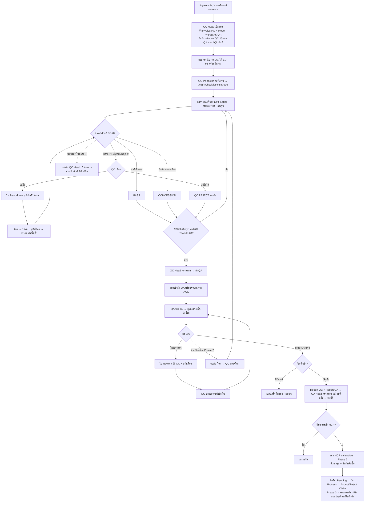

# 02 — Functional Specification: QCheck

> Draft v0.2 · 16 ต.ค. 2026 (v0.3 19 ต.ค. 2026: M01 Login + บทบาทย้ายไประบบกลาง TRW — DEC-09, ดู [08](08-central-auth-plan.md) · v0.4 19 ต.ค. 2026: M00 App shell มือถือ — ดู [09](09-app-shell.md))
> คอลัมน์ **Rel** = รุ่นที่ส่งมอบ: **1.0** = R1.0 Pilot (วงจร QC หลัก) · **1.1** = R1.1 (QC ครบ + QA แกนหลัก → Go-live Phase 1) · **2** = Phase 2 (NCP + จัดซื้อขั้นต่ำ + อีเมล/Push) · **3** = Phase 3 (เคลมเต็ม + Dashboard) · **4** = Backlog
> Priority: **M** = Must, **S** = Should, **C** = Could · Business rules (BR-xx) และ Data model อยู่ใน [03-spec-business-rules-data.md](03-spec-business-rules-data.md)

---

## 0. คำศัพท์ (Glossary)

| คำ | ความหมายในระบบ |
|---|---|
| **เอกสารรับเข้า (Receipt doc)** | Invoice (ปั๊มนำเข้า) หรือ PO (ปั๊มผลิตเอง) 1 ใบ มีได้หลาย SKU/Model — เก็บวันที่ Invoice, Vendor, จำนวน SKU และกำหนดตรวจ 90 วัน |
| **แผนตรวจ (Inspection Plan)** | 1 Model ภายใต้ 1 เอกสารรับเข้า (= 1 ล็อต) เปิดได้ครั้งเดียว ใช้ร่วมกันทั้ง QC และ QA |
| **ใบงาน (Job)** | งานที่ QC Head มอบให้ผู้ตรวจ QC 1 คน พร้อมจำนวน — ฝั่ง QA **ไม่มีใบงานแยก** (หยิบจากคิว QA) |
| **ผลตรวจรายเครื่อง (Unit Inspection)** | การตรวจ Checklist ของเครื่อง 1 เครื่อง (Serial) |
| **รอบ (round)** | ตรวจครั้งแรก = รอบ 1, ตรวจซ้ำหลังซ่อม = รอบ 2, 3… (รอบก่อนห้ามแก้) |
| **ฉบับแก้ไข (revision)** | การแก้ข้อมูลที่บันทึกผิดในรอบเดิม (หัวหน้าแก้เอง หรือผู้ตรวจแก้เมื่อถูกตีกลับ) เก็บค่าเดิมเสมอ |
| **รอบตรวจของล็อต (cycle)** | เพิ่มเมื่อ QA ตีกลับทั้งล็อต (Phase 2) |
| **Checklist Template** | ชุดหัวข้อตาม **ประเภทปั๊ม/แผนก** และ **บทบาท** — QC 6 ชนิด, QA 3 ชนิด (ตั้งต้น) มีเวอร์ชัน |
| **หัวข้อตรวจ (Item)** | 1 บรรทัดใน Checklist — ชนิดหลักคือ "ปกติ / ไม่ผ่าน" |
| **Defect (อาการ)** | อาการจาก Defect master (แยกตามประเภทปั๊มและตำแหน่ง) มี Disposition, Severity, Category |
| **Disposition** | **อนุโลม** / **Rework** / **Reject** / **ผู้ตรวจเลือก** — แยกตาม QC/QA × กลุ่มแบรนด์ PUMA/อื่นๆ |
| **Severity** | **Critical** = กระทบการใช้งาน `[A 40:28]` · **Minor** = ความสวยงามที่ไม่กระทบการใช้งาน (เช่น สีถลอกจากขนส่ง — มักไม่เคลม) `[A 23:59]` · **Major** = รอ QA นิยาม |
| **QC Reject** | QC ตัดสินว่าเครื่องนั้น **แก้ไม่ได้** → คัดออกรายตัว |
| **QA Reject** | QA ไม่ยอมรับ → ระบบสร้างงาน Rework กลับไปให้ QC (QA ไม่มีปุ่ม Rework) |
| **AQL Level** | ระดับการสุ่มของ QA: ผ่อนคลาย / ปกติ / เคร่งครัด |
| **NCP** | เอกสาร Non-conformance สำหรับเคลม Supplier (ปั๊มนำเข้าเท่านั้น) — ค่าตั้งต้น 1 ใบต่อ Invoice (ตั้งค่าได้ ❓ D4) |
| **แบรนด์ PUMA ≠ ปั๊มผลิตเอง** | brand_group = PUMA ใช้เลือก Disposition · origin = DOMESTIC (แผนก 408/409) ใช้กับกฎ 10%/AQL ตั้งต้น/Report/NCP — ปั๊มแบรนด์ PUMA อาจนำเข้าจาก OEM ❓ A16 |
| **Status board** | หน้าสรุปความคืบหน้าแบบ near real-time (เปิดบนจอ TV ได้) |

> ⚠️ ศัพท์ชนกัน: ฝั่งโรงงานใช้ "Accept" หมายถึง "รับไป Rework" แต่ฝั่ง QA ใช้ Accept/Reject หมายถึงผ่าน/ไม่ผ่าน `[A 12:54]` และ Reject ของ QC (= คัดออก) ต่างจาก Reject ของ QA (= ส่งกลับให้ QC แก้) `[B 01:26:14]` → ปุ่มในระบบใช้คำไทยกำกับเสมอ: "ผ่าน", "ส่งซ่อม (Rework)", "คัดออก (Reject)", "ไม่รับ – ส่งกลับ QC"

---

## 1. บทบาทและสิทธิ์ (Roles & Permissions)

ผู้ใช้ 1 คนมีได้หลายบทบาท — **บทบาทกำหนดในระบบกลาง TRW** (`role_prog` ของโปรแกรม `PRG003`) QCheck อ่านมาตอน login ไม่มีหน้าแก้บทบาทในตัวเอง · ✅ = ทำได้ · 👁 = ดูอย่างเดียว · ❌ = ห้ามเข้าถึง · – = ไม่เกี่ยว

| การกระทำ | Admin | Master Admin | QC Head | QC Insp. | QA Head | QA Insp. | Purchasing | PM | Mgmt |
|---|:-:|:-:|:-:|:-:|:-:|:-:|:-:|:-:|:-:|
| จัดการผู้ใช้/รหัสผ่าน/บทบาท → **ทำในระบบกลาง TRW** (ไม่ใช่สิทธิ์ใน QCheck) | – | – | – | – | – | – | – | – | – |
| จัดการอุปกรณ์ส่วนกลาง/ตั้งค่า | ✅ | – | – | – | – | – | – | – | – |
| จัดการ Master data (หลังบ้าน) `[B 02:07:52]` | – | ✅ | 👁 | – | 👁 | – | – | 👁 | 👁 |
| ดู Checklist template (อ่านอย่างเดียว) `[B 02:08:27]` | ✅ | ✅ | ✅ | ✅ | ✅ | ✅ | ✅ | ✅ | ✅ |
| เปิด/แก้ไขแผนตรวจ (ก่อนมีผล) | – | – | ✅ | – | ✅ | – | – | – | – |
| ยกเลิกแผนหลังมีผล / บังคับปิด (BR-07, BR-13) | – | – | ✅ | – | ✅ | – | – | – | – |
| เพิ่มจำนวนตรวจ / ยกระดับ (BR-02a) | – | – | ✅ | – | ✅ | – | – | – | – |
| มอบหมาย/โอนงาน QC | – | – | ✅ | – | – | – | – | – | – |
| รับงาน / ตรวจ QC / Rework / ตัดสิน Rework-Reject | – | – | ✅ | ✅ ของตัวเอง | – | – | – | – | – |
| ตรวจทานผล QC + ส่ง QA | – | – | ✅ | – | – | – | – | – | – |
| ระดับ AQL ของแผน | – | – | 👁 | – | ✅ | 👁 | – | – | – |
| หยิบงานจากคิว QA / ตรวจ QA / Pass-Reject | – | – | – | – | ✅ | ✅ | – | – | – |
| ตีกลับทั้งล็อต (Phase 2) | – | – | – | – | ✅ | – | – | – | – |
| แก้ข้อมูลที่บันทึกผิด (โหมด ก) / ตีกลับ (โหมด ข) | – | – | ✅ QC | – | ✅ QC+QA | – | – | – | – |
| อนุมัติ Report (ตาม `report_qc_approver`) | – | – | ⚙️ | – | ✅ | – | – | – | – |
| บันทึกย้อนหลังจากกระดาษ (FR-QC-17) | – | – | ✅ | ⚙️ ได้รับสิทธิ์ | ✅ | ⚙️ | – | – | – |
| ออก/ยกเลิก NCP | – | – | – | – | ✅ | – | – | – | – |
| อัปเดตสถานะเคลม | – | – | – | – | 👁 | – | ✅ | 👁 | 👁 |
| ตอบประเด็นแก้ไขสินค้า (PM track, ถ้า D11 = ทำ) | – | – | – | – | 👁 | – | 👁 | ✅ | 👁 |
| ดู Report / NCP | ✅ | – | ✅ | 👁 ของตัวเอง | ✅ | 👁 ของตัวเอง | ✅ ที่ออกแล้ว | ✅ | ✅ |
| Status board | ✅ | ✅ | ✅ | ✅ | ✅ | ✅ | ✅ | ✅ | ✅ |
| Dashboard Vendor / Pareto | – | – | ❌ | ❌ | ✅ | ❌ | ✅ | ✅ | ✅ |
| KPI ผู้ตรวจ | – | – | ✅ (ทีมตัวเอง) | ❌ | ✅ | ❌ | – | – | ✅ |
| ดู Audit log | ✅ | – | 👁 ของแผนก | – | ✅ | – | – | – | 👁 |

- QC เข้า Dashboard ผู้บริหารไม่ได้ `[B 00:05:50]` `[B 00:06:32]` · Admin ระบบอาจไม่เห็น KPI `[B 02:04:05]`
- สิทธิ์หลังบ้าน = บทบาท `MASTER_ADMIN` เท่านั้น (ไม่มี flag แยก) — ตั้งต้นให้ **ทีม QA** ส่วนทีมอื่นรอผู้บริหารตัดสิน `[B 02:07:52]` `[B 02:08:01]` ❓ B12/E2
- ผู้ใช้ที่มีทั้งบทบาท QC และ QA ต้องเลือก **"ตรวจในฐานะ QC / QA"** ก่อนสแกน Serial แล้วระบบเปิด Checklist ตามบทบาทนั้น `[B 02:01:09]`

---

## 2. Flow ภาพรวม (End-to-end)

---

## 3. Functional Requirements รายโมดูล

### M00 — App shell (โครงแอปหลัง login)

รายละเอียดหน้าตา/เมื่อไหร่ซ่อนแท็บ อยู่ใน [09-app-shell.md](09-app-shell.md) · งานลงโค้ด = WBS 1.2 · **ยังไม่ลงใน repo รอบนี้**

| ID | Requirement | Rel | Pri | ที่มา |
|---|---|:-:|:-:|---|
| FR-NAV-01 | บนมือถือ (< 768 px) หลัง login ใช้ **bottom tab bar 4 แท็บ** ติดล่างจอ + top app bar — ไม่ใช้แฮมเบอร์เกอร์อย่างเดียวเป็นทางเข้าหลัก | 1.0 | M | 09 · wireframe มือถือ |
| FR-NAV-02 | ชุดแท็บตามบทบาท: ผู้ตรวจ QC = **งานของฉัน · สแกน · แจ้งเตือน · เพิ่มเติม** · QA (R1.1) แท็บแรก = คิว QA · หัวหน้า/บทอื่นตาม 09 §2.3 | 1.0 | M | 09 §2 · S02/S04/S05/S03 |
| FR-NAV-03 | ซ่อนแท็บบนหน้างานต่อเนื่องเต็มจอ: Checklist (S06), Rework (S08), กล้อง, สแกนเต็มจอ, Login — มีปุ่มกลับ | 1.0 | M | 09 §3.2 · 02 §5.1 ข้อ 1 |
| FR-NAV-04 | จอ ≥ 768 px ใช้ **sidebar** รายการเดียวกับแท็บ ไม่โชว์แท็บล่างคู่กัน | 1.0 | M | 04 §5.1 · 09 §5 |
| FR-NAV-05 | แท็บ **เพิ่มเติม (S31)** มีออกจากระบบ, บทบาท, สถานะซิงค์, เวอร์ชัน · เครื่องส่วนกลางแสดง timeout/สลับผู้ใช้ · ออกจากระบบเป็น POST ตาม auth เดิม | 1.0 | M | FR-AUTH-05 · 09 §4 |

**AC (FR-NAV-01/03):** มือถือ 360 px หลัง login เห็น 4 แท็บและเนื้อหาไม่ถูกบัง · เข้า Checklist แล้วแท็บหาย ปุ่มกลับกลับไปแท็บเดิม · laptop 1366 px ไม่มีแท็บล่าง

### M01 — Authentication, Users & Devices

| ID | Requirement | Rel | Pri | ที่มา |
|---|---|:-:|:-:|---|
| FR-AUTH-01 | Login ด้วย **รหัสพนักงาน + รหัสผ่านของระบบกลาง TRW** (ไม่ใช้ Gmail ส่วนตัว) — server ของ QCheck เป็นผู้เรียกระบบกลาง, `access_token` และรายการโปรแกรมอื่นไม่ส่งถึงเบราว์เซอร์; QCheck ออก session cookie ของตัวเอง ❓ G1/G2 | 1.0 | M | `[A 04:54]` `[A 05:27]` · DEC-09 |
| FR-AUTH-02 | **สร้างบัญชี/ตั้ง-รีเซ็ตรหัสผ่าน/บังคับเปลี่ยนรหัสครั้งแรก ทำที่ระบบกลาง TRW** (ไม่มีหน้าสมัครหรือเปลี่ยนรหัสใน QCheck ❓ G4) · QCheck สร้างแถวผู้ใช้อัตโนมัติเมื่อ login สำเร็จครั้งแรก (JIT) · เข้าได้เมื่อ `PRG003` มี `can_use = true`, `is_active = true` และมีบทบาท QCheck ที่รู้จักอย่างน้อย 1 บทบาท | 1.0 | M | `[A 06:44]` `[A 06:47]` · DEC-09 |
| FR-AUTH-03 | ข้อมูลผู้ใช้ (ชื่อ, อีเมล, สังกัด) **sync จาก response ของระบบกลางทุกครั้งที่ login** — ไม่มี import Excel; สังกัด (ธีรวัฒน์/PUMA) ต้องขอให้ระบบกลางส่งฟิลด์ `affiliation` ❓ E9 | 1.0 | S | `[A 04:47]` `[A 06:15]` |
| FR-AUTH-04 | หลายบทบาทต่อคน **กำหนดใน `role_prog` ของ PRG003** (array หรือ string คั่น `,` ของรหัสบทบาทใน §1 ❓ G3) · รหัสที่ไม่รู้จักถูกตัดทิ้งและบันทึก audit · ค่า `dev` ใช้ได้เฉพาะนอก production · สิทธิ์หลังบ้าน = บทบาท MASTER_ADMIN | 1.0 | M | `[B 00:01:56]` `[B 02:07:52]` |
| FR-AUTH-05 | **อุปกรณ์ส่วนกลาง** (Admin ลงทะเบียนเครื่อง): หมดเวลาเมื่อไม่ใช้ 30 นาที ⚙️, ผู้ใช้หน้างาน (LOCAL, ไม่มีบัญชีระบบกลาง) เข้าด้วยรหัสพนักงาน + **PIN** ที่ QCheck ตรวจเอง — DEC-12, [12](12-field-users-pin-plan.md) ❓ I1–I6; สลับผู้ใช้เร็วบนเครื่องส่วนกลางเป็นเฟสหลัง, แสดงชื่อผู้ตรวจให้ยืนยันก่อนกด "ส่ง" · **เครื่องส่วนตัว**: 12 ชม. ⚙️ · session หมดอายุ → login ผู้ใช้เดิมแล้วทำต่อจากร่างได้ทันที (ร่างไม่หาย) | 1.0 | M | `[B 00:17:35]` `[B 02:10:15]` |
| FR-AUTH-06 | ปิดการใช้งานผู้ใช้ (ลาออก) = ระบบกลางตั้ง `can_use = false` หรือถอด PRG003 — มีผลเมื่อ login ครั้งถัดไป หรือทันทีถ้าระบบกลางมี endpoint ตรวจสิทธิ์ ❓ G2 · ประวัติใน QCheck ยังอยู่ | 1.0 | M | — |
| FR-AUTH-07 | อีเมลผู้ใช้ไม่บังคับ — ใช้อีเมลจากระบบกลาง (ถ้ามี) เพื่อรับแจ้งเตือนเท่านั้น | 1.0 | S | `[A 05:44]` |
| FR-AUTH-08 | ระบบกลางล่ม/เข้าไม่ถึง/ตอบช้าเกิน 5 วิ → แสดง "ระบบยืนยันตัวตนไม่พร้อม" (แยกจากรหัสผิด) · ผู้ที่ session ยังไม่หมดทำงานต่อได้ · ร่างและ Outbox ไม่หาย (04 §4.2 ข้อ 7) | 1.0 | M | DEC-09 |

**AC (FR-AUTH-01/02/04/05/08):** รหัสผ่านถูกแต่ไม่มี PRG003 / `can_use = false` / ไม่มีบทบาทที่รู้จัก → เข้าไม่ได้ ข้อความ "บัญชีนี้ยังไม่ได้รับสิทธิ์ใช้ QCheck" และมี audit · ระบบกลางไม่ตอบ → ข้อความ "ระบบยืนยันตัวตนไม่พร้อม" ไม่นับเป็นการใส่รหัสผิด · บทบาทที่เห็นหลัง login ตรงกับ `role_prog` · การล็อกหลังผิดหลายครั้งและบังคับเปลี่ยนรหัสครั้งแรกเป็นของระบบกลาง ❓ G4 (QCheck ยังจำกัดการยิงรัวต่อรหัสพนักงานฝั่งตัวเอง) · บนเครื่องส่วนกลาง ไม่แตะ 30 นาที → กลับหน้าเลือกผู้ใช้ ร่างของผู้ใช้เดิมยังอยู่และผู้อื่นมองไม่เห็น · ทุก login/logout อยู่ใน Audit log

### M02 — Master Data (หลังบ้าน)

| ID | Requirement | Rel | Pri | ที่มา |
|---|---|:-:|:-:|---|
| FR-MD-01 | **Brand** (ระบุกลุ่ม PUMA / อื่นๆ สำหรับ Disposition) ใช้เป็น dropdown | 1.0 | M | `[A 01:50]` `[A 10:48]` |
| FR-MD-02 | **ประเภทปั๊ม** (Piston, Oil-free, Rotary, …) เป็นคอลัมน์แยก ใช้กรองได้ | 1.0 | M | `[A 03:32]` `[A 03:52]` `[B 00:24:14]` |
| FR-MD-03 | **Model**: รหัส/คำอธิบาย, Brand, ประเภทปั๊ม, แหล่งที่มา, Checklist QC/QA, AQL ตั้งต้น (ถ้าต่างจากค่าตามแหล่งที่มา), สแกนได้หรือไม่ + รูปแบบโค้ด, ข้อมูลแสดงอย่างเดียว | 1.0 | M | `[B 00:25:17]` `[B 01:09:07]` |
| FR-MD-04 | **Vendor/ผู้ผลิต** — Master ให้ Admin เพิ่ม/แก้/ปิดใช้งานได้เหมือนเดิม (ผู้ใช้ 23 ต.ค. ยกเลิกแนวทางดึงจาก Demand Planning) | 1.0 | M | `[B 00:12:17]` |
| FR-MD-05 | **Checklist Template**: หัวข้อ, ลำดับ, ชนิดช่อง, Required, กติการูป, **กติกาวิดีโอ (ไม่มี / เมื่อไม่ผ่าน / ทุกครั้ง)**, คำอธิบาย/รูปตัวอย่าง; แยก QC/QA | 1.0 (import) / 1.1 (builder) | M | `[A 01:50]` `[B 00:29:34]` `[B 00:35:15]` |
| FR-MD-06 | Template มี **เวอร์ชัน** — Import/แก้แล้ว Publish = เวอร์ชันใหม่เสมอ; แผนผูกเวอร์ชันตอนเปิด (BR-20) | 1.0 | M | `[B 02:06:56]` |
| FR-MD-07 | **Defect master แยกตามประเภทปั๊มและตำแหน่ง** (เช่น หัวแฟร์รั่ว ≠ สายระบายรั่ว เพราะวิธีแก้ที่แจ้ง Supplier ต่างกัน): ชื่อมาตรฐาน, Category, Severity, Complexity 1–4, ต้องมีวิดีโอ, Claimable, สาเหตุตั้งต้น, ภาพเกณฑ์เคลม (แบบ SOP), ผูกกับหัวข้อตรวจ — Popup แสดงเฉพาะอาการของหัวข้อนั้นในประเภทปั๊มของ Model (❓ A13: 19 หรือ 33 หัวข้อ) | 1.0 | M | `[A 07:25]` `[A 23:59]` `[A 41:57]` `[B 01:34:47]` |
| FR-MD-08 | ตาราง **Disposition**: QC/QA × PUMA/อื่นๆ → อนุโลม / Rework / Reject / ผู้ตรวจเลือก; อาการอนุโลมเก็บผู้อนุมัติ (PM/การตลาด) และวันที่ | 1.0 | M | `[A 10:48]` `[A 12:27]` `[B 00:44:08]` |
| FR-MD-09 | **วิธีแก้ไข**: เปลี่ยน, ซ่อม/ปรับแต่ง, พ่นสี, อื่นๆ | 1.0 | M | `[B 01:22:24]` |
| FR-MD-10 | ตาราง **AQL**: ช่วงจำนวนล็อต × ระดับ → Code letter, จำนวนสุ่ม (และ Ac/Re) | 1.1 | M | `[A 07:01]` `[B 00:58:13]` `[B 01:01:58]` |
| FR-MD-11 | **ตั้งค่าระบบ**: % QC (10), AQL ตั้งต้นตามแหล่งที่มา, Report ตามแหล่งที่มา, ผู้อนุมัติ Report, โหมดแก้ Report, กำหนดแก้งานตีกลับ, แบบแจ้งเตือน, รูปแบบเลขเอกสาร, **กำหนดตรวจ QC ต่อ Invoice (90 วันนับจากวันที่ Invoice)**, เปิด/ปิด "อาการอื่นๆ", อายุเก็บสื่อ, อัตราค่าแรง, การรวม NCP | 1.0 | M | `[B 01:02:29]` `[B 01:05:55]` `[A 31:31]` |
| FR-MD-12 | **Import/Export Excel** ทุก Master + รายงานแถวที่ผิด (นำเข้าจากสำเนา Google Sheet) | 1.0 (import) / 1.1 (export) | M | `[A 00:00]` `[B 02:05:37]` |
| FR-MD-13 | ปิดใช้งานแทนการลบ (ห้ามลบ Defect/Model ที่ถูกใช้แล้ว) | 1.0 | M | — |
| FR-MD-14 | แก้/Publish Master แล้วมีผลทันทีกับ **แผน/งานที่เปิดใหม่** (ไม่ต้อง deploy) | 1.0 | M | `[A 07:25]` |
| FR-MD-17 | **หน้า Master % การสุ่มตรวจ QC** (ค่าตั้งต้น 10%) แก้ได้โดย Admin/Master Admin พร้อมประวัติ (วันที่มีผล, ผู้แก้, เหตุผล); มีผลกับแผนที่เปิดหลังบันทึก ❓ J10 | 1.0 | M | `[C 04:42]` `[C 05:09]` |
| FR-MD-15 | ตาราง Man-day ต่อ Complexity และ Man-day เพิ่มต่อ Severity (เตรียมใช้ BR-21) | 1.0 (ข้อมูล) | S | `[A 49:30]` `[A 54:16]` |
| FR-MD-16 | ฟอร์มเปิดแผน: ช่องบังคับ/แสดงอย่างเดียว ตามคอลัมน์ Show/Required ในเอกสาร Master Data ของ QA (คอลัมน์ Active ไม่ใช้) | 1.0 | S | `[A 01:50]` |

**AC (FR-MD-08):** Defect "สีถลอก" ตั้ง QC-PUMA = Rework, QC-อื่นๆ = อนุโลม → ตรวจรุ่นแบรนด์ PUMA แล้วติ๊กอาการนี้ ผลเครื่อง = ไม่ผ่าน; รุ่นแบรนด์อื่น ผลเครื่อง = อนุโลม
**AC (FR-MD-06):** แผน A เปิดด้วย Template v1 → Import Template ใหม่ (v2) → แผน A ยังตรวจด้วย v1 ครบทุกหัวข้อเดิม; แผน B ที่เปิดหลัง Publish ใช้ v2

### M03 — เอกสารรับเข้าและแผนตรวจ

| ID | Requirement | Rel | Pri | ที่มา |
|---|---|:-:|:-:|---|
| FR-PLAN-01 | ฟอร์มเปิดแผน — **หัวเอกสาร** (แผนแรกของ Invoice/PO): แหล่งที่มา, Vendor/ผู้ผลิต, เลข Invoice หรือเลข PO (แผนก), **วันที่ Invoice** (บังคับเมื่อนำเข้า) / วันที่ PO, **จำนวน SKU ทั้งหมดใน Invoice** (หรือรายการ Model) · **ส่วนแผน**: Model, Description, จำนวนตาม Invoice, วันที่รับสินค้าเข้า, ผู้ผลิต, หมายเหตุ — แผนถัดไปของเอกสารเดิมแสดงหัวแบบอ่านอย่างเดียว | 1.0 | M | `[B 00:11:23]` `[B 00:11:35]` `[B 00:12:17]` `[A 25:01]` |
| FR-PLAN-02 | **เลขที่แผน** รันอัตโนมัติ, วันที่เปิด = เวลาปัจจุบัน | 1.0 | M | `[B 00:11:32]` `[B 00:23:35]` |
| FR-PLAN-03 | เลือก Model แล้วดึง ประเภทปั๊ม/Brand/Checklist อัตโนมัติ (แก้เองไม่ได้) | 1.0 | M | `[B 00:24:56]` `[B 00:30:39]` |
| FR-PLAN-04 | **กันซ้ำ** (BR-01): เอกสารซ้ำ (**ประเภท + เลข** — ไม่รวม Vendor ตั้งแต่ 23 ต.ค.) ดึงหัวเดิม; Model ซ้ำในเอกสารเดียวกัน → ไม่ให้เปิด แสดงลิงก์แผนเดิม | 1.0 | M | `[A 00:40]` `[B 00:13:51]` |
| FR-PLAN-04b | **Vendor ไม่บังคับตอนเปิดแผน** — คลังแจ้งหัวหน้า QC ทีหลัง แล้วกรอก/แก้ที่หน้ารายละเอียดแผนได้ทุกเมื่อ (ยกเว้นแผนที่ยกเลิก); ใช้กับทุกแผน/ใบงานของเอกสารนั้น; รายการแผนแสดง "ยังไม่ระบุ Vendor" และกรองได้; audit ทุกครั้ง · ❓ ต้องมี Vendor ก่อนอนุมัติ Report/ส่ง NCP ไหม (L6) | 1.0 | M | ผู้ใช้ 23 ต.ค. |
| FR-PLAN-05 | ปั๊มผลิตเอง: **สแกน QR รายเครื่อง (อันขวาบนสติ๊กเกอร์)** ของเครื่องใดก็ได้ใน WO → เติมเลขเอกสาร = เลขที่ผลิต WO, Model, Description, วันที่ผลิต (→ วันที่ PO), แผนก (MT-409) และจำนวนล็อตจาก Serial (ค่าตั้งต้น 28 ต.ค. — แก้ในฟอร์มได้, A3b); Product ID อ่านได้แต่ยังไม่เก็บ; รูปแบบ QR ดู BR-18 · ✅ ทำแล้ว 28 ต.ค.: สแกนด้วยกล้องมือถืออย่างเดียว (ไม่มีช่องเครื่องยิง — ผู้ใช้ 28 ต.ค.) · แผน PO เก็บ WO ใน `plans.production_wo_no` | 1.0 | M | `[B 00:16:36]` QR ตัวอย่าง 22 ต.ค. |
| FR-PLAN-05b | ปั๊มนำเข้า: สแกน QR/Barcode ของ Supplier (parser ต่อ Vendor/Model) ถ้ามี; รุ่นที่ไม่มีโค้ด → dropdown Brand/Model | 1.1 (parser) / 1.0 (dropdown) | M | `[A 00:40]` `[A 01:50]` |
| FR-PLAN-06 | คำนวณ **จำนวน QC = ปัดขึ้น(ล็อต × 10%)** แบบ real-time (BR-02) | 1.0 | M | `[B 00:03:23]` `[B 01:02:29]` |
| FR-PLAN-07 | **ระดับ AQL ตั้งต้น** ตามแหล่งที่มา/Model และ **จำนวน QA** แบบ real-time ตั้งแต่ตอนเปิดแผน — QC Head เห็นแบบอ่านอย่างเดียว (BR-03) | 1.1 | M | `[B 01:05:55]` `[B 01:17:55]` `[B 01:18:35]` |
| FR-PLAN-08 | ของทยอยเข้า: **เปิดใบงานใหม่ต่อการเรียกเข้าแต่ละครั้ง** ภายใต้แผนเดิม (ไม่เปิดแผนใหม่), เครื่องที่มาใหม่ยังเป็นรอบ 1; แผนแสดง **ครั้งที่เรียกเข้าแล้ว, จำนวนที่เรียกสะสม, ยอดล็อตที่เหลือ, ยอดตรวจสะสม/เป้า** | 1.0 | M | `[B 00:14:22]` `[C 02:40]` `[C 21:37]` |
| FR-PLAN-09 | **ยกระดับการตรวจ** เมื่อพบปัญหาในตัวอย่าง (ธงอัตโนมัติ + QC Head เลือกขยาย/ไม่ขยาย พร้อมเหตุผล) (BR-02a) | 1.0 | M | `[B 00:55:28]` |
| FR-PLAN-10 | รายการแผน: กรองตามวันที่/สถานะ/Vendor/Model/**ประเภทปั๊ม**/เลขแผน/Invoice; สถานะความคืบหน้าตาม BR-12 | 1.0 | M | `[B 00:21:13]` `[A 03:52]` |
| FR-PLAN-11 | แก้ไข/ยกเลิกแผน: ก่อนมีผล = ผู้เปิด; หลังมีผล = หัวหน้า + เหตุผล (BR-13) | 1.0 | M | — |
| FR-PLAN-12 | หน้า Plan detail แบบแท็บ: ข้อมูล, ใบงาน, รายเครื่อง, Rework, QA (รวมระดับ AQL), Report, ประวัติ | 1.0 | M | `[B 00:10:52]` |
| FR-PLAN-13 | แสดง **กำหนดตรวจ 90 วันของ Invoice** + นับถอยหลังในรายการ/รายละเอียดแผน และเรียงตามกำหนดได้ (BR-11) | 1.0 | S | `[A 31:31]` `[A 32:54]` |
| FR-PLAN-14 | **ภาพรวมราย Invoice**: มีกี่ SKU เปิดแผนแล้วกี่ SKU ตรวจเสร็จกี่แผน (เช่น 5 SKU เสร็จ 2), กำหนด 90 วัน, สถานะ NCP | 2 | S | `[A 25:01]` `[A 48:15]` |
| FR-PLAN-15 | แผนมี **QC ผู้รับผิดชอบหลัก** (ตั้งต้น = ผู้รับมอบหมายคนแรก, หัวหน้าเปลี่ยนได้) — ใช้ตามกติกา BR-08 | 1.0 | M | `[B 01:30:07]` |
| FR-PLAN-16 | "สถานะ Checklist" เห็นจากรายการแผนโดยไม่ต้องตามไปหน้า Rework (ตารางจับคู่สถานะ 03 §2.1) | 1.0 | M | `[B 01:29:38]` |
| FR-PLAN-17 | ติ๊ก **"รอของ"** ที่แผน (ยอดล็อตยังเรียกเข้าไม่ครบ) — ไม่นับเป็นขาด/ลืม และไม่ส่งแจ้งเตือนค้าง | 1.0 | S | `[B 02:04:10]` `[C 21:37]` |

**AC (FR-PLAN-04):** มีแผน INV-A (Vendor V) + Model X → เปิด INV-A + X อีก → ปฏิเสธ "แผนนี้เปิดแล้ว: QP-2610-0012" + ปุ่มไปแผนเดิม; INV-A + Model Y → เปิดได้และหัว Invoice ดึงมาอัตโนมัติ; INV-A ของ Vendor W → เป็นเอกสารคนละใบ
**AC (FR-PLAN-06):** ล็อต 350 → QC = 35; 80 → 8; 81 → 9; 5 → 1 (ตัวเลขขึ้นทันทีขณะพิมพ์)
**AC (FR-PLAN-08):** แผน 40 ตัว (QC 4) วันนี้ของเข้า 5 → ตรวจ 2 เครื่อง ปิดแอป → วันรุ่งขึ้นเปิดใบงานเดิมตรวจเครื่องที่ 3 ได้ (รอบ 1) โดยไม่เปิดแผนใหม่
**AC (FR-PLAN-09):** ตัวอย่าง QC เครื่องที่ 2 ผล NOT_PASSED → QC Head ได้แจ้งเตือน "พบปัญหาในตัวอย่าง" → เลือก "ขยายทั้งล็อต" → ต้องตรวจ = 40, ไม่ถูกนับเป็นตรวจเกิน

### M04 — Assignment, Job & QA Queue

| ID | Requirement | Rel | Pri | ที่มา |
|---|---|:-:|:-:|---|
| FR-JOB-00 | QC Head **เปิดใบงานต่อการเรียกเข้า 1 ครั้ง** (ลูกของแผน: `id` + `plan_id` FK, เลข `<เลขแผน>-<ครั้งที่>`): ระบบ**เด้งค่า Need = เป้า 10% ของล็อต − True สะสม** (BR-02); กรอกวันที่และ **จำนวนเรียกเข้า ≥ Need และ ≤ ยอดล็อตที่ยังไม่เรียก** (ผิด = เตือนแดง บันทึกไม่ได้); **1 ใบ/แผน/วัน**; ประเภทใบงานเลือกอัตโนมัติ (QC / เรียกเข้าแก้ไข Need = 0) | 1.0 | M | `[D 05:12]` `[D 15:22]` `[D 02:44]` `[C 13:38]` |
| FR-JOB-08 | **สถานะ "ไม่สำเร็จ"** + ยกเลิกใบงาน: เมื่อตรวจสะสม ≥ 10% ของล็อตและเรียกเข้าครบ 100% ใบงานที่ True = 0 ขึ้น "ไม่สำเร็จ" อัตโนมัติ ไม่นำไปคำนวณ (Need/ยอดสะสม/KPI/Dashboard) เก็บเป็นประวัติ; ผู้ใช้ยกเลิกใบที่ True = 0 เองได้ | 1.0 | M | `[D 24:14]` `[D 22:50]` |
| FR-JOB-09 | **True นับ Serial ไม่ซ้ำต่อแผน** เมื่อกดส่งหน่วย (Serial เดียวกันข้ามใบงานนับ 1) กันการก๊อปผลให้ครบเป้า | 1.0 | M | `[D 01:35]` |
| FR-JOB-01 | QC Head มอบหมายใบงานให้ **QC ผู้รับผิดชอบอย่างน้อย 2 คน เพิ่มได้สูงสุด 5 คน** (รับผิดชอบร่วมกัน ไม่แยกจำนวนต่อคน; บันทึกไม่ได้ถ้าน้อยกว่า 2) — ระบบบันทึกผู้ตรวจรายเครื่อง | 1.0 | M | `[C 24:36]` `[C 25:54]` |
| FR-JOB-02 | สถานะใบงาน: กำลังทำ → ส่งแล้ว (→ ถูกตีกลับ) — ส่งได้เมื่อตรวจ ≥ Need และไม่มี Rework ค้าง | 1.0 | M | `[B 00:22:22]` `[B 00:23:36]` `[B 01:23:38]` |
| FR-JOB-03 | **ไม่ต้องกดรับงาน** — เมื่อ QC Head เลือกผู้ตรวจ ใบงานขึ้นในงานของแต่ละคนทันที (แจ้งเตือนในแอป) เข้าทำได้เลย; งาน prefetch เพื่อทำออฟไลน์ได้ | 1.0 | M | `[C 24:10]` (แทน `[B 00:22:54]`) |
| FR-JOB-04 | "งานของฉัน" (มือถือ): การ์ดแสดงเลขแผน, Model, Invoice, ต้องทำ/ทำแล้ว, สถานะ, Rework ค้าง | 1.0 | M | `[B 00:23:07]`; แสดงคอลัมน์ **Qty QC / Done / Balance และ Qty QA / Done / Balance** ในแถวเดียว, Due Date (ไม่บังคับ) `[สไลด์ 6]` |
| FR-JOB-05 | เปิดใบงาน → **เด้งเข้า Checklist ที่ถูกต้องตาม Model อัตโนมัติ** (ห้ามเลือกเอง) | 1.0 | M | `[B 00:24:20]` `[B 00:30:39]` |
| FR-JOB-06 | หัวหน้าโอนงาน/ปรับจำนวนระหว่างทาง | 1.1 | S | — |
| FR-JOB-07 | **คิว QA (ไม่มีใบงานแยก)**: แผนที่ "รอ QA" ขึ้นในคิวพร้อมจำนวนตาม AQL — ผู้มีบทบาท QA กด "เริ่มตรวจ QA" ได้ทันที (ระบบสร้าง job ภายในอัตโนมัติ); QA Head จำกัด/มอบหมายรายคนได้ถ้าต้องการ | 1.1 | M | `[B 01:17:30]` `[B 01:17:41]` `[B 02:01:03]` |

**AC (FR-JOB-00/01/02/08):** ล็อต 500 (เป้า 50) → เปิดใบ 001-1 → เด้ง Need 50 · ใส่จำนวนเรียก 40 → เตือนแดง บันทึกไม่ได้; ใส่ 200 → บันทึกได้, ใบ 001-1 Need 50 ประเภท QC · ผู้ตรวจ 1 คน → บันทึกไม่ได้ "ต้องมีอย่างน้อย 2 คน"; 2 คน → ขึ้นให้ทั้งสองทันที ไม่มีปุ่มรับงาน · วันเดียวกันเปิดใบที่ 2 ไม่ได้ · วันถัดไป ใบ 001-1 ตรวจ 30 → ใบ 001-2 เด้ง Need 20 · ตรวจ Serial SN-001 ซ้ำในใบ 001-2 → นับ True ไม่เพิ่ม · ใบ 001-1 (ไม่เคยตรวจ) + ตรวจครบ 50 + เรียกครบ 500 → ขึ้น "ไม่สำเร็จ" และไม่ถูกนับ · ใบที่มี Rework ค้าง → ปุ่มส่ง disable

### M05 — QC Checklist Execution

| ID | Requirement | Rel | Pri | ที่มา |
|---|---|:-:|:-:|---|
| FR-QC-01 | เริ่มเครื่องใหม่: **สแกน Serial ปั๊มและมอเตอร์** (กล้อง/เครื่องยิง) หรือพิมพ์ (บันทึกวิธีกรอก) | 1.0 | M | `[B 00:30:08]` `[B 00:31:08]` |
| FR-QC-02 | Serial ซ้ำใน (แผน, บทบาท, cycle) → ไม่ให้บันทึกซ้ำ; ชนกันจากออฟไลน์ → คิวขัดแย้ง (BR-18) | 1.0 | M | — |
| FR-QC-03 | ส่วนหัว: Model/ข้อมูลจากแผนแสดงอัตโนมัติ **แก้ไม่ได้**; ช่อง display-only แสดงอย่างเดียว | 1.0 | M | `[A 01:50]` `[B 00:30:39]` |
| FR-QC-04 | **ทุกหัวข้อ Required ต้องมีคำตอบก่อนส่ง (ห้ามเว้นว่าง)** — ลำดับแนะนำคือทีละหัวข้อ แต่ย้อนกลับ/ข้ามไปหัวข้ออื่นได้; ปุ่ม "ส่ง" disable จนครบ และแสดงรายการหัวข้อที่ขาด | 1.0 | M | `[B 00:43:26]` `[B 00:43:35]` |
| FR-QC-05 | หัวข้อชนิด ปกติ/ไม่ผ่าน: **ปกติ** (รูปไม่บังคับ) / **ไม่ผ่าน** (Popup อาการของหัวข้อนั้น เลือกได้หลายอาการ) | 1.0 | M | `[B 00:31:38]` `[B 00:43:17]` `[B 01:51:03]` |
| FR-QC-06 | "ไม่ผ่าน" → **บังคับถ่ายรูป ≥ 1 รูปด้วยกล้องในแอป** (ไม่เปิดคลังรูป) + ลายน้ำ เลขแผน/Serial/เวลา (BR-05) | 1.0 | M | `[B 00:31:54]` `[B 01:38:12]` |
| FR-QC-07 | วิดีโอสั้นตามกติกาหัวข้อ (`ON_FAIL`/`ALWAYS`) หรืออาการที่ตั้ง "ต้องมีวิดีโอ" (เช่น ลมรั่ว, สายพาน) | 1.0 | M | `[B 00:31:59]` `[B 00:35:15]` `[B 00:41:18]` |
| FR-QC-08 | ตรวจจับ **รูปซ้ำ** ข้ามเครื่อง → เตือน + ธงให้หัวหน้า (BR-05a) | 1.1 | S | `[B 01:38:12]` |
| FR-QC-09 | ตัวเลือก "อาการอื่นๆ (รอจัดหมวด)" — **ปิดเป็นค่าตั้งต้น** ⚙️ (ข้อเสนอทีมพัฒนา ไม่ได้มาจากประชุม) | 1.1 | C | ❓ B6 |
| FR-QC-10 | **คำนวณผลรายเครื่อง** ตาม BR-04 | 1.0 | M | `[A 08:55]` `[B 00:43:41]` `[B 00:44:43]` |
| FR-QC-11 | ผล "ไม่ผ่าน" → เลือก **Rework** หรือ **Reject** — ระบบเสนอตาม Disposition, Critical บังคับ Reject (BR-04) | 1.0 | M | `[A 14:18]` `[B 01:25:43]` |
| FR-QC-12 | ส่งแล้ว **ล็อกที่ผู้ตรวจ** — คนอื่นดูได้ แก้ไม่ได้ | 1.0 | M | `[B 00:42:12]` |
| FR-QC-13 | **บันทึกร่างอัตโนมัติทุกการกด** (ในเครื่อง แยกตามผู้ใช้) + คิวอัปโหลดรูป/วิดีโอที่รอดจากการปิดแอป (ดู 04 §4) | 1.0 | M | `[B 02:10:15]` `[B 02:11:08]` |
| FR-QC-14 | แถบความคืบหน้า (หัวข้อที่ n/ทั้งหมดของ Checklist นั้น) และสรุปก่อนส่ง | 1.0 | M | — |
| FR-QC-15 | ไม่ผ่านหัวข้อหนึ่งแล้ว **ตรวจหัวข้อถัดไปต่อได้ทันที**; ไม่ต้องลงลายเซ็น กด "ส่ง" แล้วบันทึกชื่อผู้ตรวจ | 1.0 | M | `[B 00:42:03]` `[B 00:43:23]` |
| FR-QC-16 | แท็ก **สาเหตุ** (Supplier/ขนส่ง/ภายใน — ตั้งต้นจาก Master) และ **ตำแหน่งที่พบ** ต่ออาการ (ไม่บังคับ — ผู้ตรวจหรือหัวหน้าระหว่างตรวจทาน) | 1.1 | S | `[A 53:39]` `[A 56:13]` `[A 56:20]` |
| FR-QC-17 | **บันทึกย้อนหลังจากกระดาษ** (เมื่อระบบใช้ไม่ได้): เลือกผู้ตรวจจริง + วันเวลาตรวจจริง, อัปโหลดรูปจากไฟล์ได้, ติดป้าย "บันทึกย้อนหลัง" ใน Report/Audit, ไม่นับใน KPI ความตรงเวลา — เฉพาะผู้มีสิทธิ์ | 1.1 | S | `[B 02:09:04]` |
| FR-QC-18 | **"ถ่ายต่อบนมือถือ"**: บน laptop กดแล้วแสดง QR → มือถือที่ login ผู้ใช้เดียวกันเปิดหัวข้อเดิมเพื่อถ่ายรูป/วิดีโอสด | 1.1 | S | — (รองรับ "ใช้บน laptop ได้") |
| FR-QC-19 | พิมพ์แบบฟอร์ม Checklist กระดาษจาก Template version ของแผน (มีเลขแผน + QR ของแผน) | 1.0 | S | `[B 02:09:04]` |
| FR-QC-20 | หัวข้อชนิด ตัวเลข/ข้อความ/ตัวเลือก เก็บเป็นข้อมูลประกอบ ไม่มีผลต่อผลเครื่อง (จนกว่ากำหนดเกณฑ์ ❓ B14) | 1.0 | M | — |

**AC (FR-QC-04/05/06):** กด "ไม่ผ่าน" ที่หัวข้อ 6 → Popup แสดงเฉพาะอาการของหัวข้อ 6 (ประเภทปั๊มของ Model) → เลือก 2 อาการ → ยังไปต่อไม่ได้จนถ่ายรูป 1 รูป → ไปหัวข้อ 7 ได้ · ข้ามหัวข้อ 9 ไปก่อน → ปุ่ม "ส่ง" disable และบอก "ยังไม่ตอบ: หัวข้อ 9"
**AC (FR-QC-13):** ตอบ 10 หัวข้อ + ถ่าย 2 รูป ขณะไม่มีเน็ต → ปัดปิดแอป → เปิดใหม่ → เห็นคำตอบ 10 ข้อและรูป 2 รูปครบ → มีเน็ต → ข้อมูลและรูปขึ้น server ครบ ไม่ซ้ำ

### M06 — Rework, QC Reject & Correction

| ID | Requirement | Rel | Pri | ที่มา |
|---|---|:-:|:-:|---|
| FR-RW-01 | เลือก Rework → **ใบ Rework** อัตโนมัติ เฉพาะหัวข้อ/อาการที่ไม่ผ่าน (BR-06) | 1.0 | M | `[B 00:09:00]` `[B 00:47:11]` |
| FR-RW-02 | ปิดใบ Rework: **วิธีแก้** ต่ออาการ + **รูปหลังแก้** + ประเมินหัวข้อนั้นใหม่ | 1.0 | M | `[B 00:47:36]` `[B 01:22:24]` |
| FR-RW-03 | เก็บ **ประวัติทุกรอบ** (รอบ 1 พบอะไร/รูป → รอบ 2 แก้อะไร/รูป) ห้ามเขียนทับ | 1.0 | M | `[B 00:10:32]` `[B 00:48:24]` |
| FR-RW-04 | Rework ผ่าน → PASS/CONCESSION + ธง "ผ่านหลัง Rework" | 1.0 | M | `[A 08:55]` |
| FR-RW-05 | Reject → เครื่อง **REJECTED** นับในสรุปแผน (เช่น ผ่าน 9 / Reject 1) ไม่ต้องมีขั้นตอนต่อ | 1.0 | M | `[B 00:46:22]` `[B 01:27:09]` |
| FR-RW-06 | ส่งใบงาน/ปิดงาน QC ไม่ได้ถ้ามี Rework ค้าง (BR-07) | 1.0 | M | `[B 01:23:38]` `[B 01:27:34]` |
| FR-RW-07 | ใบ Rework จาก QA แสดงแหล่งที่มา "QA" + อาการที่ QA พบ (รวมเครื่องที่ QC ไม่เคยตรวจ — BR-08) | 1.1 | M | `[B 01:30:13]` `[B 00:54:51]` |
| FR-RW-08 | **Correction** (BR-06a): หัวหน้าแก้ข้อมูลที่บันทึกผิดในรอบเดิม หรือผู้ตรวจแก้เมื่อถูกตีกลับ — เก็บค่าเดิม/ผู้แก้/เหตุผล, คำนวณผลใหม่, แสดงป้าย "แก้โดย…" | 1.0 (หัวหน้า) / 1.1 (ตีกลับ) | M | `[B 01:50:27]` `[B 01:33:38]` |
| ~~FR-RW-09~~ | ~~จับเวลาเริ่ม-จบการแก้ไข~~ — **ไม่ทำ**: ข้อเสนอถูกแย้ง ให้ใช้ค่าแรงตามเกณฑ์ (BR-21) แทน | — | — | `[A 54:50]` vs `[A 51:06]` `[A 54:16]` |

**AC (FR-RW-01..04):** หัวข้อ 3 และ 7 ไม่ผ่าน → เลือก Rework → ใบ Rework มีเฉพาะหัวข้อ 3, 7 → ปิดด้วยวิธีแก้ + รูปหลังแก้ → PASS (ผ่านหลัง Rework) และหน้ารายเครื่องยังเห็นรูปรอบแรก
**AC (FR-RW-08):** SN-357 รอบ 1 บันทึก "ขาถังเป็นสนิม" → หัวหน้าแก้เป็น "สีไม่ผ่าน" + เหตุผล → ตาราง Defect ใน Report: สีไม่ผ่าน +1, ขาถังเป็นสนิม −1 · หน้ารายเครื่องแสดงค่าใหม่ + ป้าย "แก้โดย <ชื่อ> (เดิม: ขาถังเป็นสนิม)" · ข้อมูล/รูปรอบ Rework ไม่เปลี่ยน · Audit มีค่าเดิม→ใหม่

### M07 — QA Inspection

| ID | Requirement | Rel | Pri | ที่มา |
|---|---|:-:|:-:|---|
| FR-QA-01 | QA ใช้ **แผนเดียวกับ QC** (ไม่เปิดแผน/ใบงานใหม่) | 1.1 | M | `[B 00:54:23]` `[B 01:19:22]` |
| FR-QA-02 | Checklist QA (ตั้งต้น 3 ชนิด: Piston, Oil-free, Rotary) — เนื้อหาเหมือน QC ได้แต่แยก template; ระบบเปิดตามบทบาทผู้ใช้ | 1.1 | M | `[B 01:19:46]` `[B 02:01:09]` `[B 02:01:43]` |
| FR-QA-03 | QA Head ตั้ง/เปลี่ยนระดับ AQL ได้จนกว่า QA ปิดงาน → **คำนวณจำนวน QA ใหม่ทันที** + เก็บเหตุผล/ผู้เปลี่ยน | 1.1 | M | `[B 01:13:32]` `[B 01:14:06]` |
| FR-QA-04 | ตัวช่วยตัดสินใจ: แสดงสัดส่วน Defect ใน QC ข้างช่องระดับ AQL (ยังไม่เปลี่ยนอัตโนมัติ) | 2 | C | `[B 01:04:50]` `[B 01:07:45]` |
| FR-QA-05 | QA สุ่มเครื่องใดก็ได้ในล็อต — สแกน Serial; ถ้าเป็นเครื่องที่ QC ตรวจแล้ว **เตือนแต่ยอมให้ตรวจ** (แนะนำให้สุ่มเครื่องที่ QC ยังไม่ตรวจ) ❓ C9 | 1.1 | M | `[B 00:09:15]` `[B 00:54:51]` `[B 00:55:28]` |
| FR-QA-06 | ผล QA: **ผ่าน / อนุโลม / ไม่รับ (Reject)** — ไม่มีปุ่ม Rework | 1.1 | M | `[A 13:46]` `[B 01:19:57]` |
| FR-QA-07 | QA Reject รายตัว → ใบ Rework (อาการจากรายการ ไม่ต้องพิมพ์เหตุผล) ตามกติกาผู้รับ BR-08 + แจ้งเตือน → QC แก้เฉพาะหัวข้อนั้น → QA ตรวจซ้ำ (เครื่องเดิมหรือเครื่องที่ส่งมาแทน) วนจนผ่าน; QC แก้ไม่ได้ → QA_REPLACED + สุ่มแทน | 1.1 | M | `[B 00:04:20]` `[B 01:24:39]` `[B 01:30:31]` `[A 14:12]` |
| FR-QA-08 | QA Reject **ทั้งล็อต** → cycle ใหม่ (BR-09) | 2 | M | `[B 01:21:29]` |
| FR-QA-09 | QA ปิดงานได้เมื่อครบจำนวน AQL และไม่มีเครื่องรอตรวจซ้ำ | 1.1 | M | `[B 01:24:52]` |

**AC (FR-QA-03):** ล็อต 350 ระดับผ่อนคลาย → qa_required = 20 · QA Head เปลี่ยนเป็นปกติ + เหตุผล → 50 ทันที (ไม่ต้องบันทึกก่อน), ประวัติมี 1 แถว (ผ่อนคลาย→ปกติ, 20→50, ผู้เปลี่ยน, เวลา) · QC Head เห็นช่องระดับเป็นอ่านอย่างเดียว
**AC (FR-QA-07):** QA ไม่รับ SN-120 (QC เคยตรวจโดยผู้ตรวจ A) → A ได้ใบ Rework + แจ้งเตือน, QC Head ได้สำเนา → A ซ่อมหัวข้อนั้น → SN-120 ขึ้นในคิว QA "รอตรวจซ้ำ" · QA ไม่รับ SN-200 (QC ไม่เคยตรวจ) → ใบ Rework ไป QC ผู้รับผิดชอบหลัก และไม่นับใน qc_done

### M08 — Review, Approval & Reports

| ID | Requirement | Rel | Pri | ที่มา |
|---|---|:-:|:-:|---|
| FR-RPT-01 | **Report QC** และ **Report QA** แยกกัน ต่อแผน สร้างอัตโนมัติจากผลตรวจ (ปั๊มนำเข้า) | 1.0 (QC) / 1.1 (QA) | M | `[B 01:31:37]` `[B 01:47:58]` |
| FR-RPT-02 | เนื้อหา: หัวรายงาน (แผน, Invoice/PO, Vendor, Model, จำนวน, วันที่, ผู้ตรวจ), สรุปจำนวน (ตรวจ/ผ่าน/อนุโลม/Rework/Reject), **ตาราง Defect** (อาการ, หมวด, Severity, จำนวนเครื่อง, %), **รูปตัวอย่างต่ออาการ**, วิธีแก้, หัวข้อ "พบโดย QA"/"Rework จาก QA" | 1.0 | M | `[B 01:32:05]` `[B 01:32:37]` `[B 00:46:41]` |
| FR-RPT-03 | ตาราง Defect ใช้ **ผลที่พบครั้งแรก** (รอบ 1 ฉบับแก้ไขล่าสุด — BR-06a) | 1.0 | M | `[B 01:32:37]` `[B 01:33:06]` |
| FR-RPT-04 | **Drill-down**: กดตัวเลขจำนวน → รายการ Serial → หน้ารายเครื่องพร้อมรูปทุกรอบ | 1.0 | M | `[B 01:54:24]` `[B 01:55:57]` |
| FR-RPT-05 | **ไม่ส่งอัตโนมัติ** — ต้องผ่านผู้อนุมัติ 2 โหมด: **(ก) แก้ไขเอง** (Correction + Audit) **(ข) ตีกลับ** ให้ผู้ตรวจแก้เฉพาะเครื่องที่ระบุ (เปิด Checklist เดิมพร้อมคำตอบเดิม) โดยมี **กำหนดแก้ ⚙️ (ตั้งต้น 1 วันทำการ)**, แสดงอายุค้าง, เตือนเมื่อเลยกำหนด — เปิดทั้ง 2 โหมด; ปิดโหมด (ก) ได้ในตั้งค่าเมื่อบังคับกำหนดแก้ได้แล้ว | 1.0 (ก) / 1.1 (ข) | M | `[B 01:35:47]` `[B 01:36:24]` `[B 01:37:20]` `[B 01:46:34]` |
| FR-RPT-06 | ลำดับอนุมัติ (03 §2.5): QC Head ตรวจทานผล QC (ขั้น QC_REVIEW) → ผู้อนุมัติ ⚙️ (ตั้งต้น QA Head) อนุมัติ Report QC + QA; อนุมัติแล้วล็อก + PDF snapshot; เปิดใหม่ได้โดย QA Head + เหตุผล | 1.0 | M | `[B 01:36:11]` |
| FR-RPT-07 | Export **PDF** (1.0) และ **Excel** (1.1) | 1.0 / 1.1 | M | `[B 01:32:05]` `[B 02:06:21]` |
| FR-RPT-08 | รายการ Report: กรองตาม Vendor/Model/ประเภทปั๊ม/วันที่/สถานะ, ค้นหา **Serial**, แสดงอายุ Report ที่ยังไม่อนุมัติ (SLA 7 วัน) | 1.0 | M | `[B 02:06:11]` `[B 02:06:36]` `[B 01:47:37]` |
| FR-RPT-09 | ปั๊มผลิตเอง: **ไม่ออก Report/NCP** (⚙️ `report_required_by_origin`) — ผลยังเข้า Status board/Dashboard/KPI ❓ D8 | 1.0 | M | `[B 01:58:26]` `[B 01:58:46]` |

**AC (FR-RPT-05):** ตีกลับ SN-357 พร้อมความเห็น → ผู้ตรวจได้แจ้งเตือน เปิด Checklist เดิมพร้อมคำตอบเดิม แก้ได้เฉพาะเครื่องนั้น → ส่งแล้ว Report กลับเข้า "รอตรวจทาน" · ปิดโหมด (ก) ในตั้งค่า → ไม่มีปุ่มแก้ เหลือ "ตีกลับ"

### M09 — NCP & Claim

| ID | Requirement | Rel | Pri | ที่มา |
|---|---|:-:|:-:|---|
| FR-NCP-01 | QA Head ออก **NCP** ตาม BR-15 — ค่าตั้งต้น 1 NCP ต่อ Invoice (ตั้งค่าเป็นต่อแผนได้ ❓ D4), เงื่อนไขครบ SKU, ออกก่อนได้พร้อมเหตุผล, revision เมื่อเพิ่มแผน | 2 | M | `[A 22:15]` `[A 47:08]` `[B 01:31:16]` |
| FR-NCP-02 | เลข NCP อัตโนมัติ `NCP-YYMM-NNN` (BR-10) | 2 | M | `[B 02:02:28]` |
| FR-NCP-03 | **รายการ NCP** = อาการที่เข้าเกณฑ์ (Claimable และสาเหตุไม่ใช่ขนส่ง/ภายใน) — QA Head ติ๊กเพิ่ม/ตัดได้พร้อมเหตุผล; มีรูปทุกอาการ | 2 | M | `[A 23:59]` `[A 38:54]` `[B 01:58:56]` |
| FR-NCP-04 | กด "ส่ง" → อีเมลถึงจัดซื้อ: **สรุปในเนื้ออีเมล** (ตรวจ/ผ่าน/ไม่ผ่าน/อาการหลัก) + **ลิงก์** (ไม่แนบไฟล์ใหญ่) | 2 | M | `[B 01:44:38]` `[B 01:45:02]`; **Claim Package 7 ไฟล์** ดาวน์โหลดเป็นชุดจากหน้า NCP: Claim Summary (PDF), รายงาน QC/QA ก่อน Rework (PDF), รูป Defect, รายละเอียด Invoice/PO, จำนวนที่พบ/Defect Rate, Claim List (Excel) ❓ H9 |
| FR-NCP-05 | **สถานะขั้นต่ำ**: NCP ที่ออกแล้วขึ้นหน้าจัดซื้อเป็น **Pending** → จัดซื้อกด **On Process** (รู้ว่าหยิบไปแล้ว) → **Accept Claim / Reject Claim** + หมายเหตุการชดเชย (เช่น ชดเชยสินค้า 5 ตัว) | 2 | M | `[B 01:40:37]` `[B 01:42:06]` `[B 02:00:26]` |
| FR-NCP-06 | **ค่าแรงคำนวณต่อบรรทัด** ตาม BR-21 แสดงใน NCP (ผู้ใช้ไม่ต้องกรอก) | 2 | S | `[A 49:30]` `[A 54:16]` |
| FR-NCP-07 | **PM track** (ถ้า D11 = ทำ): NCP ขึ้นรายการ "รอ PM" — PM ตอบประเด็นแก้ไขสินค้า (Supplier จะแก้อะไร ล็อตไหน, รับรายงานกลับจาก Supplier) ขนานกับฝั่งจัดซื้อ | 2 | S | `[A 16:11]` `[A 19:01]` `[A 27:44]` |
| FR-NCP-08 | ผลเคลม **รายบรรทัด** (แผน/อาการ): ตัดสิน (รับ/ไม่รับ/บางส่วน), รูปแบบ (เงิน/สินค้า/อะไหล่/ส่วนลด/ส่งคืน/อื่นๆ), จำนวน/มูลค่า — ทุกบรรทัดต้องมีผลตัดสิน; หัว NCP สรุปจากบรรทัด | 3 | M | `[A 20:17]` `[A 40:28]` |
| FR-NCP-09 | สถานะเต็ม: รอ Supplier → Supplier ตอบ (ยอมรับ/ปฏิเสธ/เสนอแนวทาง) → ตัดสิน → ปิด; บันทึกวิธีแก้ของ Supplier (ผู้บันทึกตาม D11: PM หรือจัดซื้อ) | 3 | M | `[B 01:31:37]` `[B 01:45:49]`; **ชุดสถานะตามสไลด์ 13**: Draft → Waiting Purchasing → Sent Supplier → Supplier Reviewing → Accepted/Rejected → Compensation/Replacement Pending → Closed; ประเภทชดเชยเพิ่ม Credit Note, Rework/Labor Cost, Transportation Cost ❓ H5 |
| FR-NCP-10 | จัดซื้อขอรูป/ข้อมูลเพิ่มจาก QC/QA ผ่านคอมเมนต์ในแอป | 3 | S | `[B 01:48:47]` |
| FR-NCP-11 | แจ้งเตือนกำหนดตรวจ 90 วันของ Invoice ก่อนครบ (14/7 วัน) | 3 | S | `[A 31:31]` |
| FR-NCP-12 | เกณฑ์เคลมอัตโนมัติ (ตาม Severity/สาเหตุ/Stock/การซื้อซ้ำ) | 4 | C | `[A 38:54]` `[A 40:28]` |

**AC (FR-NCP-01):** Invoice INV-A (Vendor V) มี 3 SKU เปิดครบ 3 แผน อนุมัติครบ มีรายการเข้า NCP 2 แผน → "ออก NCP" ได้ 1 ใบรวม 3 แผน · มีแผนยังไม่อนุมัติ → ต้องกรอกเหตุผล และ NCP ระบุแผนที่ยังไม่รวม → แผนนั้นอนุมัติทีหลัง → NCP revision 1 + แจ้งจัดซื้อ · INV-A ของ Vendor อื่น = NCP คนละใบ · ปั๊มผลิตเอง → ไม่มีปุ่มออก NCP

### M10 — Notifications

| ID | เหตุการณ์ | ผู้รับ | ช่องทาง | Rel |
|---|---|---|---|:-:|
| FR-NTF-01 | ได้รับมอบหมายงาน / งานถูกโอน | Inspector | In-app | 1.1 |
| FR-NTF-02 | ผู้ตรวจส่งงาน / งานพร้อมให้ตรวจทาน | หัวหน้า | In-app | 1.1 |
| FR-NTF-03 | Report/เครื่องถูกตีกลับ, เลยกำหนดแก้ | ผู้ตรวจ (+หัวหน้าเมื่อเลยกำหนด) | In-app (1.1) / + อีเมล, Push (2) | 1.1 / 2 |
| FR-NTF-04 | **QA Reject** รายตัว (ทั้งล็อต Phase 2) | ผู้รับใบ Rework + QC Head | In-app popup (1.1) / + อีเมล, Push (2) | 1.1 / 2 |
| FR-NTF-05 | พบปัญหาในตัวอย่าง 10% (BR-02a) | QC Head | In-app | 1.1 |
| FR-NTF-06 | แผนค้าง (BR-16) | ผู้รับงาน + หัวหน้า | In-app + อีเมล/Push | 2 |
| FR-NTF-07 | ออก NCP / NCP revision | จัดซื้อ (+PM ถ้ามี) | อีเมลสรุป + ลิงก์ | 2 |
| FR-NTF-08 | จัดซื้อ/PM อัปเดตสถานะ | QA Head | In-app | 2 |
| FR-NTF-09 | ใกล้ครบกำหนด 90 วัน | QC/QA Head | In-app + อีเมล | 3 |
| FR-NTF-10 | LINE | ตามตั้งค่า | — | 4 |

- ศูนย์แจ้งเตือน (กระดิ่ง + badge + popup ตอนเปิดแอป) เป็นช่องทางหลัก; **Web Push** (Phase 2) เสริม เพื่อให้รู้ปัญหาเร็วโดยไม่ต้องเปิดแอปค้าง `[B 00:04:20]` `[B 00:52:27]` — iPhone ต้องติดตั้งเป็น Home Screen app (04 §7)

### M11 — Status Board, Dashboards & KPI

| ID | Requirement | Rel | Pri | ที่มา |
|---|---|:-:|:-:|---|
| FR-DSH-01 | **Status board**: ช่วงวันที่/เลขแผน → จำนวนแผน, เครื่องที่ต้องตรวจ, ตรวจแล้ว, ยังไม่ตรวจ, ผ่าน, พบปัญหา, % ต่อแผน — ทุกคนดูได้ | 1.1 | M | `[B 00:50:02]` `[B 00:50:32]` `[B 00:51:30]` `[B 00:52:41]` |
| FR-DSH-02 | โหมด **TV/Kiosk** (ตัวอักษรใหญ่, refresh อัตโนมัติ, ไม่ต้องแตะ) | 3 | S | `[B 00:49:46]` `[B 00:52:54]` |
| FR-DSH-00 | ทบทวน **Vendor Score dashboard ที่มีอยู่** ก่อนออกแบบ — เลือก (ก) QCheck ป้อนข้อมูลให้ของเดิม หรือ (ข) สร้างแทน | 0 / 3 | M | `[A 33:51]` |
| FR-DSH-03 | **Vendor performance** (รายเดือน/ปี ตามวันที่ Invoice หรือวันที่รับเข้า): (1) **% Invoice ที่พบ Defect** = Invoice ที่มี Defect ≥ 1 ÷ Invoice ที่รับเข้าในช่วง (2) จำนวน Defect ตาม Category/Severity/SKU (นับ Defect ไม่ใช่เคส) (3) มูลค่าต่อ Invoice (ค่าแรงคำนวณ + มูลค่าเคลม) (4) สิ่งที่ Supplier ชดเชยเทียบภาระ Rework | 3 | M | `[A 43:00]` `[A 44:41]` `[A 46:41]` `[A 34:57]` `[B 01:41:53]`; **เกรด Vendor** A ≤5% · B 5.1–10% · C 10.1–15% · D >15% (ปรับค่าได้) ❓ H7 `[สไลด์ 16]` |
| FR-DSH-04 | **Pareto** ของ Defect (ทั้งหมด / ต่อ Vendor / ต่อ Model) + **สรุป Defect Critical รายเดือน** สำหรับประชุมเคลม | 3 | M | `[B 00:05:50]` `[A 40:28]` |
| FR-DSH-05 | **KPI ผู้ตรวจ**: ตรวจตามแผน %, ขาด/เกิน/ลืม (เทียบรายใบงาน), งานค้าง/ตีกลับเลยกำหนด, Rework, Invoice ที่ตรวจไม่จบใน 90 วัน | 3 | S | `[B 02:03:38]` `[B 02:05:11]` `[A 31:51]`; **สูตรตั้งต้นตามสไลด์ 15–16** (ปรับน้ำหนัก/เป้าได้ ❓ H7): ตรวจครบตามแผน 25% (≥95%) · เสร็จตามเวลา 25% (≥95%) · Checklist ครบ 20% (≥98%) · รูป/ข้อมูล Defect ครบ 20% (100%) · งานค้างเกินกำหนด 10% (≤5%); KPI ทีม: Defect Rate ≤15%, Repeat Defect ≤5%, First Rework Pass ≥90%, Rework ปิดตรงเวลา ≥90%, ส่งเคลมตรงเวลา ≥95%, ปิดเคลม ≥80%, Supplier Defect Rate ≤10% |
| FR-DSH-06 | กดกราฟ → drill-down ไปรายการแผน/Invoice | 3 | S | — |
| FR-DSH-07 | นำเข้าข้อมูล Defect ระดับ Invoice/SKU ย้อนหลังจากระบบเดิม (ไม่ย้ายรูป) ถ้า F4 = ย้าย | 3 | S | `[A 43:00]` `[B 02:06:56]` |

### M12 — Audit, History & Search

| ID | Requirement | Rel | Pri | ที่มา |
|---|---|:-:|:-:|---|
| FR-AUD-01 | **Audit log** ทุกการสร้าง/แก้ไข/ยกเลิก/อนุมัติ/login: ใคร (และทำแทนใคร), เมื่อไร, อะไร, ค่าเดิม→ใหม่, อุปกรณ์ | 1.0 | M | `[A 04:54]` `[B 02:06:56]` |
| FR-AUD-02 | หน้า "ประวัติ" ในแผน/รายเครื่อง/Report + หน้าดู Audit log | 1.1 | M | `[B 02:08:10]` |
| FR-AUD-03 | Audit log แก้ไข/ลบไม่ได้ (append-only) | 1.0 | M | — |
| FR-SRC-01 | ค้นหาทั่วระบบ: เลขแผน, Invoice/PO, Model, Serial, Vendor (+ NCP ใน Phase 2) | 1.1 | M | `[B 02:06:36]` |

---

## 4. รายการหน้าจอ (Screen inventory)

📱 = มือถือเป็นหลัก · 💻 = Laptop เป็นหลัก · 📺 = TV · ความสามารถรายอุปกรณ์ดู §5.2

| # | หน้าจอ | บทบาท | หลัก | FR | Rel |
|---|---|---|:-:|---|:-:|
| S01 | Login (ระบบกลาง สำหรับออฟฟิศ / PIN สำหรับผู้ใช้หน้างาน — DEC-12) — ไม่มีหน้าเปลี่ยนรหัสของระบบกลาง ❓ G4, I1–I6 | ทุกคน | 📱💻 | AUTH-01..05, 08 | 1.0 |
| S02 | หน้าแรกตามบทบาท (งานของฉัน, คิว QA, ทางลัด) — มือถืออยู่ในแท็บแรกของ bottom nav | ทุกคน | 📱 | JOB-04, JOB-07, NAV-01 | 1.0 |
| S03 | ศูนย์แจ้งเตือน | ทุกคน | 📱 | NTF-* | 1.1 |
| S04 | งานของฉัน (ใบงาน + Rework ค้าง) | QC Insp. | 📱 | JOB-02..05 | 1.0 |
| S05 | สแกน / เริ่มเครื่องใหม่ (เลือก "ตรวจในฐานะ" ถ้ามี 2 บทบาท) | Inspector | 📱 | QC-01/02, QA-05 | 1.0 |
| S06 | ตัวตรวจ Checklist (หัวข้อ, Popup อาการ, กล้อง, โหมดบันทึกย้อนหลัง) | Inspector | 📱 | QC-03..07, 15..20 | 1.0 |
| S07 | สรุปผลเครื่อง + Rework/Reject + ส่ง | Inspector | 📱 | QC-10..12 | 1.0 |
| S08 | ตัวตรวจ Rework (เฉพาะหัวข้อที่ไม่ผ่าน) | QC Insp. | 📱 | RW-01..07 | 1.0 |
| S09 | สถานะซิงค์ / คิวอัปโหลด | Inspector | 📱 | QC-13 | 1.0 (พื้นฐาน) / 1.1 |
| S10 | รายการแผน (การ์ด/ตาราง, สถานะ, กำหนด 90 วัน, ตัวกรอง) | หัวหน้า | 💻📱 | PLAN-10/13/16 | 1.0 |
| S11 | เปิดแผน (หัวเอกสาร + แผน, สแกน QR, คำนวณ QC/QA) | หัวหน้า | 💻📱 | PLAN-01..07 | 1.0 |
| S12 | รายละเอียดแผน (แท็บ: ข้อมูล/ใบงาน/รายเครื่อง/Rework/QA+AQL/Report/ประวัติ) | หัวหน้า | 💻📱 | PLAN-12, QA-03 | 1.0 |
| S13 | มอบหมาย/โอนงาน | QC Head | 💻📱 | JOB-01/06 | 1.0 |
| S14 | ตรวจทานผล + Correction / ตีกลับ / อนุมัติ | หัวหน้า | 💻📱 | RW-08, RPT-05/06 | 1.0 |
| S15 | Report viewer + drill-down Serial + Export | หัวหน้า, จัดซื้อ, Mgmt | 💻📱 | RPT-01..08 | 1.0 |
| S16 | NCP: สร้าง/รายการ/รายละเอียด/สถานะเคลม/PM | QA Head, จัดซื้อ, PM | 💻📱 | NCP-* | 2 |
| S17 | Status board (+ โหมด TV) | ทุกคน | 💻📺 | DSH-01/02 | 1.1 / 3 |
| S18 | Dashboard Vendor / Pareto / KPI | Mgmt, QA Head, จัดซื้อ, PM | 💻 | DSH-03..06 | 3 |
| S19 | Master: Brand, ประเภทปั๊ม, Model, Vendor, วิธีแก้, ค่าแรง | Master Admin | 💻 | MD-01..04, 09, 15 | 1.0 (ดู) / 1.1 (แก้) |
| S20 | Checklist template (รายการ/เวอร์ชัน/Builder/preview มือถือ/พิมพ์แบบฟอร์ม) | Master Admin | 💻 | MD-05/06, QC-19 | 1.0 (ดู+พิมพ์) / 1.1 |
| S21 | Defect master + ตาราง Disposition | Master Admin | 💻 | MD-07/08 | 1.0 (ดู) / 1.1 |
| S22 | ตาราง AQL | Master Admin | 💻 | MD-10 | 1.1 |
| S23 | Import/Export Excel | Master Admin | 💻 | MD-12 | 1.0 |
| S24 | อุปกรณ์ส่วนกลาง + รายชื่อผู้ใช้ที่เคย login และบทบาทล่าสุด (อ่านอย่างเดียว — แก้ที่ระบบกลาง) | Admin | 💻 | AUTH-03..06 | 1.0 |
| S25 | ตั้งค่าระบบ | Admin | 💻 | MD-11 | 1.0 |
| S26 | Audit log viewer | Admin, หัวหน้า | 💻 | AUD-02 | 1.1 |
| S27 | ภาพรวม Invoice | หัวหน้า, จัดซื้อ | 💻📱 | PLAN-14, NCP-01 | 2 |
| S28 | คิว QA | QA | 📱 | JOB-07 | 1.1 |
| S29 | คิวขัดแย้งการซิงค์ | หัวหน้า | 💻 | QC-02 | 1.1 |
| S30 | ค้นหาทั่วระบบ | ทุกคน | 📱💻 | SRC-01 | 1.1 |
| S31 | เพิ่มเติม / บัญชี (ออกจากระบบ, บทบาท, ซิงค์, เวอร์ชัน) — แท็บที่ 4 บนมือถือ | ทุกคน | 📱 | NAV-05 | 1.0 |

---

## 5. UX requirements (ไม่ขึ้นกับธีม)

### 5.1 บนมือถือ
1. หน้า Checklist ใช้ **มือเดียว** ได้: ปุ่ม "ปกติ / ไม่ผ่าน" ใหญ่ อยู่ครึ่งล่างจอ, เป้ากด ≥ 44×44 px
2. ตรวจ 1 เครื่อง (ทุกหัวข้อปกติ) จบได้ภายใน **~2 นาที** โดยไม่ต้องพิมพ์ (เป้าหมาย — วัดตอน Pilot)
3. ทุกการกดบันทึกทันที แสดงสถานะ "บันทึกแล้ว / รอซิงค์ n รายการ"
4. Popup อาการเป็น bottom sheet ค้นหาได้ เรียงตามที่ใช้บ่อย
5. กล้องเปิดในแอป ถ่ายต่อเนื่องได้หลายรูป ดู/ลบก่อนส่งได้
6. ข้อความผิดพลาดภาษาไทยที่บอกว่าต้องทำอะไรต่อ
7. หลัง login โครงเป็นแอป: **bottom tab bar 4 แท็บ** ติดล่าง + top app bar — กติกาชุดแท็บ/เมื่อซ่อนอยู่ใน [09](09-app-shell.md) (FR-NAV-01..05)
8. เนื้อหาหน้าที่มีแท็บจองที่ให้แถบล่าง (56 px + safe-area) · คีย์บอร์ดเปิดแล้วซ่อนแท็บชั่วคราว

### 5.2 ความสามารถตามอุปกรณ์ (Device × Flow) — นิยามของ "ใช้บน laptop ได้แบบไม่มีปัญหา"
| Flow | 📱 มือถือ | 💻 Laptop | ข้อจำกัดที่ยอมรับ |
|---|:-:|:-:|---|
| Login, งานของฉัน, ประวัติ, แจ้งเตือน, ค้นหา | ✅ | ✅ | — |
| ตรวจหัวข้อ "ปกติ" | ✅ | ✅ คีย์ลัด `P`/`F`/`←`/`→`, Tab/Enter | — |
| สแกน QR/Serial | ✅ กล้อง / เครื่องยิง | ✅ เครื่องยิง USB (หลัก) / webcam (รอง) | webcam ไม่เหมาะสแกนสติ๊กเกอร์บนเครื่อง |
| ถ่ายรูป/วิดีโอหลักฐาน (ไม่ผ่าน, ปิด Rework, QA Reject) | ✅ | ✅ ผ่านกล้อง USB ที่หันไปที่ชิ้นงานได้ หรือปุ่ม **"ถ่ายต่อบนมือถือ"** (FR-QC-18) | webcam ในตัวหันหาผู้ใช้ ใช้ถ่ายชิ้นงานไม่ได้จริง |
| บันทึกย้อนหลังจากกระดาษ | – | ✅ (ผู้มีสิทธิ์) | — |
| เปิดแผน, มอบหมาย, ตรวจทาน/อนุมัติ, NCP, สถานะเคลม | ✅ (สรุป + drill-down + ปุ่มตัดสิน) | ✅ (ตารางเต็ม) | การแก้ตารางขนาดใหญ่ทำบน laptop สะดวกกว่า |
| Dashboard | 👁 (การ์ดสรุป) | ✅ | — |
| Master: ดู/ค้นหา/เปิด-ปิด/แก้ค่าเดี่ยว | ✅ | ✅ | — |
| Template builder, ตาราง Disposition, Import/Export Excel | 👁 + ข้อความ "ใช้บนจอ ≥ 768 px" | ✅ | ออกแบบเพื่อ laptop โดยเจตนา |

### 5.3 บน Laptop
- ตาราง เรียง/กรอง/เลือกคอลัมน์ได้, ใช้คีย์บอร์ดได้ทั้งหมด, Report พิมพ์ A4 ได้
