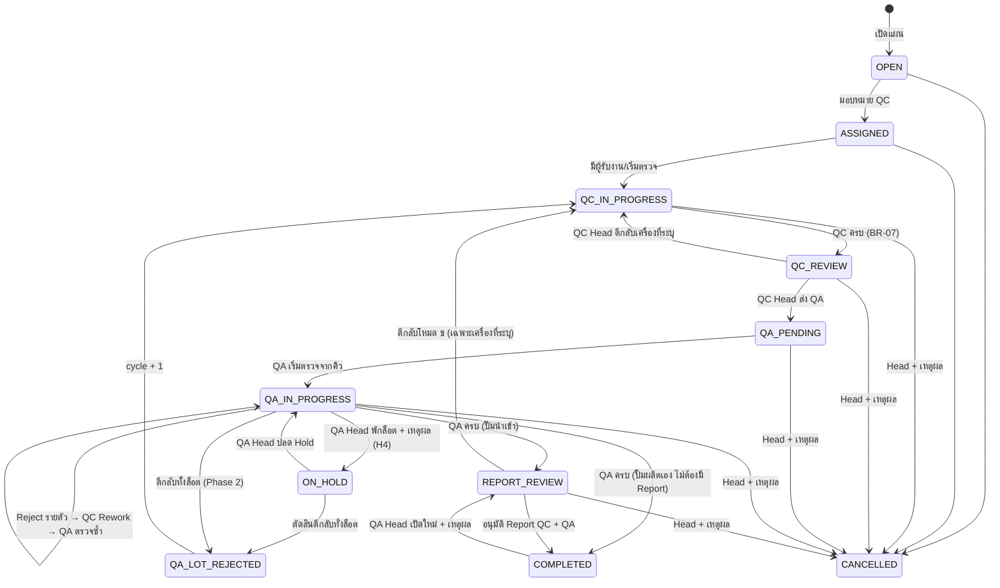
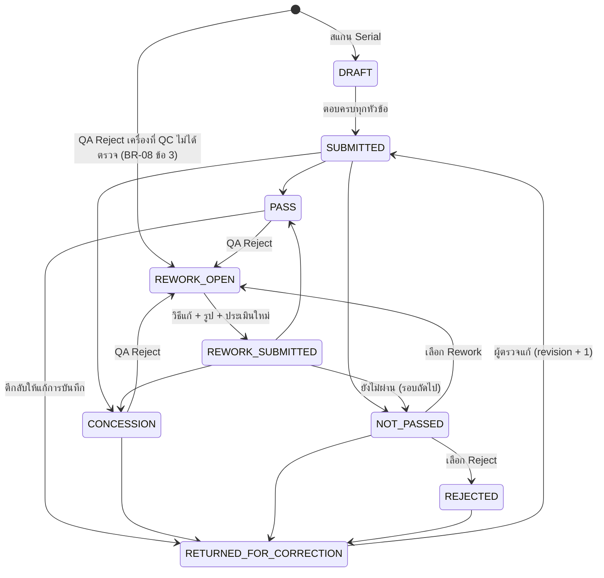
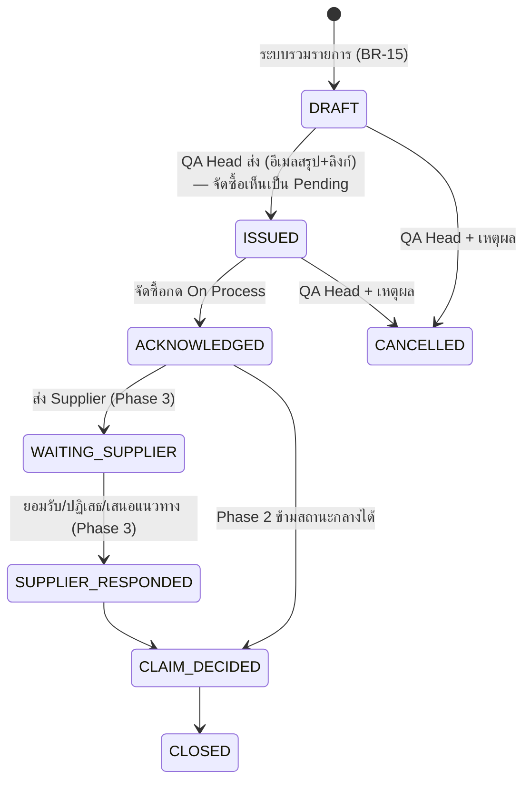
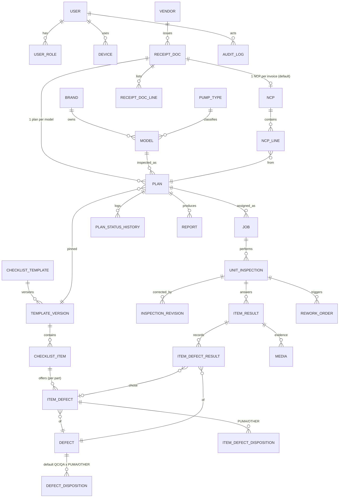

# 03 — Business Rules, State Machines & Data Model

> Draft v0.2 · 16 ต.ค. 2026 (v0.3 19 ต.ค. 2026: `users`/`user_roles` เป็นข้อมูลที่ sync จากระบบกลาง TRW — DEC-09) · ⚙️ = ตั้งค่าได้ในระบบ · ❓ = รอยืนยัน (ดูรหัสคำถามใน [06-open-questions.md](06-open-questions.md))
> เลขเวลา `[A mm:ss]` / `[B h:mm:ss]` = ตำแหน่งในไฟล์ถอดเสียงประชุม

---

## 0. แนวคิดหลักของข้อมูล (อ่านก่อน)

```
เอกสารรับเข้า (Invoice / PO)  ── 1 : n ──  แผนตรวจ (1 Model ต่อแผน)  ── 1 : n ──  ผลตรวจรายเครื่อง (Serial)
        │                                         │                                   │
        └── NCP (ค่าตั้งต้น 1 ใบต่อ Invoice)      ├── ใบงาน QC (มอบหมาย)               ├── รอบ (round) = ตรวจครั้งแรก / Rework
                                                  └── คิว QA (ไม่มีใบงานแยก)            └── ฉบับแก้ไข (revision) = แก้การบันทึกผิด
```
- **รอบ (round)** กับ **ฉบับแก้ไข (revision)** เป็นคนละเรื่อง: รอบ = ตรวจซ้ำหลังซ่อม (ข้อมูลรอบก่อนห้ามแก้) · ฉบับแก้ไข = แก้ข้อมูลที่บันทึกผิดในรอบเดิม (เช่น ติ๊ก "สนิม" แต่จริงคือ "สีไม่ผ่าน") โดยหัวหน้าหรือผู้ตรวจเมื่อถูกตีกลับ
- **รอบตรวจของล็อต (cycle)** เพิ่มขึ้นเมื่อ QA ตีกลับทั้งล็อต (Phase 2)
- **แบรนด์ PUMA (brand_group) ≠ ปั๊มผลิตเอง (origin = DOMESTIC)** — กฎ Disposition ใช้ brand_group; กฎ 10%/AQL ตั้งต้น/Report/NCP ใช้ origin (ปั๊มแบรนด์ PUMA อาจนำเข้าจาก OEM ❓ A16) `[A 10:48]` `[A 21:02]`

---

## 1. Business Rules

### BR-01 เอกสารรับเข้าและการกันแผนซ้ำ
- **เอกสารรับเข้า** = Invoice (ปั๊มนำเข้า) หรือ PO (ปั๊มผลิตเอง) — คีย์ไม่ซ้ำ = **(ประเภทเอกสาร, เลขเอกสารที่ normalize แล้ว)** (เดิมรวม Vendor — เปลี่ยน 23 ต.ค. 2026, `db/013`) `[B 00:15:01]` `[B 00:16:34]`
- **Vendor เป็นของหัวเอกสาร และไม่บังคับตอนเปิดแผน** (ผู้ใช้ 23 ต.ค.): คลังแจ้งหัวหน้า QC ทีหลัง → กรอก/แก้ได้ที่หน้าแผนทุกเมื่อ (ยกเว้นแผนที่ยกเลิก) · ทุกแผนและใบงานของเอกสารนั้นใช้ Vendor เดียวกันและเปลี่ยนตามทันที · บันทึก audit `plan.vendor` (ก่อน → หลัง) · ผลข้างเคียง: Vendor 2 รายที่ใช้เลข Invoice เดียวกันเปิดแยกเอกสารไม่ได้
- **แผนตรวจ** ไม่ซ้ำภายในเอกสารรับเข้าเดียวกัน: unique **(เอกสารรับเข้า, Model)** ไม่นับแผนที่ยกเลิก `[A 00:40]` `[B 00:13:51]`
- normalize = ตัดช่องว่างหัวท้าย, ตัวพิมพ์ใหญ่, รวมช่องว่างซ้ำ
- แผนเปิดได้ครั้งเดียว แต่ตรวจภายใต้แผนนั้นได้หลายวัน (ของทยอยเข้า) `[B 00:14:22]`
- เปิดแผนแรกของ Invoice → กรอกหัว Invoice (วันที่ Invoice, Vendor, จำนวน SKU/Model ทั้งหมดใน Invoice หรือรายการ Model) — แผนถัดไปของ Invoice เดียวกันดึงหัวมาแสดงแบบอ่านอย่างเดียว `[A 25:01]` `[A 32:54]`

### BR-02 จำนวนที่ QC ต้องตรวจ
```
ถ้า lot_qty ≤ 30 : qc_required = min( lot_qty , 3 )                       -- ฟิก 3 ตัว (ล็อต 1–2 ตัวตรวจทุกตัว)   [ผู้ใช้ 28 ต.ค.]
ถ้า lot_qty ≥ 31 : qc_required = min( lot_qty , CEILING( lot_qty × qc_percent / 100 ) )   -- เช่น 31 × 10% = 3.1 → 4
qc_percent ⚙️ ค่าตั้งต้น 10 — แก้ได้ที่หน้า Master (Admin) พร้อมประวัติ; แผนผูกค่า % ณ วันเปิดแผน (`plans.qc_percent`) [C 04:42]
```
**Need ต่อใบงาน (Meeting D 21 ต.ค. — แทนสูตร Meeting C) [D 15:22] [D 06:43]**:
```
need_wo = MAX( 0 , qc_required − qc_done_ก่อนหน้า )          -- เป้า 10% ของ "ล็อต" ลบ True สะสม; ไม่ขึ้นกับจำนวนที่เรียก
called_qty ต้อง ≥ need_wo และ ≤ ยอดล็อตที่ยังไม่เคยเรียก (ผิด → เตือนแดง บันทึกไม่ได้)         [D 05:12] [D 14:30]
True (qc_done) = จำนวน Serial ไม่ซ้ำในแผนที่ผู้ตรวจ "กดส่ง" แล้ว (ข้ามใบงานนับ 1)             [D 01:35]
ตรวจจริง ≥ need_wo ไม่จำกัดด้านบน; ยอดสะสมครบ qc_required แล้วใบถัดไป need = 0
ประเภทใบงาน (ระบบเลือกเอง): QC ถ้า qc_done < qc_required ก่อนเปิดใบ, มิฉะนั้น CALLIN_FIX "เรียกเข้าแก้ไข" (need = 0)
เปิดใบงานได้ 1 ใบ/แผน/วันที่เรียกเข้า (ใบที่ยกเลิกไม่นับ); ใบก่อนหน้าที่ยังไม่ตรวจไม่บล็อกการเปิดใบใหม่ (ผู้ใช้ 21 ต.ค.)
เมื่อ qc_done ≥ qc_required และ เรียกสะสม = lot_qty: ใบงาน QC ที่เปิดอยู่และ True = 0 → FAILED "ไม่สำเร็จ" อัตโนมัติ (ใบเรียกเข้าแก้ไข Need 0 ไม่เข้าเกณฑ์) ไม่นำไปคำนวณใดๆ เก็บเป็นประวัติ; called_qty ของใบนั้นยังนับในยอดเรียกสะสม (ของเข้ามาจริง)   [D 24:14]
```
ตัวอย่างล็อต 500 (qc_required 50): เรียก 200 → need 50 (เรียกน้อยกว่า 50 ไม่ได้) · ตรวจ 30 → ใบถัดไป need 20 · ตรวจรวมครบ 50 → need 0
- ปัดขึ้นเสมอ `[B 01:02:29]` · ตัวอย่าง: 350→35, 80→8, 81→9, 5→1
- คำนวณแบบ real-time ขณะกรอกฟอร์ม (ไม่ต้องบันทึกก่อน) `[B 01:18:35]`
- ❓ A16/B1: ปั๊มที่ต้องตรวจ 100% — ในแอปบันทึก 10% ส่วนที่เหลือตรวจบนกระดาษ `[B 00:55:28]`; มีช่องตัวเลข "ตรวจกระดาษแล้ว (ตัว)" แบบไม่บังคับ

### BR-02a ยกระดับการตรวจเมื่อพบปัญหาในตัวอย่าง 10%
- มีเครื่อง QC ผล **NOT_PASSED** อย่างน้อย 1 เครื่อง → แผนติดธง **"พบปัญหาในตัวอย่าง — ต้องเรียกตรวจส่วนที่เหลือ"** + แจ้ง QC Head ในแอปทันที `[B 00:55:28]`
- QC Head เลือก: ขยายทั้งล็อต (ค่าตั้งต้น = lot_qty) / ขยายบางส่วน / ไม่ขยาย (ต้องใส่เหตุผล)
- จำนวนที่ขยายนับเป็น **"ต้องตรวจ"** (ไม่นับเป็น "ตรวจเกิน") ใน BR-12/KPI
- ❓ B2: อาการอนุโลมนับเป็น "พบปัญหา" หรือไม่ (ตั้งต้น: ไม่นับ)

### BR-03 จำนวนที่ QA ต้องตรวจ (AQL)
```
code, sample_size = AQL_TABLE.lookup(level, lot_qty)     -- lot_qty อยู่ในช่วง [lot_min, lot_max]
qa_required        = min( sample_size , lot_qty )
level ค่าตั้งต้น ⚙️: ปั๊มนำเข้า = ผ่อนคลาย (Reduced), ปั๊มผลิตเอง = ปกติ (Normal)  [B 01:05:55]
                    (override ค่าตั้งต้นราย Brand/Model ได้ [B 01:09:07])
```
- `lot_qty` = จำนวนตาม Invoice/PO ที่กรอกตอนเปิดแผน (ทั้งล็อต ไม่ใช่จำนวนที่ QC คัด) `[B 01:00:37]` `[B 01:03:35]`
- ระดับ AQL **ไม่ใช่ค่าตายตัวใน Master** — เป็นดุลพินิจรายแผนของ QA Head; Master เก็บแค่ค่าตั้งต้น `[B 01:12:35]` `[B 01:03:58]`
- QA Head เปลี่ยนระดับได้จนกว่า QA ปิดงาน → คำนวณใหม่ทันที + เก็บประวัติ (จาก→เป็น, จำนวนเดิม→ใหม่, เหตุผล, ผู้เปลี่ยน, เวลา) — ตัวอย่างเหตุผล: พบถังรั่วที่รอยเชื่อม 5 ตัว ≈ 12% ของล็อต จึงเปลี่ยนเป็นเคร่งครัด `[B 01:04:27]` `[B 01:14:06]`
- ตรวจไปแล้วเกินจำนวนใหม่ ไม่ต้องลบ
- QC Head (ผู้เปิดแผน) **เห็นระดับและจำนวน QA แบบอ่านอย่างเดียว** — แก้ได้เฉพาะ QA Head
- ตัวอย่างจากประชุม: ล็อต 350 ตัว → ผ่อนคลาย 20 / ปกติ 50 `[B 01:13:04]` (ตรงกับ ISO 2859-1 General Inspection Level II code H) **แต่บางตัวอย่างในประชุมไม่ตรงมาตรฐาน** (เช่น ล็อต 100 เคร่งครัด = 13, ล็อต 1–8 เคร่งครัด = 8) → ระบบเก็บตาราง AQL เป็นข้อมูลที่ QA นำเข้าเอง ไม่ hard-code ❓ C1
- ❓ C2: ใช้ค่า Ac/Re ตัดสินล็อตอัตโนมัติหรือไม่ — ตั้งต้น **ไม่ใช้** (QA ตัดสินเอง) แต่เก็บช่องไว้
- Phase 2: แสดงตัวช่วยตัดสินใจ "สัดส่วน Defect ใน QC = x%" ข้างช่องระดับ (ยังไม่เปลี่ยนอัตโนมัติ จนกว่ามีเกณฑ์ ❓ C4) `[B 01:07:45]`

### BR-04 คำนวณผลรายเครื่อง
```
อาการที่ผู้ตรวจเลือก = ลิงก์ l = item_defects[หัวข้อ, อาการ d, ชิ้นส่วน]                  -- DEC-14
Disposition:  disp(l) = item_defect_dispositions[l, brand_group(model.brand)]     -- role มาจาก Checklist (checklist_templates.role)  [A 10:48]
ความรุนแรง:   sev(l)  = l.severity
  disp ∈ { CONCESSION (อนุโลม), REWORK, REJECT, CHOOSE (ผู้ตรวจเลือก Rework/Reject) }
  ตัวเลือกอาการของหัวข้อ = ลิงก์ที่ item_defects.is_active = 1 และมีแถว Disposition ของกลุ่มยี่ห้อนั้นที่ is_active = 1

สำหรับหัวข้อชนิด ปกติ/ไม่ผ่าน: ถ้า "ไม่ผ่าน" ต้องเลือก defect ≥ 1 (เลือกได้หลายอาการ)  [B 00:31:46] [B 01:51:03]

ผลเครื่อง =
  PASS        ถ้า ไม่มีหัวข้อไม่ผ่าน
  CONCESSION  ถ้า มีหัวข้อไม่ผ่าน และ ทุก defect มี disp = CONCESSION                 [A 14:18] [B 00:44:43]
  NOT_PASSED  ถ้า มี defect อย่างน้อย 1 ตัวที่ disp ∈ {REWORK, REJECT, CHOOSE}
```
- ค่าที่ใช้ตัดสินอยู่ที่ลิงก์ หัวข้อ × อาการ × ชิ้นส่วน (**DEC-14**, `db/014`) เพราะไฟล์อาการของ QA (Piston / Oil-free / Rotary) ให้อาการชื่อเดียวกันมีความรุนแรงและ Disposition ต่างกันตามชนิดปั๊มและชิ้นส่วน (เช่น Piston `การ์ดป้องกันชำรุด` = Rework แต่ `ถังชำรุด` = Reject) · `defects.severity` และ `defect_dispositions` เป็น**ค่าตั้งต้น**ที่ copy ไปตอนผูกอาการเข้าหัวข้อ ไม่ใช้ตัดสินผล
- ผลไม่คิดเป็นเปอร์เซ็นต์ — ตัดสินจากชนิด Disposition เท่านั้น `[B 00:44:43]`
- อนุโลม = Defect ที่ PM/การตลาดอนุมัติไว้ล่วงหน้า (เก็บผู้อนุมัติ/วันที่ที่ `item_defect_dispositions`) จึงไม่ต้องกดยืนยันซ้ำ `[B 00:44:08]`
- **QC + NOT_PASSED** → ผู้ตรวจเลือก **Rework** (แก้ได้) หรือ **Reject** (แก้ไม่ได้ เช่น ไม่มีอะไหล่) `[A 14:18]` `[B 01:25:43]`
  - ระบบเสนอ: มี disp = REJECT → เสนอ Reject; มี REWORK → เสนอ Rework; มีแต่ CHOOSE → ไม่เสนอ (ปัจจุบันอาการส่วนใหญ่ฝั่ง QC เป็นแบบนี้ `[A 12:27]`)
  - Defect ที่ Severity (`sev(l)` ของลิงก์) = **Critical** (กระทบการใช้งาน) และ disp = REJECT → **บังคับ Reject** เปลี่ยนเป็น Rework ได้เฉพาะ QC Head + เหตุผล ❓ B5 `[A 53:19]` (ขัดกับตัวอย่าง `[A 08:55]` ที่ Reject ถูกแก้ได้ — รอยืนยัน)
  - เลือกต่างจากที่เสนอ → บันทึกไว้
- **QA + NOT_PASSED** → ผลคือ **QA Reject** เท่านั้น (QA ไม่สั่ง Rework) `[A 12:12]` `[A 13:50]`
- CONCESSION นับเป็น "ผ่าน" ในการปิดแผน แต่แสดงแยกใน Report
- หัวข้อชนิด ตัวเลข/ข้อความ/ตัวเลือก เป็นข้อมูลประกอบ **ไม่มีผลต่อผลเครื่องใน Phase 1** จนกว่าจะกำหนดเกณฑ์ (min/max/หน่วย) ❓ B14
- ตัวเลือก "อาการอื่นๆ (รอจัดหมวด)" **ปิดเป็นค่าตั้งต้น** ⚙️ (ข้อเสนอของทีมพัฒนา ไม่ได้มาจากประชุม — ขัดเป้าหมายชื่ออาการมาตรฐาน) ❓ B6; ถ้าเปิด จะถือเป็น NOT_PASSED และหัวหน้าต้องจัดหมวดก่อนอนุมัติ Report

### BR-05 กติกาหลักฐาน (รูป/วิดีโอ)
| สถานการณ์ | รูป | วิดีโอ |
|---|---|---|
| หัวข้อ "ปกติ" | ไม่บังคับ `[B 00:31:33]` | บังคับ ถ้าหัวข้อตั้ง `video_rule = ALWAYS` (เช่น เดินสายพาน, ทดสอบรั่ว — หลักฐานสภาพสินค้าก่อนออกจากบริษัท) `[B 00:35:15]` `[B 00:41:18]` |
| หัวข้อ "ไม่ผ่าน" | **บังคับ ≥ 1 รูปต่อหัวข้อ** ถ่ายจากกล้องในแอปเท่านั้น `[B 00:31:54]` `[B 01:38:12]` | บังคับ ถ้าหัวข้อตั้ง `ON_FAIL`/`ALWAYS` หรือมี defect ที่ตั้ง `requires_video` (เช่น ลมรั่ว) `[B 00:31:59]` |
| ปิด Rework | **บังคับรูปหลังแก้ ≥ 1 รูปต่อหัวข้อ** `[B 00:47:25]` | ตามกติกาเดียวกัน |
| QA Reject | บังคับ ≥ 1 รูป | ตามกติกาเดียวกัน |
| บันทึกย้อนหลังจากกระดาษ (FR-QC-17) | อัปโหลดจากไฟล์ได้ (เฉพาะผู้มีสิทธิ์) ติดป้าย "บันทึกย้อนหลัง" | เช่นเดียวกัน |
- รูปย่อในเครื่องก่อนอัปโหลด (ด้านยาว ≤ 1600 px, JPEG ~80%) ⚙️ · วิดีโอ ≤ 20 วินาที, ~2 Mbps (≈ 5 MB) ⚙️
- **BR-05a ตรวจรูปซ้ำ**: คำนวณ perceptual hash บนเครื่อง **ก่อนใส่ลายน้ำ** แล้วส่งเป็น metadata; ค่าใกล้กันมากกับรูปของเครื่องอื่นในแผนเดียวกัน → เตือนผู้ตรวจ + ติดธงให้หัวหน้า `[B 01:38:12]` (sha256 ใช้กันอัปโหลดไฟล์ซ้ำเท่านั้น)

### BR-06 ขอบเขต Rework (รอบ)
- ใบ Rework มีเฉพาะ **หัวข้อที่มี defect disp ∈ {REWORK, REJECT, CHOOSE}** ของรอบล่าสุด (ไม่ใช่ทั้ง Checklist) `[B 00:09:00]` `[B 00:47:11]`
- ระหว่างรอซ่อม ระบบรอ — ไม่ต้องทำอะไรในระบบจนกว่าจะกลับมาตรวจ `[B 00:48:57]`
- ปิดใบ Rework: ต่อ defect ต้องเลือก **วิธีแก้** (เปลี่ยน / ซ่อม-ปรับแต่ง / พ่นสี / อื่นๆ ⚙️) + รูปหลังแก้ + ประเมินหัวข้อนั้นใหม่ `[B 01:22:24]`
- รอบใหม่ = round_no + 1; **ข้อมูลรอบเดิมห้ามแก้โดยผู้ตรวจ** (ใช้ทำ Report และตรวจย้อนหลังว่าแก้จริงไหมเมื่อ QA/ลูกค้ายังพบปัญหา) `[B 00:48:24]` `[B 00:48:42]`
- ประเมินแล้วยังไม่ผ่าน → Rework รอบถัดไป หรือ Reject

### BR-06a การแก้ข้อมูลที่บันทึกผิด (Correction) ≠ Rework
- **revision_no** = ฉบับแก้ไขของรอบเดียวกัน ใช้แก้ความผิดพลาดในการบันทึก (ชื่ออาการผิด, เลือกหัวข้อผิด) `[B 01:50:27]` `[B 01:33:38]`
  - โหมด (ก) หัวหน้าแก้เองระหว่างตรวจทาน · โหมด (ข) ผู้ตรวจแก้เมื่อถูกตีกลับ (FR-RPT-05)
  - เก็บค่าเดิม, ผู้แก้, เหตุผล, เวลา — ทุกครั้ง
- **"ผลที่พบครั้งแรก"** (BR-14) = **round 1, revision ล่าสุด** — Report, drill-down, NCP, Dashboard อ่านข้อมูลชุดเดียวกันนี้ (ห้ามแก้เฉพาะใน snapshot ของ Report)
- แก้แล้วคำนวณผลรอบนั้นใหม่ตาม BR-04 และสร้างร่าง Report ใหม่; ถ้าการแก้ทำให้ Rework รอบถัดไปไม่จำเป็น → ติดธงให้หัวหน้าตัดสิน
- รูปแก้ไม่ได้ (เพิ่มรูปได้ ลบไม่ได้)

### BR-07 เงื่อนไขปิดงาน QC ของแผน
```
qc_done = จำนวน Serial (บทบาท QC, cycle ปัจจุบัน) ที่ผลสุดท้าย ∈ {PASS, CONCESSION, REJECTED}
ส่งต่อ (QC Head ตรวจทาน → QA) ได้เมื่อ:
  qc_done ≥ qc_required  และ  ไม่มีเครื่องที่ NOT_PASSED / Rework ค้าง  และ  ใบงาน QC ทุกใบ "ส่งแล้ว"
```
- ใบงานส่งได้เมื่อ ตรวจครบจำนวนที่ได้รับมอบหมาย และไม่มี Rework ค้างในใบงานนั้น `[B 01:23:38]`
- เครื่อง QC Reject นับเป็นตรวจแล้ว (ผ่าน 9 / Reject 1 = ครบ 10) และอยู่ในประวัติ ไม่ต้องมีขั้นตอนต่อ `[B 00:46:22]` `[B 01:27:09]`
- `qc_done < qc_required` (ของเข้าไม่ครบ ฯลฯ) → QC Head **บังคับปิด** ได้พร้อมเหตุผล → นับเป็น "ตรวจขาด" ใน KPI (ยกเว้นติ๊ก "รอของ") `[B 02:05:11]` `[B 02:04:10]`

### BR-08 วงจร QA Reject รายตัว
1. QA Reject เครื่อง S → สร้างใบ Rework (source = QA, อาการ = ที่ QA เลือก ไม่ต้องพิมพ์เหตุผล) `[B 01:30:07]` `[B 01:30:31]`
2. **ผู้รับใบ Rework (กติกาเดียวทั้งระบบ)**: QC ผู้ตรวจเครื่อง S ในรอบล่าสุด → ถ้าไม่มี (QA สุ่มเครื่องที่ QC ไม่ได้ตรวจ) หรือผู้นั้นถูกปิดใช้งาน → **QC ผู้รับผิดชอบหลักของแผน** · ผู้รับแจ้งเตือน = ผู้รับใบ Rework + QC Head (สำเนา)
3. ถ้าเครื่อง S **ไม่มีผล QC** → ระบบสร้างผลตรวจบทบาท QC ชนิด "Rework จาก QA" ที่มีเฉพาะหัวข้อที่ QA พบ — **ไม่นับใน qc_required / qc_done / ตรวจเกิน** และแสดงใน Report QC หัวข้อ "พบโดย QA" `[B 00:54:51]`
4. QC แก้เฉพาะหัวข้อนั้น + วิธีแก้ + รูป → สถานะ "รอ QA ตรวจซ้ำ" → QA ตรวจซ้ำ (ไม่ผ่าน QC Head ตรวจทานอีก) วนจนผ่าน `[B 01:24:52]`
5. ส่งเครื่องอื่นในล็อตมาแทน → QA สแกน Serial ใหม่และผูกกับใบ Rework เดิม `[A 14:12]`
6. QC แก้ไม่ได้ → QC Reject เครื่อง S → ผล QA ของ S = **QA_REPLACED** (ไม่ถือเป็น "Reject ค้าง") และ QA ต้องสุ่มเครื่องอื่นแทนให้ครบ `qa_required` ❓ C5
- QA ปิดงานได้เมื่อ เครื่องที่ผล QA ∈ {PASS, CONCESSION} ≥ `qa_required` และไม่มีเครื่องรอตรวจซ้ำ

### BR-09 QA Reject ทั้งล็อต (Phase 2)
- QA Head กด "ตีกลับทั้งล็อต" + เหตุผล → `inspection_cycle + 1`, สถานะแผน = QA_LOT_REJECTED → QC Head **ต้องกำหนด** qc_required ของ cycle ใหม่ (เช่น 100%) → QC ตรวจใหม่ (Serial เดิมตรวจซ้ำได้เพราะเป็น cycle ใหม่) → QA สุ่มใหม่ `[B 00:00:59]` `[B 01:21:29]`
- ผล cycle เดิมเก็บไว้ แสดงใน Report หัวข้อ "ก่อนตีกลับทั้งล็อต" ❓ C6

### BR-10 รูปแบบเลขเอกสาร ⚙️
| เอกสาร | รูปแบบตั้งต้น | ตัวอย่าง | รีเซ็ต | ที่มา |
|---|---|---|---|---|
| แผนตรวจ | `QP-YYMM-NNNN` ✅ D15 | QP-2610-0001 | รายเดือน (ตาราง `doc_counters` — db/009) | ประชุมบอกแค่ "รันอัตโนมัติ" `[B 00:23:35]` · ผู้ใช้ยืนยัน 20 ต.ค. |
| ใบงาน | `<เลขแผน>-<ครั้งที่>` ✅ | QP-2610-0001-1, QP-2610-0001-2 | ต่อแผน | `[C 06:43]` · ผู้ใช้ยืนยัน 20 ต.ค. |
| NCP | `NCP-YYMM-NNN` (3 หลัก) ❓ D6 | NCP-2610-001 | รายเดือน | `[B 02:02:28]` `[B 02:02:47]` (มีพูดทั้ง "ปีเดือน" และ "ปีเดือนวัน" `[B 02:02:30]`) |
| ใบ Rework | `RW-YYMM-NNNN` (ข้อเสนอ ❓ D15) | RW-2610-0007 | รายเดือน | — |
- เลขรันออกโดย server ใน transaction (ไม่ซ้ำแม้กดพร้อมกัน); ใบ Rework ที่สร้างตอนออฟไลน์แสดง "RW-รอเลข" จนซิงค์
- **Invoice / PO ไม่รันให้** — เป็นเลขจาก Supplier/โรงงาน กรอกหรือสแกน `[B 00:15:01]` `[B 00:16:34]`

### BR-11 กำหนดตรวจ 90 วันต่อ Invoice
```
qc_deadline = invoice_date + invoice_qc_deadline_days ⚙️(90)        -- ใช้กับปั๊มนำเข้า
แสดงตั้งแต่ Phase 1 (นับถอยหลังในรายการแผน/หน้า Invoice) · แจ้งเตือนเมื่อเหลือ 14 และ 7 วัน ⚙️ (Phase 2–3) · เลยกำหนด = ติดธงแดง
```
- เป็น **กำหนดให้ QC ตรวจทุก SKU ของ Invoice ให้จบ** (ไม่ใช่อายุเคลม) — ห้ามเลื่อน, ถ้าเลื่อนแผนต้องอยู่ภายในกำหนดนี้ `[A 22:15]` `[A 31:51]` `[A 32:54]`
- ที่ประชุม A พิจารณาทางเลือก credit term 60 วัน / วันที่ของถึงคลัง แล้วสรุปที่ 90 วันหลังวันที่ Invoice `[A 30:03]` `[A 31:31]` — ❓ D10 ยืนยันเป็นระเบียบบริษัท

### BR-12 สถานะความคืบหน้าและสี (ใช้ทำ KPI) `[B 00:21:13]`
- **"ตรวจแล้ว"** = จำนวน Serial บทบาท QC ใน cycle ปัจจุบันที่ผลสุดท้าย ∈ {PASS, CONCESSION, REJECTED}
- **"ต้องตรวจ"** = qc_required (รวมจำนวนที่ยกระดับตาม BR-02a)

| ความคืบหน้า | เงื่อนไข | สีตาม Sheet ปัจจุบัน | token |
|---|---|---|---|
| ยังไม่เริ่ม | ตรวจแล้ว = 0 | ขาว | `status-not-started` |
| กำลังดำเนินการ | 0 < ตรวจแล้ว < ต้องตรวจ **หรือ** มี Rework ค้าง (มาก่อนเสมอ) | ส้ม | `status-in-progress` |
| ตรวจครบ-รอปิด | ตรวจแล้ว ≥ ต้องตรวจ แต่แผนยังไม่ COMPLETED | — | `status-awaiting-close` |
| เสร็จ | COMPLETED และ ตรวจแล้ว = ต้องตรวจ | เทา | `status-done` |
| ตรวจเกิน | COMPLETED และ ตรวจแล้ว > ต้องตรวจ (ประเมินหลังปิดเท่านั้น) | เขียว | `status-over` |
| ตรวจขาด / ลืม | บังคับปิด (ตรวจ < ต้องตรวจ) / เลย `due_at` ยังไม่เริ่ม | แดง (เฉพาะ KPI) | `status-under` |
- คำนวณทั้ง **ระดับแผน** และ **ระดับใบงาน** (เทียบ `qty_assigned` ของแต่ละคน) สำหรับ KPI ผู้ตรวจ `[B 00:21:13]`
- ใบงาน/แผนที่หัวหน้าติ๊ก **"รอของ"** ไม่นับเป็นขาด/ลืม `[B 02:04:10]`
- `due_at` = opened_at + N วัน ⚙️ ❓ E6
- สีจริงกำหนดตอนคุยธีม — ที่นี่กำหนดแค่สถานะที่ต้องแยกให้เห็น

### BR-13 การล็อก การแก้ไข และการยกเลิก
- ผลรายเครื่องที่ "ส่งแล้ว" ล็อกไว้ที่ผู้ตรวจ — คนอื่นดูได้ แก้ไม่ได้ `[B 00:42:12]` — เปลี่ยนได้ทาง Rework (BR-06) หรือ Correction (BR-06a) เท่านั้น
- แผนที่มีผลตรวจแล้ว **เปลี่ยน Model ไม่ได้** → ต้องยกเลิกแผนแล้วเปิดใหม่
- **ยกเลิกแผน**: ก่อนมีผลตรวจ = ผู้เปิดแผน; หลังมีผลตรวจ = QC/QA Head + เหตุผล → ผลตรวจ/รูปเก็บแบบอ่านอย่างเดียว ไม่นับใน KPI/Dashboard, ใบงาน/ใบ Rework ถูกยกเลิก, ข้อมูลที่ซิงค์เข้ามาภายหลังถูกปฏิเสธพร้อมแจ้งผู้ตรวจ (ข้อมูลยังเก็บในคิวขัดแย้ง)
- Report ที่อนุมัติแล้วแก้ไม่ได้; QA Head เปิดใหม่ได้ + เหตุผล → แผนกลับ REPORT_REVIEW, Report เวอร์ชันใหม่, ถ้ามี NCP แล้วต้องออก NCP revision

### BR-14 การสร้าง Report และ SLA
- **ปั๊มนำเข้า**: ร่าง Report QC สร้างเมื่อแผนเข้า QC_REVIEW; ร่าง Report QA สร้างเมื่อ QA ปิดงาน `[B 01:31:37]`
- **ปั๊มผลิตเอง**: ⚙️ `report_required_by_origin.DOMESTIC = false` — ไม่ออก Report/NCP (ซ่อมที่หน้างาน) แต่ผลยังเข้า Status board/Dashboard/KPI `[B 01:58:26]` `[B 01:58:46]` ❓ D8
- สถิติ Defect ใช้ **ผลที่พบครั้งแรก** (BR-06a) และแสดงวิธีแก้ประกอบ `[B 01:32:37]` `[B 01:33:06]`
- `% อาการ = จำนวนเครื่องที่พบอาการนั้น ÷ จำนวนเครื่องที่ตรวจ (บทบาทนั้น) × 100` — นับเป็นจำนวน Defect ไม่ใช่ "เคส" `[A 46:41]`
- รูปตัวอย่างต่ออาการ: สูงสุด 3 รูป ⚙️ (หัวหน้าเปลี่ยนรูปที่แสดงได้)
- Rework ที่เกิดจาก QA Reject หลัง Report QC ร่างแล้ว ไม่เปลี่ยน "ผลที่พบครั้งแรก" ของ QC แต่แสดงใน Report QA หัวข้อ "Rework จาก QA"
- **SLA**: Report QC ต้องอนุมัติภายใน **7 วัน** (กำหนดปัจจุบัน) `[B 01:47:37]` ❓ D14 นับจากอะไร — ใช้เฉพาะปั๊มนำเข้า, แสดงอายุ Report ที่ยังไม่อนุมัติ และใช้ใน KPI

### BR-15 การออก NCP (Phase 2)
- เฉพาะ **ปั๊มนำเข้า** ที่มีรายการเข้า NCP อย่างน้อย 1 รายการ
- **การรวม ⚙️ ค่าตั้งต้น 1 NCP ต่อ 1 Invoice** รวมทุกแผน (SKU) — ข้อเสนอฝ่ายจัดซื้อเพื่อให้หักเงินจบในใบลดหนี้ใบเดียวต่อ Invoice `[A 22:15]` `[A 47:08]` แต่ในประชุมยังมีเสนอรวมตาม item/lot `[A 47:46]` → ตั้งค่าได้: ต่อ Invoice / ต่อแผน ❓ D4
- **ออกได้เมื่อ** (ก) จำนวนแผน = จำนวน SKU ของ Invoice หรือหัวหน้ายืนยัน "เปิดแผนครบทุก SKU แล้ว" **และ** (ข) Report ทุกแผนอนุมัติแล้ว — ไม่ครบ ออกก่อนได้โดย QA Head + เหตุผล (NCP ระบุแผนที่ยังไม่รวม) → แผนที่เสร็จทีหลังเพิ่มเป็น **revision** (ห้ามเพิ่มเมื่อ CLAIM_DECIDED แล้ว ❓ D5)
- **รายการที่ดึงเข้า NCP** = Defect ที่พบครั้งแรก ของแผนใน Invoice ที่ `is_claimable = true` และ `cause_tag ∉ {TRANSPORT, INTERNAL}`; QA Head ติ๊กเพิ่ม/ตัดออกได้พร้อมเหตุผล `[A 23:59]` `[A 38:54]`
  - รายการที่ไม่เข้า NCP ยังอยู่ใน Report/Dashboard พร้อมค่าแรงคำนวณ เพื่อใช้ต่อรอง `[A 53:19]`
  - แม้ QC Rework เองได้ ก็ยังเข้า NCP ถ้าเข้าเกณฑ์ (Rework กับการเคลมเป็นคนละเรื่อง) `[A 23:59]`
  - อาการอนุโลม: ตั้งต้นไม่ดึง ❓ D7
- การเคลมต้องมีรูปประกอบ → NCP แนบรูปตัวอย่างทุกอาการ `[B 01:58:56]`

### BR-16 แจ้งเตือนแผนค้าง (Phase 2) ⚙️
- แบบ A (ตั้งต้น): ครบ **24 ชม. นับจากเวลาเปิดแผน** แล้วแผนยังไม่ COMPLETED → แจ้งผู้รับงาน + หัวหน้า และซ้ำทุก 24 ชม. `[B 01:28:42]`
- แบบ B: สรุปรายวันตามเวลาที่ตั้ง (เช่น 07:00) `[B 01:27:50]`
- ที่ประชุมยังไม่สรุป "จะคุยกันอีกรอบ" `[B 01:28:47]` ❓ E5 · ไม่แจ้งแผนที่ติ๊ก "รอของ"

### BR-17 อายุการเก็บข้อมูล ⚙️
| ข้อมูล | เก็บ | หลังครบกำหนด |
|---|---|---|
| ข้อความ/ตัวเลข/ประวัติ/Audit | ถาวร (≥ 5 ปี) ❓ F1 | — |
| รูป | ตั้งต้น **2 ปี นับจากวันที่ถ่าย (captured_at)** — ประชุมเสนอ "วันที่ QC บันทึก + 2 ปี" (2–3 ปี) `[B 00:33:56]` `[B 00:38:05]` | ระบบย้ายไป Archive อัตโนมัติ และ **ยังเปิดดูจากในแอปได้** (อาจช้ากว่า) `[B 00:33:19]` |
| วิดีโอ | ตั้งต้น 2 ปี ❓ F1 | ย้าย Archive หรือลบตามนโยบาย |
| PDF Report ที่อนุมัติ, NCP | ถาวร | — |
- เหตุผล: รับประกันสินค้า 1 ปีนับจากวันขาย และสินค้าอาจค้างสต็อกก่อนขาย `[B 00:33:21]`

### BR-18 Serial / QR
- Serial ไม่ซ้ำภายใน **(แผน, บทบาท, cycle)** — Rework ใช้ Serial เดิม
- Serial ซ้ำจาก 2 เครื่องที่ออฟไลน์พร้อมกัน → รายการที่ซิงค์ทีหลังเข้าคิว "ขัดแย้ง: Serial ซ้ำ" ให้หัวหน้าเลือก
- **QR รายเครื่องปั๊มผลิตเอง (ตัวอย่างจริง + ผู้ใช้ยืนยันความหมาย 22 ต.ค.)** — สติ๊กเกอร์มี QR 2 อัน ใช้ **อันขวา** (อันซ้ายเป็น URL เว็บ); ข้อมูล 8 ช่องคั่นด้วย `|`:
  `5x3 HP 260L. (PP-23P) + MOTOR …|FG1004-000675|WC:WMT-409|MODEL:PP-23P|FIC:FG-MT-00156|Date:2569/10/22|WO1274/69|SN69/00014-15`

  | ช่อง | ตัวอย่าง | ใช้เป็น |
  |---|---|---|
  | 1 | `5x3 HP 260L. (PP-23P) + MOTOR …` | Description |
  | 2 | `FG1004-000675` | Product ID (รหัสสินค้า FG) — อ่านได้แต่ยังไม่เก็บ (ผู้ใช้ 28 ต.ค.) |
  | 3 | `WC:WMT-409` | ผลิตภายใน — เก็บแค่ `MT-409` (ตัด `WC:W`) → แผนก 409 |
  | 4 | `MODEL:PP-23P` | Model (ต้องตรงกับ Model ของแผน) |
  | 5 | `FIC:FG-MT-00156` | ⚠️ ไม่ใช้ |
  | 6 | `Date:2569/10/22` | วันที่ผลิต (พ.ศ. → เก็บ ค.ศ.) → ฟอร์มใส่ช่อง "วันที่ PO" (ค่าตั้งต้น 28 ต.ค.; มีผลเมื่อเอกสารยังไม่มีในระบบ) |
  | 7 | `WO1274/69` | **เลขที่ผลิต → ใส่ช่องเลข Invoice/เอกสารของแผน** |
  | 8 | `SN69/00014-15` | Serial — ตัวเลขหลัง `-` บอกว่า WO นี้ผลิตกี่ตัว (15) ❓ A3b |

  **1 WO (ใบสั่งผลิต) = 1 Model** (ผู้ใช้ 22 ต.ค.) → ปั๊มผลิตเอง 1 WO = 1 แผนเสมอ (คีย์กันซ้ำ BR-01 เอกสาร+Model จึงเท่ากับ "WO ซ้ำ") — คนละความหมายกับ "ใบงาน" (work_orders) ของ QCheck ที่เป็นการเรียกเข้าแต่ละครั้ง
  **ทำแล้ว (28 ต.ค. 2026):** ตัวแปล `lib/plans/qr.ts` + ช่องสแกนในฟอร์มเปิดแผน `components/plans/PlanQrScan.tsx` (กล้องมือถือ `components/scan/CameraScanDialog.tsx` อย่างเดียว — ผู้ใช้ตัดช่องเครื่องยิง/วางออก 28 ต.ค.) · สแกนแล้วเขียนทับค่าที่พิมพ์ไว้ แก้ต่อได้ · ตรวจรูปแบบ WO แบบหลวม `^WO[A-Z0-9][A-Z0-9./-]{0,61}$` เผื่อสติ๊กเกอร์แผนก 408 (A3c)

  ใช้ 2 จุด: **เปิดแผน** สแกนเครื่องใดก็ได้ของ WO → เติมเลขเอกสาร (WO), Model, Description, แผนก และจำนวนล็อต (ถ้า A3b ยืนยัน); **ตรวจรายเครื่อง** สแกน → ได้ Serial ไม่ซ้ำต่อแผน และตรวจว่า WO/Model ตรงกับแผน ไม่ตรงห้ามบันทึก
- QR ปั๊มผลิตเอง: ตรวจรูปแบบ ⚙️ (regex) และตรวจว่า PO/Model/จำนวนตรงกับแผน → ไม่ตรงห้ามบันทึก `[B 00:16:36]` `[B 00:19:45]`
- QR/Barcode ของ Supplier ต่างประเทศ: parser ตามรูปแบบต่อ Vendor/Model ⚙️; รุ่นที่ไม่มีโค้ด → dropdown `[A 00:40]` `[A 01:50]` ❓ A3/A4
- วิธีกรอก Serial บันทึกเป็น `SCAN_CAMERA` / `SCAN_WEDGE` (เครื่องยิง — ตรวจจากความเร็วการพิมพ์) / `MANUAL`

### BR-19 วันเวลาและภาษา
- เขตเวลา Asia/Bangkok; เก็บเป็น UTC ในฐานข้อมูล
- แสดงวันที่ `dd/mm/yyyy` ❓ D15 (ค.ศ./พ.ศ.)

### BR-20 เวอร์ชัน Master ที่แผนใช้
- แผนผูก `qc_template_version_id` / `qa_template_version_id` ณ เวลาเปิดแผน — เวอร์ชันที่ Publish ใหม่มีผลกับ **แผนที่เปิดหลัง Publish** เท่านั้น; แผนที่ยังไม่มีผลตรวจ หัวหน้ากด "อัปเดตเป็นเวอร์ชันล่าสุด" ได้
- Disposition/Defect ที่ใช้ = snapshot ที่ดาวน์โหลดตอนรับงาน (`master_snapshot_id`) บันทึกใน `disposition_applied`; server คำนวณผลซ้ำด้วย snapshot เดียวกัน — ถ้าต่างจากในเครื่อง ใช้ผลในเครื่องและติดธง "Master เปลี่ยนระหว่างตรวจ"
- Import Template ซ้ำ = **สร้างเวอร์ชันใหม่เสมอ** (ห้ามเขียนทับ)

### BR-21 ค่าแรงคำนวณต่ออาการ (Phase 2, Should)
```
ค่าแรงต่อเครื่องต่ออาการ = ( Man-day ตามระดับ Complexity 1–4 ⚙️  +  Man-day เพิ่มตาม Severity ⚙️ ) × อัตราค่าแรง/Man-day ⚙️
ยอดรวมต่ออาการ = ค่าแรงต่อเครื่อง × จำนวนเครื่องที่พบ
ตัวอย่าง: งานสี 0.5 + Minor 0.25 = 0.75 man-day × 1,000 บาท = 750 บาท/ตัว   [A 49:30]
อัตราตั้งต้น 1,000 บาท/วัน (≈ 30,000 ÷ 30 วัน รวม OT) — ใช้อัตราตลาดช่าง ห้ามใช้ค่าแรงขั้นต่ำ   [A 51:26] [A 52:47]
```
- **ไม่เก็บเวลาทำงานจริง** — ใช้ค่ากลางตามเกณฑ์ `[A 51:06]` `[A 54:16]` (ข้อเสนอให้จับเวลา Rework `[A 54:50]` ถูกแย้ง — ไม่ทำจนกว่าผู้บริหารเปลี่ยนแนวทาง ❓ D12)

---

## 2. State Machines

### 2.1 แผนตรวจ (Plan)

- ทุกการเปลี่ยนสถานะบันทึกใน `plan_status_history` (ใช้วัด SLA/KPI/O2)
- ช่วง Pilot (R1.0 ยังไม่มีโมดูล QA): แผนตั้ง `qa_mode = EXTERNAL` → QC_REVIEW → "QC เสร็จ – QA นอกระบบ" (แสดงเป็น QA_PENDING ที่อ่านอย่างเดียว) จนกว่าจะเปิดใช้ R1.1 แล้วหัวหน้าแปลงเป็น `IN_APP` หรือปิดแผน

**ตารางจับคู่สถานะ (ใช้คำเดียวกันทั้งระบบ)**
| สถานะแผน | "สถานะ Checklist" ในรายการแผน (FR-PLAN-16) | ความคืบหน้า (BR-12) |
|---|---|---|
| OPEN, ASSIGNED | ยังไม่ตรวจ | ยังไม่เริ่ม |
| QC_IN_PROGRESS | กำลังตรวจ / มี Rework | กำลังดำเนินการ |
| QC_REVIEW | QC ครบ – รอหัวหน้าตรวจทาน | ตรวจครบ-รอปิด |
| QA_PENDING, QA_IN_PROGRESS | รอ QA / QA กำลังตรวจ (มี Rework จาก QA) | ตรวจครบ-รอปิด (ส้มถ้ามี Rework) |
| QA_LOT_REJECTED | QA ตีกลับทั้งล็อต | กำลังดำเนินการ |
| REPORT_REVIEW | รออนุมัติ Report | ตรวจครบ-รอปิด |
| COMPLETED | เสร็จ | เสร็จ / ตรวจเกิน / ตรวจขาด |
| CANCELLED | ยกเลิก | (ไม่นับ) |

**จับคู่กับชื่อสถานะในสไลด์ประชุม IT (แผ่น 17)** — PLAN CREATED = OPEN · WAITING FOR INSPECTION = ASSIGNED · IN PROGRESS = QC_IN_PROGRESS · INSPECTION COMPLETED = QC_REVIEW · WAITING QA REVIEW = QA_PENDING/QA_IN_PROGRESS · ห้าเส้นทางหลัง QA: ACCEPTED = REPORT_REVIEW→COMPLETED, REWORK = Rework จาก QA, **HOLD = ON_HOLD (ใหม่ ❓ H4)**, CLAIM = ออก NCP, REJECTED = QA_LOT_REJECTED/Reject · CLOSED = COMPLETED (หรือ NCP CLOSED) ❓ H4

**Escalate (สไลด์ 10 ❓ H3):** Re-inspection รอบที่ 2+ ไม่ผ่าน → QC ส่งกลับ Rework หรือ "Escalate" ให้ QA ตัดสิน (Rework ต่อ / Reject / Hold) เก็บประวัติทุกครั้ง; การให้ QA approve ก่อนปิดใบ Rework ทุกใบยังรอยืนยัน (H2 ตั้งต้น: เฉพาะ Escalate)

### 2.2 ผลตรวจรายเครื่อง (QC)


### 2.3 ผลตรวจรายเครื่อง (QA)
`DRAFT → SUBMITTED → {QA_PASS, QA_CONCESSION, QA_REJECTED}` · `QA_REJECTED → (QC Rework) → QA_RECHECK → {QA_PASS, QA_CONCESSION, QA_REJECTED}` · `QA_REJECTED → QA_REPLACED` (QC Reject เครื่องนั้น — QA สุ่มเครื่องอื่นแทน) · ผลใดๆ → `RETURNED_FOR_CORRECTION` (ตีกลับ)

### 2.4 ใบงาน QC (Work order — ลูกของแผน, 1 ใบงาน = การเรียกของเข้า 1 ครั้ง)
- เลขใบงาน `<เลขแผน>-<ครั้งที่>` (unique ต่อแผน) · มอบหมาย QC **อย่างน้อย 2 สูงสุด 5 คน รับผิดชอบร่วมกัน** · **ไม่ต้องกดรับงาน** — ใบงานขึ้นให้ผู้ที่ถูกเลือกทันที `[C 24:10]` `[C 24:36]`
- ไม่มีสถานะ WAITING: `IN_PROGRESS (ขึ้นให้ผู้ตรวจแล้ว) → SUBMITTED → CLOSED` ตามด้านล่าง
`WAITING (รอรับงาน) → IN_PROGRESS (กำลังทำ) → SUBMITTED (ส่งแล้ว) → CLOSED (เมื่อแผนเข้า QA_PENDING)` · `SUBMITTED/CLOSED → RETURNED (ถูกตีกลับ) → IN_PROGRESS` · `WAITING/IN_PROGRESS → REASSIGNED / CANCELLED`
- งาน QA **ไม่มีใบงานแยก**: เมื่อ QA กด "เริ่มตรวจ QA" ระบบสร้าง job บทบาท QA ภายในอัตโนมัติ (จำนวน = qa_required ที่เหลือ) เพื่อเก็บว่าใครตรวจ `[B 01:17:30]` `[B 02:01:03]`

### 2.5 Report
- **Report QC**: DRAFT (สร้างเมื่อแผนเข้า QC_REVIEW) → REVIEWED (QC Head — ขั้น QC_REVIEW เดียวกัน ไม่ตรวจซ้ำ 2 รอบ) → APPROVED (ผู้อนุมัติ ⚙️ `report_qc_approver` = QA_HEAD (ตั้งต้น) | QC_HEAD ❓ D2)
- **Report QA**: DRAFT (สร้างเมื่อ QA ปิดงาน) → APPROVED (QA Head)
- ทั้งสอง: IN_REVIEW → RETURNED (โหมด ข) → IN_REVIEW · APPROVED → REOPENED (QA Head + เหตุผล) → IN_REVIEW (เวอร์ชันใหม่)
- อนุมัติแล้วล็อก + เก็บ PDF snapshot; **ไม่ส่งอัตโนมัติ** ต้องผ่านผู้อนุมัติเสมอ `[B 01:35:47]`

### 2.6 NCP / Claim (ชุดสถานะเดียว ใช้ได้ทั้ง Phase 2 และ 3)
- **ชุดสถานะเคลมตามสไลด์ 13 (Phase 3 ❓ H5):** Draft → Waiting Purchasing → Sent Supplier → Supplier Reviewing → Accepted/Rejected → Compensation/Replacement Pending → (Replacement Received) → Closed — เก็บ timestamp ต่อสถานะ; Phase 2 ใช้ชุดย่อด้านล่าง

- `CLAIM_DECIDED` เก็บผลระดับหัว = Accept Claim / Reject Claim / บางส่วน (คำนวณจากรายบรรทัดใน Phase 3) + หมายเหตุการชดเชย `[B 01:40:37]` `[B 01:41:08]` `[B 01:41:30]`
- เพิ่มแผนเข้า NCP ที่ ISSUED/ACKNOWLEDGED → `revision_no + 1` + แจ้งจัดซื้อ
- **PM track (ถ้า D11 = ทำ)**: ขนานกับฝั่งจัดซื้อ `PM_PENDING → PM_RESPONDED` — PM ตอบประเด็นแก้ไขสินค้า (Supplier จะแก้อะไร ล็อตไหน, รายงานกลับจาก Supplier) ส่วนจัดซื้อตอบเรื่องเคลม `[A 16:11]` `[A 19:01]` `[A 27:44]`

---

## 3. Data Model (Logical)



### 3.0 คอลัมน์มาตรฐานของ Master data (ผู้ใช้กำหนด 19 ต.ค. 2026)

**ทุกตาราง Master ต้องมี** วันที่เพิ่ม · วันที่แก้ไข · สถานะ (**บังคับ** — มี test `tests/db-master-columns.test.ts` ตรวจทุกตารางใน `db/*.sql`; ตารางที่ไม่ใช่ Master ต้องขึ้นรายการยกเว้นพร้อมเหตุผล) · ส่วน `created_by`/`updated_by` **แนะนำ** (ไม่บังคับโดย test) (รวมถึง `users`, `brands`, `vendors`, `models`, `defects`, `checklist_templates`, `aql_table`, `settings`, … ตามรายการใน §3.1 — ฟิลด์ในตารางด้านล่างเป็นฟิลด์เฉพาะของแต่ละตาราง ไม่ได้ซ้ำคอลัมน์มาตรฐานนี้):

| คอลัมน์ | ชนิด (SQL Server) | ความหมาย |
|---|---|---|
| `status` / `is_active` | `BIT` (`is_active`) — ตารางที่มีวงจรเอกสารใช้ `status` ของตัวเอง (เช่น `template_versions`: DRAFT/PUBLISHED/RETIRED) | สถานะใช้งาน: ใช้งาน / ปิดใช้งาน — **ไม่ลบแถวจริง** (soft-disable) เพื่อรักษาประวัติและผลตรวจเดิมที่อ้างถึง |
| `created_at` | `DATETIME2(0)` UTC, `DEFAULT SYSUTCDATETIME()` | วันที่เพิ่ม |
| `created_by` | `BIGINT` → `users.id` | ผู้เพิ่ม (null สำหรับข้อมูลที่ import/seed ระบบ — ระบุ `source` ถ้ามี) |
| `updated_at` | `DATETIME2(0)` UTC, ตั้งค่าเมื่อแก้ไขทุกครั้ง | วันที่แก้ไขล่าสุด (เท่ากับ `created_at` ตอนสร้าง) |
| `updated_by` | `BIGINT` → `users.id` | ผู้แก้ไขล่าสุด |

หมายเหตุ: ค่าก่อน→หลังของการแก้ไขอยู่ใน `audit_logs` (FR-AUD-01) · เวลาเก็บ UTC แสดงเป็น Asia/Bangkok (BR-19) · Import Excel ของ Master (FR-MD) ต้องใส่ `created_by/updated_by` เป็นผู้ที่ทำการนำเข้า · `updated_at`/`updated_by` **ชั้นแอปตั้งค่าทุกครั้งที่แก้ไข** (ไม่ใช้ trigger เพราะ `INSERT/MERGE … OUTPUT` ใช้กับตารางที่มี trigger ไม่ได้ — SQL Server error 334) · DDL อยู่ที่ `db/002_brands.sql`, `db/004–007_*.sql` และ `db/014_item_defect_rules.sql`

### 3.1 ตารางและฟิลด์สำคัญ

**ผู้ใช้และอุปกรณ์**
| ตาราง | ฟิลด์สำคัญ |
|---|---|
| `users` | id, employee_code (unique = `employee_no` ของระบบกลาง), source (`CENTRAL`), full_name (`display_name`), nickname (ชื่อเล่นหน้างาน), department, affiliation (ธีรวัฒน์ / PUMA — จากระบบกลางถ้ามี ❓ E9), email (จากระบบกลาง — ใช้แจ้งเตือนเท่านั้น), is_active (ตาม `can_use && is_active` ล่าสุด), last_login_at, roles_synced_at — **ไม่เก็บรหัสผ่านระบบกลาง** · ผู้ใช้ `source = LOCAL` (หน้างาน, DEC-12) มี `pin_hash` (Argon2id), `pin_set_at`, `pin_locked_at`, `created_by` และบทบาทที่ Admin กำหนด (ไม่ถูก sync ทับ) — ดู [12](12-field-users-pin-plan.md) (ระบบกลางเป็นเจ้าของ) · สร้าง/อัปเดตอัตโนมัติทุกครั้งที่ login |
| `user_roles` | user_id, role (`ADMIN`, `QC_HEAD`, `QC_INSPECTOR`, `QA_HEAD`, `QA_INSPECTOR`, `MASTER_ADMIN`, `PURCHASING`, `MANAGEMENT`, `PM`) — **snapshot จาก `role_prog` ของ PRG003 ตอน login** (เขียนทับทั้งชุดทุกครั้ง) ใช้สำหรับ query/รายงาน/audit · ต้นทางคือระบบกลาง |
| `devices` | id, label, type (`PERSONAL`/`SHARED`), registered_by, last_seen_at |
| `push_subscriptions` | user_id, device_id, endpoint, keys, created_at (ลบเมื่อ logout/เปลี่ยนผู้ใช้) |

**Master data**
| ตาราง | ฟิลด์สำคัญ |
|---|---|
| `brands` | id, name, brand_group (`PUMA`/`OTHER`), is_active |
| `pump_types` | id, code, name (Piston, Oil-free, Rotary, …) |
| `vendors` | id, name, country, is_active |
| `models` | id, code, description, brand_id, pump_type_id, origin (`IMPORTED`/`DOMESTIC`), default_aql_level (null = ตามแหล่งที่มา), qc_template_id, qa_template_id, is_scannable, barcode_pattern, display_fields (json), is_active |
| `checklist_templates` | id, code, name, role (`QC`/`QA`), scope (ประเภทปั๊ม หรือ แผนก 408/409), current_version_id |
| `template_versions` | id, template_id, version_no, status (`DRAFT`/`PUBLISHED`/`RETIRED`), published_at, published_by, source (`IMPORT`/`BUILDER`) |
| `checklist_items` | id, version_id, seq, topic_code, title, input_type (`PASS_FAIL`/`NUMBER`/`TEXT`/`SELECT`/`DISPLAY`), is_required, photo_rule, video_rule (`NONE`/`ON_FAIL`/`ALWAYS`), help_text, example_image |
| `header_fields` | id, version_id, key (serial_pump, serial_motor, …), label, scan_enabled, is_required |
| `defects` | **อาการกลาง ใช้ร่วมทุกชนิดปั๊ม** (DEC-14 — ชื่อชิ้นส่วนแยกไปที่ `item_defects.part`): id, code, name_th, name_en, category (ค่าตั้งต้น: Leakage, Assembly Issue, Performance, Cosmetic, Electrical ❓ H8), severity (`MINOR`/`MAJOR`/`CRITICAL` — **ค่าตั้งต้น** ตอนผูกเข้าหัวข้อ), complexity (1–4), requires_video, is_claimable, cause_type_default (`SUPPLIER`/`TRANSPORT`/`INTERNAL`/`UNKNOWN`), criteria_image (ภาพเกณฑ์แบบ SOP `[A 23:59]`), is_active |
| `item_defects` | item_id (ต่อ template version — แยกตามประเภทปั๊มโดยอัตโนมัติ), defect_id `[A 07:25]`, part (ชิ้นส่วน/ตำแหน่ง เช่น ถัง, ขาถัง — ว่าง = ทั้งหัวข้อ), severity (ค่าที่ใช้ตัดสิน BR-04), seq (ลำดับตัวเลือกในหัวข้อ) · unique (item_id, defect_id, part) · DEC-14 `db/014` |
| `item_defect_dispositions` | item_defect_id, brand_group (`PUMA`/`OTHER`), disposition (`CONCESSION`/`REWORK`/`REJECT`/`CHOOSE`), concession_approved_by, concession_approved_at, is_active (= "ใช้งาน PUMA/Other" ในไฟล์ QA) — **ค่าที่ใช้ตัดสิน BR-04** · ไม่มี role เพราะ Checklist แยกตามบทบาทอยู่แล้ว · DEC-14 `db/014` |
| `defect_dispositions` | **ค่าตั้งต้น** ที่ copy ไป `item_defect_dispositions` ตอนผูกอาการเข้าหัวข้อ (DEC-14): defect_id, role (`QC`/`QA`), brand_group (`PUMA`/`OTHER`), disposition (`CONCESSION`/`REWORK`/`REJECT`/`CHOOSE`), concession_approved_by, concession_approved_at |
| `fix_methods` | id, name (เปลี่ยน, ซ่อม/ปรับแต่ง, พ่นสี, อื่นๆ) |
| `aql_table` | id, level (`REDUCED`/`NORMAL`/`TIGHTENED`), lot_min, lot_max, code_letter, sample_size, ac, re |
| `complexity_levels` | level (1–4), manday |
| `severity_addons` | severity, manday |
| `master_snapshots` | id, created_at, payload (Defect + กติกาของลิงก์หัวข้อ × อาการ (severity, Disposition) ที่ใช้ตอนรับงาน — BR-20, DEC-14) |
| `settings` | key, value (qc_percent, default_aql_by_origin, report_required_by_origin, report_qc_approver, report_edit_mode, returned_fix_days, reminder_mode/hours, number_formats, invoice_qc_deadline_days, other_defect_enabled, media_retention, labor_rate_per_manday, ncp_grouping, …) |

**Transactions**
| ตาราง | ฟิลด์สำคัญ |
|---|---|
| `receipt_docs` | id, doc_type (`INVOICE`/`PO`), doc_no, doc_no_normalized, vendor_id, origin, invoice_date (บังคับเมื่อนำเข้า), doc_date, expected_sku_count, sku_complete_confirmed_by/at, qc_deadline, remarks · **unique(doc_type, doc_no_normalized, vendor_id)** |
| `receipt_doc_lines` | receipt_doc_id, model_id, qty, plan_id (null จนเปิดแผน) — ไม่บังคับกรอก |
| `plans` | id, plan_no, receipt_doc_id, model_id, description, department (408/409/null), manufacturer, lot_qty, lot_called_total, lot_remaining, qc_done_total, receipt_date, opened_at, opened_by, responsible_qc_id, qc_template_version_id, qa_template_version_id, qc_percent, qc_required, paper_checked_qty, escalated (bool), aql_level, qa_required, qa_mode (`IN_APP`/`EXTERNAL`), inspection_cycle, status, waiting_goods (bool), due_at, force_closed, force_close_reason, remarks, production_wo_no (เลขที่ผลิต WO ของแผน PO = เลข PO ที่ normalize แล้ว · Invoice = null — db/015, 28 ต.ค. 2026; ไม่ใช้ชื่อ wo_no เพราะชนกับเลขใบงาน) · **unique(receipt_doc_id, model_id) where status ≠ CANCELLED** · Common ID ของแผน = plan_no |
| `plan_status_history` | plan_id, from_status, to_status, at, by, reason |
| `plan_aql_changes` | plan_id, from_level, to_level, old_required, new_required, reason, changed_by, changed_at |
| `plan_qty_overrides` | plan_id, role, old_required, new_required, reason (รวมกรณียกระดับ BR-02a), by, at |
| `work_orders` (ใบงาน — ลูกของแผน) | id (PK, UUID), plan_id (**FK → plans.id**), seq (ครั้งที่), wo_no (`<plan_no>-<seq>`), type (`QC`/`CALLIN_FIX` "เรียกเข้าแก้ไข" — ระบบเลือก), called_qty, called_date, qty_need, qty_done, status, waiting_goods, created_by, created_at, submitted_at · **unique(plan_id, seq)** |
| `work_order_assignees` | work_order_id, user_id, slot (1–5; slot 1–2 บังคับ), assigned_by, assigned_at |
| `jobs` (ภายใน — ใบงาน QA ที่สร้างอัตโนมัติ) | id (UUID), plan_id, role=QA, assignee_id, qty_assigned, status, submitted_at |
| `qc_sampling_rates` | percent, effective_from, changed_by, reason — หน้า Master ของ Admin `[C 04:42]` |
| `unit_inspections` | id (UUID จากเครื่อง), plan_id, work_order_id, job_id, role, cycle_no, inspection_no, serial_pump, serial_motor, serial_supplier, motor_brand, motor_hp, motor_voltage (ฟิลด์ใหม่จากสไลด์ ไม่บังคับ ❓ H3), serial_entry_mode (`SCAN_CAMERA`/`SCAN_WEDGE`/`MANUAL`), entry_mode (`LIVE`/`PAPER_BACKFILL`), actual_inspected_at (กรณีย้อนหลัง), round_no, parent_inspection_id, revision_no, origin (`NORMAL`/`FROM_QA`), template_version_id, master_snapshot_id, inspector_id, started_at, submitted_at, result, action (`REWORK`/`REJECT`/null), suggested_action, flags (json: master_changed, duplicate_photo, …), device_id |
| `inspection_revisions` | unit_inspection_id, revision_no, before (json), after (json), reason, revised_by, revised_at, mode (`HEAD_EDIT`/`RETURNED`) |
| `item_results` | id (UUID), unit_inspection_id, item_id, status (`NORMAL`/`FAIL`), value, remark |
| `item_defect_results` | id (UUID), item_result_id, item_defect_id (ลิงก์ที่เลือก → รู้ชิ้นส่วนและกติกาที่ใช้ — DEC-14), defect_id (หรือ other_text), disposition_applied, cause_tag (`SUPPLIER`/`TRANSPORT`/`INTERNAL`/`UNKNOWN` — ตั้งต้นจาก defect), location_note, fix_method_id, fix_note `[A 56:13]` `[A 56:20]` |
| `media` | id (UUID), owner_type, owner_id, kind (`PHOTO`/`VIDEO`), storage_key, mime, bytes, sha256, phash, captured_at, uploaded_at, capture_mode (`IN_APP`/`FILE_UPLOAD`), retention_until, archived_at |
| `rework_orders` | id (UUID), rework_no (null จนซิงค์), plan_id, unit_inspection_id, source (`QC`/`QA`), source_inspection_id (ผล QA ที่ Reject), assigned_to, status, created_at, closed_at |
| `reports` | id, plan_id, role, version_no, status, data_snapshot (json), pdf_storage_key, reviewed_by, reviewed_at, approved_by, approved_at, return_comment, return_due_at |
| `ncps` | id, ncp_no, receipt_doc_id (unique เมื่อรวมต่อ Invoice), revision_no, vendor_id, status, issued_at, issued_by, purchasing_owner_id, acknowledged_at, supplier_response (`ACCEPT`/`REJECT`/`PROPOSE`), claim_result (`ACCEPT_CLAIM`/`REJECT_CLAIM`/`PARTIAL`), compensation_note, pm_owner_id, pm_status, supplier_corrective_action, target_fix_lot, supplier_report_received_at, closed_at |
| `ncp_lines` | ncp_id, plan_id, defect_id, units_affected, is_included, include_reason, calc_labor_cost, claim_decision (`PENDING`/`ACCEPT`/`REJECT`/`PARTIAL`), claim_type (`MONEY`/`GOODS`/`PARTS`/`DISCOUNT`/`RETURN`/`CREDIT_NOTE`/`LABOR`/`TRANSPORT`/`OTHER`), claim_qty, claim_value, currency, decided_by, decided_at, note `[A 20:17]` `[A 40:28]` |
| `claim_updates` | ncp_id, status, note, by, at |
| `comments` | entity_type, entity_id, author_id, body, created_at (ตีกลับ, ขอรูปเพิ่ม) |
| `notifications` | id, user_id, type, entity_type, entity_id, title, body, read_at, emailed_at, pushed_at |
| `sync_ops` | op_id (PK, UUID), user_id, device_id, received_at, result — ทำให้ส่งซ้ำได้โดยไม่เกิดข้อมูลซ้ำ |
| `sync_conflicts` | id, op_payload (json), reason (`SERIAL_DUP`/`PLAN_CANCELLED`/`JOB_REASSIGNED`/…), status, resolved_by, resolved_at |
| `audit_logs` | id, actor_id, on_behalf_of (กรณีหัวหน้าซิงค์แทน), action, entity_type, entity_id, before (json), after (json), at, ip, user_agent, device_id — **append-only** |
| `legacy_defect_facts` (Phase 3 ถ้า F4 = ย้าย) | invoice_no, vendor, model/SKU, defect (map เป็นรหัสมาตรฐาน), severity, category, qty, incoming_date, source |

### 3.2 ปริมาณข้อมูลโดยประมาณ (ใช้วางแผน Storage)
| รายการ | ค่าประมาณ | หมายเหตุ |
|---|---|---|
| ผู้ใช้ | ผู้ตรวจ ~4 เผื่อ ~10 `[A 06:50]`; รวมทุกบทบาท ≤ 30 (ประมาณการ ❓) | |
| ขนาดล็อตสูงสุด | ~500 ตัว `[B 01:56:31]` | QC 10% → ≤ 50 เครื่อง/แผน |
| NCP ต่อเดือน | < 100 (ปัจจุบันไม่ถึง 2 หลัก) `[B 02:02:51]` | |
| แผนต่อเดือน | ❓ เก็บจากข้อมูลจริงใน Phase 0 | |
| รูปต่อเครื่องที่ไม่ผ่าน | 1–5 รูป × ~300 KB | หลังย่อในเครื่อง |
| วิดีโอ | ~5 MB/คลิป — หัวข้อ `ALWAYS` ทำให้เกิดกับ **ทุกเครื่องที่ตรวจ** | ปัจจัยหลักของค่า Storage |
- ประมาณ storage/เดือน ≈ (เครื่องที่ตรวจ × อัตราไม่ผ่าน × รูปเฉลี่ย × 0.3 MB) + (เครื่องที่ตรวจ × จำนวนหัวข้อ `ALWAYS` × 5 MB) + (เครื่องไม่ผ่านที่มีวิดีโอ × 5 MB) — คำนวณจริงใน Phase 0

---

## 4. Master data ที่ต้องเตรียม (Phase 0) — Template สำหรับ Import

| ไฟล์/ชีต | คอลัมน์ | ผู้เตรียม |
|---|---|---|
| `brands` | name, brand_group (PUMA/OTHER) | QA |
| `pump_types` | code, name | QA |
| `models` | code, description, brand, pump_type, origin (IMPORTED/DOMESTIC), default_aql_level, qc_checklist_code, qa_checklist_code, is_scannable, barcode_pattern | QA `[B 00:25:47]` |
| `vendors` | name, country | จัดซื้อ / QA |
| `checklist_<code>` | seq, topic_code, title, input_type, is_required, photo_rule, video_rule, help_text | QA (QC 6 ชนิด: Piston, Oil-free, Rotary, 408, 409, +1 ❓ A5; QA 3 ชนิด) `[B 00:23:36]` `[B 01:19:46]` |
| `defects` | code, name_th, name_en, category, severity (ค่าตั้งต้น), complexity, requires_video, is_claimable, cause_type_default | QA — **อาการกลางใช้ร่วมทุกชนิดปั๊ม: รวมชื่อซ้ำให้เป็นชื่อมาตรฐาน ชิ้นส่วนแยกไปที่ `item_defects`** `[A 07:25]` `[B 01:34:47]` (DEC-14) |
| `item_defects` | checklist (ชนิดปั๊ม + บทบาท), หัวข้อตรวจ, ชิ้นส่วน, อาการ (ชื่ออาการกลาง), ใช้งาน PUMA / Other, Severity PUMA / Other (เก็บค่าที่รุนแรงกว่า), Disposition PUMA / Other (Concession / Rework / Reject / Reject And Rework = เลือกเอง), เคสอนุโลม | QA — รูปแบบเดียวกับไฟล์ "New <ชนิด> Checklist V.1 - Defect" ที่ QA ใช้อยู่ (DEC-14) |
| `defect_dispositions` | defect_code, QC_PUMA, QC_OTHER, QA_PUMA, QA_OTHER (ค่า: อนุโลม/Rework/Reject/เลือกเอง), concession_approved_by — **ค่าตั้งต้น** ตอนผูกอาการเข้าหัวข้อ (ไม่บังคับ) | QA `[A 10:48]` |
| `aql_table` | level, lot_min, lot_max, code_letter, sample_size, ac, re | QA `[B 00:05:24]` |
| `complexity_levels`, `severity_addons` | level → manday, severity → manday | QA + จัดซื้อ (ตารางค่าแรงของจัดซื้อ `[A 34:57]`) |
| `fix_methods` | name | QA |
| ~~`users`~~ | ไม่ต้อง import — มาจากระบบกลาง TRW ตอน login (DEC-09) · QA ส่งรายชื่อ + บทบาท QCheck ให้ผู้ดูแลระบบกลางตั้งใน `role_prog` แทน | QA → IT ระบบกลาง |
| คอลัมน์ Show/Required ของฟอร์มเปิดแผน | field, show, required | QA (ตามเอกสาร Master Data `[A 01:50]`) |

> ไฟล์อาการของ QA (Piston / Oil-free / Rotary V.1) แปลงด้วย `tools/defect-lists.mjs` (`review` → ให้ QA ตรวจ → `sql`) — ชุดแรกอยู่ใน `db/016_seed_defect_lists.sql`: อาการกลาง 127 · Checklist QA + QC ชนิดละ 1 ชุด (เวอร์ชัน 1 DRAFT) · ลิงก์ 770 ต่อบทบาท (DEC-14)

> ทีม QA จะส่ง "Main data" พร้อมคำอธิบายจุดประสงค์แต่ละคอลัมน์ + ตัวอย่างใน Google Sheet `[A 00:00]` `[A 00:40]` — ใช้ **สำเนา** เท่านั้น (ไฟล์ที่แชร์เป็นข้อมูลจริง `[B 02:05:37]`) และศึกษาสูตรใน Sheet เพราะบอกเงื่อนไขไว้แล้ว `[A 13:57]`
