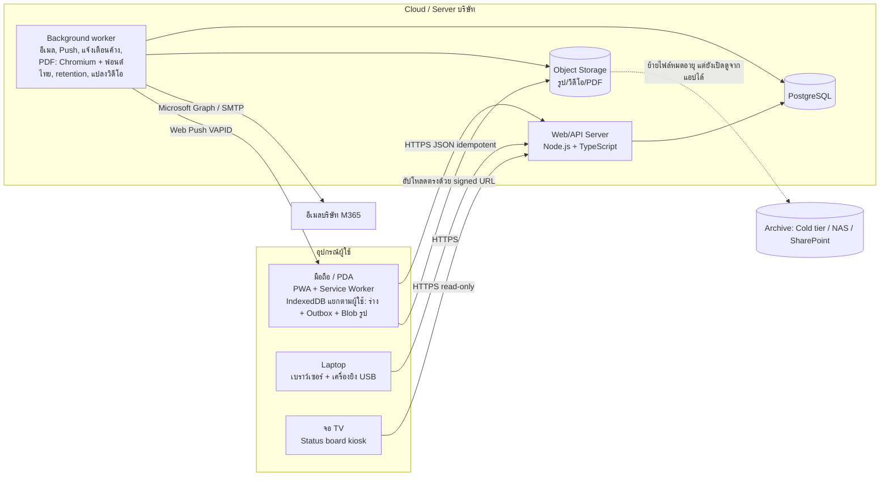

# 04 — Technical & Non-functional Specification

> Draft v0.2 · 16 ต.ค. 2026 (v0.3 19 ต.ค. 2026: Auth ผ่านระบบกลาง TRW — DEC-09, §3.1 · v0.4 19 ต.ค. 2026: App shell มือถือ — DEC-10, ดู [09](09-app-shell.md)) · สิ่งที่เป็น "ข้อเสนอ" ต้องตัดสินใจให้เสร็จใน Phase 0 (ดู §10 Decision log — รหัส DEC-xx)

---

## 1. Non-functional Requirements

| ID | หมวด | Requirement |
|---|---|---|
| NFR-01 | อุปกรณ์/เบราว์เซอร์ | **ผู้ตรวจ (ใช้ออฟไลน์)**: Android 10+ Chrome ล่าสุด, **iOS 17+** Safari ติดตั้งเป็น Home Screen app · **บทบาทที่ใช้ออนไลน์อย่างเดียว**: iOS 16.4+ · Laptop: Chrome/Edge 2 เวอร์ชันล่าสุด (Windows/macOS) · TV 1920×1080 ผ่านเบราว์เซอร์ |
| NFR-02 | Responsive | ใช้งานได้ตั้งแต่ **360 px ถึง 1920 px** ไม่มี horizontal scroll ทั้งหน้า (ตารางกว้างเลื่อนเฉพาะในกรอบ) — ความสามารถรายอุปกรณ์ตาม 02 §5.2 |
| NFR-03 | ความเร็ว | เปิดแอปครั้งแรก ≤ 3 วิ (Wi-Fi โรงงาน), ครั้งถัดไป ≤ 1 วิ (cache); กดตอบหัวข้อ < 100 ms (บันทึกในเครื่องก่อน); หน้า Report 50 เครื่อง ≤ 5 วิ; สร้าง PDF ≤ 30 วิ |
| NFR-04 | ทนเน็ตไม่เสถียร | ตรวจ Checklist/Rework ของงานที่ดาวน์โหลดแล้ว **โดยไม่มีเน็ต** แล้วซิงค์ภายหลัง; ข้อมูลและรูปไม่หายเมื่อปิดแอป/ระบบปิดแอป/แบตหมด (§4) |
| NFR-05 | ความพร้อมใช้งาน | 99% ในเวลาทำงาน (❓ E13); แจ้งปิดปรับปรุงล่วงหน้า; มีแผนสำรองกระดาษ (FR-QC-17/19) |
| NFR-06 | สำรองข้อมูล | DB backup อัตโนมัติรายวัน + Point-in-time ≥ 7 วัน; Object storage เปิด versioning; ทดสอบกู้คืนก่อน Go-live และไตรมาสละครั้ง · RPO ≤ 24 ชม. (เป้า 15 นาทีด้วย PITR) · RTO ≤ 4 ชม. |
| NFR-07 | ความปลอดภัย | HTTPS เท่านั้น, ไม่เก็บรหัสผ่าน (ยืนยันตัวตนที่ระบบกลาง TRW — §3.1), ตรวจสิทธิ์ฝั่ง Server ทุก API, Session cookie (HttpOnly/Secure/SameSite), Rate-limit login, ตรวจชนิด/ขนาดไฟล์ทั้งตอนขอ URL และที่ storage, ลิงก์สื่อเป็น signed URL อายุสั้น, ไม่ใส่ข้อมูลส่วนบุคคลใน URL, ทดสอบตาม OWASP ASVS Level 1 + dependency scan ก่อน Go-live |
| NFR-08 | Audit | Audit log append-only เก็บ ≥ 5 ปี ❓ F1 |
| NFR-09 | ข้อมูลส่วนบุคคล | เก็บข้อมูลพนักงานเท่าที่จำเป็น (รหัส, ชื่อ, แผนก, สังกัด, อีเมลบริษัท **หรืออีเมลส่วนตัวที่ยินยอม** — ไม่ใช่ทุกคนมีอีเมลบริษัท `[A 05:44]`; ใช้แจ้งเตือนเท่านั้น) ตามแนวทาง PDPA |
| NFR-10 | ภาษา | UI ภาษาไทย, i18n-ready, ฟอนต์ไทยทั้งเว็บและ PDF |
| NFR-11 | ขนาดระบบ | ผู้ตรวจ ~4 เผื่อ ~10, ผู้ใช้รวม ≤ 30, พร้อมกัน ~15, ล็อตสูงสุด ~500 ตัว — เน้นดูแลง่าย ค่าใช้จ่ายต่ำ |
| NFR-12 | ดูแลรักษา | TypeScript ทั้ง front/back, migration เป็นโค้ด, staging สำหรับ UAT, Master data แก้ได้โดยผู้ใช้ |
| NFR-13 | Accessibility | Label ทุกช่อง, คีย์บอร์ดได้ครบบน laptop, ไม่สื่อความหมายด้วยสีอย่างเดียว (มีไอคอน/ข้อความ), ตรวจก่อน Go-live |
| NFR-14 | Observability | Error tracking client/server, log 90 วัน, uptime monitor แจ้ง IT, รายงาน storage รายเดือน |

---

## 2. สถาปัตยกรรมที่เสนอ

### 2.1 ภาพรวม

### 2.2 Stack ที่เสนอ (ปรับได้ตามความถนัดทีม)
| ชั้น | ข้อเสนอ | เหตุผล / รายละเอียด | ทางเลือก |
|---|---|---|---|
| Frontend | **React + TypeScript + Vite**, PWA (Workbox), React Router, TanStack Query, React Hook Form + Zod | SPA เหมาะกับ offline-first บนมือถือ | Next.js |
| UI | Headless components (Radix UI / shadcn/ui) + Tailwind ผ่าน **design tokens** | ธีมใส่ภายหลังได้ (§6) | MUI, Mantine |
| Offline | IndexedDB (Dexie) แยก DB ตาม user_id + Outbox pattern + Background Sync เมื่อมี (Chromium เท่านั้น) | §4 | RxDB, PowerSync |
| สแกน | ใช้ **`BarcodeDetector` เมื่อตรวจพบและ `getSupportedFormats()` มี qr_code/code_128** (Chrome Android ที่มี Google Play services, macOS/ChromeOS) — กรณีอื่น (iOS ทุกเวอร์ชัน, Chrome/Edge บน Windows, Android/PDA ที่ไม่มี GMS) ใช้ **WebAssembly ZXing (zxing-cpp)** โหลดเฉพาะตอนเปิดสแกน · ห้ามเลือกด้วย User-Agent · บน laptop ใช้เครื่องยิง USB เป็นหลัก · **เลือกแล้ว 28 ต.ค. 2026:** `barcode-detector` 3.2.2 (ponyfill บน `zxing-wasm` 3.1.3 = ZXing-C++) ผ่าน `lib/scan/detector.ts` + กล้องเต็มจอ `components/scan/CameraScanDialog.tsx` · ไฟล์ `.wasm` เสิร์ฟเองที่ `/zxing/` (คัดลอกโดย `tools/copy-zxing-wasm.mjs` หลัง `npm install`) ไม่พึ่ง CDN | iOS/Windows ไม่มี BarcodeDetector | html5-qrcode |
| เครื่องยิง (keyboard-wedge) | ช่องสแกนใช้ `inputmode="none"` (กันคีย์บอร์ดบนจอเด้ง); ตั้งเครื่องยิงส่ง suffix = Enter; ตัวดักคีย์แบบ global แยก "การยิง" (ตัวอักษรเข้าถี่ < ~50 ms/ตัว ลงท้าย Enter) ส่งเข้าตัวรับสแกนแม้ focus อยู่ช่องอื่น → บันทึก `SCAN_WEDGE`; PDA ใช้โหมด keyboard output (เว็บรับ Intent ของ DataWedge ไม่ได้) | — | — |
| กล้อง | `getUserMedia` กล้องในแอป: รูป = เฟรมจาก stream ขอ ideal 1920×1080 → ย่อเหลือ ≤ 1600 px + ลายน้ำบน canvas; คำนวณ pHash **ก่อน**ใส่ลายน้ำ (BR-05a); `ImageCapture` ใช้เฉพาะ Chrome; ไฟฉาย (torch) ไม่รับประกันบน iOS → กำหนดแสงสว่างที่จุดตรวจแทน; ใช้ camera stream เดียวร่วมกันระหว่างสแกนกับถ่าย, `<video playsinline muted>` | บังคับถ่ายสด `[B 01:38:12]` | `<input capture>` เป็น fallback (ติดธง) |
| วิดีโอ | `MediaRecorder` เลือก mimeType ด้วย `isTypeSupported()` เรียง `video/mp4;codecs=avc1` → `video/webm;codecs=vp9` → `vp8`; `videoBitsPerSecond ≈ 2 Mbps`, หยุดอัตโนมัติที่ 20 วิ (≈ 5 MB); ไฟล์ WebM ให้ Worker แปลงเป็น MP4 (ffmpeg) หรือยอมรับ WebM หลังทดสอบเปิดบน iPhone/Windows; ถ้าต้องมีเสียง (ลมรั่ว) ต้องขอสิทธิ์ไมค์เพิ่ม ❓ B7 | iOS อัด MP4, Android หลายรุ่นอัด WebM | — |
| Backend | **Node.js LTS + Fastify หรือ NestJS + TypeScript**, Prisma ORM | แชร์ type/validation/business rules กับ frontend | Supabase (BaaS) ลดงาน backend |
| Database | **PostgreSQL 16** | transaction สำหรับเลขรัน, JSON สำหรับ snapshot | — |
| Job/Queue | pg-boss (คิวบน Postgres) | ไม่ต้องมี Redis | BullMQ + Redis |
| Storage | **S3-compatible** (Cloudflare R2 / AWS S3 / Azure Blob / MinIO บน NAS) + lifecycle rules | อัปโหลดตรง, ตั้งอายุไฟล์ได้ | SharePoint/OneDrive ผ่าน Graph (ช้าและซับซ้อนกว่า `[B 00:34:37]`) |
| PDF | HTML template → Headless Chromium (Playwright) ใน container พร้อมฟอนต์ไทย (เช่น Sarabun / Noto Sans Thai) | หน้าตาเหมือนเว็บ รองรับไทย — มีผลกับการเลือก Hosting (DEC-01) | react-pdf, pdfmake |
| Excel | ExcelJS | Import/Export | SheetJS |
| อีเมล | Microsoft Graph (App registration + application access policy จำกัด Mail.Send เฉพาะกล่องบริการ) หรือ SMTP AUTH; ตั้ง SPF/DKIM | ใช้ M365 ที่มีอยู่ | บริการ transactional email |
| Push | Web Push (VAPID) + Badging API | Phase 2 (§7) | — |
| Auth | **ระบบกลาง TRW** (ยืนยันรหัสผ่าน + บทบาทจาก `role_prog` ของ PRG003) → session ของ QCheck (HttpOnly cookie เข้ารหัส) + RBAC ฝั่ง server (ไม่มี PIN — DEC-11) | บริษัทใช้บัญชีกลางนี้กับโปรแกรมอื่นอยู่แล้ว (PRG001/PRG002) — DEC-09 | ~~บัญชีในตัว QCheck~~ (ตัดสินแล้ว), Microsoft Entra ID SSO (ไม่ทุกคนมีบัญชีบริษัท `[A 05:44]`) |

### 2.3 Hosting — ตัวเลือก
| ตัวเลือก | ข้อดี | ข้อเสีย |
|---|---|---|
| **A. Cloud managed (แนะนำ)** — PaaS/VPS ที่รัน container ได้ (สำหรับ Chromium/ffmpeg) + Managed PostgreSQL + Object storage | IT แทบไม่ต้องดูแล, backup/PITR, เข้าจากนอกโรงงานได้ (จัดซื้อ/ผู้บริหาร), HTTPS ง่าย | ค่าใช้จ่ายรายเดือน (ระดับนี้ประมาณหลักพันบาท/เดือน — เช็คราคาจริงตอนเลือก) |
| B. Server ในบริษัท + NAS (MinIO) | ค่าใช้จ่ายรายเดือนต่ำ, ข้อมูลอยู่ในบริษัท | IT ดูแล backup/อัปเดต/ไฟดับ; ต้องมี **ใบรับรอง HTTPS แบบ public** (เช่น Let's Encrypt ผ่าน DNS-01) — **ห้าม self-signed/private CA** เพราะต้องติดตั้ง CA ในมือถือทุกเครื่อง; เข้าจากภายนอกต้อง VPN/Reverse proxy |
| C. Hybrid | DB/App บน Cloud, Archive รูปเก่าลง NAS/SharePoint | ซับซ้อนขึ้นเล็กน้อย |

> ⚠️ กล้อง (getUserMedia), Service Worker, PWA และ Web Push ทำงานได้เฉพาะบน **HTTPS**

---

## 3. API & Integration

- REST/JSON ภายใต้ `/api/v1`, ตรวจสิทธิ์ทุก endpoint
- **Idempotency ทุก entity ที่สร้างได้ตอนออฟไลน์** (unit_inspections, item_results, item_defect_results, media, rework_orders, เหตุการณ์รับงาน/ส่งงาน): id = UUID v7 สร้างจากเครื่อง + ทุก request เขียนข้อมูลมี `op_id` → ตาราง `sync_ops` ทำให้ส่งซ้ำได้โดยไม่เกิดข้อมูลซ้ำ
- อัปโหลดไฟล์: ขอ signed URL **ตอนจะอัปโหลดจริง** (ไม่ขอล่วงหน้า), sign Content-Type + Content-Length → อัปโหลดตรงไป Storage → แจ้ง server ยืนยัน (ตรวจ hash/ขนาด/ชนิด)
- Business rules (BR-02/03/04/07/10/12) เป็นฟังก์ชันล้วนใน `packages/shared` ใช้ร่วมทั้งเครื่องและ server; server คำนวณซ้ำด้วย master snapshot เดียวกัน (BR-20)
- Realtime: ศูนย์แจ้งเตือน/Status board ใช้ polling 30–60 วิ ขณะเปิดแอป + Web Push (Phase 2)
- **ไม่มี integration ภายนอกใน Phase 1–3 ยกเว้นระบบกลาง TRW สำหรับ login** (§3.1) (ไม่ผูก Business Central `[B 00:12:29]` `[B 00:13:41]`) — ออกแบบ doc_no/vendor/model ให้ map กับ BC ได้ภายหลัง (Phase 4)

### 3.1 เชื่อมระบบกลาง TRW (Login + บทบาท) — DEC-09

รายละเอียดเต็มและเหตุผล: [08-central-auth-plan.md](08-central-auth-plan.md)

1. **เรียกจาก server เท่านั้น** (route handler `POST /api/auth/login`) — เบราว์เซอร์ส่งรหัสพนักงาน/รหัสผ่านมาที่ QCheck แล้ว QCheck ส่งต่อไประบบกลาง; `access_token` และรายการโปรแกรมอื่นไม่ถึง client และไม่ถูก log ❓ G1
2. **หาโปรแกรมด้วย `program_code`** (`PRG003`, ตั้งค่าผ่าน env) ไม่ใช้ `program_id`/`url` · เข้าได้เมื่อ `can_use && is_active` และมีบทบาทที่รู้จัก ≥ 1
3. **`role_prog`** รับทั้ง array และ string คั่น `,` ❓ G3 · ตัดช่องว่าง เทียบแบบตัวพิมพ์ใหญ่ · รหัสที่ไม่รู้จัก → ตัดทิ้ง + audit `login.unknown_role` · `dev` = ทุกบทบาทเฉพาะเมื่อ `QCHECK_ALLOW_DEV_ROLE=on` และไม่ใช่ production
4. **ตรวจรูปแบบ response** ก่อนใช้ — ผิดรูปแบบถือเป็น "ระบบกลางไม่พร้อม" ไม่ใช่ "รหัสผิด"
5. **Timeout 5 วิ** ⚙️ · ไม่ retry อัตโนมัติ (กันล็อกบัญชีที่ระบบกลาง) · แยกข้อความ รหัสผิด / ถูกล็อก / ปิดบัญชี / ไม่มีสิทธิ์ QCheck / ระบบกลางไม่พร้อม
6. **Session**: cookie ของ QCheck เก็บแค่ user id + รหัสพนักงาน (เหมือนเดิม) · บทบาทอ่านจาก `users`/`user_roles` ที่ sync ตอน login → ถอดบทบาทในระบบกลางมีผลเมื่อ session หมด (สูงสุด 12 ชม. ⚙️) เว้นแต่ระบบกลางมี endpoint ตรวจสิทธิ์ ❓ G2
7. **Rate-limit ฝั่ง QCheck** ต่อรหัสพนักงาน + IP ยังคงอยู่ แม้ระบบกลางล็อกเองด้วย ❓ G4
8. **เส้นทางเครือข่าย**: server QCheck ต้องเข้าถึงระบบกลาง (`192.168.0.248` ใน LAN) ได้ — มีผลกับ DEC-01 ❓ G5 · ขอให้เส้นนี้เป็น HTTPS ❓ G7
9. **Dev/Test**: adapter แบบ mock ส่ง JSON รูปแบบเดียวกับระบบกลาง เลือกด้วย env `QCHECK_AUTH=mock|central` (mock ห้ามใช้ใน production)

---

## 4. Offline / เน็ตไม่เสถียร (สำคัญ — Wi-Fi จุดตรวจไม่ทั่วถึง, เครื่องโรงงานไม่มีซิม `[B 02:12:39]` `[B 02:12:48]`)

### 4.1 ขอบเขตที่ทำงานออฟไลน์ได้
| งาน | ออฟไลน์ | เหตุผล |
|---|:-:|---|
| ดาวน์โหลดงานที่ได้รับมอบหมายล่วงหน้า (prefetch อัตโนมัติเมื่อออนไลน์) | — | ทำให้ "รับงาน" ทำออฟไลน์ได้ |
| รับงาน, ตรวจ Checklist/Rework, คิว QA ที่ดาวน์โหลดแล้ว | ✅ | ใช้ Template version + master snapshot ที่ cache ไว้ |
| ถ่ายรูป/วิดีโอ | ✅ | เก็บเป็น Blob ใน IndexedDB เข้าคิวอัปโหลด |
| เปิดแผน / มอบหมาย / อนุมัติ / ออก NCP | ❌ ต้องออนไลน์ | ต้องกันซ้ำและเลขรันจาก server |
| Report / Dashboard | ❌ (ดูข้อมูล cache ล่าสุดได้) | |

### 4.2 กลไก
1. ทุกการกด → บันทึกลง IndexedDB ทันที (draft) + เพิ่มรายการใน **Outbox** (R1.0 = Outbox-lite: คำตอบ + Blob รูป/วิดีโอ + คิวอัปโหลดที่ทำงานต่อเมื่อเปิดแอป/กลับมาออนไลน์)
2. Sync ส่ง Outbox ตามลำดับเมื่อออนไลน์ (event `online`, เปิดแอป, Background Sync เฉพาะ Chromium) — retry แบบ backoff; ปุ่ม "ซิงค์ตอนนี้" เสริม
3. **ข้อขัดแย้ง → คิวขัดแย้ง (ไม่ทิ้งข้อมูล)**: Serial ซ้ำจาก 2 เครื่อง, ใบงานถูกโอน, แผนถูกยกเลิกระหว่างออฟไลน์ → หัวหน้าตัดสินในหน้า S29
4. แถบสถานะ "ออนไลน์/ออฟไลน์" + "รอซิงค์ n รายการ, รูป m ไฟล์"
5. **ข้อมูลในเครื่องแยกตามผู้ใช้** (ผู้ใช้อื่นบนเครื่องส่วนกลางมองไม่เห็น)
6. **Logout / เปลี่ยนผู้ใช้**: ออนไลน์ → ซิงค์ให้ครบก่อนแล้วจึงออก แล้ว **ล้างข้อมูลของผู้ใช้นั้นในเครื่อง** (ตามข้อเสนอทีมพัฒนา `[B 02:10:15]`) · ออฟไลน์ → ออกได้ แต่ข้อมูลยังเก็บแบบล็อก หน้า Login แสดง "มีงานค้างซิงค์ของ [ชื่อ] n รายการ" — ส่งเมื่อเจ้าของ login อีกครั้ง หรือหัวหน้ากด "ซิงค์แทน" (Audit บันทึกผู้ตรวจเดิม + ผู้ส่ง) ❓ E12 · การปัดปิดแอป/เบราว์เซอร์ **ไม่ใช่** Logout `[B 02:10:49]`
7. Session หมดอายุระหว่างออฟไลน์ต้องไม่ทำให้ Outbox หาย — ขอ login ผู้ใช้เดิมแล้วส่งต่อ
8. **ไม่ activate Service Worker ใหม่** ระหว่างมีงานเปิดหรือ Outbox ไม่ว่าง (release ทุก 2 สัปดาห์); IndexedDB มีเลข schema + migration test
9. ขอ `navigator.storage.persist()` และตรวจค่าที่ได้ — ถ้าไม่ได้ ให้เตือนผู้ใช้

### 4.3 สเปกอุปกรณ์ขั้นต่ำที่เสนอ (สำหรับจัดซื้อเครื่องส่วนกลาง) `[B 02:12:04]`
| รายการ | ขั้นต่ำ | แนะนำ |
|---|---|---|
| OS | Android 10 / iOS 17 | Android 13+ / iOS 17+ |
| RAM | 3 GB | 4 GB+ (ลดโอกาสระบบปิดแอปเบื้องหลัง `[B 02:11:08]`) |
| พื้นที่ว่าง | 16 GB | 32 GB+ |
| กล้องหลัง | autofocus (ความละเอียดเว็บได้ราว 1080p — แสงที่จุดตรวจสำคัญกว่าจำนวน MP) | — |
| เครือข่าย | Wi-Fi 2.4/5 GHz | — |
| การจัดการเครื่อง | บัญชี Google ของบริษัทหรือ MDM เพื่อให้ Chrome อัปเดตได้ (DEC-08) | ล็อกเครื่องให้เปิด QCheck, ล้างเครื่องระยะไกล |
| อื่นๆ | — | ตัวเลือก: PDA ทนทานมีสแกนเนอร์ในตัว (แพงกว่า — ให้ IT เทียบราคา) `[B 00:17:16]` `[B 00:18:29]` |
> Phase 0: สำรวจ Wi-Fi จุดตรวจ/ไลน์ 408-409 และทดสอบสแกน (BarcodeDetector + WASM) กับสติ๊กเกอร์จริงบน iPhone, Android ราคาประหยัด และ PDA ที่จะซื้อ ในแสงหน้างาน

### 4.4 ข้อจำกัด iOS ที่ต้องออกแบบรองรับ
1. Home Screen app มี **storage/คุกกี้แยกจาก Safari** — ติดตั้งก่อน แล้ว login ในแอปที่ติดตั้ง
2. ลิงก์จากอีเมล/LINE บน iPhone **เปิดใน Safari/เบราว์เซอร์ในแอป LINE ไม่ใช่แอปที่ติดตั้ง** → หน้า Checklist/Rework บน iOS ทำงานเฉพาะ `display-mode: standalone`; ถ้าเปิดในเบราว์เซอร์ให้แสดงแบบอ่านอย่างเดียว + "เปิดจากไอคอน QCheck บนหน้าจอหลัก"
3. iOS ไม่มี Background Sync และหยุด JavaScript เมื่อแอปไปเบื้องหลัง → ซิงค์ตอนเปิดแอป/กลับมาออนไลน์ และแสดง "รอซิงค์ n รายการ — เปิดแอปค้างไว้จนครบ"
4. Safari อาจล้างข้อมูลเว็บที่ไม่ได้ใช้นานถ้าไม่ได้ติดตั้งเป็นแอป; `storage.persist()` ใช้ได้ตั้งแต่ iOS 17
5. แอปบนหน้าจอหลักอาจขอสิทธิ์กล้อง/ไมค์ซ้ำเมื่อเปิดใหม่ และใช้กล้องได้ทีละ stream

---

## 5. Mobile-first + Laptop (Responsive strategy)

### 5.1 Breakpoints
| ชื่อ | ความกว้าง | อุปกรณ์ | Layout |
|---|---|---|---|
| `xs` | < 480 px | มือถือ | 1 คอลัมน์, **Bottom tab bar** (4 แท็บ, 56 px + safe-area), Top app bar — [09](09-app-shell.md) |
| `sm` | 480–767 | มือถือจอใหญ่ / PDA | 1 คอลัมน์ + tab bar ชุดเดียวกับ `xs` |
| `md` | 768–1023 | แท็บเล็ต / laptop จอเล็ก | 2 คอลัมน์ (list + detail) **หรือ sidebar — ไม่ใช้แท็บล่าง** |
| `lg` | 1024–1439 | Laptop | Sidebar ซ้าย + Header, ตารางเต็ม |
| `xl` | ≥ 1440 | จอใหญ่ / TV | Dashboard grid หลายคอลัมน์ |

### 5.2 กติกาออกแบบ (ไม่ขึ้นกับธีม)
1. **ออกแบบมือถือก่อน** แล้วขยาย — ความสามารถรายอุปกรณ์ตาม **02 §5.2 (Device × Flow)** คือเกณฑ์ "ใช้บน laptop ได้แบบไม่มีปัญหา"
2. **ตาราง → การ์ด** เมื่อ < 768 px; บน laptop ตารางเรียง/กรอง/เลือกคอลัมน์ได้
3. เป้ากด ≥ 44×44 px, ระยะห่าง ≥ 8 px, ไม่มีฟังก์ชันที่ต้อง hover อย่างเดียว
4. ช่องกรอกบนมือถือ font-size ≥ 16 px, ใช้ `inputmode` ให้ถูก
5. รองรับ safe-area (iPhone notch / home indicator) และใช้ `dvh` — แท็บล่างต้องอยู่เหนือ `env(safe-area-inset-bottom)` (09 §3)
6. แนวตั้งเป็นหลัก; แนวนอน/แท็บเล็ตต้องไม่พัง
7. Laptop: คีย์ลัดใน Checklist (`P` = ปกติ, `F` = ไม่ผ่าน, `←/→`), Tab/Enter ตามลำดับ, รับเครื่องยิง USB (§2.2)
8. รูปหลักฐานบน laptop: กล้อง USB ที่เลือกได้ หรือ **"ถ่ายต่อบนมือถือ"** (FR-QC-18); **ไม่เปิดอัปโหลดจากไฟล์ให้ Inspector** (ยกเว้นโหมดบันทึกย้อนหลังสำหรับผู้มีสิทธิ์ + Audit)
9. หน้าออกแบบเพื่อ laptop โดยเจตนา (Template builder, ตาราง Disposition, Import/Export) บนมือถือแสดงแบบอ่านอย่างเดียว + ข้อความ "ใช้บนจอ ≥ 768 px"
10. Report มี print stylesheet (A4) และ PDF; TV mode เป็น URL kiosk read-only ตัวอักษรใหญ่ refresh อัตโนมัติ
11. **App chrome:** มือถือ < 768 px ใช้ bottom tab bar ใน layout ของกลุ่มหน้าทำงาน (ไม่ใช่ใส่ซ้ำทุกเพจ) · ≥ 768 px ใช้ sidebar · ซ่อนแท็บบน Checklist/กล้องตาม 09 §3.2 · คีย์บอร์ดเปิดแล้วซ่อนแท็บผ่าน `visualViewport`

### 5.3 Test matrix (ขั้นต่ำ — ทดสอบเครื่องจริงทุก Sprint)
| กลุ่ม | อุปกรณ์ / กรณี |
|---|---|
| Android | มือถือระดับกลางที่ใช้จริง 1 รุ่น + รุ่นเก่าสุดที่ยังใช้ 1 รุ่น (Chrome) + PDA ถ้าจะซื้อ — ตัดเน็ตกลางการตรวจ, ปิดแอปกลางคัน, RAM ต่ำ |
| iOS | iPhone ที่ใช้จริง 1 รุ่น ติดตั้งเป็น Home Screen — เปิดจากลิงก์อีเมล/LINE, สลับแอประหว่างอัปโหลด, ไม่เปิดแอป 7 วันแล้วกลับมา, ขอสิทธิ์กล้องซ้ำ |
| Laptop | Windows + Chrome/Edge (1366×768, 1920×1080) — Checklist ด้วยคีย์บอร์ดล้วน, เครื่องยิง USB, webcam ในตัว + กล้อง USB, สแกน QR ผ่าน webcam (WASM), "ถ่ายต่อบนมือถือ" |
| TV | 1920×1080 เบราว์เซอร์บน TV/Mini PC |
| อัตโนมัติ | Playwright E2E บน viewport Pixel/iPhone + Desktop |

---

## 6. Theme-ready (ธีมจะกำหนดภายหลัง)

- ใช้ **design tokens** (CSS variables) ทั้งหมด: สี, ฟอนต์, ขนาดตัวอักษร, ระยะห่าง, มุมโค้ง, เงา — ห้าม hard-code สีใน component
- Semantic tokens ที่ต้องมี (ค่าจริงกำหนดตอนคุยธีม):
  - สถานะแผน: `status-not-started`, `status-in-progress`, `status-awaiting-close`, `status-done`, `status-over`, `status-under`
  - ผลตรวจ: `result-pass`, `result-concession`, `result-fail`, `result-reject`, `result-rework`
  - ระบบ: `surface`, `on-surface`, `primary`, `danger`, `warning`, `success`, `info`, `focus-ring`
- รองรับ Light/Dark ในอนาคต (token แยกตามโหมด)
- Design tokens **ลดงานแก้** แต่เมื่อได้ธีมจริงยังต้องเผื่อเวลาปรับ layout (ฟอนต์ไทยมีความสูงบรรทัดต่างกัน), ไอคอน, โลโก้ และเทมเพลต PDF → มีงาน "ใส่ธีม" แยกใน WBS (05)
- Phase 0 ทำ **wireframe ขาวดำ** เท่านั้น (ยืนยัน flow) — ไม่ลงสี/สไตล์

---

## 7. Notifications (เทคนิค)

| ช่องทาง | Rel | หมายเหตุ |
|---|:-:|---|
| ศูนย์แจ้งเตือนในแอป (กระดิ่ง + badge + popup) | 1.1 | ช่องทางหลัก ทุกอุปกรณ์ — ทำงานขณะเปิดแอป |
| อีเมล (สรุป + ลิงก์) | 2 | บัญชีบริการบริษัท; ไม่แนบไฟล์ใหญ่ `[B 01:45:02]`; ไม่ใช่ทุกคนมีอีเมล → ช่องทางเสริม |
| **Web Push** | 2 | Android: ใช้ได้ทั้งในเบราว์เซอร์และแอปที่ติดตั้ง · iPhone: iOS 16.4+ เฉพาะแอปบนหน้าจอหลัก ขอสิทธิ์จากการกดปุ่ม · subscription ผูก (ผู้ใช้, เครื่อง) ลบเมื่อ logout/เปลี่ยนผู้ใช้บนเครื่องส่วนกลาง · ใช้ Badging API แสดงจำนวนค้าง |
| LINE | 4 | LINE Notify ปิดบริการแล้ว — ต้องใช้ LINE Official Account (Messaging API) ซึ่งมีโควต้า/ค่าใช้จ่าย `[B 00:04:45]` |
- งานแจ้งเตือนค้าง (BR-16) และเตือนกำหนด รันใน Background worker ทุก 15 นาที

---

## 8. Media storage & retention

- รูปย่อในเครื่องก่อนอัปโหลด (≈ 200–400 KB), วิดีโอ ≤ 20 วิ ~2 Mbps (≈ 5 MB) ⚙️
- เก็บใน Object storage แยก prefix `ปี/เดือน/แผน/` อ้างอิงด้วย key ใน DB (ไม่ใช่ลิงก์ส่วนตัวของใคร `[B 00:36:29]`)
- Lifecycle (BR-17): ครบอายุ → ย้าย cold tier/Archive อัตโนมัติ; ในแอปยังเปิดดูได้ (อาจช้ากว่า) `[B 00:33:19]`
- หัวข้อที่ตั้งวิดีโอ "ทุกครั้ง" เพิ่ม storage ตามจำนวนเครื่องที่ตรวจ — ประเมินใน Phase 0 ก่อนตั้ง
- รายงาน storage รายเดือนให้ Admin (ใช้ไปเท่าไร คาดการณ์ค่าใช้จ่าย) `[B 00:37:38]`

---

## 9. งาน IT ที่มีกำหนดเสร็จ

| งาน | ต้องเสร็จก่อน | ผู้รับผิดชอบ |
|---|---|---|
| โดเมน + TLS (public cert) + staging — URL ของ PRG003 ในระบบกลางต้องเปลี่ยนจาก `http://192.168.0.248:8083` เป็น HTTPS ❓ G6 | Sprint 1 | IT |
| สัญญา API ระบบกลาง (G1–G4) + `role_prog` ของ PRG003 เป็นรหัสบทบาท QCheck + บัญชีทดสอบบน staging | Sprint 1 | IT ระบบกลาง |
| เส้นทางเครือข่าย server QCheck → ระบบกลาง (G5) | ก่อน deploy staging | IT |
| Object storage + lifecycle + versioning | Sprint 4 (ก่อนทำกล้อง) | IT + Dev |
| การจัดการเครื่องส่วนกลาง (บัญชีบริษัท/MDM), ลงทะเบียนเครื่อง | ก่อน Pilot | IT |
| Wi-Fi จุดตรวจ (ถ้าผลสำรวจไม่ผ่าน) | ก่อน Pilot (หรือ Pilot เฉพาะจุดที่ผ่าน) | IT |
| Backup/Restore drill | ก่อน Go-live Phase 1 | IT + Dev |
| Uptime monitor + ช่องทางแจ้งปัญหา | ก่อน Go-live Phase 1 | IT |
| M365 Graph app registration + access policy (หรือ SMTP AUTH) + SPF/DKIM | ก่อน Phase 2 | IT |
| VAPID keys / Web Push | ก่อน Phase 2 | Dev |

---

## 10. Decision log (ตัดสินใน Phase 0)

| # | เรื่อง | ข้อเสนอตั้งต้น | ผู้ตัดสิน | สถานะ |
|---|---|---|---|---|
| DEC-01 | Hosting | A. Cloud managed (รัน container ได้) — ⚠️ ต้องเข้าถึงระบบกลาง TRW ใน LAN ได้ (VPN/tunnel) หรือเลือก B ❓ G5 | IT + ผู้บริหาร | Open |
| DEC-02 | Frontend/Backend stack | ~~React+Vite PWA~~ → **Next.js (App Router) + PWA (Serwist)** / Node+TypeScript / PostgreSQL — Frontend ตัดสิน 16 ต.ค. 2026 (ดู 07 §11) · 28 ต.ค. 2026: มี Web App Manifest (`app/manifest.ts`) + ไอคอน → ติดตั้งเป็นแอปได้เมื่อเปิดผ่าน https ที่เครื่องเชื่อถือ · ยังไม่มี Service Worker/ออฟไลน์ (Serwist) | ทีมพัฒนา | Frontend: Decided · Backend/DB: Open |
| DEC-03 | Object storage + Archive | S3-compatible + Archive cold tier/NAS | IT | Open |
| DEC-04 | อีเมลระบบ | Microsoft Graph บัญชีบริการ | IT | Open |
| DEC-05 | อุปกรณ์หน้างาน | มือถือ Android ส่วนกลาง (หรือ PDA) จำนวน ❓ + มือถือส่วนตัวที่สมัครใจ | QA + IT + จัดซื้อ | Open |
| DEC-06 | อายุเก็บรูป/วิดีโอ | 2 ปีนับจากวันที่ถ่าย, ข้อความ ≥ 5 ปี | QA + ผู้บริหาร | Open |
| DEC-07 | ระบบเดิม (AppSheet) | QC ใช้คู่ได้จนถึง Go-live Phase 1, QA ใช้จนกว่าโมดูล QA เปิด (R1.1) จากนั้น read-only; ย้ายเฉพาะข้อมูล Defect ระดับ Invoice/SKU ปีปัจจุบันถ้า F4 = ย้าย | QA | Open |
| DEC-08 | การจัดการเครื่องส่วนกลาง | บัญชี Google ของบริษัท / Android Enterprise | IT | Open |
| DEC-09 | Login + บทบาท | **ระบบกลาง TRW** เป็นเจ้าของตัวตน รหัสผ่าน และบทบาท QCheck (`role_prog` ของ PRG003) — ทางเลือก A ตัดสิน 19 ต.ค. 2026 (ดู [08](08-central-auth-plan.md)) · ต้องทบทวน DEC-01 คู่กันเพราะ server ต้องเข้าถึงระบบกลางใน LAN (G5) | ทีมพัฒนา + IT | Decided (รอสัญญา API G1–G4) |
| DEC-14 | กติกาอาการอยู่ที่หัวข้อ Checklist | `defects` = **อาการกลาง ใช้ร่วมทุกชนิดปั๊ม** (เช่น ชำรุด, สีถลอก, เป็นสนิม, รั่วซึม + อาการเฉพาะ เช่น มอเตอร์ไหม้) · ความรุนแรง / Disposition PUMA-Other / ใช้งาน / ชิ้นส่วน อยู่ที่ลิงก์ หัวข้อ × อาการ × ชิ้นส่วน (`item_defects` + `item_defect_dispositions`, `db/014`) เพราะไฟล์อาการ QA ทั้ง 3 ชนิด (Piston / Oil-free / Rotary, 771 แถว) ให้อาการชื่อเดียวกันต่างกันตามชนิดปั๊มและชิ้นส่วน (239 ชื่อที่อยู่หลายชนิด มีแค่ 17 ชื่อที่กติกาเหมือนกัน) · `defects.severity` / `defect_dispositions` เหลือเป็นค่าตั้งต้น · Disposition ไม่มี role (Checklist แยกตามบทบาท) · Severity เก็บค่าที่รุนแรงกว่าระหว่าง PUMA/Other · แก้ BR-04 ใน [03](03-spec-business-rules-data.md) | ผู้ใช้ 28 ต.ค. | Decided 28 ต.ค. 2026 (ข้อมูลชุดแรก `db/016` — ยังไม่รันกับ SQL Server จริง) |
| DEC-13 | ~~Vendor มาจาก Demand Planning~~ → **Vendor ไม่บังคับตอนเปิดแผน กรอกทีหลังได้** (ผู้ใช้ 23 ต.ค.) | ยกเลิกแนวทางดึง Vendor จาก Demand Planning — Master Vendor แก้ได้เหมือนเดิม; Vendor อยู่ที่หัวเอกสาร (`receipt_docs.vendor_id` NULL ได้, `db/013`), กันเอกสารซ้ำด้วย (ประเภท, เลข) อย่างเดียว; แก้ Vendor ที่หน้าแผน → ทุกแผน/ใบงานของเอกสารเปลี่ยนตาม | ผู้ใช้ 23 ต.ค. |
| DEC-12 | ผู้ใช้หน้างาน (LOCAL) + PIN | พนักงานหน้างานไม่มีบัญชีระบบกลาง → **Admin สร้างผู้ใช้ LOCAL ใน QCheck**, login ด้วยรหัสพนักงาน + **PIN** ที่ QCheck ตรวจเอง (hash Argon2id), บทบาทกำหนดใน QCheck (จำกัดบทบาทหน้างาน), ผู้ใช้ออฟฟิศยังใช้ระบบกลางตามเดิม · รายละเอียด [12](12-field-users-pin-plan.md) · **แก้ DEC-09 บางส่วน และกลับ DEC-11** | ผู้ใช้ (เจ้าของโครงการ) | Decided 19 ต.ค. 2026 (คำถาม I1–I6 รอยืนยัน) |
| DEC-11 | ~~ไม่ใช้ PIN สลับผู้ใช้~~ (**ถูกแทนที่ด้วย DEC-12**) | เข้าใช้ด้วย **รหัสพนักงาน + รหัสผ่าน** (ระบบกลาง) อย่างเดียวทุกเครื่อง · เครื่องส่วนกลางยังหมดเวลา 30 นาทีเมื่อไม่ใช้งาน · ตัด `/switch-user`, hash PIN, ทะเบียน PIN | ผู้ใช้ (เจ้าของโครงการ) | Decided 19 ต.ค. 2026 |
| DEC-10 | App shell มือถือ | หลัง login บนมือถือใช้ **bottom tab bar 4 แท็บ** (ไม่ใช่เว็บทักทายอย่างเดียว) ชุด QC = งานของฉัน / สแกน / แจ้งเตือน / เพิ่มเติม · laptop = sidebar · รายละเอียด [09](09-app-shell.md) | ผู้ใช้ (QC/QA) + ทีมพัฒนา | Proposed 19 ต.ค. 2026 (รอคอนเฟิร์มป้ายแท็บ) |

---

## 11. คุณภาพซอฟต์แวร์ & DevOps

- Monorepo: `apps/web`, `apps/api`, `apps/worker`, `packages/shared` (type + business rules)
- **Business rules เขียนเป็นฟังก์ชันล้วน + unit test ครบทุกตัวอย่างในเอกสาร** ใช้ร่วมเครื่อง (offline) และ server
- CI: lint + typecheck + unit + integration + build ทุก PR; E2E บน staging ก่อน release; dependency scan
- Environments: `dev` → `staging` (UAT) → `prod`; migration DB เป็นโค้ด; seed Master data จากไฟล์ที่ QA ยืนยัน
- Release ทุก 2 สัปดาห์ (หลัง Demo), hotfix ได้ทันที; PWA update prompt ที่ไม่ขัดงานที่เปิดอยู่ (§4.2 ข้อ 8)
