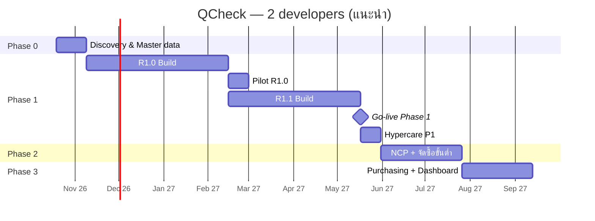
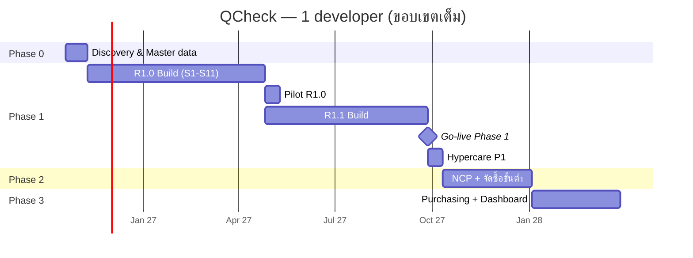

# 05 — แผนการทำงาน (Work Plan)

> Draft v0.2 · 16 ต.ค. 2026 (v0.3 19 ต.ค. 2026: งาน Auth ปรับตาม DEC-09 ระบบกลาง TRW · v0.4: งาน 1.2 อ้าง spec แถบล่างมือถือ [09](09-app-shell.md))
> ประมาณการเป็น **person-day (pd)** ของนักพัฒนา full-stack ที่คุ้นกับ TypeScript (ค่ากลาง) — ปฏิทินคำนวณจาก **pd × 1.15 (buffer) ÷ focus factor** (1 คน = 0.8 → 8 pd ต่อ Sprint 2 สัปดาห์; 2 คน = 0.7 ต่อคน → 14 pd ต่อ Sprint) และหักวันหยุด
> focus factor เผื่อเวลาที่ไม่ใช่เขียนโค้ด: Demo, check-in, ประเมิน Change request, ทดสอบเครื่องจริง, อัปเดตเอกสาร
> ⚠️ ตัวเลขเป็นค่าแบบระมัดระวัง — **ประเมินใหม่หลัง Sprint 2** จาก velocity จริง (ถ้าใช้ AI-assisted development อาจเร็วกว่า)

---

## สถานะลงมือทำล่าสุด — 19 ต.ค. 2026

ตารางนี้เป็นผลที่ทำและตรวจแล้ว ส่วน WBS/pd/ปฏิทินด้านล่างยังเป็นแผนตั้งต้น ไม่ได้หมายความว่าจบ Story หรือผ่าน Pilot แล้ว

| WBS | ทำแล้ว | ยังเหลือ |
|---|---|---|
| 1.2 App shell | Home demo, sidebar/4 mobile tabs ตามบทบาท, แจ้งเตือน, บัญชี/Logout, จังหวะ Login → Home | หน้าทำงานจริงตามบทบาท, sync/outbox และทดสอบเครื่องจริง |
| 1.3 Auth | Central/mock แยกชัด, session/rate limit/audit, กติกาหน้า/เมนูและ server guard ของหน้าปัจจุบัน; ทดสอบระบบกลางจริง TEST001–TEST009 ครบ 9 บทบาท | สัญญา token/สิทธิ์ล่าสุด/รหัสผ่านตาม docs/08, shared-device timeout (ผู้ใช้หน้างาน PIN ตาม DEC-12 — งานเพิ่ม ~6–7 pd ดู [12](12-field-users-pin-plan.md)); page guard และสิทธิ์รายข้อมูลของโมดูลใหม่ |
| 1.4 Audit log | `db/002_audit_logs.sql` (append-only ด้วย trigger), `toAuditRow` + `insertAuditRow`, `audit()` เขียนลงตารางแบบ fire-and-forget เมื่อมี DB (login ไม่ล้มถ้า DB มีปัญหา) · 169 tests | แก้ TLS และเชื่อม DB จริงได้แล้ว; มีตาราง audit_logs แต่ยังไม่ยืนยันประวัติ runner (`schema_migrations` ไม่มี) หรือทดสอบ audit write โดยตรง · ยังไม่มีหน้าดู Audit (1.20) และ audit ของงานธุรกิจ |
| 1.3+ ผู้ใช้หน้างาน (DEC-12) | PIN login, Admin จัดการผู้ใช้ LOCAL, บังคับเปลี่ยน PIN, audit, test E2E ใน Chrome (store จำลอง) · 207 tests · ตัวตรวจคอลัมน์มาตรฐาน Master (วันที่เพิ่ม/แก้ไข/สถานะ) | แก้ TLS/เติมคอลัมน์ผ่าน 008 และอ่านหน้า Admin จาก DB จริงได้แล้ว (LOCAL 0 คน); ตั้ง `PIN_PEPPER` เครื่องพัฒนาแล้ว; ยังต้อง seed และทดสอบเพิ่ม/แก้ไขผู้ใช้/PIN; ลืม PIN ด้วยตัวเอง; เครื่องส่วนกลางสลับผู้ใช้ — ดู [12](12-field-users-pin-plan.md) |
| 1.5 Master — สคีมา | DDL ครบ: `002_brands` (มีอยู่เดิม) + `004` pump_types/vendors/models, `005` checklist_templates/template_versions/checklist_items/header_fields, `006` defects/item_defects/defect_dispositions/fix_methods, `007` aql_table/complexity_levels/severity_addons/master_snapshots/settings — ทุกตารางมี สถานะ + วันที่เพิ่ม + วันที่แก้ไข + ผู้ทำ · test ตรวจคอลัมน์/วงเล็บ/ชื่อ constraint ซ้ำ/FK (231 tests) | พบตาราง Master บน SQL Server จริงแล้ว แต่ยังไม่ตรวจโครงสร้าง/constraint ทั้งหมดและไม่มีประวัติ runner; import Excel, หน้ารายการ/CRUD, ค่าจริง (AQL, Defect, Disposition) รอไฟล์ QA; เลขไฟล์ `002_` ซ้ำ 2 ไฟล์ (audit_logs, brands) ใช้งานได้แต่ควรจัดเลข |
| 1.5 Master — หน้าจอ (20 ต.ค.) | `/master` + `/master/[table]` สำหรับ ยี่ห้อ, ประเภทปั๊ม, Vendor, รุ่น, Defect, วิธีแก้ไข: รายการ + ค้นหา + กรองสถานะ + แบ่งหน้า, แสดง **สถานะ / วันที่เพิ่ม / วันที่แก้ไข + ผู้ทำ**, เพิ่ม/แก้ไข/ปิด-เปิดใช้งาน (ไม่มีลบ, FR-MD-13) เฉพาะ Master Admin; หัวหน้า/PM/ผู้บริหารดูอย่างเดียว · ตรวจฟอร์มฝั่ง server + audit ก่อน→หลัง · registry เดียวขับทั้งหน้า/ฟอร์ม/SQL และ test เทียบกับ `db/*.sql` · test ฐานข้อมูลจริงแบบ rollback (`QCHECK_DB_TESTS=on`) ผ่าน 8/8 | Checklist Template/เวอร์ชัน, Disposition, AQL, ค่าแรง, ค่าตั้งระบบ, **นำเข้า/ส่งออก Excel** (รอไฟล์ QA + เลือกไลบรารี) · ยังไม่ได้ลองบันทึกจริงผ่านหน้าเว็บ (ทดสอบบันทึกด้วย test แบบ rollback แทน) |
| 1.5–1.8 Master/แผน/มอบหมาย/ตรวจ | มีขอบเขตและตารางสิทธิ์สำหรับต่อยอด | ยังไม่มี business backend/flow จริง; Home ยังใช้ข้อมูลตัวอย่าง |

ผลล่าสุด (19 ต.ค.): 231 unit tests, lint, TypeScript และ production build ผ่าน; Chrome ตรวจเมนู desktop/mobile, Login/โปรไฟล์/Logout ครบ 9 บทบาทแล้ว แต่ยังไม่ได้ deploy staging หรือทดสอบบนมือถือจริง ดูหลักฐานและขอบเขตใน [login-progress.md](login-progress.md) §5.1 · งานภาพ Login Pass 5–7 ตาม [07](07-login-art-direction.md) ยังเหลือ

---

## 1. แนวทางการทำงาน

- **Iterative, Sprint ละ 2 สัปดาห์** — Demo บนมือถือจริงให้ QA/QC ทุกสิ้น Sprint
- **ส่งของใช้งานได้เร็ว**: R1.0 Pilot (วงจร QC หลัก) → R1.1 (QC ครบ + QA แกนหลัก) = Go-live Phase 1 → Phase 2 → Phase 3
- **Business rules เป็นโค้ดที่ทดสอบได้ก่อน UI** — ใช้ตัวอย่างในเอกสารเป็น test case
- **Master data มาก่อนหน้าจอ** — ทุก Sprint ที่ใช้ข้อมูล ต้องได้ไฟล์จาก QA ก่อนเริ่ม
- **ธีม**: ใช้ wireframe/สไตล์กลางไปก่อน (design tokens) และมีงาน "ใส่ธีม" ก่อน Go-live Phase 1

### Definition of Done (ระดับ Story)
1. ผ่าน Acceptance criteria ใน 02-spec
2. ผ่านเกณฑ์ Device × Flow (02 §5.2) ที่ 360 px และ 1366 px บนเครื่องจริง (หน้าที่เป็น 👁 บนมือถือ ทดสอบการแสดงผล)
3. Unit test สำหรับ business rule ที่เกี่ยวข้อง + E2E สำหรับ flow หลัก
4. ตรวจสิทธิ์ฝั่ง server + Audit log ครบ
5. Deploy ขึ้น staging แล้ว

---

## 2. ทีมและความรับผิดชอบ (RACI)

| งาน | Dev | QA Head (Product owner ❓ E11) | QC Head | IT | Purchasing / PM | Management |
|---|:-:|:-:|:-:|:-:|:-:|:-:|
| ยืนยันความต้องการ / Open questions | R | **A** | C | C | C | C |
| Master data (Model, Checklist, Defect, AQL, ค่าแรง) | C | **A/R** | R | – | C (ค่าแรง) | – |
| ออกแบบ/พัฒนา/ทดสอบ | **A/R** | C | C | C | – | – |
| Hosting / โดเมน / HTTPS / อีเมล / Backup / อุปกรณ์ (04 §9) | C | – | – | **A/R** | – | I |
| งบประมาณอุปกรณ์/Hosting/คนที่ 2 | I | C | – | C | – | **A** |
| UAT & Pilot | R | **A** | R | – | R (P2–3) | I |
| นโยบาย: เกณฑ์เคลม, 1 NCP/Invoice, 90 วัน, PM track, อายุเก็บข้อมูล | I | R | C | – | C | **A** |
| อบรม / คู่มือ | R | A | R | – | R | – |

R = ลงมือทำ · A = อนุมัติ/รับผิดชอบสุดท้าย · C = ให้ข้อมูล · I = รับทราบ

---

## 3. Work Breakdown Structure (WBS) + ประมาณการ

### Phase 0 — Discovery & Preparation (3 สัปดาห์: 19 ต.ค. – 6 พ.ย. 2026)
| # | งาน | ผลลัพธ์ | pd |
|---|---|---|:-:|
| 0.1 | Workshop ยืนยัน Open questions **P0** กับ QA/QC/ผู้บริหาร (2–3 รอบ) | 06 อัปเดต + Decision ที่ปิดแล้ว | 2.5 |
| 0.2 | รับไฟล์ (สำเนา Main data + คำอธิบาย, AQL จริง, Defect, ตัวอย่าง Report/NCP, รูปสติ๊กเกอร์ QR, Vendor Score dashboard, ตารางค่าแรงของจัดซื้อ) + **ประชุมส่งมอบกับผู้เขียนเอกสาร Master Data ก่อนย้ายงาน** + ศึกษาสูตรใน Sheet | Master data ฉบับดิบ | 1.5 |
| 0.3 | ทำความสะอาด Master data ร่วมกับ QA (ชื่ออาการมาตรฐานแยกตามประเภทปั๊ม/ตำแหน่ง, Disposition 4 คอลัมน์, Severity/Complexity) + สคริปต์ตรวจรูปแบบไฟล์ | ไฟล์ import ตาม 03 §4 ผ่านการตรวจ | 2.5 |
| 0.4 | Wireframe ขาวดำ (มือถือ + laptop) S04–S08, S10–S14 แล้วให้หน้างานลองกด | Wireframe ที่ผู้ใช้ยืนยัน — [wireframes/qcheck-wireframe.html](wireframes/qcheck-wireframe.html) — ร่างแรก 16 ต.ค. S04–S08 + S10–S11; 19 ต.ค. เพิ่ม S12–S14 (รายละเอียดแผน 7 แท็บ + BR-02a, มอบหมาย/โอนงาน, ตรวจทาน Correction/ตีกลับ/อนุมัติ) → ครบ WBS 0.4 รอ workshop ยืนยัน | 3 |
| 0.5 | ตัดสินใจ DEC-01…08 กับ IT/ผู้บริหาร | Decision log ปิด | 1 |
| 0.6 | สำรวจ Wi-Fi จุดตรวจ + ทดสอบสแกน (BarcodeDetector + WASM) และกล้องกับสติ๊กเกอร์จริงบน iPhone/Android/PDA | รายงานสั้น + สเปกเครื่อง | 1 |
| 0.7 | ออกแบบแบบฟอร์ม Checklist กระดาษ + ขั้นตอนบันทึกย้อนหลัง | แบบฟอร์มที่ QA ยืนยัน | 0.5 |
| | **รวม** | **Spec v1.0 เซ็นรับ** | **12** |
> งานที่ไม่ขึ้นกับคำตอบ P0 (1.1 Foundation, 1.3 Auth) เริ่มได้ในสัปดาห์ที่ 3 ของ Phase 0 — Gate "P0 ปิดหมด" เป็นเงื่อนไขก่อนเริ่มงานเปิดแผน/Checklist (1.6, 1.8)

### Phase 1 — R1.0 Pilot (วงจร QC หลัก)
| # | งาน | pd |
|---|---|:-:|
| 1.1 | Foundation: repo, CI, dev/staging/prod, error tracking, deploy อัตโนมัติ, container Chromium + ฟอนต์ไทยสำหรับ PDF | 4 |
| 1.2 | App shell responsive (**bottom tab bar มือถือ / sidebar laptop** ตาม [09](09-app-shell.md) + FR-NAV-01..05), design tokens, PWA install/update (ไม่ activate ระหว่างมีงานเปิด) — ลงโครงแอปและตรวจเมนูครบ 9 บทบาทแล้ว; PWA install/update และงานที่เหลือตามสถานะด้านบนยังไม่เสร็จ | 3 |
| 1.3 | Auth: **เชื่อมระบบกลาง TRW** (adapter + mock, แปลง `role_prog` ของ PRG003, sync ผู้ใช้/บทบาทตอน login, แยกข้อความรหัสผิด/ไม่มีสิทธิ์/ระบบกลางไม่พร้อม), session, rate-limit, **เครื่องส่วนกลาง (timeout เมื่อไม่ใช้งาน; ผู้ใช้หน้างาน PIN ตาม DEC-12 — งานเพิ่ม ~6–7 pd ดู [12](12-field-users-pin-plan.md))** — ตัดงานรหัสผ่าน/บังคับเปลี่ยนรหัส/จัดการ Users & Roles ไปอยู่ที่ระบบกลาง จึงคง pd เดิม (DEC-09) | 6 |
| 1.4 | Audit log (middleware) | 1.5 |
| 1.5 | Master data schema + **Import Excel** ทุก Master + validation + Import Template = เวอร์ชันใหม่เสมอ + หน้ารายการแบบอ่าน | 7 |
| 1.6 | หัวเอกสาร Invoice/PO + เปิดแผน (กันซ้ำ BR-01, QC 10% real-time, QR ปั๊มผลิตเอง, dropdown Brand/Model), รายการแผน (สถานะ BR-12, ตัวกรอง, กำหนด 90 วัน), รายละเอียดแผน, ยกเลิก/แก้ | 9 |
| 1.7 | ใบงานต่อการเรียกเข้า (เลขแผน-ครั้งที่, Need ต่อใบงาน, ประเภทอัตโนมัติ), มอบหมาย 2–5 คน (ไม่ต้องกดรับ), งานของฉัน (prefetch), ส่งใบงาน, Master % QC + ประวัติ | 6 |
| 1.8 | **Checklist runner**: หัวข้อ/ห้ามเว้นว่าง, Popup อาการตามประเภทปั๊ม, คำนวณผล BR-04 (รวม Critical), เสนอ Rework/Reject, ส่ง+ล็อก | 9 |
| 1.9 | สแกน Serial: BarcodeDetector + WASM ZXing + เครื่องยิง (ตัวดัก wedge) | 3 |
| 1.10 | กล้องในแอป: รูป (ย่อ+ลายน้ำ), วิดีโอ (mimeType/bitrate/20 วิ), ทดสอบ iOS/Android | 7 |
| 1.11 | ร่างในเครื่อง (แยกตามผู้ใช้) + **Outbox-lite** (Blob รูปใน IndexedDB, คิวอัปโหลดรอดการปิดแอป, UUID ทุก entity, API idempotent) | 5 |
| 1.12 | Rework orders + QC Reject + ประวัติรอบ + บังคับปิด + ยกระดับ (BR-02a) | 6 |
| 1.13 | ตรวจทานผล QC + **Correction โหมด ก** (revision) + Report QC + drill-down Serial + PDF | 7 |
| 1.14 | พิมพ์แบบฟอร์ม Checklist กระดาษจาก Template | 1 |
| 1.15 | Unit test BR + E2E flow หลัก + แก้บั๊กก่อน Pilot | 4 |
| | **รวม R1.0** | **78.5** |

### Phase 1 — R1.1 (QC ครบ + QA แกนหลัก) → Go-live Phase 1
| # | งาน | pd |
|---|---|:-:|
| 1.16 | Master CRUD ในระบบ + **Template builder + Publish เวอร์ชัน** + ตาราง Disposition + Defect ตามประเภทปั๊ม | 10 |
| 1.17 | Offline เต็ม: คิวขัดแย้ง (S29), หน้าสถานะซิงค์, Serial ซ้ำข้ามเครื่อง, logout/ซิงค์แทน | 4 |
| 1.18 | Parser QR/Barcode ของ Supplier ต่างประเทศ (ตามรูปแบบต่อ Vendor) | 2 |
| 1.19 | ศูนย์แจ้งเตือนในแอป (มอบหมาย, ส่งงาน, ตีกลับ, QA Reject, พบปัญหาในตัวอย่าง) | 2 |
| 1.20 | โหมดตีกลับ (ข) + กำหนดแก้/อายุค้าง + เวอร์ชัน Report + หน้าดู Audit/ประวัติ | 4 |
| 1.21 | ตาราง AQL + ระดับตั้งต้น/เปลี่ยน/คำนวณใหม่/ประวัติ (FR-MD-10, FR-PLAN-07, FR-QA-03) | 5 |
| 1.22 | **QA แกนหลัก**: คิว QA, Checklist ตามบทบาท, ผ่าน/อนุโลม/ไม่รับ, Rework กลับ QC (รวมเครื่องที่ QC ไม่ได้ตรวจ, QA_REPLACED), ตรวจซ้ำ | 9 |
| 1.23 | Report QA (ใช้ generator เดิม) + ลำดับอนุมัติ | 3 |
| 1.24 | Export Excel + ค้นหาทั่วระบบ + Status board | 5 |
| 1.25 | ตรวจจับรูปซ้ำ (pHash บนเครื่อง) | 2 |
| 1.26 | โหมดบันทึกย้อนหลังจากกระดาษ (FR-QC-17) + "ถ่ายต่อบนมือถือ" (FR-QC-18) + แท็กสาเหตุ/ตำแหน่ง (FR-QC-16) | 4 |
| 1.27 | **ใส่ธีม/visual design** + เทมเพลต PDF ตามธีม (หลังคุยธีม) | 4 |
| 1.28 | Security test (OWASP ASVS L1, dependency scan) + ตรวจ Accessibility | 3 |
| 1.29 | Hardening, performance, E2E เพิ่ม, แก้บั๊กจาก Pilot | 6 |
| 1.30 | คู่มือรายบทบาท + คู่มือติดตั้ง Home Screen, อบรม, seed ข้อมูลจริง, เตรียม Go-live | 3 |
| | **รวม R1.1** | **66** |
| | **งานสนับสนุน (ไม่รวม buffer)**: ซัพพอร์ต Pilot 5 + Hypercare 5 | 10 |

### Phase 2 — NCP + จัดซื้อขั้นต่ำ + แจ้งเตือนนอกแอป
| # | งาน | pd |
|---|---|:-:|
| 2.1 | QA ตีกลับทั้งล็อต + inspection cycle (BR-09) | 4 |
| 2.2 | ตัวช่วยตัดสินใจระดับ AQL (% Defect ใน QC) | 1 |
| 2.3 | ระบบอีเมล (Graph/SMTP, template, คิว, log) | 3 |
| 2.4 | Web Push (VAPID, subscription ต่อเครื่อง, Badging, หน้าตั้งค่า) | 4 |
| 2.5 | แจ้งเตือนแผนค้าง (BR-16 ทั้ง 2 แบบ) + เตือนงานตีกลับเลยกำหนด | 2 |
| 2.6 | NCP: รวมต่อ Invoice (ตั้งค่าได้), รายการตามเกณฑ์ (BR-15), เลขรัน, revision, ยกเลิก | 6 |
| 2.7 | ส่ง NCP (อีเมลสรุป + ลิงก์) + หน้าจัดซื้อ + สถานะขั้นต่ำ (Pending → On Process → Accept/Reject Claim) | 4 |
| 2.8 | ค่าแรงคำนวณต่อบรรทัด (BR-21) | 2 |
| 2.9 | PM track (ถ้า D11 = ทำ) | 3 |
| 2.10 | ภาพรวมราย Invoice (S27) | 2 |
| 2.11 | ทดสอบ / UAT ชุด C / อบรม QA+จัดซื้อ / แก้บั๊ก | 7 |
| | **รวม Phase 2** | **38** |

### Phase 3 — Purchasing & Management
| # | งาน | pd |
|---|---|:-:|
| 3.1 | ผลเคลมรายบรรทัด + Supplier response + วิธีแก้ของ Supplier + ปิดงาน (FR-NCP-08/09) | 5 |
| 3.2 | คอมเมนต์/ขอรูปเพิ่ม จัดซื้อ ↔ QA/QC | 2 |
| 3.3 | แจ้งเตือนกำหนด 90 วัน + KPI Invoice เลยกำหนด | 2 |
| 3.4 | นำเข้าข้อมูล Defect ย้อนหลังระดับ Invoice/SKU (ถ้า F4 = ย้าย, รวม map ชื่ออาการกับ QA) | 5 |
| 3.5 | Data layer สำหรับ Dashboard (aggregation/materialized views) | 4 |
| 3.6 | Dashboard Vendor performance (KPI ตาม FR-DSH-03) + เชื่อม/แทน Vendor Score เดิม | 4 |
| 3.7 | Pareto + Category/Severity + สรุป Critical รายเดือน + drill-down | 4 |
| 3.8 | KPI ผู้ตรวจ (เทียบรายใบงาน, รอของ, ตีกลับ, 90 วัน) | 4 |
| 3.9 | Status board โหมด TV/kiosk | 2 |
| 3.10 | ทดสอบ / UAT ชุด D / อบรม / แก้บั๊ก | 6 |
| | **รวม Phase 3** | **38** |

### สรุปความพยายามรวม
| ช่วง | pd | + buffer 15% |
|---|:-:|:-:|
| Phase 0 | 12 | (timebox 3 สัปดาห์) |
| R1.0 | 78.5 | ~90 |
| R1.1 | 66 | ~76 |
| งานสนับสนุน Pilot/Hypercare | 10 | 10 |
| Phase 2 | 38 | ~44 |
| Phase 3 | 38 | ~44 |
| **รวม** | **242.5** | **~276** |

---

## 4. Timeline

### 4.1 เปรียบเทียบทางเลือก (ให้ผู้บริหารเลือกใน Phase 0)
| เหตุการณ์ | **(ก) นักพัฒนา 2 คน — แนะนำ** | (ข) 1 คน ขอบเขตเต็ม | (ค) 1 คน เร่ง Go-live (เลื่อนบางงานไป R1.2) |
|---|---|---|---|
| Phase 0 | 19 ต.ค. – 6 พ.ย. 2026 | เหมือนกัน | เหมือนกัน |
| R1.0 พร้อม Pilot | ~12 ก.พ. 2027 | ~23 เม.ย. 2027 | ~23 เม.ย. 2027 |
| Pilot (2 สัปดาห์) | 15–26 ก.พ. 2027 | 26 เม.ย. – 7 พ.ค. 2027 | 26 เม.ย. – 7 พ.ค. 2027 |
| **Go-live Phase 1** | **~กลาง พ.ค. 2027** | ~ปลาย ก.ย. 2027 | ~กลาง ก.ค. 2027 (R1.2 เสร็จ ~ต.ค. 2027) |
| Go-live Phase 2 | ~ปลาย ก.ค. 2027 | ~ต้น ม.ค. 2028 | ~ปลาย ม.ค. 2028 |
| Go-live Phase 3 | ~กลาง ก.ย. 2027 | ~ปลาย มี.ค. 2028 | ~ปลาย เม.ย. 2028 |

- (ค) เลื่อนไป R1.2 (หลัง Go-live): Template builder (ใช้ Import Excel ไปก่อน), Offline เต็ม, Parser QR Supplier, โหมดตีกลับ (ข), Excel/ค้นหา/Status board, ตรวจรูปซ้ำ, บันทึกย้อนหลัง/ถ่ายต่อบนมือถือ, ใส่ธีม (Go-live ด้วยสไตล์กลาง) — รวม ~35 pd
- วันหยุดที่หักแล้ว: 23 ต.ค., 7 ธ.ค. (ชดเชย 5 ธ.ค.), 10 ธ.ค., 31 ธ.ค.–1 ม.ค., 6 เม.ย., 13–15 เม.ย., วันแรงงาน/4 พ.ค., 3 มิ.ย., 28 ก.ค., 12 ส.ค., 13 ต.ค., 23 ต.ค. — **วันหยุดทางจันทรคติ (มาฆบูชา/วิสาขบูชา/อาสาฬหบูชา–เข้าพรรษา) ต้องยืนยันตามปฏิทินบริษัทปี 2027**
- Hypercare 2 สัปดาห์หลังแต่ละ Go-live เป็นช่วงแยก (ไม่ซ้อนกับการเริ่ม Phase ถัดไปเต็มกำลัง)

### 4.2 Gantt — ทางเลือก (ก) นักพัฒนา 2 คน

### 4.3 Gantt — ทางเลือก (ข) นักพัฒนา 1 คน

---

## 5. แผน Sprint — R1.0 (ทางเลือก ข: 1 คน, ความจุ 8 pd/Sprint)

| Sprint | ช่วง | วันทำงาน / ความจุ | งาน (pd) | Demo ให้ผู้ใช้ดู |
|---|---|:-:|---|---|
| S1 | 9–20 พ.ย. | 10 / 8 | 1.1 (4), 1.2 (3), 1.4 (1) | App shell บนมือถือ/laptop, staging |
| S2 | 23 พ.ย.–4 ธ.ค. | 10 / 8 | 1.3 (6), 1.4 (0.5), 1.5 (1.5) | Login, ผู้ใช้, สลับผู้ใช้บนเครื่องส่วนกลาง |
| S3 | 7–18 ธ.ค. | 8 / 6.4 | 1.5 (5.5), 1.14 (1) | Import ไฟล์ QA จริง, พิมพ์แบบฟอร์มกระดาษ |
| S4 | 21 ธ.ค.–8 ม.ค. | 13 / 10 | 1.6 (9), 1.7 (1) | เปิดแผนจริง กันซ้ำ คำนวณ 10% สแกน QR |
| S5 | 11–22 ม.ค. | 10 / 8 | 1.7 (2.5), 1.8 (5.5) | มอบหมาย 3 คน รับงาน เริ่ม Checklist |
| S6 | 25 ม.ค.–5 ก.พ. | 10 / 8 | 1.8 (3.5), 1.9 (3), 1.10 (1.5) | ตรวจ 1 เครื่องครบ + สแกน Serial |
| S7 | 8–19 ก.พ. | ~9 / ~7.5 | 1.10 (5.5), 1.11 (2) | บังคับถ่ายรูป วิดีโอ ลายน้ำ |
| S8 | 22 ก.พ.–5 มี.ค. | 10 / 8 | 1.11 (3), 1.12 (5) | ตัดเน็ต/ปิดแอปแล้วข้อมูลไม่หาย, Rework/Reject |
| S9 | 8–19 มี.ค. | 10 / 8 | 1.12 (1), 1.13 (7) | Report QC + drill-down + PDF + แก้ข้อมูลผิด |
| S10 | 22 มี.ค.–2 เม.ย. | 10 / 8 | 1.15 (4) + buffer (4) | ซ้อม UAT ชุด A |
| S11 | 5–23 เม.ย. | ~11 / ~9 | buffer + เตรียม Pilot | UAT ชุด A ผ่าน → พร้อม Pilot |

> ทางเลือก (ก) 2 คน: แบ่งงาน คนที่ 1 = มือถือ/Checklist/Offline/กล้อง/สแกน (1.2, 1.8–1.11, 1.17, 1.22), คนที่ 2 = Backend/หลังบ้าน/Report/แจ้งเตือน (1.1, 1.3–1.7, 1.12–1.13, 1.16, 1.19–1.21, 1.23–1.24) — ใช้ลำดับ Demo เดียวกัน แต่ทุก Sprint ได้ ~14 pd

### ลำดับงาน R1.1 (หลัง Pilot)
1. ระหว่าง Pilot (2 สัปดาห์): ซัพพอร์ต Pilot เป็นหลัก (≤ 50% ทำงานใหม่)
2. **QA แกนหลักก่อน** (1.21 → 1.22 → 1.23 → 1.19) — เพื่อให้ QA เลิกใช้ระบบเดิมเร็วที่สุด
3. Master CRUD/Template builder (1.16) → Offline เต็ม (1.17) → ตีกลับ (1.20)
4. ที่เหลือ (1.18, 1.24–1.26) → ใส่ธีม (1.27) → Security/Hardening/อบรม (1.28–1.30) → Go-live

---

## 6. Milestones & Gates

| # | Milestone | เกณฑ์ผ่าน |
|---|---|---|
| M0 | Spec v1.0 sign-off (สิ้น Phase 0) | Open questions P0 ปิดหมด (หรือมีค่าตั้งต้นที่ยอมรับ), ไฟล์ Master data ผ่านสคริปต์ตรวจรูปแบบตาม 03 §4 ไม่มี error, Wireframe ยืนยัน, DEC-01..08 ตัดสินแล้ว (การ import จริงเป็น Demo ของ S3) |
| M1 | R1.0 พร้อม Pilot | ผ่าน UAT ชุด A ทุกข้อบน staging ด้วยเครื่องจริง; ผลสำรวจ Wi-Fi จุด Pilot ผ่าน หรือยืนยันว่าทดสอบออฟไลน์แล้ว |
| M2 | Pilot สำเร็จ | ไม่มีข้อมูล/รูปหาย, ≥ 90% ของแผนใน Pilot ทำในแอปได้จบ, บั๊ก Critical = 0, เวลาเฉลี่ยต่อเครื่องอยู่ในเป้า (02 §5.1) |
| M3 | **Go-live Phase 1** | ผ่าน UAT ชุด A+B, อบรมครบ, Backup/Restore drill ผ่าน, Security test ผ่าน, ธีมใส่แล้ว (หรือยอมรับสไตล์กลางในทางเลือก ค) |
| M4 | Go-live Phase 2 | ผ่าน UAT ชุด C — NCP ส่งอีเมลได้, จัดซื้อกดสถานะได้, Web Push ทำงานบน Android + iPhone |
| M5 | Go-live Phase 3 | ผ่าน UAT ชุด D — Dashboard ใช้แทนรายงานมือ, ผลเคลมรายบรรทัดครบ |

---

## 7. การทดสอบ, UAT และ Pilot

### 7.1 ระดับการทดสอบ
| ระดับ | ทำอะไร | ใคร |
|---|---|---|
| Unit | BR-01…BR-21 (คำนวณ 10%, AQL, ผลเครื่อง, ปิดแผน, เลขรัน, สถานะ BR-12, ค่าแรง) | Dev |
| Integration | API + สิทธิ์ + Audit + idempotency การซิงค์ + คิวขัดแย้ง | Dev |
| E2E | Playwright viewport มือถือ + desktop: เปิดแผน → ตรวจ → Rework → (QA) → Report | Dev |
| Device | ตาม test matrix 04 §5.3 ทุก Sprint | Dev + QC |
| Security / A11y | ASVS L1, dependency scan, ตรวจคีย์บอร์ด/label | Dev |
| UAT | สคริปต์ตามบทบาท | QA/QC (+ จัดซื้อ/PM/ผู้บริหารใน Phase 2–3) |

### 7.2 UAT ชุด A (R1.0)
1. เปิดแผนปั๊มนำเข้า Invoice ใหม่ (กรอกวันที่ Invoice + จำนวน SKU) 350 ตัว → QC 35; เปิดซ้ำ Invoice+Model เดิม → ถูกปฏิเสธ; Model อื่นใน Invoice เดิม → หัวเอกสารดึงอัตโนมัติ; กำหนด 90 วันแสดงถูก
2. เปิดแผนปั๊มผลิตเองด้วยการสแกน QR → ข้อมูลเติมอัตโนมัติ; QR ผิดรูปแบบ/จำนวนไม่ตรง → ระบบแจ้ง
3. มอบหมาย 35 ตัวให้ 3 คน (12/12/11) → ทุกคนเห็นงานและกดรับได้ (รวมกรณีออฟไลน์หลัง prefetch)
4. เครื่องปกติทั้งหมด → PASS; อาการอนุโลม → CONCESSION; อาการ Rework → ต้องถ่ายรูปก่อนไปต่อ; อาการ Critical ที่ตั้ง Reject → บังคับ Reject
5. Rework → ใบ Rework มีเฉพาะหัวข้อที่ไม่ผ่าน → ปิดด้วยวิธีแก้ + รูปหลังแก้ → PASS (ผ่านหลัง Rework) และยังเห็นรูปรอบแรก
6. Reject 1 เครื่อง → สรุปแผน ผ่าน 9 / Reject 1; ตัวอย่างพบปัญหา → QC Head ได้ธง "เรียกตรวจส่วนที่เหลือ"
7. **ตัดเน็ตกลางการตรวจ + ปัดปิดแอป → เปิดใหม่ตรวจต่อจนจบ → เปิดเน็ต → ข้อมูลและรูปขึ้นครบ ไม่ซ้ำ** (Outbox-lite)
8. ส่งใบงาน/ปิดแผนทั้งที่ยังมี Rework ค้าง → ระบบไม่ให้ทำ
9. Report QC แสดงจำนวนตามอาการ → กดเลขเห็นรายการ Serial + รูป → Export **PDF**
10. หัวหน้าแก้ "ขาถังเป็นสนิม" เป็น "สีไม่ผ่าน" → ตาราง Defect เปลี่ยน + ป้าย "แก้โดย…" + Audit ค่าเดิม→ใหม่
11. เครื่องส่วนกลาง: ผู้ใช้ A ตรวจค้าง → A ออกจากระบบ (หรือหมดเวลา) → B login ด้วยรหัสของตัวเอง → B มองไม่เห็นร่างของ A → A กลับมาทำต่อได้

### 7.3 UAT ชุด B (R1.1)
1. แก้ Checklist ในระบบ → Publish v2 → แผนเก่ายังใช้ v1, แผนใหม่ใช้ v2
2. AQL: ล็อต 350 ผ่อนคลาย = 20 → QA Head เปลี่ยนเป็นปกติ = 50 ทันที + ประวัติ; QC Head แก้ไม่ได้
3. QA หยิบงานจากคิว → ไม่รับเครื่องที่ QC ตรวจแล้ว → QC ผู้ตรวจได้ใบ Rework + แจ้งเตือน → แก้ → QA ตรวจซ้ำผ่าน
4. QA ไม่รับเครื่องที่ QC ไม่เคยตรวจ → ใบ Rework ไป QC ผู้รับผิดชอบหลัก ไม่นับใน qc_done
5. QC Reject เครื่องที่ QA ไม่รับ → QA_REPLACED → QA ต้องสุ่มเครื่องอื่นแทน
6. ตีกลับ Report ให้ผู้ตรวจแก้ → เลยกำหนดแก้ → ผู้ตรวจ+หัวหน้าได้แจ้งเตือน
7. 2 เครื่องออฟไลน์บันทึก Serial เดียวกัน → รายการหลังเข้าคิวขัดแย้ง → หัวหน้าตัดสิน
8. สแกน QR Supplier ต่างประเทศ → Brand/Model เติมอัตโนมัติ; รุ่นไม่มีโค้ด → dropdown
9. ใช้รูปเดียวกันกับ 2 เครื่อง → เตือนรูปซ้ำ
10. บน laptop: ตรวจด้วยคีย์ลัด + เครื่องยิง USB; หัวข้อไม่ผ่าน → "ถ่ายต่อบนมือถือ" → รูปขึ้นในหัวข้อเดิม
11. บันทึกย้อนหลังจากแบบฟอร์มกระดาษ → ป้าย "บันทึกย้อนหลัง" ใน Report, ไม่นับใน KPI ความตรงเวลา
12. Export Excel, ค้นหา Serial, Status board แสดงความคืบหน้าถูกต้อง

### 7.4 UAT ชุด C (Phase 2) / D (Phase 3) — สรุป
- **C**: ตีกลับทั้งล็อต (cycle ใหม่), NCP 1 ใบต่อ Invoice + revision, รายการตามเกณฑ์ + ค่าแรง, อีเมลสรุป+ลิงก์, Web Push (Android + iPhone Home Screen), จัดซื้อ Pending → On Process → Accept/Reject, PM track (ถ้าทำ), แจ้งเตือนแผนค้าง
- **D**: ผลเคลมรายบรรทัด, ขอรูปเพิ่ม, เตือน 90 วัน, Dashboard Vendor/Pareto/Critical รายเดือน ตรงกับข้อมูลทดสอบ, KPI รายใบงาน, TV mode

### 7.5 Pilot plan (R1.0)
- 2 สัปดาห์, QC 2–3 คน + QC Head, **จุดที่ผลสำรวจ Wi-Fi ผ่าน** (หรือจุดที่ทดสอบออฟไลน์แล้ว), เริ่มจาก 1 ประเภทปั๊ม แล้วขยาย
- **บันทึก QC ใน QCheck เป็นหลัก** (ไม่บันทึกซ้ำสองระบบทุกเครื่อง) — กระดาษ/AppSheet เป็นสำรองเมื่อระบบล่มเท่านั้น; QA ทำในระบบเดิมโดยอ้างเลขแผน QCheck (01 §6.1)
- เก็บ: เวลาเฉลี่ยต่อเครื่อง, การซิงค์ล้มเหลว, ปัญหาสแกน/กล้อง, feedback รายวัน (ฟอร์ม 3 คำถาม)
- จบ Pilot: ประชุมสรุป → ปรับ backlog R1.1

### 7.6 Go-live checklist (Phase 1)
- [ ] Master data จริงครบและ QA เซ็นรับ
- [ ] ผู้ใช้ทุกคนมีบัญชีในระบบกลาง TRW + สิทธิ์ PRG003 + `role_prog` ถูกต้อง (QA Head ตรวจรายชื่อแล้ว) · อุปกรณ์ส่วนกลางลงทะเบียน + ตั้ง PIN แล้ว
- [ ] อุปกรณ์หน้างานติดตั้ง PWA บนหน้าจอหลักแล้ว (iOS 17+ สำหรับผู้ตรวจ)
- [ ] Backup อัตโนมัติ + Restore drill ผ่าน
- [ ] Monitoring + ช่องทางแจ้งปัญหา (ใคร/เบอร์/กลุ่ม)
- [ ] แผนที่เปิดค้างในระบบเดิม ณ วันตัดระบบ: ทำต่อระบบเดิมจนจบ; แผนใหม่ทั้งหมดเปิดใน QCheck; แผน Pilot แปลง `qa_mode` เป็น IN_APP
- [ ] แบบฟอร์มกระดาษสำรองพิมพ์ไว้ที่จุดตรวจ
- [ ] Hypercare 2 สัปดาห์ (Dev อยู่หน้างานช่วงเช้า 3 วันแรก)

### 7.7 อบรม
| กลุ่ม | รูปแบบ | เวลา |
|---|---|---|
| QC/QA Inspector | สาธิตบนมือถือ + ลองตรวจจริง 1 เครื่อง + คู่มือ 1 หน้า + ติดตั้ง Home Screen | 45 นาที |
| QC/QA Head | เปิดแผน, มอบหมาย, ตรวจทาน/แก้/ตีกลับ, AQL, Report | 1.5 ชม. |
| Master-data Admin | Import/แก้ Checklist/Defect/AQL, เวอร์ชัน | 1.5 ชม. |
| Purchasing / PM / Mgmt (P2–3) | NCP, สถานะเคลม, Dashboard | 1 ชม. |

---

## 8. ความเสี่ยงและแนวทางรับมือ

| # | ความเสี่ยง | โอกาส | ผลกระทบ | แนวทางรับมือ |
|---|---|:-:|:-:|---|
| R1 | ตีความความต้องการผิด (ไฟล์ถอดเสียงคลาดเคลื่อนมาก) | สูง | สูง | Open questions + wireframe ให้ผู้ใช้กดจริงใน Phase 0, Demo ทุก 2 สัปดาห์ |
| R2 | Master data ไม่พร้อม/ไม่สะอาด | สูง | สูง | Template + สคริปต์ตรวจรูปแบบ; เป็น Gate ของ M0 |
| R3 | Wi-Fi ไม่ทั่วถึง / อุปกรณ์ไม่พอ | กลาง | สูง | Outbox-lite ตั้งแต่ R1.0, สำรวจ Wi-Fi Phase 0, Pilot เฉพาะจุดที่ผ่าน, สเปกเครื่องขั้นต่ำ |
| R4 | ข้อจำกัด iOS (storage แยก, ลิงก์เปิดนอกแอป, ไม่มี Background Sync) | กลาง | กลาง | บังคับติดตั้ง Home Screen, iOS 17+, หน้า Checklist ทำงานเฉพาะ standalone (04 §4.4) |
| R5 | ผู้ตรวจไม่ยอมรับการบังคับถ่ายรูป/ขั้นตอนเพิ่ม | กลาง | กลาง | UX มือเดียว, วัดเวลาใน Pilot, สื่อสารว่าผู้ตรวจไม่ต้องทำ Report เองอีก `[B 01:47:58]` |
| R6 | Scope creep จากนโยบายเคลม/ค่าแรง/PM | สูง | กลาง | Phase 2–4, ระบบเปิดใช้ตามการตั้งค่าเมื่อนโยบายอนุมัติ, Change request ผ่าน Product owner |
| R7 | นักพัฒนาคนเดียว (bus factor + timeline ยาว) | สูง | สูง | แนะนำทางเลือก (ก) 2 คน หรือ (ค) เร่ง Go-live; เอกสาร + CI; ประเมินใหม่หลัง S2 |
| R8 | ค่า Storage โตเร็ว (วิดีโอทุกเครื่องในหัวข้อ ALWAYS) | กลาง | กลาง | จำกัดหัวข้อ/ความยาว/bitrate, lifecycle, รายงานรายเดือน, ประเมินใน Phase 0 |
| R9 | HTTPS/โดเมนไม่พร้อม (ถ้า host ในบริษัท) | กลาง | สูง | ตัดสิน DEC-01 ใน Phase 0, public cert ตั้งแต่ Sprint 1 |
| R10 | อีเมลระบบถูกบล็อก/เข้า Junk, ไม่ใช่ทุกคนมีอีเมล | กลาง | กลาง | In-app + Web Push เป็นหลัก, SPF/DKIM |
| R12 | ระบบกลาง TRW: สัญญา API ล่าช้า (G1–G4), server เข้าถึงไม่ได้จาก hosting ที่เลือก (G5), หรือระบบกลางล่ม = login ใหม่ไม่ได้ทั้งโรงงาน | กลาง | สูง | ใช้ mock ที่รูปแบบเดียวกันระหว่างรอ, ตัดสิน DEC-01 คู่ G5 ใน Phase 0, session 12 ชม. + ทำงานออฟไลน์ต่อได้, ข้อความ "ระบบยืนยันตัวตนไม่พร้อม" แยกจากรหัสผิด |
| R11 | ผู้เกี่ยวข้องหลักเปลี่ยน (หัวหน้า 2 → 1, ผู้เขียน Master Data ย้ายงาน) | กลาง | สูง | ระบุ Product owner คนเดียว (E11), ประชุมส่งมอบใน 0.2, Decision log |
| R12 | นโยบายเคลมยังถกเถียง (1 NCP/Invoice, 90 วัน, PM gate) | สูง | กลาง | โครงสร้างข้อมูลรองรับไว้ก่อน (เอกสารรับเข้า, ncp_lines) แต่ตั้งค่าเปิดใช้ภายหลัง |
| R13 | ประมาณการคลาดเคลื่อน | กลาง | กลาง | Buffer 15% + focus factor, ประเมินใหม่หลัง S2 และทุกสิ้น Release |
| R14 | 408 → 409 อาจเป็น 1 แผน 2 ขั้น (A6) | กลาง | กลาง | ปิด A6 ใน Phase 0; ถ้าใช่ เพิ่ม ~3–5 pd ใน 1.6/1.8 |

---

## 9. การสื่อสารและการเปลี่ยนแปลงขอบเขต

- **Weekly check-in** 30 นาที กับ Product owner (สถานะ, blocker, คำถาม)
- **Sprint demo** ทุก 2 สัปดาห์ กับ QA/QC Head (+ จัดซื้อ/PM/ผู้บริหารเมื่อเกี่ยวข้อง)
- **Change request**: ผู้ขอเขียนสั้นๆ (อะไร/ทำไม/ด่วนแค่ไหน) → Dev ประเมิน pd + ผลต่อ timeline → Product owner อนุมัติ/จัดลำดับ
- ทุกการตัดสินใจบันทึกใน Decision log (04 §10) และ 06-open-questions

---

## 10. งานถัดไป (สัปดาห์นี้)

1. ส่ง [06-open-questions.md](06-open-questions.md) กลุ่ม **P0** ให้ QA/QC Head + ผู้บริหาร และนัด workshop รอบแรก
2. ขอไฟล์ (สำเนา): Main data + คำอธิบายคอลัมน์, ตาราง AQL จริง, Defect ต่อชนิด + Disposition, ตัวอย่าง Report/NCP ปัจจุบัน, รูปสติ๊กเกอร์ QR (ผลิตเอง + Supplier), Vendor Score dashboard, ตารางค่าแรง/Data model ของจัดซื้อ
3. นัดประชุมส่งมอบกับผู้เขียนเอกสาร Master Data (ก่อนย้ายงาน)
4. นัด IT: Hosting, โดเมน/HTTPS, อีเมลระบบ, อุปกรณ์ส่วนกลาง/MDM, Wi-Fi
5. เสนอผู้บริหารเลือกทางเลือก Timeline (ก)/(ข)/(ค)
6. ทำ wireframe มือถือ S04–S08 (งานของฉัน → สแกน → Checklist → สรุป → Rework)

### 10.1 สื่อสารกับ IT/ผู้บริหารเรื่อง Phase (จากสไลด์ประชุม IT, ❓ H1)
สไลด์ที่นำเสนอวาง Phase 1 = Core QC + QA Review, Phase 2 = Rework/Claim/Notification/Search/Audit, Phase 3 = Analytics — แผนเราเลื่อน **Rework และ Audit เข้ามา R1.0** (เป็นแกนของ Checklist) และ **QA แกนหลักใน R1.1**; Claim/NCP ยังอยู่ Phase 2 และ Dashboard Phase 3 ตามเดิม ควรแจ้งเหตุผลนี้ก่อนเริ่ม Sprint 1 ดู [11-meeting-slides-delta.md](11-meeting-slides-delta.md)

